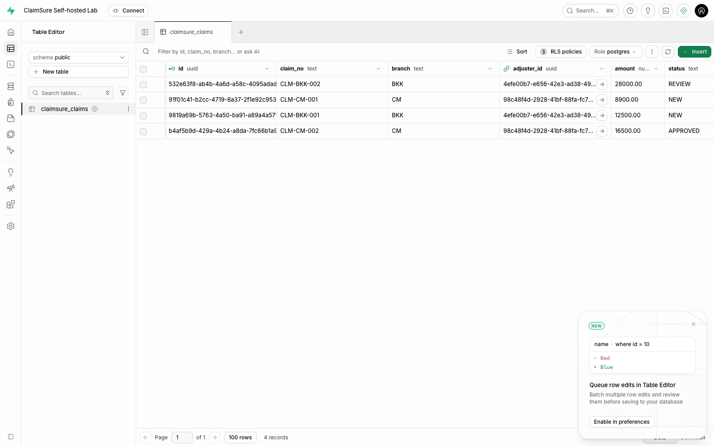

# Lab 10 — สร้าง Data API และ Authentication ด้วย Supabase

หากต้องการใบงานแยกขั้นพร้อม Checkpoints และเกณฑ์ส่งงาน ใช้ [Supabase Labs — SB0–SB10](../../../labs/module-10-supabase.md) ซึ่งเพิ่มการ INSERT/UPDATE ด้วย curl และการคืนแถวฝึกด้วยตนเอง

**เป้าหมาย:** มี REST API สำหรับอ่าน เพิ่ม และแก้ไขข้อมูลเคลม พร้อม Login และสิทธิ์ตามผู้ใช้ โดยใช้ Table, Auth และ RLS ของ Supabase ผู้เรียนต้องเรียก API จริงและอธิบายผลที่เห็นได้

เส้นทางหลักใช้เวลาประมาณ 35–45 นาทีหลังเปิดระบบ เน้น **สร้าง Table → Login → เรียก Data API → เปลี่ยนผู้เรียก → ตรวจสิทธิ์** ส่วน Storage, Realtime, Edge Functions และการดูแลระบบเป็นหัวข้อเสริม

## 1. เห็นงานที่ลดลงก่อนเริ่ม

| งานของแอป | สิ่งที่ใช้ใน Lab | ส่วนที่ผู้เรียนยังต้องออกแบบ |
| --- | --- | --- |
| สร้าง endpoint อ่าน/เพิ่ม/แก้ไขเคลม | Data API จาก Table ผ่าน PostgREST | Schema, constraints และ grants |
| Login ด้วย Email/Password | Supabase Auth ออก access token ให้ | ผู้ใช้ที่อนุญาตและนโยบายบัญชี |
| ตรวจตัวตนของ request | ใช้ user JWT เรียก Data API | ส่ง token ของผู้ใช้ที่ Login อยู่ |
| จำกัดข้อมูลของแต่ละคน | RLS ใน PostgreSQL | Policy ที่ตรงกับกติกาธุรกิจ |
| ทดสอบการเข้าถึง | HTTP requests ไปยัง endpoint เดิม | ตรวจทั้งกรณีอนุญาตและปฏิเสธ |

ใน Lab ไม่ต้องเขียน route/controller สำหรับ CRUD และ Login เอง แต่ยังต้องกำหนดสิทธิ์ให้ครบ ไม่ใช่สร้าง Table แล้วเปิดทุกแถวให้ทุกคน

เมื่อเขียนแอปด้วย Supabase JavaScript client ที่ตั้งค่า Project URL และ anon key ไว้แล้ว ส่วน Login และอ่านข้อมูลใช้โค้ดลักษณะนี้ได้ โดย SDK ใช้ session ของคนที่ Login ส่งไปกับ request:

```javascript
const { error: loginError } = await supabase.auth.signInWithPassword({ email, password });
if (loginError) throw loginError;

const { data: claims, error } = await supabase
  .from('claimsure_claims')
  .select('claim_no,branch,amount,status')
  .order('claim_no');
if (error) throw error;
console.table(claims);
```

เปลี่ยนผู้ใช้ที่ Login แล้วโค้ดอ่านข้อมูลเดิมก็ได้ผลตาม RLS ของคนนั้น ในบทฝึกด้านล่างใช้ curl เพื่อให้เห็น request และผลตอบกลับอย่างชัดเจน

```text
Email + Password ──POST /auth/v1/token──> Auth ──> User JWT
                                                   │
GET /rest/v1/claimsure_claims + apikey + JWT ─────────┘
                         │
                         v
               database role + RLS ──> JSON เฉพาะข้อมูลที่มีสิทธิ์
```

## 2. เตรียมระบบและข้อมูลตัวอย่าง

รันจาก **root ของ repository `postgres-practices`** ด้วย Docker Compose v2 และ Python 3.10+:

```bash
bash labs/docker-labs.sh 10 init
# ตรวจ project name และ host ports ใน labs/supabase/.env ก่อนเปิดครั้งแรก
bash labs/docker-labs.sh 10 config
bash labs/docker-labs.sh 10 pull
bash labs/docker-labs.sh 10 up
bash labs/docker-labs.sh 10 seed
```

หาก port 18000 ถูกใช้อยู่ ให้ตั้ง ports/URLs ตาม [คู่มือ Docker Labs](../../../labs/DOCKER-LABS.md#existing-stacks-and-multiple-students) ก่อน `up`

`seed` เตรียม Table, Grants, RLS, Confirmed Auth Users สองราย และ Claims สี่แถว โดยไม่ต้องตั้ง SMTP หรือเตรียม Storage สำหรับบทหลัก ใช้ข้อมูลจำลองเท่านั้น และรัน `seed` ซ้ำเฉพาะเมื่อตั้งใจคืนค่า Demo

| ผู้ใช้ | ข้อมูลที่เป็นเจ้าของ |
| --- | --- |
| `adjuster.bkk@claimsure.example.com` | CLM-BKK-001, CLM-BKK-002 |
| `adjuster.cm@claimsure.example.com` | CLM-CM-001, CLM-CM-002 |

Email เปลี่ยนได้จาก `DEMO_BKK_EMAIL` / `DEMO_CM_EMAIL` ใน `.env` ทั้งสองใช้ `DEMO_PASSWORD` ของ Lab ส่วน Dashboard Basic Auth ใช้บัญชีอีกชุดหนึ่ง

## 3. เรียกดูผลทันที — API demo

```bash
bash labs/docker-labs.sh 10 api-demo
```

คำสั่งนี้เรียก HTTP จริง แล้วแสดง **ชื่อกรณีทดสอบ, method/path, HTTP status และ JSON ของการอ่านข้อมูล** โดย Login Response ซ่อน token จากหน้าจอและรายงาน ใช้เป็น Demo ของผู้สอนหรือเช็กผลก่อนลงมือด้วย curl

| ผู้เรียก / การทดลอง | Role | ผลที่ต้องเห็น |
| --- | --- | --- |
| ยังไม่ Login | `anon` | HTTP 200, `[]` |
| Login เป็น BKK แล้ว GET | `authenticated` | HTTP 200, เคลม BKK สองแถว |
| Login เป็น CM แล้ว GET endpoint เดิม | `authenticated` | HTTP 200, เคลม CM สองแถว |
| BKK ใส่ filter หา CM | `authenticated` | HTTP 200, `[]` |
| Backend/ผู้สอนอ่านด้วย service key | `service_role` | HTTP 200, เคลมสี่แถว |
| Login ด้วย Password ผิด | ยังไม่ผ่าน Auth | HTTP 400/401 |
| ส่ง Bearer Token ไม่ถูกต้อง | ไม่ผ่านการตรวจ JWT | HTTP 401 |
| BKK เพิ่มเคลมของตน | `authenticated` | HTTP 201 และ BKK อ่านแถวใหม่ได้ |
| CM อ่านแถวใหม่ของ BKK | `authenticated` | HTTP 200, `[]` |
| BKK แก้ status ของเคลมตน | `authenticated` | HTTP 200, status เป็น REVIEW |
| BKK เพิ่มเคลม/เปลี่ยน Owner ให้ CM | `authenticated` | HTTP 403 |

**BKK และ CM ไม่ใช่ database roles คนละตัว:** ทั้งคู่เป็น `authenticated` แต่ JWT มี user ID ต่างกัน และ RLS ตรวจ `auth.uid() = adjuster_id` จึงเห็นคนละแถว ชื่อสาขาเป็นข้อมูลประกอบ; Policy นี้ไม่ได้ให้ทุกคนในสาขาอ่านเคลมของกันและกัน

`service_role` เป็นการเทียบให้ผู้สอนเห็นขอบเขต Admin เท่านั้น Key นี้ข้าม RLS ได้ จึงเก็บไว้ที่ Backend/เครื่องมือผู้ดูแล ห้ามใส่ใน Frontend หรือใช้แทน token ของผู้ใช้เพื่อให้ request ผ่าน

## 4. ลงมือด้วย curl — อ่าน endpoint โดยยังไม่ Login

ใช้ **Bash ใน Terminal เดียวกัน** ตลอดขั้น 4–7 ต้องมี `curl` และ Python 3 ไม่ต้องมี SDK หรือแอป Backend เพิ่ม

โหลดเฉพาะค่าที่ใช้เรียก API จาก `.env` ผ่าน Python parser ไม่ใช้ `source` เพราะบางค่ามีช่องว่าง:

```bash
SUPABASE_URL=$(python3 -c 'from labs.supabase.lab import config; print(config()["SUPABASE_PUBLIC_URL"])')
ANON_KEY=$(python3 -c 'from labs.supabase.lab import config; print(config()["ANON_KEY"])')
CLAIMS_URL="$SUPABASE_URL/rest/v1/claimsure_claims?select=claim_no,branch,amount,status&order=claim_no"

curl --silent --show-error "$CLAIMS_URL" \
  -H "apikey: $ANON_KEY" \
  -H "Authorization: Bearer $ANON_KEY" \
  --write-out '\nHTTP %{http_code}\n'
```

ต้องได้ `[]` และ HTTP 200: Request เข้าถึง endpoint ได้ แต่ `anon` ไม่มี RLS Policy ที่อนุญาตให้อ่านแถวใด จึงไม่มีข้อมูลคืนมา กรณีนี้ต่างจาก HTTP 401 ที่ตรวจ token ไม่ผ่าน

## 5. Login จริง แล้วใช้ token อ่านข้อมูลของ BKK

เตรียม JSON สำหรับ Login โดยอ่าน Email/Password จาก `.env` ไม่ต้องพิมพ์ secrets ลงในประวัติคำสั่ง:

```bash
auth_payload() {
  python3 - "$1" <<'PY'
import json, sys
from labs.supabase.lab import config
values = config()
print(json.dumps({"email": values["DEMO_" + sys.argv[1] + "_EMAIL"],
                  "password": values["DEMO_PASSWORD"]}))
PY
}

BKK_LOGIN=$(auth_payload BKK | curl --silent --show-error --fail-with-body \
  "$SUPABASE_URL/auth/v1/token?grant_type=password" \
  -H "apikey: $ANON_KEY" -H 'Content-Type: application/json' \
  --data-binary @-)
BKK_TOKEN=$(printf '%s' "$BKK_LOGIN" | python3 -c 'import json,sys; print(json.load(sys.stdin)["access_token"])')
BKK_ID=$(printf '%s' "$BKK_LOGIN" | python3 -c 'import json,sys; print(json.load(sys.stdin)["user"]["id"])')

curl --silent --show-error "$CLAIMS_URL" \
  -H "apikey: $ANON_KEY" -H "Authorization: Bearer $BKK_TOKEN" \
  --write-out '\nHTTP %{http_code}\n'
```

ต้องได้ HTTP 200 พร้อมสองแถวที่มี `claim_no` เป็น **CLM-BKK-001 / CLM-BKK-002** สังเกตว่า URL เดิมและ `apikey` เดิม สิ่งที่เปลี่ยนคือ Bearer Token หลัง Auth ยืนยันตัวตนแล้ว

Response ของ Login มี `access_token`, `refresh_token` และ `user` คำสั่งเก็บไว้ในตัวแปร ไม่พิมพ์ token ออกหน้าจอ ในแอปจริง SDK ช่วยจัดการ session/refresh ได้ ส่วน Lab ใช้ curl เพื่อให้เห็น HTTP โดยตรง

## 6. เปลี่ยนเป็น CM แล้วทดลองข้ามสิทธิ์

```bash
CM_LOGIN=$(auth_payload CM | curl --silent --show-error --fail-with-body \
  "$SUPABASE_URL/auth/v1/token?grant_type=password" \
  -H "apikey: $ANON_KEY" -H 'Content-Type: application/json' \
  --data-binary @-)
CM_TOKEN=$(printf '%s' "$CM_LOGIN" | python3 -c 'import json,sys; print(json.load(sys.stdin)["access_token"])')
CM_ID=$(printf '%s' "$CM_LOGIN" | python3 -c 'import json,sys; print(json.load(sys.stdin)["user"]["id"])')

curl --silent --show-error "$CLAIMS_URL" \
  -H "apikey: $ANON_KEY" -H "Authorization: Bearer $CM_TOKEN" \
  --write-out '\nHTTP %{http_code}\n'

curl --silent --show-error "$CLAIMS_URL&branch=eq.CM" \
  -H "apikey: $ANON_KEY" -H "Authorization: Bearer $BKK_TOKEN" \
  --write-out '\nHTTP %{http_code}\n'
```

ครั้งแรกต้องเห็น **CLM-CM-001 / CLM-CM-002** ครั้งที่สองต้องได้ `[]` แม้ BKK ระบุ filter หา CM เอง แสดงว่า Database บังคับสิทธิ์ และการเปลี่ยน query string ไม่ทำให้เข้าถึงแถวของคนอื่น

## 7. ทดสอบการเขียนข้อมูลตามสิทธิ์

ลองให้ BKK เพิ่มเคลมโดยตั้ง CM เป็นเจ้าของ:

```bash
REJECT_BODY=$(python3 - "$CM_ID" <<'PY'
import json, sys, uuid
print(json.dumps({"claim_no": "CLM-REJECT-" + uuid.uuid4().hex,
                  "branch": "CM", "adjuster_id": sys.argv[1], "amount": 100}))
PY
)
printf '%s' "$REJECT_BODY" | curl --silent --show-error \
  "$SUPABASE_URL/rest/v1/claimsure_claims" \
  -H "apikey: $ANON_KEY" -H "Authorization: Bearer $BKK_TOKEN" \
  -H 'Content-Type: application/json' --data-binary @- \
  --write-out '\nHTTP %{http_code}\n'
```

ต้องได้ HTTP 403 จาก RLS `WITH CHECK` และไม่มีแถวถูกเพิ่ม จากนั้นใช้ชุดทดสอบอัตโนมัติให้ทำทั้งกรณีที่ผ่านและไม่ผ่าน:

```bash
bash labs/docker-labs.sh 10 verify
```

ต้องผ่าน **15 กรณี Auth / Data API / RLS** รวมการเพิ่มเคลมของ BKK, อ่านแถวที่เพิ่ม, ทดลองอ่านด้วย CM, แก้ status และปฏิเสธการโอน Owner ตัวทดสอบใช้แถวชั่วคราวของตนและลบคืนเมื่อจบ จึงยังเหลือข้อมูล Demo สี่แถว

ผลตรวจอยู่ที่ [verification.json](verification.json) โดยไม่บันทึก passwords, API keys หรือ user tokens ใช้ `api-demo` หากต้องการดู HTTP/JSON ของแต่ละกรณีแทนการดูเพียง PASS

## 8. เชื่อมผล API กลับไปยัง Table และ Policy

เปิด Studio ตาม `SUPABASE_PUBLIC_URL` ใช้ `DASHBOARD_USERNAME` / `DASHBOARD_PASSWORD` จาก `.env` แล้วดูเพียงสามจุด:

1. **Table Editor → public.claimsure_claims:** มีสี่แถวและคอลัมน์ `adjuster_id`
2. **Authentication → Users:** มี Auth Users สองรายที่ UUID ตรงกับ Owner ใน Table
3. **Policies:** SELECT ใช้ `USING`; INSERT/UPDATE ใช้ `WITH CHECK`



SQL ส่วนสำคัญจาก [ไฟล์ Schema ฉบับเต็ม](../../../labs/supabase/sql/01-claims-schema.sql):

```sql
GRANT SELECT ON public.claimsure_claims TO anon;
GRANT SELECT, INSERT, UPDATE ON public.claimsure_claims TO authenticated;
ALTER TABLE public.claimsure_claims ENABLE ROW LEVEL SECURITY;

CREATE POLICY claims_read_own ON public.claimsure_claims
  FOR SELECT TO authenticated
  USING ((SELECT auth.uid()) = adjuster_id);
```

ตัวอย่างข้างบนใช้สำหรับอ่านประกอบ ให้รันไฟล์ Schema เต็มหากเตรียมเอง เพราะมี constraints และ Policies สำหรับการเขียนด้วย Studio ใช้สิทธิ์ Admin จึงเห็นทั้งสี่แถว; หลักฐานสิทธิ์ของแอปคือผล HTTP ด้วย User JWT

ผู้เรียนควรอธิบายได้ว่า **Table ให้ Data API, Auth ให้ตัวตนและ token, Grants กำหนด operations และ RLS กำหนดแถวที่เข้าถึงได้** งานที่ลดลงคือการเขียน CRUD routes และระบบ Login/token ด้วยตนเอง ส่วนกติกาธุรกิจและสิทธิ์ยังเป็นงานของผู้พัฒนา

## 9. จบ Lab และเนื้อหาเสริม

```bash
unset SUPABASE_URL ANON_KEY CLAIMS_URL BKK_LOGIN BKK_TOKEN BKK_ID CM_LOGIN CM_TOKEN CM_ID REJECT_BODY
unset -f auth_payload
bash labs/docker-labs.sh 10 stop
```

Volumes และ `.env` ยังอยู่ เปิดใหม่ด้วย `up` โดยไม่ต้อง `seed` ทุกครั้ง

Storage และ Edge Functions ใช้เฉพาะเมื่อเลือกทำหัวข้อเสริม:

```bash
bash labs/docker-labs.sh 10 seed --extended
bash labs/docker-labs.sh 10 verify --extended
```

อ่านเพิ่มได้จาก [คู่มือ Studio และ Storage](README.md), [คู่มือดูแลระบบ](USER-GUIDE.md) และ [การติดตั้ง Compose](../../../labs/supabase/README.md)

อ้างอิง: [Supabase Data API](https://supabase.com/docs/guides/api), [Password Auth](https://supabase.com/docs/guides/auth/passwords), [Row Level Security](https://supabase.com/docs/guides/database/postgres/row-level-security)
