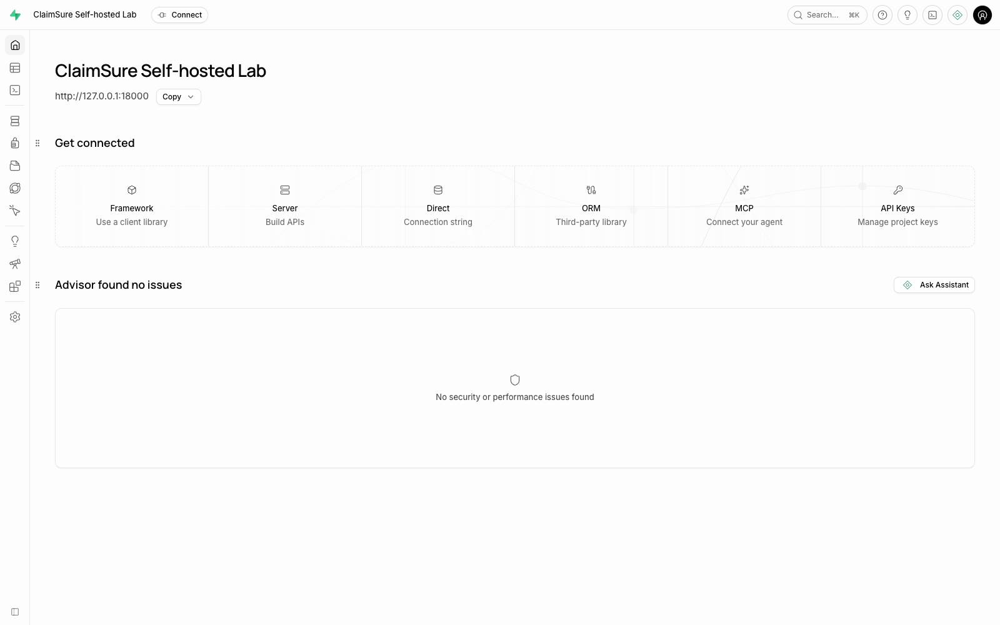
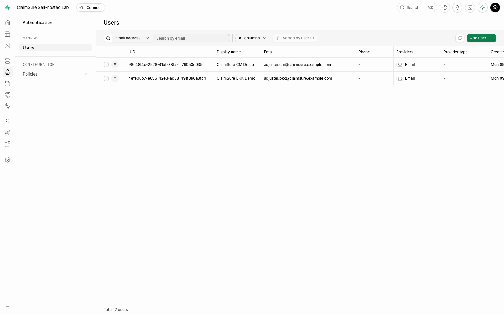
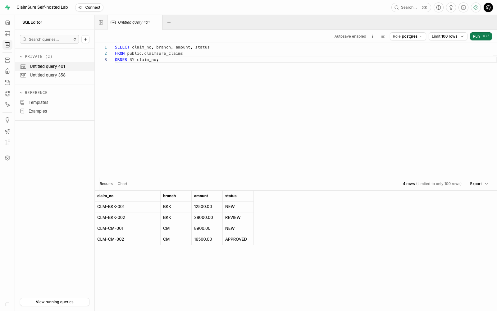
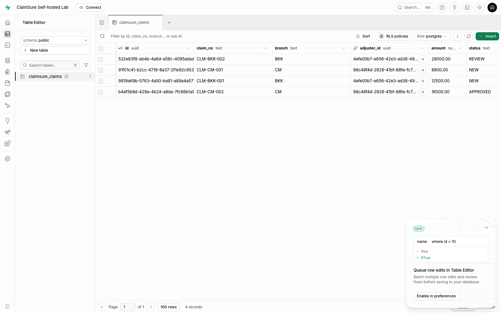
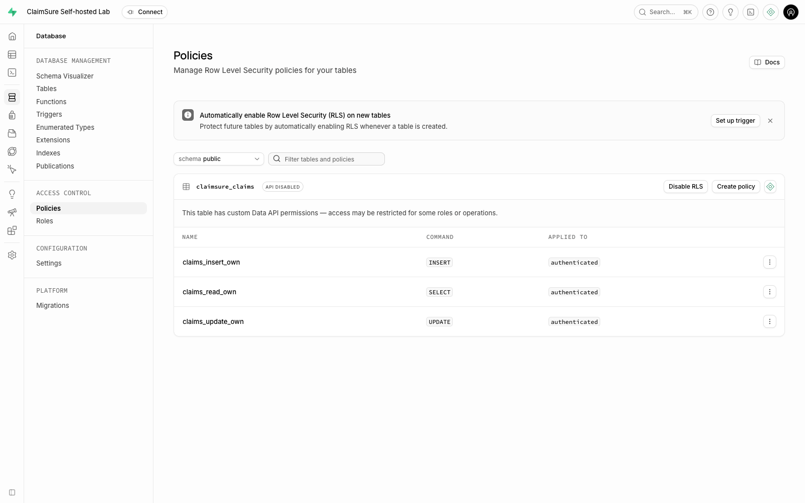
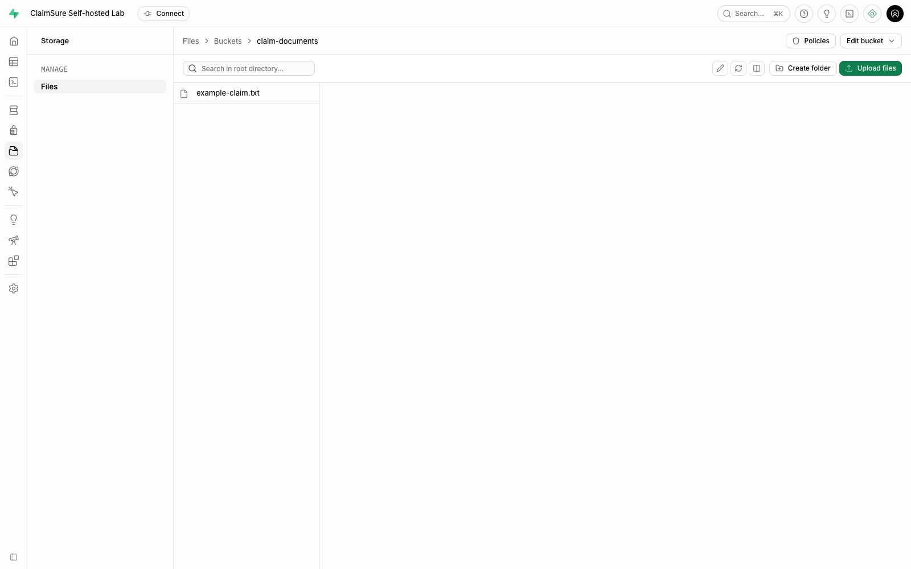
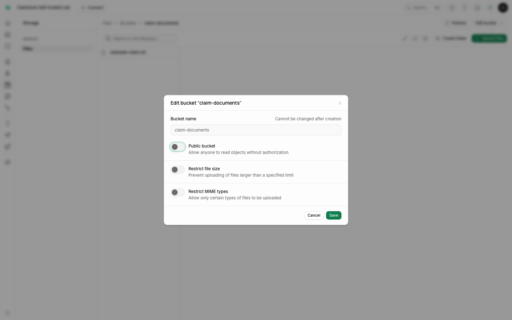

# Tutorial: Supabase self-hosted สำหรับระบบ ClaimSure

**หัวข้อเสริมสำหรับ Studio และ Storage:** บทหลักของ Lab 10 คือ
[Data API + Authentication พร้อม curl](API-LAB.md) หรือ [บทฝึก HTML](index.html)
เน้นเรียก API และเห็นข้อมูลตาม Role/RLS โดยใช้ `seed`, `api-demo`, `verify`
ส่วนคู่มือหน้านี้ใช้ `--extended` เพื่อเตรียม Storage ประกอบด้วย

เรียนรู้ PostgreSQL ร่วมกับ Studio, Auth, Data API, RLS และ Storage บน Docker ของตนเอง โดยใช้ข้อมูล Claim จำลอง แยกจาก Database และ Containers ของหลักสูตรเดิม

สำหรับคู่มืออ้างอิงการใช้งานประจำ มี [คู่มือใช้งาน 14 บท](user-guide.html), [Source Markdown](USER-GUIDE.md) และ [ฉบับ PDF](../../../output/pdf/supabase-self-hosted-user-guide-th.pdf) แยกบัญชีที่ใช้ ตำแหน่งรันคำสั่ง และผลลัพธ์ที่ควรได้

ไฟล์สำหรับเริ่มระบบ: [Compose และคู่มือการติดตั้ง](../../../labs/supabase/README.md) · [Compose](../../../labs/supabase/compose.yaml) · [SQL สร้าง Table/Policies](../../../labs/supabase/sql/01-claims-schema.sql) · [SQL เพิ่ม Claims](../../../labs/supabase/sql/02-demo-claims.sql)

## ภาพรวม: ส่วนไหนทำหน้าที่อะไร

| ส่วน | หน้าที่ใน Lab | หลักฐานที่ต้องเห็น |
| --- | --- | --- |
| Studio | หน้าจอ Admin สำหรับดูและจัดการ Project | เปิด Project ของตนได้ |
| PostgreSQL | เก็บ Table, Auth Records, Policies และ Metadata | มี `public.claimsure_claims` |
| Auth | ยืนยันตัวตนของ Application Users แล้วออก JWT | มี Confirmed Demo Users 2 ราย |
| Data API / PostgREST | แปลง HTTP Requests เป็นการเข้าถึง PostgreSQL | Query Table ผ่าน `/rest/v1/claimsure_claims` ได้ |
| RLS | เลือกแถวและตรวจค่าที่เขียนตาม Identity | BKK/CM เห็นเฉพาะ Claim ที่ตนรับผิดชอบ |
| Storage | เก็บไฟล์และควบคุมการเข้าถึงแยกจาก Table | Private Bucket อ่านแบบ Anonymous ไม่ได้ |
| Supavisor | Pool Connections สำหรับ SQL Clients | ใช้ Session/Transaction Ports แยกกัน |

**Auth User ไม่ใช่ Database Role:** Demo Users Sign-in ผ่าน Auth ส่วน Data API ใช้ Role `authenticated` แล้วให้ RLS อ่าน `auth.uid()` จาก JWT ที่ผ่านการตรวจแล้ว ไม่ต้อง `CREATE ROLE` ให้ผู้ใช้แอปแต่ละคน

ตัวอย่างนี้แยกสิทธิ์ตาม **`adjuster_id` ของแต่ละคน** ชื่อ BKK/CM เป็นข้อมูลประกอบ ไม่ใช่ Policy ที่ให้ทุกคนในสาขาเห็นข้อมูลทั้งสาขา

## 0. เตรียมและเปิดระบบ — Terminal

รันจาก root ของ repository:

```bash
python3 labs/supabase/lab.py init
python3 labs/supabase/lab.py config
python3 labs/supabase/lab.py pull
python3 labs/supabase/lab.py up
```

`config` ตรวจ Compose โดยไม่แสดง Secrets ส่วน `up` รอ Service Health Checks ไม่ใช่ดูเพียงว่า Container ถูกสร้างแล้ว ครั้งแรกต้องดาวน์โหลด Images และ Initialize Database จึงใช้เวลามากกว่าครั้งถัดไป

เปิด `http://127.0.0.1:18000` ใช้ `DASHBOARD_USERNAME` และ `DASHBOARD_PASSWORD` จาก `labs/supabase/.env` สำหรับ Basic Auth ไม่ใช้ PostgreSQL Password

ถ้า Docker อยู่บน Server ให้เปิด SSH Tunnel ตาม README ของ Lab ก่อน ค่าเริ่มต้นไม่เปิด Studio หรือ Database ออกทุก Network Interface

## 1. สำรวจ Studio และสร้าง Schema — Studio / SQL Editor

**เป้าหมาย:** รู้ว่า Studio คือหน้าจอ Admin ของ Project ที่รันเอง Self-hosted ชุดนี้มีหนึ่ง Project ไม่ต้องสร้าง Organization/Project แบบ Supabase Cloud



เปิด **SQL Editor → New query** เปิดไฟล์ [01-claims-schema.sql](../../../labs/supabase/sql/01-claims-schema.sql) แล้วคัดลอกทั้งไฟล์ ตั้งแต่ `LAB 1 START` ถึง `LAB 1 END` มารันใน SQL Editor

คำสั่งหลักที่ควรอธิบายให้ได้:

```sql
ALTER TABLE public.claimsure_claims ENABLE ROW LEVEL SECURITY;

CREATE POLICY claims_read_own ON public.claimsure_claims
  FOR SELECT TO authenticated
  USING ((SELECT auth.uid()) = adjuster_id);
```

นี่คือ **ตัวอย่างบางส่วนเพื่ออธิบายแนวคิด** ให้ใช้ไฟล์เต็มในการรัน เพราะต้องสร้าง Table, Index, Grants และ Policies ให้ครบ และไฟล์เต็มมีการจัดการการรันซ้ำแล้ว

Table มี `claim_no`, `branch`, `adjuster_id`, `amount`, `status` และ Timestamp โดย `adjuster_id` อ้างถึง `auth.users(id)` จึงต้องมี Auth User ก่อนใส่ Claim ให้คนนั้น

## 2. สร้าง Application Users — Studio / Authentication

**เป้าหมาย:** สร้างตัวตนสำหรับผู้ใช้แอป โดยไม่สร้าง Database Roles เพิ่ม

ไป **Authentication → Users → Add user / Create new user** สร้างสองรายนี้ ใช้ Password จาก `DEMO_PASSWORD` ใน `.env` และเปิดตัวเลือก **Auto confirm / Confirm email** เพื่อไม่ต้องส่ง Email ใน Lab

| Email จำลอง | ใช้แทนใคร |
| --- | --- |
| `adjuster.bkk@claimsure.example.com` | ผู้รับผิดชอบ Claims ชุด BKK |
| `adjuster.cm@claimsure.example.com` | ผู้รับผิดชอบ Claims ชุด CM |



ถ้าหน้าจอไม่มี Auto confirm ให้สร้างผ่านตัวช่วยในขั้นทางลัดด้านล่าง ซึ่งใช้ Auth Admin API พร้อม `email_confirm=true` Public Signup ปิดไว้โดยตั้งใจ ไม่ต้องเปลี่ยน Email Confirmation เป็นปิดทั้งระบบ

## 3. เพิ่มและตรวจ Claims — Studio / SQL Editor / Table Editor

**เป้าหมาย:** เชื่อม Auth User UUID กับแถวธุรกิจ

กลับ SQL Editor วางไฟล์ [02-demo-claims.sql](../../../labs/supabase/sql/02-demo-claims.sql) ทั้งไฟล์แล้ว Run คำสั่งจะค้น UUID จาก Email ใน `auth.users` และใช้ UUID เหล่านั้นเป็น `adjuster_id` ไม่ต้องคัดลอก UUID ด้วยมือ

จากนั้นรัน Query นี้เพื่อตรวจข้อมูล:

```sql
SELECT claim_no, branch, amount, status
FROM public.claimsure_claims
ORDER BY claim_no;
```



เปิด **Table Editor → public → claimsure_claims** ต้องเห็น 4 แถว:

| Claim | Branch | Amount | Status |
| --- | --- | ---: | --- |
| CLM-BKK-001 | BKK | 12,500.00 | NEW |
| CLM-BKK-002 | BKK | 28,000.00 | REVIEW |
| CLM-CM-001 | CM | 8,900.00 | NEW |
| CLM-CM-002 | CM | 16,500.00 | APPROVED |



**เห็นทั้ง 4 แถวใน Studio เป็นเรื่องปกติ:** SQL Editor และ Table Editor ใช้สิทธิ์ Admin จึงใช้ผลตรงนี้พิสูจน์ว่า RLS ของ Application ทำงานไม่ได้ ต้องทดสอบผ่าน User JWT ในขั้น 5

## 4. อ่าน RLS Policies — Studio / Policies

**เป้าหมาย:** แยก Table Privileges, การกรองแถว และการตรวจค่าหลังเขียน

เปิดหน้า **Policies** ของ Table `claimsure_claims` ตรวจว่ามี 3 Policies และเปิด RLS แล้ว:

| Policy | Operation | ตรวจอะไร |
| --- | --- | --- |
| `claims_read_own` | SELECT | `USING`: มองเห็นแถวที่ `adjuster_id = auth.uid()` |
| `claims_insert_own` | INSERT | `WITH CHECK`: แถวใหม่ต้องเป็นของ User ที่ Sign-in |
| `claims_update_own` | UPDATE | `USING`: เลือกได้เฉพาะแถวของตน; `WITH CHECK`: แก้แล้ว Owner ยังต้องเป็นตน |



**เกี่ยวกับป้าย `API DISABLED` ในภาพ:** Studio เวอร์ชันนี้แสดงป้ายดังกล่าวเมื่อ Grants ไม่ครบชุดมาตรฐาน แม้บาง Operations ยังเรียกผ่าน API ได้ ภาพจึงมีข้อความ `custom Data API permissions` ด้วย ใน Lab เราจำกัด Grants โดยตั้งใจ อย่าเพิ่ม `GRANT ALL` ให้ Anonymous เพื่อให้ป้ายหาย ให้ตรวจผล HTTP และ RLS ในขั้นถัดไปเป็นหลัก

`GRANT SELECT` ให้ Role บอกว่ามีสิทธิ์ใช้คำสั่ง แต่ RLS ยังตัดสินว่าเข้าถึงแถวใด ใน Lab นี้ Role `anon` มี SELECT แต่ไม่มี Policy ที่อนุญาต จึงได้ `[]` ส่วน `authenticated` มี Policies สำหรับแต่ละ Operation ไม่มี DELETE Grant ให้ผู้ใช้แอป

การซ่อนข้อมูลด้วย `WHERE branch='BKK'` ใน Frontend เพียงอย่างเดียวไม่ใช่การควบคุมสิทธิ์ ผู้ใช้แก้ Request ได้ จึงให้ Database บังคับ Policy เอง

## 5. พิสูจน์ผ่าน Data API — Terminal

**เป้าหมาย:** ใช้ Auth JWT จริงทดสอบทั้งกรณีสำเร็จและถูกปฏิเสธ

```bash
python3 labs/supabase/lab.py verify
```

ตัวช่วย Sign-in ด้วย Auth API แล้วเรียก Data API โดยไม่พิมพ์ Passwords หรือ Tokens ผลที่ต้องได้:

| Request | ผลที่คาดหวัง |
| --- | --- |
| Anonymous SELECT | HTTP 200 และ `[]` |
| BKK SELECT | เฉพาะ CLM-BKK-001 / CLM-BKK-002 |
| CM SELECT | เฉพาะ CLM-CM-001 / CLM-CM-002 |
| BKK SELECT โดยกรองหา CM | HTTP 200 และ `[]` เพราะแถวถูกกรองโดย RLS |
| BKK INSERT โดยระบุ CM เป็น Owner | HTTP 403 เพราะ `WITH CHECK` ไม่ผ่าน |
| BKK INSERT โดยระบุตนเป็น Owner | HTTP 201 |
| BKK เปลี่ยน Owner ของแถวตนเป็น CM | HTTP 403 |

ผลจากการรันทดสอบจริงอยู่ที่ [verification.json](verification.json) บทหลักตรวจ 15 กรณีตาม [API Lab](API-LAB.md) การตรวจจะลบเฉพาะ Claim ชั่วคราวที่สร้างเอง เพื่อให้ Table กลับมาเหลือ 4 แถว

โครงสร้าง HTTP Request ที่ควรจำ:

```http
GET /rest/v1/claimsure_claims?select=claim_no,branch,amount,status
apikey: <ANON_KEY ของ Project>
Authorization: Bearer <Access Token ของ Auth User หลัง Sign-in>
```

`apikey` บอก Project/API Access ส่วน User JWT บอกตัวตนของ User ห้ามใช้ `SERVICE_ROLE_KEY` ใน Frontend เพื่อแก้ RLS เพราะ Key นี้ข้าม RLS ได้ เก็บไว้เฉพาะ Server/Admin Scripts

## 6. หัวข้อเสริม: Private Storage — Studio / Storage

**เป้าหมาย:** แยกไฟล์ Claim ออกจากข้อมูล Table และไม่เปิดเอกสารเป็น Public โดยไม่จำเป็น

เปิด **Storage → New bucket** ตั้งชื่อ `claim-documents` และคง **Public bucket = OFF** จากนั้น Upload [example-claim.txt](../../../labs/supabase/fixtures/example-claim.txt)



ตรวจอีกครั้งได้ที่ **Edit bucket → Bucket settings** โดย `Public bucket` ต้องปิดอยู่ ไม่ต้องกด Save หากไม่ได้แก้ค่า:



Admin อัปโหลดและดูไฟล์ได้ แต่ Auth Users ไม่ได้รับสิทธิ์อ่านโดยอัตโนมัติจาก Policy ของ `claimsure_claims` ถ้าต้องการให้แอปอ่าน/เขียนไฟล์ ต้องออกแบบ Policies ของ `storage.objects` เพิ่ม หรือให้ Trusted Backend ออก Signed URL ตามสิทธิ์ อย่าเปลี่ยน Bucket เป็น Public เพียงเพื่อให้ Request ผ่าน

## ทางลัดเตรียม Demo และจับภาพซ้ำ

หากต้องการได้สถานะเดียวกับภาพโดยไม่คลิกเตรียมข้อมูลทีละหน้า ให้รัน:

```bash
python3 labs/supabase/lab.py seed --extended
python3 labs/supabase/lab.py verify --extended
npm ci --prefix labs/supabase
npx --prefix labs/supabase playwright install chromium
npm run capture --prefix labs/supabase
```

`seed --extended` ทำขั้นสร้าง Schema, สร้าง/ปรับ Demo Users, Seed Claims และสร้าง Private Storage ผ่าน SQL/Auth/Storage APIs ตามลำดับ รันซ้ำได้กับชุด Lab นี้ `capture` ใช้ Playwright จับ Studio จริง ตรวจข้อความก่อนบันทึกภาพ และมี [Capture Manifest](capture-manifest.json) ระบุ URL/เวลา/Screenshot ของแต่ละขั้น

ภาพไม่รวมหน้า API Keys และไม่บันทึก Session State หรือ Credentials ใช้เฉพาะข้อมูลจำลอง หากนำ Capture Script ไปใช้กับข้อมูลอื่น ควรทบทวนข้อมูลที่จะแสดงก่อน

## ปิด Lab และสิ่งที่ต้องจำ

```bash
python3 labs/supabase/lab.py stop
```

Named Volumes ยังเก็บข้อมูลไว้ เปิดใหม่ด้วย `up` ห้ามลบ `.env` แล้วสร้าง Secrets ใหม่กับข้อมูลเดิม

- Studio Admin, Database Role และ Auth User เป็นคนละสิ่ง
- Table Grants กับ RLS ต้องมีทั้งคู่
- พิสูจน์ RLS ด้วย User JWT ผ่าน API ไม่ใช้ผลจาก Admin SQL Editor
- Backup ต้องครอบคลุม PostgreSQL, Storage และ Secrets ของ Deployment
- Lab นี้ใช้ PostgreSQL 17 ตาม Image ของชุด Supabase ที่ pin ไว้ ไม่ใช่ PostgreSQL 18 ของ ClaimSure Classroom

อ้างอิง: [Supabase Self-hosting](https://supabase.com/docs/guides/self-hosting/docker), [PostgreSQL RLS ใน Supabase](https://supabase.com/docs/guides/database/postgres/row-level-security), [Playwright Screenshots](https://playwright.dev/docs/screenshots)
