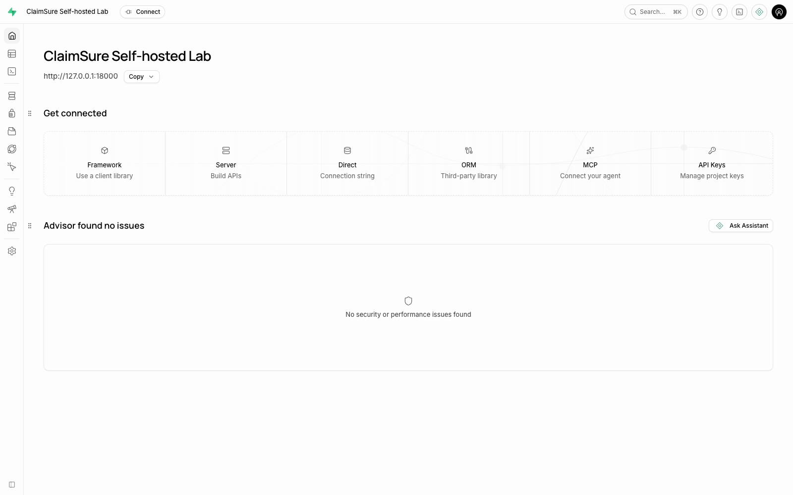
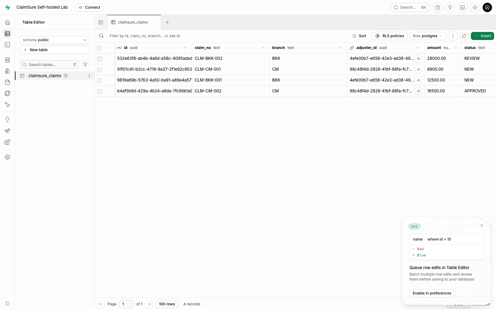
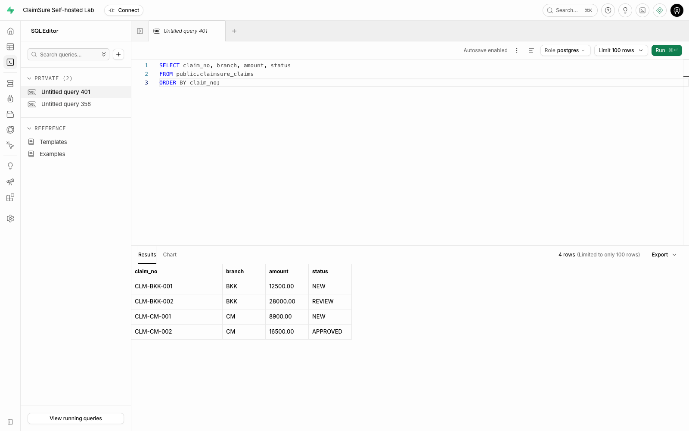
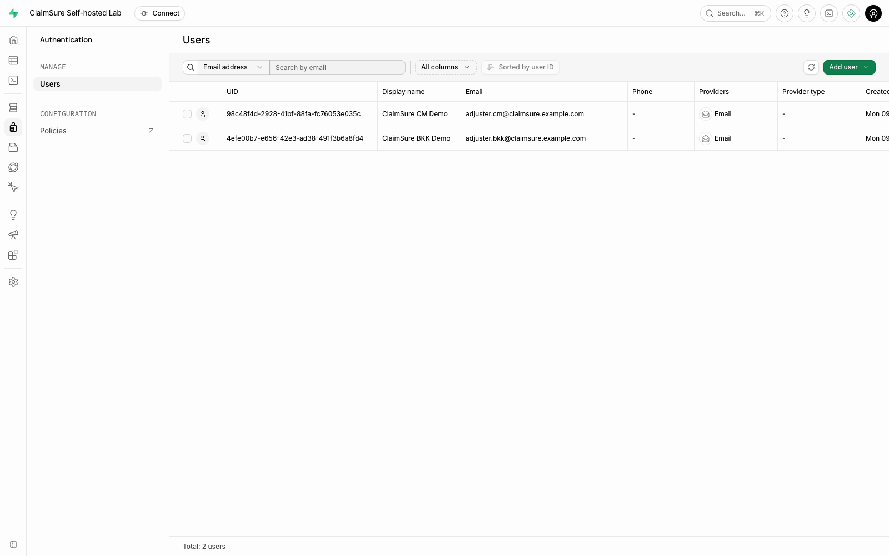
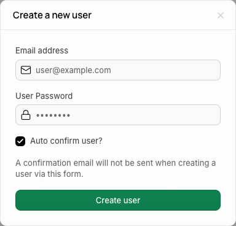
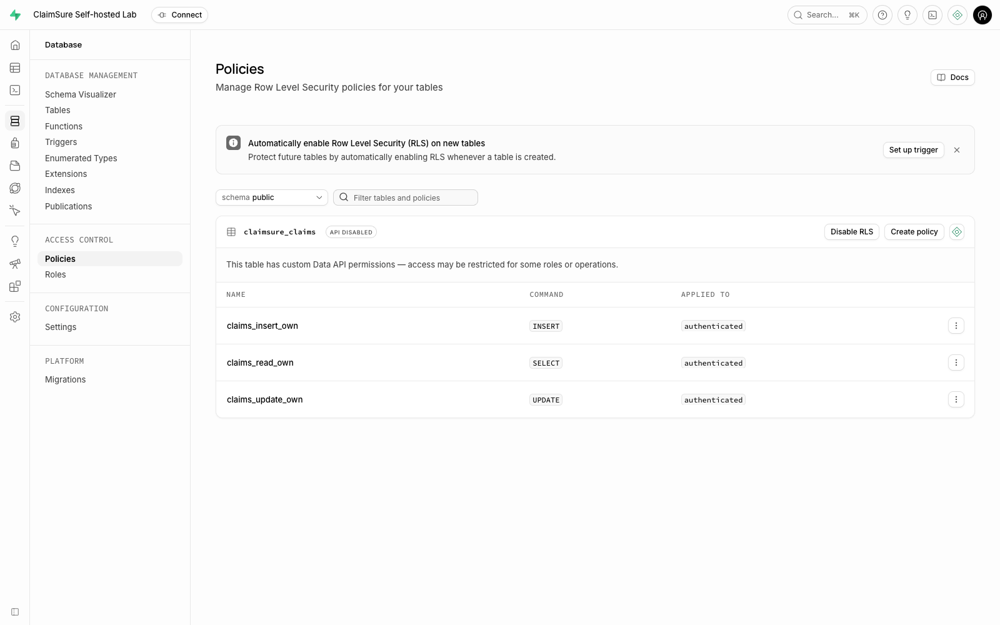
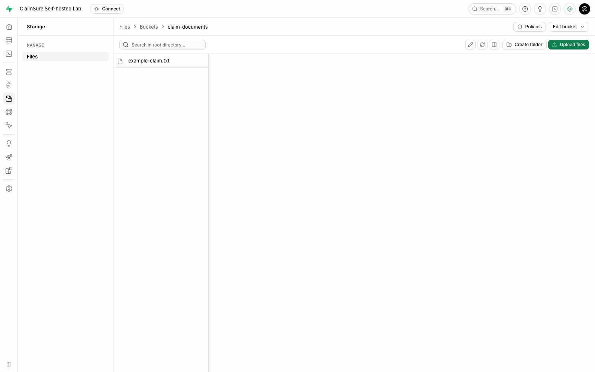
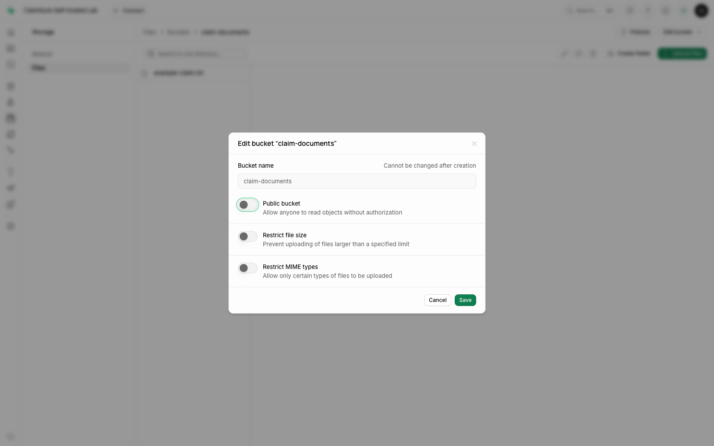

# คู่มือใช้งาน Supabase Self-hosted

สำหรับระบบ ClaimSure บน Docker Compose

คู่มืออ้างอิงนี้ครอบคลุมงานดูแลระบบและหัวข้อเสริม สำหรับบทหลักของ Lab 10 ให้เริ่มที่ [Data API + Authentication พร้อม curl](API-LAB.md) หรือ [HTML lesson](index.html)

ฉบับ 1.0 | 9 พฤศจิกายน 2026 | ภาษาไทยและศัพท์เทคนิคภาษาอังกฤษ

คู่มือนี้ใช้สำหรับผู้เรียน, Developer และผู้ดูแล Lab ที่ต้องการเข้า Studio จัดการข้อมูล Claim, สร้าง Auth Users และตรวจสิทธิ์ผ่าน Data API ใช้ข้อมูลจำลองของชุด `labs/supabase` ใน repository นี้

ภาพประกอบมาจาก Studio ที่รันจริงในชุด Lab ชื่อเมนูอ้างอิง Studio `2026.11.02-sha-a05e7ec` และ PostgreSQL `17.6.1.136` ไม่ใช่ PostgreSQL 18 ของระบบ Classroom เดิม

**ถ้าระบบเปิดอยู่แล้ว:** เริ่มที่บท 2 โดยไม่ต้องติดตั้งหรือ `seed` ซ้ำ หากเพิ่งเปิดครั้งแรกให้ทำบท 1 ก่อน

## 1. เตรียมระบบครั้งแรก

### สิ่งที่ต้องมีและตำแหน่งทำงาน

ต้องมี Docker Engine/Desktop พร้อม Compose v2 และ Python 3.10+ ส่วน Node.js 22+ ใช้เฉพาะการสร้างคู่มือ HTML หรือจับภาพด้วย Playwright คำสั่ง Terminal ในคู่มือนี้เริ่มจาก **root ของ repository `postgres-practices`** ยกเว้นส่วนที่ระบุ Directory อื่น

ตรวจ Directory และเครื่องมือก่อนเริ่ม:

```bash
pwd
docker compose version
python3 --version
```

ควรเห็น Directory ที่มี `labs/supabase/compose.yaml` หาก `pwd` ยังอยู่ใน `labs/supabase` ให้กลับ root ด้วย `cd ../..` ก่อนใช้คำสั่ง `python3 labs/supabase/lab.py ...`

### เปิดระบบครั้งแรกตามลำดับ

**ทำใน:** Terminal | **ผู้ใช้:** OS User ที่มีสิทธิ์ใช้ Docker

```bash
# 1. สร้างไฟล์ค่าตั้งและ Secrets ของชุดนี้
python3 labs/supabase/lab.py init

# 2. ตรวจ Compose โดยไม่แสดง Secrets
python3 labs/supabase/lab.py config

# 3. ดาวน์โหลด Images ที่ pin เวอร์ชันไว้
python3 labs/supabase/lab.py pull

# 4. เปิด Services และรอ Health Checks
python3 labs/supabase/lab.py up

# 5. สร้างข้อมูลจำลองสำหรับใช้ตามคู่มือ
python3 labs/supabase/lab.py seed --extended

# 6. ทดสอบการเข้าถึงจริงผ่าน APIs
python3 labs/supabase/lab.py verify --extended
```

**ผลที่ควรได้:** Services 11 ตัวพร้อมใช้งาน, Auth Users จำลอง 2 ราย, Claims 4 แถว, Private Bucket 1 แห่ง และ Example File 1 ไฟล์ คำสั่ง `verify --extended` ต้องรายงาน `PASS` ทั้ง 18 กรณี (บทหลัก Data API/Auth ใช้ `verify` จำนวน 15 กรณี)

`init` ไม่เขียนทับ `.env` ที่มีอยู่แล้ว แต่ `seed --extended` จะสร้าง/ปรับ Password ของ Demo Users, ตั้ง Grants/Policies ของ Table ตัวอย่าง, คืนค่า Claims ที่มี Claim Number เดิม และอัปโหลด Example File ซ้ำ ใช้เมื่อเตรียม Demo หรือเมื่อตั้งใจคืนข้อมูลตัวอย่าง ไม่ใช้เป็นคำสั่งเปิดระบบประจำวัน

### ไฟล์สำคัญอยู่ที่ไหน

| ไฟล์/Directory | ใช้ทำอะไร |
| --- | --- |
| `labs/supabase/compose.yaml` | ระบุ Services, Images, Ports และ Volumes |
| `labs/supabase/.env` | เก็บ URLs, Passwords และ Keys ของเครื่องนี้ |
| `labs/supabase/lab.py` | ตัวช่วยเปิดระบบ, Seed และทดสอบ |
| `labs/supabase/sql/01-claims-schema.sql` | สร้าง Table, Grants และ RLS Policies |
| `labs/supabase/sql/02-demo-claims.sql` | เพิ่ม Claims โดยค้น Auth User UUID จาก Email |
| `labs/supabase/volumes/functions/` | Source ของ Edge Functions |

ไฟล์ `.env` ถูกสร้างด้วยสิทธิ์ `0600` ให้เก็บเป็นความลับและสำรองไว้กับข้อมูลของ Deployment ไม่ลบแล้วสร้าง Secrets ใหม่ทับข้อมูลใน Volumes เดิม

## 2. เข้าใช้งานและเลือกบัญชีให้ถูก

### เปิดใช้งานในวันถัดไป

**ทำใน:** Terminal | **ผู้ใช้:** OS User ที่ใช้ Docker

```bash
python3 labs/supabase/lab.py status
# ถ้ายังไม่เปิด หรือเคย stop/down ให้ใช้:
python3 labs/supabase/lab.py up
```

จากนั้นเปิด Browser ที่ **http://127.0.0.1:18000** และกรอก Basic Auth จาก `.env`:

| ช่องที่ถาม | ค่าที่ใช้ |
| --- | --- |
| Username | ค่า `DASHBOARD_USERNAME` ค่าเริ่มต้นคือ `claimsure` |
| Password | ค่า `DASHBOARD_PASSWORD` ที่ `init` สร้างให้ |

**ผลที่ควรได้:** หน้า Project Overview ชื่อ `ClaimSure Self-hosted Lab` ดังภาพในบท 3

### บัญชีสามประเภทนี้ใช้คนละงาน

| ต้องการทำอะไร | บัญชี/Role | Password หรือ Key |
| --- | --- | --- |
| เปิด Studio ผ่าน Browser | Dashboard Basic Auth User | `DASHBOARD_PASSWORD` |
| ทำ SQL ใน Studio | Role `postgres` ภายใน Project | Studio จัดการ Connection ให้ |
| ต่อจาก psql/DBeaver ผ่าน Pooler | `postgres.claimsure` | `POSTGRES_PASSWORD` |
| Sign-in เป็นผู้ใช้ Application | Email ใน Authentication | Password ของ Auth User; Demo ใช้ `DEMO_PASSWORD` |
| เรียก Data API ในฐานะผู้ใช้ | Role `authenticated` ที่ได้จาก User JWT | `ANON_KEY` + User Access Token |
| ทำ Admin API จาก Trusted Backend | `service_role` | `SERVICE_ROLE_KEY` ใช้ฝั่ง Server เท่านั้น |

Auth User ไม่ใช่ Database Role การเพิ่ม Email ใน Authentication ไม่ต้องสั่ง `CREATE ROLE` ใหม่ และการ Login เข้า Studio ไม่ได้ทำให้ Browser เป็น Auth User ของ Application

### ใช้งานเมื่อ Docker อยู่บน Server

ค่าตั้งต้นเปิด Ports บน `127.0.0.1` ของ Docker Host ถ้า Browser อยู่คนละเครื่อง ให้รันคำสั่งนี้บนเครื่องที่ใช้ Browser แล้วคงหน้าต่าง SSH ไว้:

```bash
ssh -L 18000:127.0.0.1:18000 your-user@your-server
```

แทนชื่อ User/Server ด้วยค่าจริง จากนั้นเปิด `http://127.0.0.1:18000` ที่เครื่องตนเอง ถ้า Tunnel ใช้ Local Port อื่น ต้องคำนึงถึง Public URLs ที่ Studio/Client ใช้ด้วย

## 3. รู้จักหน้า Studio

Self-hosted ชุดนี้มีหนึ่ง Project ให้ใช้งาน ไม่ต้องสร้าง Organization หรือ Project แบบ Supabase Cloud



**ภาพ 1:** แถบด้านซ้ายเป็นเมนูหลัก บางหน้าจอแสดงเป็น Icons ให้เลื่อน Mouse ค้างเพื่อดูชื่อเมนู ส่วนชื่อ Project อยู่ด้านบน

| เมนู | งานที่ใช้บ่อย | ควรรู้อะไรก่อนใช้ |
| --- | --- | --- |
| Project Overview | ตรวจ Project และ URL ที่เชื่อมต่อ | URL นี้เป็นของชุด Lab ตนเอง |
| Table Editor | ดู, กรอง, เพิ่ม และแก้ข้อมูลแบบตาราง | ทำงานด้วยสิทธิ์ Admin ได้ จึงอาจเห็นทุกแถว |
| SQL Editor | รัน Query และคำสั่งจัดการ Database | ตรวจ Role และ SQL ที่จะรันก่อนกด Run |
| Database / Policies | ดูโครงสร้างและ RLS Policies | Table Grants และ Policies มีหน้าที่ต่างกัน |
| Authentication / Users | สร้างและตรวจ Auth Users | ใช้ตัวตนนี้ในการ Sign-in ของแอป |
| Storage / Files | จัดการ Buckets และ Objects | Private Bucket ต้องมีสิทธิ์อ่านไฟล์แยกต่างหาก |
| Edge Functions | ดู Source ของ Server-side Functions | `claimsure-health` เป็นตัวอย่างของชุดนี้ |

การทดสอบว่า Application ถูกจำกัดสิทธิ์จริงต้องเรียก Data API ด้วย JWT ของ Auth User ตามบท 8 ไม่ตัดสินจากจำนวนแถวที่ Admin เห็นใน Studio

## 4. ดูและค้นหา Claims ใน Table Editor

**ทำใน:** Browser / Studio | **บัญชี:** Dashboard Admin

### เปิดข้อมูลและตรวจจำนวนแถว

1. เปิด **Table Editor** ที่แถบซ้าย
2. เลือก Schema เป็น **public**
3. เลือก Table **claimsure_claims**
4. ตรวจว่าแสดงข้อมูล 4 รายการ และมี Column `claim_no`, `branch`, `adjuster_id`, `amount`, `status`



**ภาพ 2:** `adjuster_id` คือ UUID ที่เชื่อมแถวนี้กับ `auth.users` ส่วนปุ่ม `RLS policies` ใช้เปิดดู Policies ของ Table ได้

| Claim Number | Branch | Amount | Status |
| --- | --- | ---: | --- |
| CLM-BKK-001 | BKK | 12,500.00 | NEW |
| CLM-BKK-002 | BKK | 28,000.00 | REVIEW |
| CLM-CM-001 | CM | 8,900.00 | NEW |
| CLM-CM-002 | CM | 16,500.00 | APPROVED |

### กรองและเรียงข้อมูล

1. ใช้ช่อง Filter/Search เหนือตาราง แล้วระบุ Column/เงื่อนไขที่ต้องการ
2. ถ้าต้องการดูงาน BKK ให้ตั้ง `branch` เท่ากับ `BKK`
3. ใช้ **Sort** เพื่อเรียง `claim_no` หรือ `amount`
4. เมื่อต้องการกลับมาดูทั้งหมด ให้ล้าง Filters

**ผลที่ควรได้:** กรอง BKK แล้วเหลือ 2 แถว การกรองใน Studio เป็นเครื่องมือค้นข้อมูล ไม่ใช่การตั้ง Security Policy

### เมื่อต้องแก้ข้อมูลจริงผ่านหน้าตาราง

เลือก Cell/Row ที่ต้องการ แก้ค่า แล้วตรวจหน้าจอยืนยันหรือคิวบันทึกก่อน Commit การเปลี่ยนแปลง วิธี Save ขึ้นกับการเปิดใช้ Row Edit Queue ของ Studio ให้ Refresh และ Query แถวนั้นซ้ำเพื่อยืนยัน

สำหรับการฝึกแก้ข้อมูลตามคู่มือนี้ ให้ใช้ Transaction แบบ `ROLLBACK` ในบท 5 แทน เพื่อไม่เปลี่ยนข้อมูลตั้งต้นที่การทดสอบ API คาดหวัง

## 5. ใช้ SQL Editor อย่างเป็นลำดับ

**ทำใน:** Browser / SQL Editor | **Role:** `postgres`

### เปิด Query ใหม่และอ่านข้อมูล

1. เปิด **SQL Editor**
2. กดปุ่ม **+ / New query**
3. ตรวจ Role ที่มุมบนขวาว่าเป็น `postgres`
4. วาง SQL ด้านล่างทั้ง Block แล้วกด **Run** หรือ Shortcut ที่ปุ่มแสดง เช่น `Cmd+Enter` บน macOS

```sql
-- START: ตรวจข้อมูล Claims ทั้งหมด
SELECT claim_no, branch, amount, status
FROM public.claimsure_claims
ORDER BY claim_no;
-- END
```



**ภาพ 3:** ผลลัพธ์อยู่ด้านล่าง ต้องเห็น 4 แถว ถ้า Claim Number ถูกตัด ให้ลากขอบหัว Column `claim_no` ให้กว้างขึ้น

### Query งานที่ต้อง Review

```sql
-- START: อ่านอย่างเดียว
SELECT claim_no, amount, status
FROM public.claimsure_claims
WHERE branch = 'BKK'
  AND status = 'REVIEW'
ORDER BY claim_no;
-- END
```

**ผลตั้งต้น:** CLM-BKK-002 จำนวนเงิน 28,000.00

### ฝึก UPDATE โดยคืนค่าท้าย Block

ให้เลือกและรัน **ทั้ง Block** ตั้งแต่ `BEGIN` ถึง `ROLLBACK` ไม่รันค้างไว้เพียงครึ่งเดียว:

```sql
-- START: ทดลองแก้ใน Transaction แล้วคืนค่า
BEGIN;

UPDATE public.claimsure_claims
SET status = 'REVIEW'
WHERE claim_no = 'CLM-BKK-001'
RETURNING claim_no, status;

ROLLBACK;
-- END
```

`RETURNING` แสดงค่าระหว่าง Transaction เป็น `REVIEW` ส่วน `ROLLBACK` คืนข้อมูล หลังจากนั้นให้รัน SELECT แถวดังกล่าวอีกครั้ง ต้องกลับเป็น `NEW` ถ้ามี Error แล้ว Session ค้างใน Transaction ให้รัน `ROLLBACK;` ก่อนเริ่มงานใหม่

### สร้าง Table/Policies เมื่อทำแบบ Manual

ใช้ไฟล์ `01-claims-schema.sql` **ทั้งไฟล์** ก่อนสร้าง Claims ตามด้วยการสร้าง Auth Users ในบท 6 และรัน `02-demo-claims.sql` ทั้งไฟล์ตามลำดับ หากรัน `seed` แล้วไม่ต้องสร้างซ้ำเพื่อใช้งานตามบทนี้

## 6. สร้างและดูแล Auth Users

**ทำใน:** Browser / Authentication | **บัญชี:** Dashboard Admin

### ตรวจ Users ที่มีอยู่

เปิด **Authentication > Users** ต้องเห็น Demo Users สองรายดังภาพ:



| Email | เป็นผู้รับผิดชอบข้อมูลชุดใด |
| --- | --- |
| `adjuster.bkk@claimsure.example.com` | CLM-BKK-001 และ CLM-BKK-002 |
| `adjuster.cm@claimsure.example.com` | CLM-CM-001 และ CLM-CM-002 |

**ภาพ 4:** UID เป็น UUID ของ Auth User ที่นำไปใช้ใน `adjuster_id` ไม่ใช่ชื่อ Database Role ตัวอย่างนี้จำกัดสิทธิ์ราย User ไม่ใช่สิทธิ์ร่วมทั้ง Branch

### เพิ่ม User ใหม่จาก Studio

1. กด **Add user > Create new user**
2. ใส่ Email ที่ต้องการใช้ทดสอบ และ Password สำหรับ User นั้น
3. ใน Lab ให้เปิด **Auto confirm user?** เพื่อสร้างบัญชีที่ยืนยันแล้ว โดยไม่ต้องส่ง Email
4. ตรวจข้อมูลแล้วกด **Create user**
5. กลับรายการ Users และตรวจว่า Email/UID ใหม่ปรากฏ



**ภาพ 5:** ภาพเป็นฟอร์มว่าง ไม่มี Password จริงของระบบ หลีกเลี่ยงการสร้าง Email เดิมซ้ำ ถ้าเป็น Demo Users ที่มีอยู่แล้วให้เปิดดูข้อมูลเดิม

### เมื่อ User ใหม่ยังไม่เห็น Claims

เป็นผลปกติเพราะยังไม่มีแถวที่ `adjuster_id` ตรงกับ UID ของคนนั้น ให้ Admin สร้างหรือกำหนดแถวธุรกิจให้ตรงกับ User ที่ถูกต้อง แล้วทดสอบด้วย User JWT ใหม่ตามบท 8

### Password และการลบ User

- Demo Users ใช้ Password ที่เก็บใน `DEMO_PASSWORD` ของ `.env` อย่านำ Dashboard Password ไปใช้ Sign-in แทน
- การส่ง Invitation หรือ Reset Password Email ต้องตั้ง SMTP จริง ชุด Lab นี้ยังไม่ได้ตั้ง Email Delivery
- `seed` ตั้ง Password ของ Demo Users กลับเป็น `DEMO_PASSWORD` และคืนข้อมูล Demo จึงใช้เฉพาะเมื่อตั้งใจ Reset Demo
- หากจะลบ User ให้ตรวจแถวใน `claimsure_claims` ที่อ้างถึง UID ก่อน Table นี้มี Foreign Key จึงอาจปฏิเสธการลบขณะที่ยังมี Claims อ้างถึง

## 7. ตรวจและเข้าใจ RLS Policies

**ทำใน:** Browser / Database > Policies หรือ SQL Editor | **บัญชี:** Dashboard Admin

เปิด **Database > Policies** เลือก Schema `public` แล้วค้นหา `claimsure_claims` ตรวจว่าปุ่มแสดง **Disable RLS** ซึ่งหมายความว่า RLS กำลังเปิดอยู่ ไม่ต้องกดปุ่มนี้



**ภาพ 6:** มี 3 Policies สำหรับ Role `authenticated`

| Policy | Operation | กฎที่บังคับ |
| --- | --- | --- |
| `claims_read_own` | SELECT | อ่านเฉพาะแถวที่ `adjuster_id = auth.uid()` |
| `claims_insert_own` | INSERT | แถวใหม่ต้องระบุ Owner เป็น User ที่ Sign-in |
| `claims_update_own` | UPDATE | เลือกเฉพาะแถวของตน และค่าหลังแก้ต้องยังเป็นของตน |

### แยก Grants กับ Policies

Table Grants บอกว่า Role ใช้ Operation ใดได้ ส่วน RLS บอกว่า Operation นั้นใช้กับแถวใด ในชุดนี้:

| Role | Table Grants | ผลของ RLS |
| --- | --- | --- |
| `anon` | SELECT | ไม่มี Policy อนุญาต จึงอ่านได้ศูนย์แถว |
| `authenticated` | SELECT, INSERT, UPDATE | เข้าถึงเฉพาะแถวของตน |
| `service_role` | Admin Operations | ใช้ข้าม RLS จึงเก็บ Key เฉพาะฝั่ง Server |

ไม่มี DELETE Grant ให้ผู้ใช้แอปใน Lab นี้

ตรวจ Policy ด้วย Query แบบอ่านอย่างเดียวได้:

```sql
SELECT policyname, cmd, roles, qual, with_check
FROM pg_policies
WHERE schemaname = 'public'
  AND tablename = 'claimsure_claims'
ORDER BY policyname;
```

### ทำไมภาพมีป้าย API DISABLED

Studio รุ่นที่ใช้แสดงป้าย `API DISABLED` พร้อมข้อความ `custom Data API permissions` เมื่อ Grants ไม่ครบชุดมาตรฐาน แม้บาง Operations ยังเรียกได้ ชุดนี้จำกัด Grants โดยตั้งใจ ให้ตรวจ Grants และผล HTTP จริงในบท 8 ไม่เพิ่ม `GRANT ALL` ให้ Anonymous เพื่อเปลี่ยนป้าย

### ก่อนแก้ Policy

บันทึกนิยามเดิม, ระบุ User/Operation ที่ต้องอนุญาต และทดสอบทั้งกรณีของตนกับของคนอื่น ใช้ `USING` ตรวจแถวที่เข้าถึง และ `WITH CHECK` ตรวจค่าหลัง INSERT/UPDATE การปิด RLS เพื่อให้ Request ผ่านจะเปลี่ยนขอบเขตการเข้าถึงข้อมูล

## 8. ใช้ Data API และพิสูจน์สิทธิ์

**ทำใน:** Terminal หรือ HTTP Client | **ตัวตนที่ทดสอบ:** Auth User ของแอป

### ทดสอบครบชุดด้วยคำสั่งเดียว

```bash
python3 labs/supabase/lab.py verify --extended
```

**ผลที่ควรได้:** `PASS` 18 กรณีเมื่อใช้ `--extended` รายละเอียดถูกเขียนลง `verification.json` โดยไม่บันทึก Passwords หรือ Tokens การตรวจสร้างแถวชั่วคราวของตนและลบเมื่อจบ เพื่อรักษาข้อมูล Demo 4 แถว

| กรณี | ผลตั้งต้นที่ถูกต้อง |
| --- | --- |
| Anonymous อ่าน Claims | HTTP 200 และ `[]` |
| BKK อ่าน Claims | เห็นเฉพาะ 2 แถวของ BKK User |
| CM อ่าน Claims | เห็นเฉพาะ 2 แถวของ CM User |
| BKK กรองหา Claims ของ CM | HTTP 200 และ `[]` |
| BKK INSERT โดยใส่ CM เป็น Owner | HTTP 403 |
| BKK INSERT โดยใส่ตนเป็น Owner | HTTP 201 |
| BKK เปลี่ยน Owner ของแถวตนเป็น CM | HTTP 403 |
| Admin อ่าน Private Example File | HTTP 200 และเนื้อหาตรงกับ Fixture |
| Anonymous อ่าน Private Example File | ถูกปฏิเสธ อาจตอบ 400/401/403/404 |
| เรียก `claimsure-health` ด้วย JWT ถูกต้อง | HTTP 200 |

### เข้าใจ Request ก่อนส่งเอง

ตั้งตัวแปรใน HTTP Client โดยอ่านค่าจาก `.env` ของตนเอง:

| Variable | ค่า |
| --- | --- |
| `base_url` | `http://127.0.0.1:18000` หรือ URL ที่ตั้งไว้ |
| `anon_key` | `ANON_KEY` ของชุดนี้ |
| `demo_email` | Email ของ BKK หรือ CM User |
| `demo_password` | `DEMO_PASSWORD` สำหรับ Demo Users |

ตัวอย่างต่อไปนี้เป็นรูปแบบ Request สำหรับ HTTP Client ให้แทน `{{...}}` ด้วย Variables จริง ไม่ใช่คำสั่งที่ Paste ลง psql

**ขั้น A: Sign-in เพื่อรับ User Access Token**

```http
POST {{base_url}}/auth/v1/token?grant_type=password
apikey: {{anon_key}}
Content-Type: application/json

{
  "email": "{{demo_email}}",
  "password": "{{demo_password}}"
}
```

เมื่อได้ HTTP 200 ให้นำค่า `access_token` ไปใช้เป็น `user_access_token` ส่วน `user.id` คือ UID ที่ Policies ใช้เทียบกับ `adjuster_id` เก็บ Access/Refresh Tokens ไว้เป็นความลับ

**ขั้น B: อ่าน Claims ด้วยตัวตนของ User**

```http
GET {{base_url}}/rest/v1/claimsure_claims?select=claim_no,branch,amount,status&order=claim_no
apikey: {{anon_key}}
Authorization: Bearer {{user_access_token}}
```

Sign-in ด้วย BKK จะได้สองแถวของ BKK เมื่อลอง Sign-in เป็น CM แล้วใช้ Token ใหม่ต้องได้สองแถวของ CM

**ขั้น C: ลองกรองหาข้อมูลของอีกคน**

เพิ่ม `&branch=eq.CM` ใน URL ขณะใช้ Token ของ BKK ต้องได้ `[]` ไม่ใช่ข้อมูลของ CM HTTP 200 เพียงอย่างเดียวจึงยังบอกไม่ได้ว่าได้ข้อมูลที่ต้องการหรือไม่ ต้องดู Response Body ด้วย

`ANON_KEY` ใช้ระบุ API Access ของ Project ส่วน User JWT ใช้ระบุตัวตน Request นี้ไม่ต้องใช้ Dashboard Basic Auth หรือ `POSTGRES_PASSWORD` ห้ามนำ `SERVICE_ROLE_KEY` ไปใส่ Frontend เพื่อเลี่ยง RLS

## 9. จัดการไฟล์ด้วย Private Storage

**ทำใน:** Browser / Storage | **บัญชี:** Dashboard Admin

### เปิด Bucket และอัปโหลดไฟล์

1. เปิด **Storage > Files**
2. เลือก Bucket **claim-documents** ถ้า `seed --extended` แล้วจะมีอยู่ก่อน
3. ตรวจว่ามี `example-claim.txt`
4. ถ้าต้องการอัปโหลดไฟล์ทดสอบเพิ่มเติม ให้กด **Upload files** และเลือกไฟล์ข้อมูลจำลอง
5. ตรวจว่าชื่อไฟล์ปรากฏในรายการหลัง Upload สำเร็จ



**ภาพ 7:** ไฟล์ตั้งต้นมาจาก `labs/supabase/fixtures/example-claim.txt` ถ้าจะรันตามข้อมูลตั้งต้น ใช้ชื่อและเนื้อหาไฟล์นี้ตามเดิม

### สร้าง Bucket ใหม่เมื่อทำแบบ Manual

เลือก **New bucket**, ใส่ชื่อที่ไม่ซ้ำ, ตั้ง **Public bucket = OFF** แล้วสร้าง Bucket ก่อน Upload หาก Bucket `claim-documents` มีอยู่แล้วให้เปิดของเดิม

### ตรวจว่า Bucket ยังเป็น Private

1. เปิด Bucket `claim-documents`
2. เลือก **Edit bucket > Bucket settings**
3. ตรวจว่า **Public bucket** ปิดอยู่ดังภาพ
4. ถ้าไม่ได้แก้ค่า ให้กด **Cancel**



**ภาพ 8:** การปิด Public ไม่ได้แปลว่า Auth User ทุกคนอ่านไฟล์ได้ ผู้ใช้แอปยังต้องมี Storage Policies หรือใช้ Signed URL ที่ออกหลังตรวจสิทธิ์แล้ว

### แยกสิทธิ์ไฟล์ออกจากสิทธิ์ Claims

Policy บน `public.claimsure_claims` ไม่ได้ให้สิทธิ์บน `storage.objects` โดยอัตโนมัติ ชุด Lab ให้ Admin จัดการไฟล์และทดสอบว่า Anonymous ดาวน์โหลดไม่ได้ ถ้าจะให้ผู้ใช้แอป Upload/Download ให้กำหนด Object Path และ Policies เพิ่มตามงานจริง

อย่าลบแถวจาก `storage.objects` โดยตรงเพื่อจัดการไฟล์ ให้ใช้ Storage UI หรือ Storage API เพื่อให้ Metadata และไฟล์สอดคล้องกัน

## 10. เชื่อมต่อด้วย psql หรือ DBeaver

### ใช้ psql ภายใน Container

**ทำใน:** Terminal | **Database Role:** `postgres`

```bash
python3 labs/supabase/lab.py psql
```

เมื่อเห็น Prompt ของ psql จึงค่อยรัน:

```sql
SELECT current_user, current_database();
SELECT count(*) FROM public.claimsure_claims;
```

**ผลที่ควรได้:** User `postgres`, Database `postgres` และ Count เท่ากับ 4 สำหรับข้อมูลตั้งต้น

คำสั่ง psql ที่ใช้บ่อย:

```text
\conninfo       ดู Connection ปัจจุบัน
\dt public.*    ดู Tables ใน Schema public
\c postgres     Reconnect ไป Database postgres
\q              ออกจาก psql กลับ Terminal
```

### เชื่อมจากเครื่อง Host ผ่าน Session Pooler

```bash
psql -X -h 127.0.0.1 -p 15480 -U postgres.claimsure -d postgres -W
```

เมื่อถาม Password ให้ใช้ `POSTGRES_PASSWORD` ถ้ากำหนด Ports หรือ Tenant ID ใหม่ให้แทนค่าตาม `.env`

| ช่องใน DBeaver | Session Mode | Transaction Mode |
| --- | --- | --- |
| Host | `127.0.0.1` | `127.0.0.1` |
| Port | `15480` | `16543` |
| Database | `postgres` | `postgres` |
| Username | `postgres.claimsure` | `postgres.claimsure` |
| Password | `POSTGRES_PASSWORD` | `POSTGRES_PASSWORD` |

เริ่มงาน SQL ที่ต้องพึ่ง Session State ด้วย Session Mode ก่อน Transaction Mode อาจคืน Backend Connection ให้ Pool หลังจบ Transaction จึงไม่ควรสมมติว่า Session Settings จะอยู่บน Connection เดิมตลอด

## 11. เปิด ปิด และปรับค่าระบบ

### คำสั่งงานประจำ

| งาน | คำสั่งจาก root ของ repository | ผลกับข้อมูล |
| --- | --- | --- |
| ดูสถานะ | `python3 labs/supabase/lab.py status` | อ่านอย่างเดียว |
| เปิด/เปิดใหม่ | `python3 labs/supabase/lab.py up` | ใช้ Volumes เดิม |
| รอความพร้อม | `python3 labs/supabase/lab.py wait` | ไม่แก้ข้อมูล |
| หยุดชั่วคราว | `python3 labs/supabase/lab.py stop` | เก็บ Containers และ Volumes |
| ถอด Containers/Network | `python3 labs/supabase/lab.py down` | Named Volumes ยังอยู่ |
| คืน Demo | `python3 labs/supabase/lab.py seed --extended` | ปรับข้อมูลตัวอย่างและ Demo Passwords |

### แก้ค่าที่ไหน และทำอย่างไรให้มีผล

ค่าของชุดนี้อยู่ใน `labs/supabase/.env` ให้แก้ไฟล์นี้โดยคง Secrets เดิม แล้วรัน `config` และ `up` เพื่อให้ Compose Recreate Services ที่ Environment เปลี่ยน การ `restart` อย่างเดียวไม่โหลด Environment ใหม่

| ค่าที่แก้ | ตัวแปร | สิ่งที่ต้องทำร่วมกัน |
| --- | --- | --- |
| Host Port ของ Studio/API | `API_GW_HTTP_PORT` | ปรับ `SUPABASE_PUBLIC_URL` และ `API_EXTERNAL_URL` ให้ตรง แล้ว `up` |
| Host Port ของ Session Pooler | `DB_SESSION_PORT` | เปลี่ยน Port ของ SQL Client แล้ว `up` |
| Host Port ของ Transaction Pooler | `DB_TRANSACTION_PORT` | เปลี่ยน Port ของ SQL Client แล้ว `up` |
| URL ของ Frontend/Redirect | `SITE_URL`, `ADDITIONAL_REDIRECT_URLS` | ให้ตรงกับ Application แล้ว `up` |
| SMTP | `SMTP_*` | ใส่ค่าจาก Mail Provider และทดสอบ Email Delivery หลัง `up` |

คง `POSTGRES_PORT=5432` ไว้เป็น Port ภายใน Network อย่าเปลี่ยนค่านี้เพียงเพื่อแก้ Host Port ชนกัน

สำหรับ `POSTGRES_PASSWORD`, JWT Signing Keys และ Encryption Keys ให้ทำตามขั้นตอนเปลี่ยน Credential ของ Upstream โดยเฉพาะ การแก้ Environment อย่างเดียวไม่เปลี่ยน Passwords/Keys ที่ข้อมูลเดิมใช้อยู่

## 12. เก็บข้อมูลและสำรองก่อนเปลี่ยนระบบ

### สิ่งที่ต้องเก็บเป็นชุดเดียวกัน

| รายการ | เก็บที่ไหนในชุดนี้ | เหตุผล |
| --- | --- | --- |
| Tables, Auth Records, Policies | Named Volume `db-data` | เป็นข้อมูลและโครงสร้างหลัก |
| Database Encryption Configuration | Named Volume `db-config` | ใช้ร่วมกับข้อมูล Database |
| Storage Objects | Named Volume `storage-data` | ไฟล์จริงไม่อยู่ใน Table Dump ทั้งหมด |
| Deployment Secrets | `labs/supabase/.env` | ต้องสอดคล้องกับข้อมูล/Encryption Keys |
| Functions และ Snippets | `labs/supabase/volumes/` | เป็น Source และ SQL ที่บันทึกไว้ |

ชื่อจริงของ Named Volume มี Compose Project Name นำหน้า เช่น `claimsure-supabase_db-data` การ `stop` หรือ `down` ของ Helper ไม่ลบ Named Volumes ส่วน `down -v` หรือการลบ Volume เองอาจทำให้ข้อมูลหาย

### ตัวอย่าง Dump เฉพาะ Table Lab

คำสั่งนี้สำรองเฉพาะ `claimsure_claims` เพื่อฝึกดู Archive ไม่ใช่ Backup ของ Supabase Project ทั้งชุด

**ทำใน:** Terminal จาก `labs/supabase`

```bash
cd labs/supabase
mkdir -p artifacts/backups

docker compose --env-file .env -f compose.yaml exec -T db \
  pg_dump -U postgres -d postgres -Fc \
  -t public.claimsure_claims \
  > artifacts/backups/claimsure-claims.dump

# แสดงสารบัญของ Archive โดยยังไม่ Restore
docker compose --env-file .env -f compose.yaml exec -T db \
  pg_restore --list < artifacts/backups/claimsure-claims.dump

# กลับ root เมื่อต้องใช้ Helper ตามบทอื่น
cd ../..
```

ตรวจ Exit Status และสารบัญทุกครั้ง ไฟล์ Dump ที่มีขนาดมากกว่าศูนย์อย่างเดียวไม่ได้ยืนยันว่า Restore ได้ การนำ Table นี้ไป Restore ต้องมี Auth User UUID ที่อ้างถึงอยู่ด้วย

ก่อน Upgrade/ย้ายเครื่อง ให้เตรียม Backup ที่ครอบคลุม Database, Storage และ Secrets พร้อมทดสอบ Restore แยกจากระบบต้นทาง ไม่คัดลอก PGDATA ขณะ Database ทำงานเพื่อถือเป็น Backup ที่สมบูรณ์

## 13. แก้ปัญหาที่พบบ่อย

### ดู Logs ให้ตรง Service

**ทำใน:** Terminal จาก `labs/supabase`

```bash
cd labs/supabase
docker compose --env-file .env -f compose.yaml ps
docker compose --env-file .env -f compose.yaml logs --tail=80 db
docker compose --env-file .env -f compose.yaml logs --tail=80 auth rest meta
docker compose --env-file .env -f compose.yaml logs --tail=80 api-gw studio
cd ../..
```

| อาการ | ตรวจอะไร | แนวทางแก้ |
| --- | --- | --- |
| เข้า Studio ไม่ได้ | Docker/Services, URL, SSH Tunnel | รัน `status` แล้ว `up`; ตรวจ Host Port |
| Browser ถาม Basic Auth ซ้ำ | Dashboard Username/Password | ใช้ค่าจาก `.env`; ทดลอง Incognito ถ้า Browser จำค่าเก่า |
| `port is already allocated` | Host Ports ชนโปรแกรมอื่น | เปลี่ยน Host Ports และ URLs ที่เกี่ยวข้อง แล้ว `up` |
| Auth Sign-in ไม่ผ่าน | Email, Password, Confirmed State | ใช้ `DEMO_PASSWORD` สำหรับ Demo และตรวจ Users; `seed` เฉพาะเมื่อต้องการ Reset Demo |
| `relation does not exist` | รัน Schema แล้วหรือไม่, Database/Schema ถูกชุดหรือไม่ | ตรวจ Connection; ใช้ SQL 01 ทั้งไฟล์ก่อน SQL 02 |
| Foreign Key Error | `adjuster_id` มีอยู่ใน `auth.users` หรือไม่ | สร้าง Auth User ก่อน และใช้ UID ให้ตรง |
| Data API ได้ 401 | API Key, JWT, Expiry, Signing Key | Sign-in ใหม่และตรวจ Keys ของ Project เดียวกัน |
| Data API ได้ `[]` | User มีแถวของตนหรือไม่, Policy อนุญาตหรือไม่ | ตรวจ `adjuster_id`, JWT ของคนที่ใช้ และ RLS |
| INSERT/UPDATE ได้ 403 | Grants และ `WITH CHECK` | ตรวจว่ากำลังเขียนให้ Owner ที่ตรงกับ User ไม่ใช้ Service Key กลบปัญหา |
| Studio เห็น 4 แถว แต่ API เห็น 2 | Admin ต่างจาก Application User | เป็นผลที่ตั้งใจของ RLS ใน Demo |
| หน้า Policies มี `API DISABLED` | ข้อความ Custom Grants และผล HTTP | ดูคำอธิบายในบท 7 ไม่เปิดสิทธิ์เกินจำเป็น |
| Private File ดาวน์โหลดไม่ได้ | ตัวตน, Object Path, Storage Policies | ตรวจผ่าน Storage API/UI และออกแบบสิทธิ์ไฟล์เพิ่มเติม |
| `/functions/v1/hello` ตอบ `INVALID_API_KEY` | Example ของ Upstream ใช้ New Opaque Keys | ชุดนี้มี `claimsure-health` สำหรับ Legacy HS256 Keys |
| `verify` ไม่ผ่านหลังแก้ข้อมูล | ข้อมูล Demo ต่างจากค่าที่ Test คาดไว้ | ตรวจการเปลี่ยนแปลงก่อน; `seed` เฉพาะเมื่อตั้งใจคืน Demo |

หากต้องส่ง Logs ให้ผู้อื่น ให้ตัด Passwords, Tokens, Connection Strings และข้อมูลจริงออกก่อน ไม่ส่ง `.env` ทั้งไฟล์

## 14. ตารางใช้งานด่วนและเอกสารอ้างอิง

### เลือกทางทำงานตามเป้าหมาย

| เป้าหมาย | เปิดที่ไหน/ใช้คำสั่งไหน |
| --- | --- |
| เข้า Dashboard | `http://127.0.0.1:18000` + Dashboard Basic Auth |
| ค้นหา Claim | Table Editor > public > claimsure_claims |
| รัน SELECT/ทดลอง Transaction | SQL Editor โดยตรวจ Role ก่อน |
| เพิ่มตัวตนของผู้ใช้แอป | Authentication > Users > Add user |
| ตรวจสิทธิ์แถว | Database > Policies และทดสอบ User JWT |
| เก็บไฟล์ Claim | Storage > Files > claim-documents |
| ทดสอบครบชุด | `python3 labs/supabase/lab.py verify --extended` |
| เปิด Console SQL | `python3 labs/supabase/lab.py psql` |
| หยุดงานวันนี้ | `python3 labs/supabase/lab.py stop` |

### คำศัพท์ที่ควรจำ

| คำศัพท์ | ความหมายในคู่มือนี้ |
| --- | --- |
| Studio | หน้าจอ Admin ของ Supabase Project |
| Auth User | ตัวตนของผู้ใช้ Application |
| Database Role | Identity/ชุดสิทธิ์ภายใน PostgreSQL |
| JWT / Access Token | Token ยืนยันตัวตนที่ API ตรวจแล้วใช้กำหนดสิทธิ์ |
| RLS | กฎที่ Database ใช้เลือกและตรวจแถวตาม Role/Identity |
| `USING` | เงื่อนไขสำหรับแถวที่เข้าถึงได้ |
| `WITH CHECK` | เงื่อนไขที่แถวหลัง INSERT/UPDATE ต้องผ่าน |
| Bucket / Object | กลุ่มเก็บไฟล์ / ไฟล์พร้อม Metadata |
| Pooler | ตัวกลางจัดการและใช้ Database Connections ร่วมกัน |

### เอกสารของชุด Lab

- [วิธีติดตั้งและโครงสร้างไฟล์](../../../labs/supabase/README.md)
- [Tutorial พร้อมภาพและลำดับ Lab](README.md)
- [SQL สร้าง Table และ RLS](../../../labs/supabase/sql/01-claims-schema.sql)
- [SQL เพิ่ม Claims ตัวอย่าง](../../../labs/supabase/sql/02-demo-claims.sql)
- [ผลทดสอบ API ที่บันทึกไว้](verification.json)
- [รายละเอียดภาพ Tutorial เดิม](capture-manifest.json)
- [ข้อมูลเวอร์ชัน Upstream](../../../labs/supabase/upstream.json)

### แหล่งอ้างอิงทางการ

คู่มือนี้อธิบายพฤติกรรมของ Compose และ Scripts ใน repository นี้ หากจะเปลี่ยน Deployment หรือย้ายเป็น Public Service ให้ตรวจคู่มือเวอร์ชันที่ใช้ร่วมด้วย:

- [Supabase Self-hosting with Docker](https://supabase.com/docs/guides/self-hosting/docker)
- [Supabase Row Level Security](https://supabase.com/docs/guides/database/postgres/row-level-security)
- [Supabase Storage Access Control](https://supabase.com/docs/guides/storage/security/access-control)
- [การเข้าถึง PostgreSQL ของ Self-hosted Supabase](https://supabase.com/docs/guides/self-hosting/accessing-postgres)
- [แนวทางย้ายไปใช้ New Auth/API Keys](https://supabase.com/docs/guides/self-hosting/self-hosted-auth-keys)

ข้อมูลตัวอย่างและภาพใช้เพื่อการเรียนรู้ ไม่มี Password, API Key หรือ Access Token จริงถูกพิมพ์ลงในคู่มือ
