# Module 7E student manual — Databasus backup and recovery

> ไฟล์ helper ที่คู่มือนี้เรียกใช้ต้องให้อาจารย์เตรียมบนเครื่องเรียนก่อน สำเนาต้นทางรอบนี้มีคู่มือ/ภาพ/PDF แต่ไม่มี `run-lab07-databasus.sh` หรือ `scripts/databasus/classroom.sh` ดูขอบเขตใน [คู่มือหลัก](module-07-databasus.md)

Create a logical backup, simulate a committed loss, and recover the original data
into a separate PostgreSQL database. Allow about **45–60 minutes**. Work through
the steps in order, keeping your SSH terminal and web browser open.

This illustrated companion follows the [Module 7E lab](module-07-databasus.md).
The screenshots were captured with **Playwright from the live Databasus 3.60.0
classroom application**, using a demonstration account. Use **your own assigned two-digit number**
where you see `xx`. Names visible in historical screenshots belong to the demonstration account; use `claimsure_xx` / `student_xx` with your number for every new connection. Screenshot dates, sizes, UUIDs and table counts are examples.
Passwords remain hidden. A [printable PDF](module-07-databasus-student-manual.pdf)
is available alongside this manual.

By the end, you should be able to identify a completed recovery point, restore
it into the correct target, and prove recovery using database identity, practice
rows and insurance-table counts.

## Before you start: identify your connections

You need your normal classroom SSH account, assigned Databasus account, existing
PostgreSQL password, and DBeaver or desktop pgAdmin. The instructor must already
have provisioned your workspace and recovery database.

| Item | Your assigned value (replace xx) |
| --- | --- |
| SSH account | `studentxx` |
| PostgreSQL user | `student_xx` |
| Databasus workspace | `ClaimSure Student xx - Module 07` |
| Backup source | `claimsure_xx` |
| Recovery target | `claimsure_databasus_xx` |
| Selected schemas | `insurance`, `lab_m7_databasus` (same for everyone) |

The source and target use direct PostgreSQL port **5432**. Databasus connects
to Docker hostname **`postgres`**. Your laptop's SQL client connects to the
**classroom server hostname/IP** instead. Port 6432 belongs to PgBouncer and is
not used in this exercise.

Only the marked practice data is deliberately damaged. Pause other SQL writes
to your own database while recording the baseline and taking the backup.

## 1. Get your login and open Databasus

In your classroom SSH terminal, run:

```bash
cd "$HOME/scripts"
./run-lab07-databasus.sh credentials
./run-lab07-databasus.sh verify
```

Read your own URL, email and generated web password. The web password differs
from your existing SQL password. Keep the output private; do not put it in your
report or screenshots. `verify` should report that your own workspace/login,
source/recovery ownership and non-superuser checks passed.

For an SSH tunnel, run this in a **second terminal on your laptop**, replacing
the SSH account and classroom host:

```bash
ssh -N -L 14005:127.0.0.1:4005 studentxx@YOUR_CLASSROOM_HOST
```

Leave that terminal running and open **http://127.0.0.1:14005** on your laptop.
Alternatively, use the direct classroom URL printed by `credentials`.

If the application opens on **Sign up**, click **Sign in** at the bottom. Use
your assigned account; you do not need to register another one.

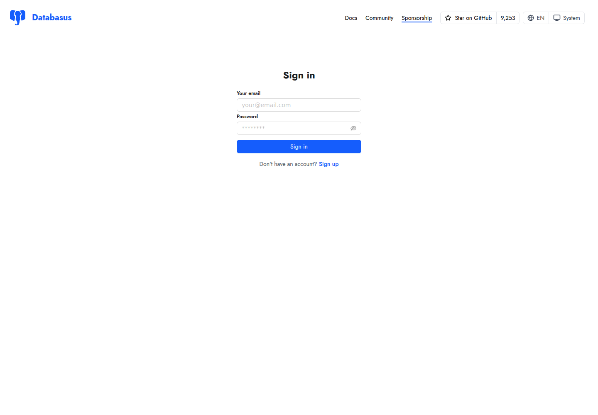

*Figure 1. Enter the email and web password printed by your own helper.*

## 2. Select your workspace and check the source

Check **Selected workspace** at the upper left. Select
**ClaimSure Student xx - Module 07**, then your **claimsure_xx - Module 07**
source in the left-hand database list. You should see only your assigned
workspace/source. You are a workspace Member.

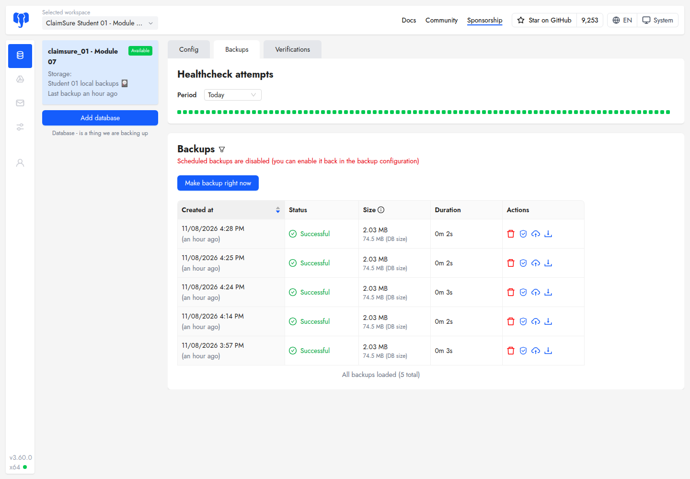

*Figure 2. The left panel identifies the source and its private local storage.
Existing backup rows may already be present; they are not your new recovery point.*

Open **Config**. Compare the displayed database settings:

| Setting | Required value |
| --- | --- |
| Host / port | `postgres` / `5432` |
| Username | `student_xx` |
| DB name | `claimsure_xx` |
| SSL mode | Disable, within the classroom Docker network |
| Include schemas | `insurance, lab_m7_databasus` |
| Scheduled backups | Disabled initially; manual backups still work |

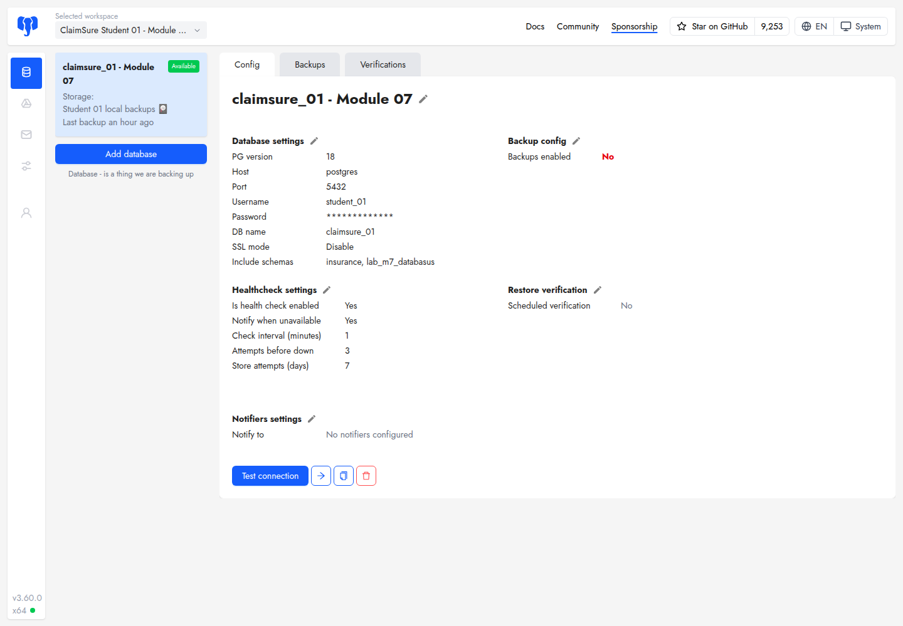

*Figure 3. Confirm your own source name and the two included schemas. Preserve
the assigned source settings during the controlled exercise.*

Click **Test connection**. Wait for **Connection test successful!** and
**Database connection tested successfully**.

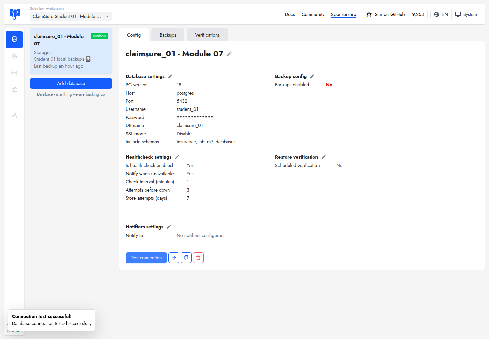

*Figure 4. A successful connection test confirms connectivity. You still need
to create and restore a backup to demonstrate recovery.*

## 3. Create the starting practice rows and record the baseline

Return to the **classroom SSH terminal**:

```bash
./run-lab07-databasus.sh seed --reset-practice
./run-lab07-databasus.sh inspect --database main
./run-lab07-databasus.sh counts --database main
```

The practice output must show:

```text
1|CLAIM_REGISTERED|100.00
2|CLAIM_APPROVED|200.00
```

Record the insurance-table names and counts from `counts` in your notes **before
the backup**. Students may have different insurance models and counts. The seed
command resets only this lab's marked practice rows; insurance data is preserved.

Your starting checkpoint is **source IDs 1,2**. Stop here if it differs.

## 4. Make a backup and record its exact UUID

In Databasus, open **Backups** and click **Make backup right now**. On a narrow
screen, the same button reads **Backup now**. Wait until the new row shows the
green **Successful** status, a size and a duration.

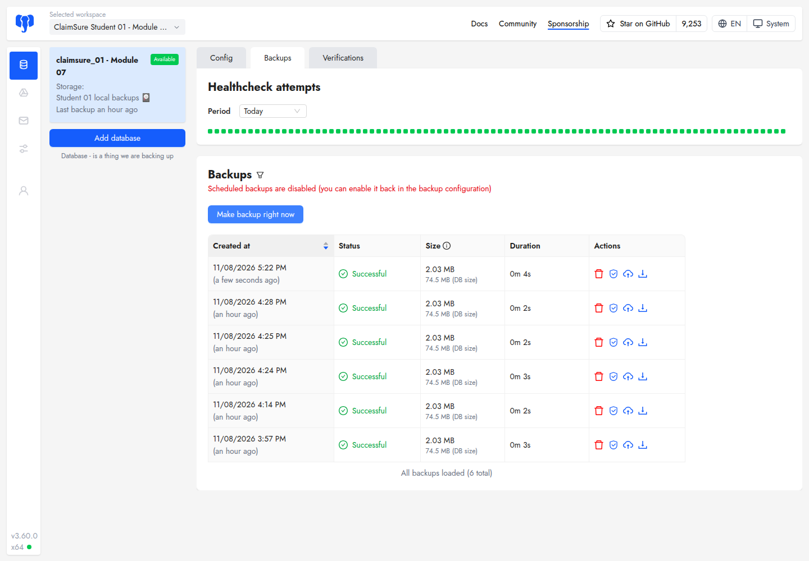

*Figure 5. Record the newly created row's date/time and size. The captured
example is about 2.03 MB; your size will vary.*

The UI uses **Successful** for the API/helper status **`COMPLETED`**. A running
or failed backup is not a usable recovery point. To obtain the UUID of the
backup you just made, run:

```bash
./run-lab07-databasus.sh status
```

Match its `createdAt` to the new UI row and check `status` is `COMPLETED`.
`createdAt` ends in `Z` and is UTC; the browser may display a different timezone.
For example, the captured backup at **2026-11-08 16:22 UTC** appears as
**17:22 Europe/Berlin**. Record **your own** UUID, then set this variable in the
same SSH shell:

```bash
BACKUP_ID='PASTE_YOUR_COMPLETED_BACKUP_UUID_HERE'
```

Keep that UUID for the remaining steps. This manual uses a UI-created backup,
so pass `--backup-id "$BACKUP_ID"` explicitly whenever selecting it in the helper.
The helper's previously recorded default can point to an older terminal backup.

## 5. Simulate committed data loss

Only after completing step 4, run:

```bash
./run-lab07-databasus.sh damage --backup-id "$BACKUP_ID"
./run-lab07-databasus.sh inspect --database main
```

Expected source rows:

```text
1|CLAIM_REGISTERED|100.00
3|AFTER_LOSS|999.00
```

The helper verifies that the selected completed backup belongs to your source.
It then commits deletion of practice row 2 and insertion of row 3. Insurance data
is preserved. Your second checkpoint is **source IDs 1,3**.

**Keep using the backup from step 4.** A new backup made now would contain the
damaged practice state.

## 6. Prepare the recovery target

Close or commit/roll back any open SQL transactions on your recovery connection.
Preview the target preparation, then apply it:

```bash
./run-lab07-databasus.sh prepare-target
./run-lab07-databasus.sh prepare-target --yes
```

A first-time empty target may report nothing to detach. A previously restored
target may list `ALTER TABLE ... DETACH PARTITION` statements. The helper detaches
only your owned target partitions within the selected schemas so a repeated
`pg_restore --clean` can replace them. It preserves their data until restore and
does not detach source partitions. A five-second lock timeout indicates that you
should close blocking transactions before retrying preparation.

## 7. Choose the same backup and enter the restore target

Return to the **same pre-damage backup row** in **Backups**. Hover over the
blue **cloud with an upward arrow** in its Actions column: the tooltip identifies
**Restore**. Click it. Avoid the red trash icon.

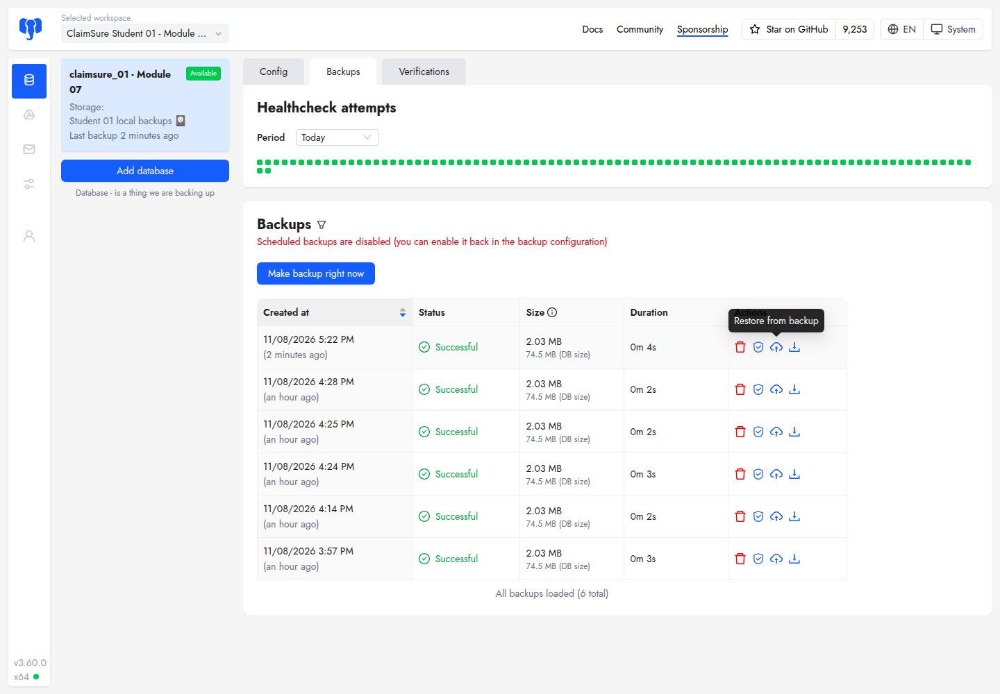

*Figure 6. Use the Restore action belonging to the recovery point you recorded.*

In **Restore from backup**, click **Select database to restore to**. This opens
the target connection form:

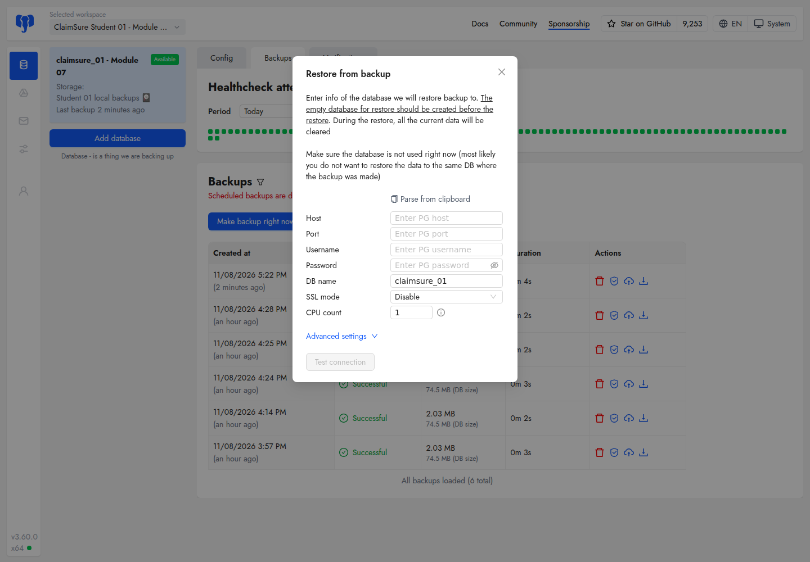

*Figure 7. The initial DB name can be your source, `claimsure_xx`. Replace it
with `claimsure_databasus_xx` before testing or submitting the restore.*

Enter these settings:

| Restore field | Required value |
| --- | --- |
| Host / port | `postgres` / `5432` |
| Username | `student_xx` |
| Password | Your existing PostgreSQL password |
| **DB name** | **`claimsure_databasus_xx`** |
| SSL mode | Disable |
| CPU count | `1` |
| Advanced settings → SSH tunnel | Unchecked; Databasus already has network access |
| Advanced settings → Exclude extensions | **Checked** |
| Advanced settings → Restore ownership | Unchecked |
| Advanced settings → Restore privileges | Unchecked |

The instructor has already created the recovery database and its extensions.
Use **Advanced settings** to reveal the checkboxes. Verify the full target name;
`claimsure_backup_xx` belongs to a different exercise.

## 8. Test, submit and wait for the restore itself

Click **Test connection** in the restore form. After the test passes, the action
changes to **Restore to this DB**. Check the target and advanced options once
more, then click **Restore to this DB**.

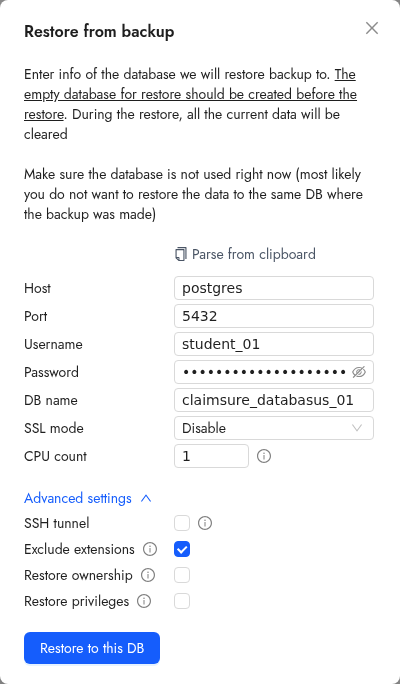

*Figure 8. The tested target uses the recovery database. Exclude extensions is
checked; ownership and privileges are unchecked. The SQL password is masked.*

Wait for **Status → Successful** inside the **Restore from backup** window.
The backup row behind the window has its own status; it does not prove that the
restore succeeded. If you closed the window, reopen Restore on the same backup
to see its restore history.

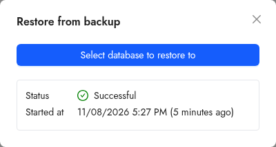

*Figure 9. This success belongs to the restore operation, separately from the
successful backup in the background.*

## 9. Prove the result in DBeaver or desktop pgAdmin

Keep your original `claimsure_xx` connection. Create a **second connection**:

| SQL client setting | Recovery connection |
| --- | --- |
| Host | Your classroom server hostname/IP |
| Port | `5432` |
| Database | `claimsure_databasus_xx` |
| Username / password | `student_xx` / your existing PostgreSQL password |

Open an SQL editor on **each connection** and run this same SQL; no `xx`
substitution is needed within it:

```sql
SELECT current_database(), current_user, current_setting('port');

SELECT event_id, description, amount
FROM lab_m7_databasus.claim_event
ORDER BY event_id;

SELECT table_name
FROM information_schema.tables
WHERE table_schema = 'insurance' AND table_type = 'BASE TABLE'
ORDER BY table_name;
```

Compare the results:

| Evidence | Source connection | Recovery connection |
| --- | --- | --- |
| Database | `claimsure_xx` | `claimsure_databasus_xx` |
| User / port | `student_xx` / `5432` | `student_xx` / `5432` |
| Practice row 1 | `CLAIM_REGISTERED`, `100.00` | `CLAIM_REGISTERED`, `100.00` |
| Other practice row | **3**, `AFTER_LOSS`, `999.00` | **2**, `CLAIM_APPROVED`, `200.00` |

For each actual insurance table, run `SELECT count(*) FROM insurance.table_name;`
using a name from your table list. Compare recovery counts with your **step 3
baseline**, or use the terminal helper to list all counts:

```bash
./run-lab07-databasus.sh inspect --database main
./run-lab07-databasus.sh inspect --database recovery
./run-lab07-databasus.sh counts --database main
./run-lab07-databasus.sh counts --database recovery
```

Partition parents and children appear separately. Compare each named table;
do not sum the counts because a parent scan includes its partitions.

The captured Student xx run restored IDs **1,2**, left source IDs **1,3**, and
matched all **14** insurance-table counts. Your own insurance-table list may
differ. A fresh SQL query against the named recovery database is your evidence;
refresh the navigator or open a new editor if the GUI shows stale results.

## 10. Inspect retention and download a copy

Under **Config**, click the pencil beside **Backup config**. Inspect storage,
encryption and retention:

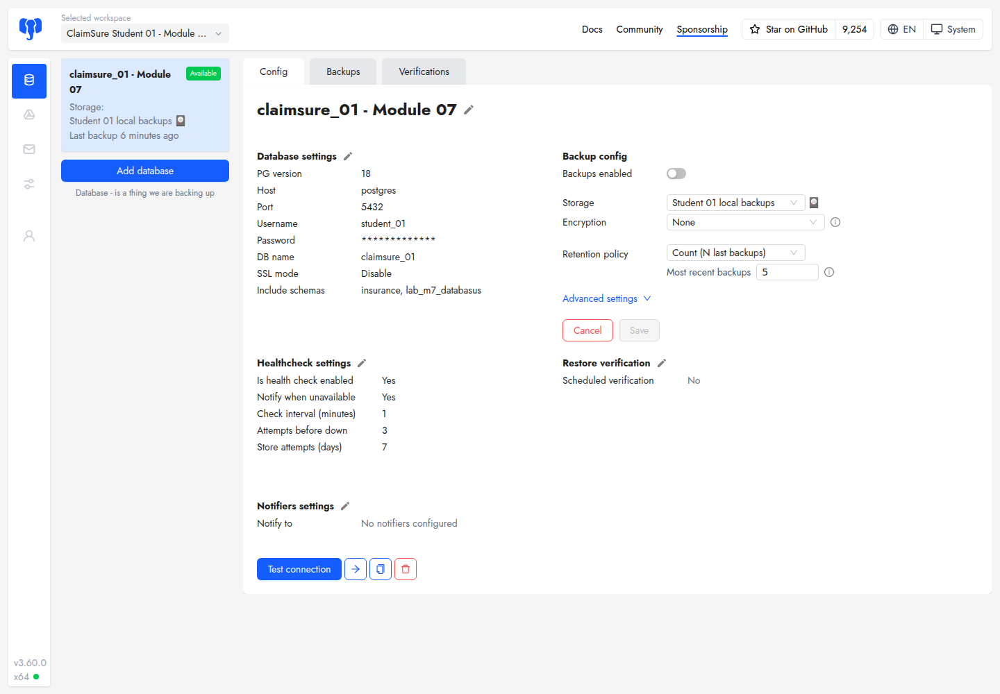

*Figure 10. The classroom uses your local storage, None encryption, and Count
retention with Most recent backups set to 5. Use Cancel after inspecting.*

### 10.1. Retention policy: GFS, Time and Count

**Scheduling decides when to create a backup. Retention decides which existing
backups to keep.** Choosing GFS does not create additional daily, weekly or
monthly backup jobs. Select **one** retention policy in **Config → Backup config**;
the three choices are alternatives, not three rules applied together.

| Policy | Question it answers | Example settings | What it keeps | Main trade-off |
| --- | --- | --- | --- | --- |
| **GFS** (Grandfather-Father-Son) | Which recent and historical recovery points should remain? | Daily = **3**, Weekly = **2**; other tiers = **0** | The newest available completed backup in each selected calendar period, within that tier's window | Keeps a spread of recovery points; older periods have less detail |
| **Time** | How old may a backup be? | Retention period = **1 week** | Backups created within the last 7 days | The number and total size grow with backup frequency |
| **Count** | How many recent successful backups should remain? | Most recent backups = **5** | The newest 5 completed backups | The history covered changes when backup frequency changes |

These are teaching examples, not changes to your assigned source. Preview each
choice and use **Cancel** unless the instructor authorizes saving it. Retention
can remove the recovery point needed for the lab; download an independent copy
before experimenting with deletion.

### 10.2. GFS example: keep recent detail and an older weekly point

GFS traditionally describes daily (**Son**), weekly (**Father**) and monthly
(**Grandfather**) generations. Databasus also supports hourly and yearly tiers.
For a small example, set:

| GFS field | Value | Meaning |
| --- | --- | --- |
| Daily | **3** | Keep up to one newest backup per day in the daily window |
| Weekly | **2** | Keep up to one newest backup per ISO calendar week in the weekly window |
| Monthly / Yearly | **0** | Do not select backups using these tiers |
| Hourly, if displayed | **0** | Do not select backups using the hourly tier |

With the history in section 10.5, the daily tier selects **6, 7 and 8 November**.
The weekly tier selects **1 November** for ISO week 44 and **8 November** for
ISO week 45. The final set is **1, 6, 7 and 8 November: four backup files**.

The 8 November backup satisfies both Daily and Weekly. It is kept once, not
duplicated, so **3 Daily + 2 Weekly does not necessarily mean 5 files**. Monthly
and yearly tiers work similarly when enabled. A higher-tier recovery point can
survive after the daily tier no longer selects it.

**Use GFS when:** ClaimSure needs frequent recent recovery points and a smaller
selection of older weekly/monthly points. It does not preserve every backup in
the historical window, create a missing backup, or guarantee recovery to every
time between the retained points.

### 10.3. Time example: keep everything within one week

Select **Time** and choose **1 week**. For a cleanup evaluated at
**2026-11-08 18:00 UTC**, the cutoff is **2026-11-01 18:00 UTC**.

With one successful backup every day at 12:00 UTC, keep **2–8 November** and
remove the older **30 October–1 November** backups. The 1 November backup was
created at 12:00, six hours before the cutoff.

If the schedule changes to hourly, Time still keeps the backups inside that
same seven-day window, so there can be many more files. It does not reduce them
to one backup per day. If backups stop, the time cutoff continues advancing;
this policy does not guarantee a minimum number of remaining backups.

**Use Time when:** the requirement is a defined age window such as “keep the
last week,” and storage can accommodate all backups created within it.

### 10.4. Count example: keep the newest five successful backups

Select **Count** and set **Most recent backups = 5**, as in Figure 10.
With the same daily history, keep **4–8 November** and remove
**30 October–3 November**.

If you manually create another successful backup, it takes one of those five
places and can displace the oldest retained backup. With hourly backups, the
five places represent five hourly runs rather than five daily runs. Count is
therefore **not “keep five days.”**

**Use Count when:** a small fixed number of recent successful recovery points is
enough, as in this classroom exercise. It limits the number of retained completed
backups after cleanup, not their total storage size; file sizes can differ.

### 10.5. Compare the same backup history

Assume all **10 backups completed successfully**, one per day at **12:00 UTC**,
and evaluate cleanup at **8 November 2026, 18:00 UTC**. The newest backup is
8 November at 12:00. All backups are older than the recent-backup grace period.
“Remove” below means eligible for retention cleanup, assuming no other deletion
blocker or storage error.

| Backup creation date, 2026 | GFS: Daily 3 + Weekly 2 | Time: 1 week | Count: 5 |
| --- | --- | --- | --- |
| 30 October | Remove | Remove | Remove |
| 31 October | Remove | Remove | Remove |
| 1 November | **Keep: Weekly** | Remove | Remove |
| 2 November | Remove | **Keep** | Remove |
| 3 November | Remove | **Keep** | Remove |
| 4 November | Remove | **Keep** | **Keep** |
| 5 November | Remove | **Keep** | **Keep** |
| 6 November | **Keep: Daily** | **Keep** | **Keep** |
| 7 November | **Keep: Daily** | **Keep** | **Keep** |
| 8 November | **Keep: Daily + Weekly** | **Keep** | **Keep** |
| **Unique backups retained** | **4** | **7** | **5** |

The difference is visible on **1 November**: GFS keeps an older weekly
representative that Time and Count remove. Conversely, Time keeps all available
daily points inside its window, including 2–5 November, while GFS keeps a
sparser selection.

### 10.6. Databasus 3.60.0 cleanup details

- Count and GFS select **completed** backups. A failed job is not a replacement
  for a successful recovery point.
- GFS selects the newest backup in each calendar bucket. Its tier windows are
  measured back from the **newest completed backup**, whereas Time uses the
  **current UTC time**. They can behave differently if backups stop.
- GFS keeps the union of its tiers. A backup selected by several tiers is one
  file, and a period without a backup contributes no recovery point.
- In this version, automatic logical-backup retention cleanup processes
  configurations with **Backups enabled**. The classroom starts with scheduling
  disabled, so inspecting or saving a different retention choice alone is not
  a deletion demonstration.
- Backups created less than **60 minutes** ago have a cleanup grace period.
  Count may temporarily show more than its configured limit, and deletion need
  not occur immediately after a setting is saved.

These examples were checked against the version used in the screenshots:
[Databasus 3.60.0 logical retention cleaner](https://github.com/databasus/databasus/blob/v3.60.0/backend/internal/features/backups/backups/backuping/logical/cleaner.go)
and [GFS selection algorithm](https://github.com/databasus/databasus/blob/v3.60.0/backend/internal/features/backups/backups/backuping/shared/gfs/gfs.go).

### 10.7. Inspect a schedule and download a copy

Scheduled backups start disabled. With instructor permission, enable the
**Backups enabled** switch to inspect a daily or staggered schedule. Review its
time/timezone before saving. Disable scheduling after the observation. If you
are just inspecting the form, click **Cancel** so nothing is applied.

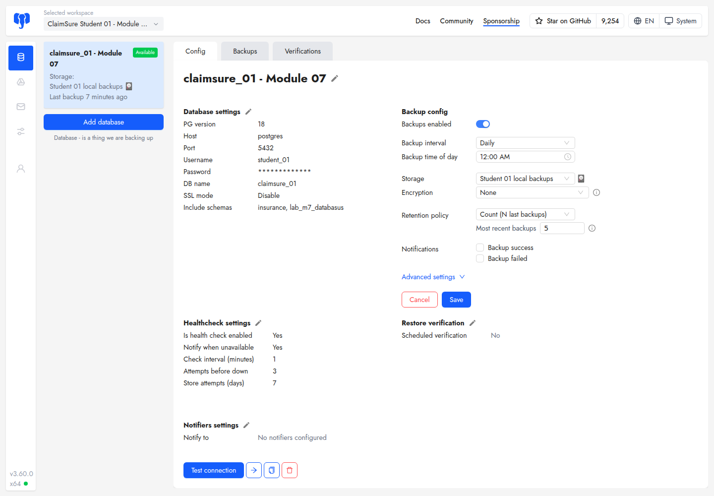

*Figure 11. Scheduling controls appear when Backups enabled is switched on.
This screenshot is an unsaved preview; the capture left scheduling disabled.*

In **Backups**, use the **downward arrow** in your selected backup's Actions
column to **Download** it to your laptop. Keep that file outside the classroom
server. It contains the backed-up schema data; store it privately.

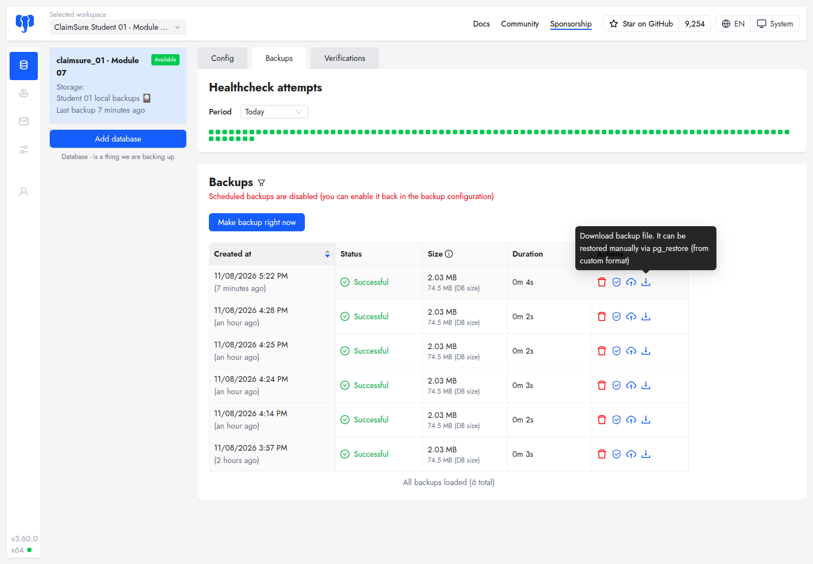

*Figure 12. Download your own completed backup through your own workspace.*

Retention may remove older managed backups; preserve an independent copy of
an important recovery point first. Local Databasus storage alone does not protect
against VM/disk loss. Downloading a file is useful, while the successful restore
and SQL checks demonstrate that it can recover the expected data.

## 11. Submit your lab evidence

Include these items in your report, with passwords hidden:

1. Your student number, source database and recovery database.
2. Backup UUID, creation time/timezone, size and Successful status.
3. The restore's own Successful status and start time.
4. SQL identity and practice results for **both** databases: source **1,3** and
   recovery **1,2**.
5. Insurance-table baseline and recovered counts, plus whether they match.
6. A brief explanation of why the source remains damaged after this isolated
   restore, and why keeping only a local backup does not cover server loss.

Use screenshots of **your own run**, not the example images in this manual.
Command evidence is also stored under `~/labs/module07-databasus/` as reported
by the helper. Keep private credential output out of the submission.

## 12. Repeat the exercise or troubleshoot

To repeat the illustrated workflow, seed the practice rows again and create a
**new pre-damage backup**, then repeat the UUID selection, damage and restore
steps. To remove only this lab's marked practice schema from both databases:

```bash
./run-lab07-databasus.sh reset        # preview
./run-lab07-databasus.sh reset --yes  # apply only when finished with evidence
```

Reset keeps insurance data, databases, accounts, settings and backup history.
Keep your evidence before resetting. The separate terminal-only shortcut is:

```bash
./run-lab07-databasus.sh all          # preview
./run-lab07-databasus.sh all --yes    # backup, damage, restore and checks
```

| Symptom | What to check or do |
| --- | --- |
| Login fails | Use the generated web password from `credentials`; SQL and web passwords differ. |
| Wrong workspace/source | Select your assigned workspace. Stop if another student's resources are visible and tell the instructor. |
| Connection test fails | Databasus uses `postgres:5432`; your laptop SQL client uses the classroom server hostname/IP. Recheck your own SQL password. |
| Backup fails with permission errors | Preserve the assigned include schemas `insurance` and `lab_m7_databasus`; whole-database backup can encounter security-lab restrictions. |
| Cannot find today's backup | Check the Backups period/date filter and browser timezone; compare the UUID/time from `status`. |
| UUID is missing or rejected | Set `BACKUP_ID` to your own completed backup from `status`; repeat the assignment after reconnecting your shell. |
| Restore tries to use the source | Replace the initially populated DB name with `claimsure_databasus_xx` before testing and submitting. |
| Repeat restore fails on a partition primary key | Close target transactions, rerun `prepare-target --yes`, then retry the same pre-damage backup. |
| Preparation times out | Close blocking transactions on the recovery database, then retry; ask the instructor if it continues. |
| Recovery shows IDs 1,3 | Check `current_database()` and the selected backup. You may be querying the source or have chosen a post-damage backup. |
| Recovery counts differ | Compare against the pre-backup baseline, verify the source/schema scope and stop other writes before a new attempt. |

For course setup and further reference, return to the
[main Module 7E lab](module-07-databasus.md). Screenshot capture and verification
details are in the [image notes](images/module-07-databasus/README.md).
