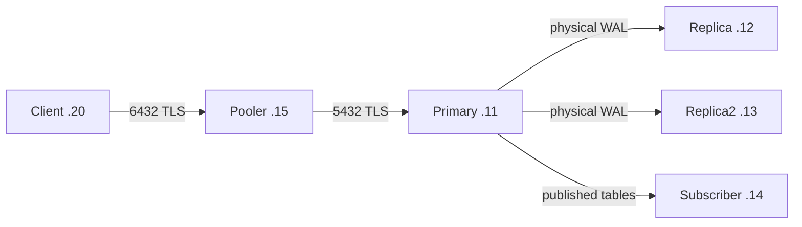

# Module 8 — ติดตั้ง PostgreSQL Replication บน Self-host แบบ Native

อ้างอิงลำดับ 8A–8E จาก [Lab Module 8](module-08-replication.md) ฉบับนี้ใช้ PostgreSQL services บน Linux โดยตรง ควบคุมด้วย `pg_ctlcluster` / `systemctl` และแก้ไฟล์ของแต่ละเครื่อง คำสั่ง `make` ใน Lab เดิมเป็นตัวจัดการ Docker ให้ใช้คำสั่งใน tutorial นี้สำหรับ native setup

**สภาพแวดล้อมตัวอย่าง:** Ubuntu Server 24.04, PostgreSQL 18 จาก PGDG, cluster ชื่อ `main` และเครื่อง/VM ใหม่สำหรับ Lab ใช้บัญชี Linux ที่มี sudo ตัวอย่าง IP ทั้งหมดให้เปลี่ยนเป็น private IP ของตนก่อนรัน หากติดตั้งด้วยวิธีอื่น ให้หา paths จริงด้วย `SHOW config_file`, `SHOW hba_file`, `SHOW data_directory`

## 0. วางแผนว่าเครื่องไหนทำหน้าที่อะไร

| เครื่อง | IP ตัวอย่าง | Service | หน้าที่ |
| --- | --- | --- | --- |
| Primary | `10.20.0.11` | PostgreSQL `5432` | รับ writes และส่ง physical/logical changes |
| Replica | `10.20.0.12` | PostgreSQL `5432` | Physical standby ตัวแรก |
| Replica2 | `10.20.0.13` | PostgreSQL `5432` | เพิ่ม node และหยุด/คืน node ใน 8B–8C |
| Subscriber | `10.20.0.14` | PostgreSQL `5432` | อีก cluster สำหรับ logical replication ใน 8D |
| Pooler | `10.20.0.15` | PgBouncer `6432` | รับ app connections ใน 8E |
| Client / Admin | `10.20.0.20` | psql / SSH client | เข้าถึงเครื่องต่าง ๆ และทดสอบ app |

ทุก PostgreSQL ใช้ port 5432 ได้เพราะอยู่คนละเครื่อง จึงไม่มี host port mapping 55811–55820 แบบ Docker Database ใช้ชื่อ **`claimsure`**; Primary/physical replicas จะมีข้อมูลทั้ง cluster เดียวกัน ส่วน Subscriber มี cluster ของตัวเอง

Primary และ physical replicas ควรใช้ PostgreSQL major version, hardware architecture และ extension binaries ที่เข้ากันได้ ใช้ patch release และ packages ชุดเดียวกันใน Lab นี้

| ต้องตั้งที่เครื่องไหน | Configuration / สิ่งที่ต้องสร้าง |
| --- | --- |
| Primary | PostgreSQL config, HBA อนุญาตผู้เชื่อมออกจากแต่ละเครื่อง, roles/grants/RLS, physical slots และ publication |
| Replica / Replica2 | Config ระบุ IP ของตน, replication passfile, clone PGDATA, standby.signal และ recovery settings จาก base backup |
| Subscriber | Cluster/PGDATA ของตัวเอง, matching table DDL, passfile และ SQL subscription ชี้ Primary |
| Pooler | PgBouncer ini ชี้ Primary, auth file, TLS certificate/key และ service |
| Client | PostgreSQL connection URL ชี้ Pooler, app password และ tenant context ต่อ transaction |



แผนเริ่มต้นเป็น **asynchronous replication** วาง disk budget สำหรับ WAL ระหว่าง standby หยุด, จำนวน SQL connections, backup/restore และ RPO/RTO แยกด้วย การมี replica ยังไม่สร้างระบบ automatic failover ให้

## 1. ติดตั้ง packages และตรวจ paths

### 1.1 ทุกเครื่อง Linux ที่จะติดตั้ง packages

**เครื่อง: Primary, Replica, Replica2, Subscriber และ Pooler**

```bash
sudo apt update
sudo apt install -y postgresql-common ca-certificates
sudo /usr/share/postgresql-common/pgdg/apt.postgresql.org.sh
sudo apt update
```

คำสั่ง PGDG setup อาจถามยืนยัน repository อ่านค่าบนหน้าจอก่อนดำเนินต่อ ตาม [คู่มือ Ubuntu ของ PostgreSQL](https://www.postgresql.org/download/linux/ubuntu/)

### 1.2 ติดตั้ง Database Server

**เครื่อง: Primary, Replica, Replica2 และ Subscriber เท่านั้น**

```bash
sudo apt install -y postgresql-18 postgresql-client-18 ssl-cert
sudo usermod -a -G ssl-cert postgres
pg_lsclusters
/usr/lib/postgresql/18/bin/postgres --version
```

ตรวจว่าเป็น `18 / main` และ port `5432` ถ้าไม่มี cluster `18 main` จึงใช้ `sudo pg_createcluster 18 main --start` ถ้ามี PostgreSQL รุ่นอื่นหรือข้อมูลเดิมอยู่ ให้เลือก VM ใหม่สำหรับ tutorial นี้ก่อน

| รายการ | Path / service ที่ใช้ใน tutorial |
| --- | --- |
| PostgreSQL config | `/etc/postgresql/18/main/postgresql.conf` |
| ไฟล์ override ที่เราจะเพิ่ม | `/etc/postgresql/18/main/conf.d/80-claimsure.conf` |
| Client authentication | `/etc/postgresql/18/main/pg_hba.conf` |
| PGDATA | `/var/lib/postgresql/18/main` |
| Recovery settings ที่ base backup สร้าง | `/var/lib/postgresql/18/main/postgresql.auto.conf` |
| Service | `postgresql@18-main` |
| Log เริ่มต้น | `/var/log/postgresql/postgresql-18-main.log` |

Debian/Ubuntu package แยก config ออกจาก PGDATA จึงต้องเก็บ config ของ Replica ไว้ที่ `/etc/...` ของเครื่องนั้น การ clone PGDATA จาก Primary ไม่ได้คัดลอกไฟล์ `/etc/postgresql/...` ของ Primary มาด้วย [รายละเอียด package cluster layout](https://manpages.debian.org/trixie/postgresql-common/pg_createcluster.1.en.html)

### 1.3 ติดตั้ง Pooler

**เครื่อง: Pooler เท่านั้น**

```bash
sudo apt install -y pgbouncer postgresql-client-18 openssl
sudo systemctl stop pgbouncer
pgbouncer --version
systemctl show pgbouncer --property=User --value
```

ตัวอย่างสิทธิ์ไฟล์ในบทนี้ใช้ service account `postgres` ตรวจให้ตรงกับ `User` ใน unit ของ package ก่อนใช้คำสั่ง chown หาก unit ใช้บัญชีอื่นให้ใช้บัญชีนั้นกับไฟล์และ directory ของ PgBouncer ในขั้น 9

## 2. ตั้ง PostgreSQL config แยกตามเครื่อง

**เครื่อง: Primary, Replica, Replica2 และ Subscriber**

```bash
sudoedit /etc/postgresql/18/main/conf.d/80-claimsure.conf
```

ใส่ config ด้านล่าง โดยเปลี่ยน **สองบรรทัดแรกตามตาราง** ก่อน restart:

| เครื่อง | `listen_addresses` | `cluster_name` |
| --- | --- | --- |
| Primary | `'localhost,10.20.0.11'` | `'claimsure_primary'` |
| Replica | `'localhost,10.20.0.12'` | `'claimsure_replica'` |
| Replica2 | `'localhost,10.20.0.13'` | `'claimsure_replica2'` |
| Subscriber | `'localhost,10.20.0.14'` | `'claimsure_subscriber'` |

```conf
listen_addresses = 'localhost,REPLACE_WITH_THIS_NODE_IP'
cluster_name = 'REPLACE_WITH_THIS_NODE_NAME'
port = 5432
password_encryption = 'scram-sha-256'
wal_level = logical
max_wal_senders = 8
max_replication_slots = 8
wal_keep_size = '64MB'
max_slot_wal_keep_size = '256MB'
hot_standby = on
recovery_target_timeline = 'latest'
wal_log_hints = on
synchronous_commit = on
synchronous_standby_names = ''
max_connections = 60
shared_buffers = '128MB'
timezone = 'Asia/Bangkok'
ssl = on
ssl_cert_file = '/etc/ssl/certs/ssl-cert-snakeoil.pem'
ssl_key_file = '/etc/ssl/private/ssl-cert-snakeoil.key'
```

ใช้ชุดค่าร่วมเพื่อให้การสลับบทบาทในอนาคตมี setting ที่รองรับไว้ โดย `wal_level = logical` จำเป็นบน Publisher สำหรับ 8D และรองรับ physical replication ด้วย ตัวเลข memory/WAL เป็น **ค่า Lab**; ขนาดระบบจริงต้องอิง workload และระยะ outage ที่ต้องรองรับ

ตรวจว่า `postgresql.conf` มี `include_dir = 'conf.d'` ที่เปิดใช้งานอยู่ แล้วบน **แต่ละเครื่อง Database**:

```bash
sudo pg_ctlcluster 18 main restart
sudo -u postgres psql -X -h /var/run/postgresql -p 5432 -d postgres
```

ใน psql:

```sql
SHOW config_file;
SHOW hba_file;
SHOW data_directory;
SHOW listen_addresses;
SHOW ssl;
SELECT name, setting, context, pending_restart
FROM pg_settings
WHERE name IN ('wal_level','max_wal_senders','max_replication_slots',
              'max_connections','hot_standby');
\q
```

**ผ่านเมื่อ:** paths ตรงกับเครื่องนั้น, IP ถูกต้อง, `ssl=on`, `wal_level=logical` และไม่มี `pending_restart=true` ในค่าที่ตรวจ

TLS ใน Lab ใช้ package/self-signed certificates และ connection mode `require` เพื่อเข้ารหัส เมื่อใช้กับระบบจริงให้เตรียม trusted CA/certificate และใช้ `verify-full` พร้อมชื่อ server ที่ตรง certificate เพื่อยืนยัน server identity ด้วย

## 3. ตั้ง Network และ pg_hba.conf บน Primary

### 3.1 แผน Firewall

| ปลายทาง | เปิดให้ต้นทางไหน |
| --- | --- |
| Primary `.11:5432` | Replica `.12`, Replica2 `.13`, Subscriber `.14`, Pooler `.15` |
| Pooler `.15:6432` | Client `.20` |
| SSH ของทุกเครื่อง | Admin IP ตามที่ใช้งานจริง |

ตัวอย่างหากใช้ UFW บน **Primary**:

```bash
sudo ufw allow proto tcp from 10.20.0.12 to 10.20.0.11 port 5432
sudo ufw allow proto tcp from 10.20.0.13 to 10.20.0.11 port 5432
sudo ufw allow proto tcp from 10.20.0.14 to 10.20.0.11 port 5432
sudo ufw allow proto tcp from 10.20.0.15 to 10.20.0.11 port 5432
```

และบน **Pooler**:

```bash
sudo ufw allow proto tcp from 10.20.0.20 to 10.20.0.15 port 6432
```

ถ้า firewall ยังไม่เปิด ให้เตรียม SSH access rule ของ Admin ให้ครบก่อนเปิดตามนโยบายเครื่อง ตรวจ cloud security groups/firewall ภายนอกประกอบด้วย

### 3.2 HBA ของ Primary

**เครื่อง: Primary เท่านั้น** เปิดไฟล์ที่ `SHOW hba_file` รายงาน:

```bash
sudoedit /etc/postgresql/18/main/pg_hba.conf
```

เก็บ local peer rules ของ package ไว้ เพิ่ม rules ที่ตรงกับ private IP จริง โดยวางก่อน rule อื่นที่อาจ match/reject connection เดียวกัน:

```text
# Physical base backup / WAL streaming
hostssl replication replicator 10.20.0.12/32 scram-sha-256
hostssl replication replicator 10.20.0.13/32 scram-sha-256

# Logical replication and initial table copy
hostssl claimsure replicator 10.20.0.14/32 scram-sha-256

# Application backend connections from PgBouncer
hostssl claimsure claim_app 10.20.0.15/32 scram-sha-256
```

```bash
sudo pg_ctlcluster 18 main reload
sudo -u postgres psql -X -h /var/run/postgresql -p 5432 -d postgres
```

```sql
SELECT line_number, error FROM pg_hba_file_rules WHERE error IS NOT NULL;
\q
```

**ผ่านเมื่อ:** ไม่มี parse errors ส่วน Replica/Replica2/Subscriber ใช้ local peer ของตนสำหรับการตรวจผ่าน SSH ใน tutorial นี้ การอนุญาต app ให้อ่าน Replica จากเครื่องอื่นต้องเพิ่ม HBA/firewall และสิทธิ์ที่เหมาะสมตามแผนนั้น

## 4. สร้าง Roles และข้อมูลบน Primary

**เครื่อง: Primary เท่านั้น**

```bash
sudo -u postgres psql -X -h /var/run/postgresql -v ON_ERROR_STOP=1 -p 5432 -d postgres
```

ใน psql ของ cluster ใหม่:

```sql
CREATE ROLE replicator WITH LOGIN REPLICATION NOSUPERUSER
  NOCREATEDB NOCREATEROLE NOBYPASSRLS;
CREATE ROLE claim_app WITH LOGIN NOSUPERUSER
  NOCREATEDB NOCREATEROLE NOBYPASSRLS;
\password replicator
\password claim_app
CREATE DATABASE claimsure;
\connect claimsure

CREATE SCHEMA insurance;
CREATE SCHEMA lab_m8;
CREATE TABLE insurance.claim (
  claim_id bigint GENERATED ALWAYS AS IDENTITY PRIMARY KEY,
  tenant_id bigint NOT NULL,
  claim_no text NOT NULL UNIQUE,
  status text NOT NULL,
  amount numeric(12,2) NOT NULL,
  updated_at timestamptz NOT NULL DEFAULT clock_timestamp()
);
CREATE TABLE insurance.claim_payment (
  payment_id bigint GENERATED ALWAYS AS IDENTITY PRIMARY KEY,
  tenant_id bigint NOT NULL,
  claim_id bigint NOT NULL REFERENCES insurance.claim(claim_id),
  amount numeric(12,2) NOT NULL
);
CREATE TABLE insurance.audit_event (
  event_id bigint GENERATED ALWAYS AS IDENTITY PRIMARY KEY,
  tenant_id bigint NOT NULL,
  actor text NOT NULL,
  action text NOT NULL,
  entity_type text NOT NULL,
  entity_id text NOT NULL,
  details jsonb NOT NULL DEFAULT '{}',
  created_at timestamptz NOT NULL DEFAULT clock_timestamp()
);
INSERT INTO insurance.claim(tenant_id,claim_no,status,amount) VALUES
  (1,'CLM-M8-001','NEW',1000),
  (1,'CLM-M8-002','REVIEW',2000),
  (2,'CLM-M8-003','NEW',3000);
INSERT INTO insurance.claim_payment(tenant_id,claim_id,amount)
SELECT tenant_id,claim_id,amount/2 FROM insurance.claim;

GRANT CONNECT ON DATABASE claimsure TO replicator, claim_app;
GRANT USAGE ON SCHEMA insurance TO replicator, claim_app;
GRANT SELECT ON insurance.claim, insurance.claim_payment TO replicator;
GRANT SELECT ON insurance.claim TO claim_app;
ALTER TABLE insurance.claim ENABLE ROW LEVEL SECURITY;
CREATE POLICY claim_tenant ON insurance.claim FOR SELECT TO claim_app
  USING (tenant_id = nullif(current_setting('app.tenant_id',true),'')::bigint);
CREATE POLICY claim_replication ON insurance.claim FOR SELECT TO replicator
  USING (true);

SELECT count(*) FROM insurance.claim;
SELECT count(*) FROM insurance.claim_payment;
SELECT rolname,rolreplication,rolsuper,rolbypassrls
FROM pg_roles WHERE rolname IN ('replicator','claim_app');
\q
```

เมื่อถึง `\password` ให้กรอกรหัสตาม prompt ให้จบก่อนวางคำสั่งถัดไป

**ผ่านเมื่อ:** สองตารางมีตารางละ 3 แถว; replicator มี REPLICATION แต่ไม่เป็น superuser และ claim_app ไม่มี BYPASSRLS เก็บรหัสของทั้งสอง role แยกกัน สำหรับ Lab ใช้รหัสสุ่มยาว เช่น 24 ตัวอักษรขึ้นไปและหลีกเลี่ยง `:` / `\` เพื่อกรอก passfile ได้ตรงไปตรงมา

ทำขั้นนี้เฉพาะ Primary ข้อมูล/roles จะตามไป physical replicas ผ่าน base backup ส่วน Subscriber จะสร้างตารางว่างของตนในขั้น 8

## 5. สร้าง Physical Replica ตัวแรก — 8A

### 5.1 สร้าง Slot บน Primary

**เครื่อง: Primary** เปิด psql ของ `claimsure`:

```bash
sudo -u postgres psql -X -h /var/run/postgresql -p 5432 -d claimsure
```

```sql
SELECT pg_create_physical_replication_slot('replica_slot');
SELECT slot_name,slot_type,active FROM pg_replication_slots;
\q
```

ตอนนี้ slot ยัง inactive จน standby เริ่มใช้ ทำครั้งเดียวสำหรับ slot นี้; หากมีอยู่แล้วให้ตรวจที่มาและสถานะก่อน ไม่ลบ slot ที่ยังมีผู้ใช้งาน

### 5.2 เตรียม Passfile และ Clone บน Replica

**เครื่อง: Replica `.12`** ตั้ง config ในขั้น 2 ให้เป็น IP/name ของ Replica เรียบร้อยก่อน จากนั้น:

```bash
export REPL_APP=replica
export REPL_SLOT=replica_slot
sudo -u postgres touch /var/lib/postgresql/.pgpass
sudo chmod 600 /var/lib/postgresql/.pgpass
sudoedit -u postgres /var/lib/postgresql/.pgpass
```

เพิ่มบรรทัดนี้ใน passfile โดยแทนรหัสด้วยรหัสจริงของ `replicator` จาก Primary และเก็บบรรทัดเดิมไว้หากมี:

```text
10.20.0.11:5432:replication:replicator:REPLACE_WITH_REPLICATION_PASSWORD
```

ก่อน clone ต้องหยุด PostgreSQL และให้ PGDATA ปลายทางว่าง Block นี้ตรวจว่าเป็น cluster ใหม่ที่ยังไม่มี user databases/tables แล้วเก็บ data directory ตั้งต้นของ package ไว้ข้าง ๆ:

```bash
(
  set -euo pipefail
  : "${REPL_APP:?Set replica or replica2 first}"
  : "${REPL_SLOT:?Set the matching physical slot first}"
  [[ "$REPL_APP" =~ ^replica2?$ && "$REPL_SLOT" == "${REPL_APP}_slot" ]]
  sudo -u postgres psql -X -h /var/run/postgresql -v ON_ERROR_STOP=1 -p 5432 -d postgres <<'SQL'
DO $$
BEGIN
  IF current_setting('server_version_num')::int / 10000 <> 18
     OR current_setting('data_directory') <> '/var/lib/postgresql/18/main'
     OR pg_is_in_recovery() THEN
    RAISE EXCEPTION 'Expected a fresh local PostgreSQL 18 main cluster';
  END IF;
  IF EXISTS (SELECT FROM pg_database
             WHERE NOT datistemplate AND datname <> 'postgres')
     OR EXISTS (SELECT FROM pg_class c JOIN pg_namespace n ON n.oid=c.relnamespace
                WHERE c.relkind IN ('r','p') AND n.nspname !~ '^pg_'
                  AND n.nspname <> 'information_schema') THEN
    RAISE EXCEPTION 'Existing user data found: use a fresh standby host';
  END IF;
END $$;
SQL
  if sudo test -e /var/lib/postgresql/18/main.before-basebackup; then
    echo 'STOP: preserved directory already exists; inspect it first.' >&2
    exit 1
  fi
  sudo pg_ctlcluster 18 main stop
  sudo mv /var/lib/postgresql/18/main /var/lib/postgresql/18/main.before-basebackup
  sudo install -d -o postgres -g postgres -m 700 /var/lib/postgresql/18/main
  sudo -u postgres /usr/lib/postgresql/18/bin/pg_basebackup \
    --dbname="host=10.20.0.11 port=5432 user=replicator sslmode=require application_name=$REPL_APP passfile=/var/lib/postgresql/.pgpass connect_timeout=5" \
    --pgdata=/var/lib/postgresql/18/main \
    --write-recovery-conf --wal-method=stream --slot="$REPL_SLOT" \
    --checkpoint=fast --progress
)
```

**หาก block error ให้หยุดตรวจสาเหตุก่อนขั้น start** สำเนา Primary ที่ได้จะมี `standby.signal` และ `postgresql.auto.conf` ที่กำหนด upstream/slot จาก `-R` ส่วน `.conf` และ HBA ที่ `/etc/postgresql/18/main/` ยังคงเป็นของ Replica เครื่องนี้ [pg_basebackup](https://www.postgresql.org/docs/18/app-pgbasebackup.html)

### 5.3 Start และตรวจ Replica

**เครื่อง: Replica**

```bash
sudo -u postgres test -f /var/lib/postgresql/18/main/standby.signal
sudo pg_ctlcluster 18 main start
sudo -u postgres psql -X -h /var/run/postgresql -p 5432 -d claimsure
```

```sql
SELECT pg_is_in_recovery(); -- t
SHOW config_file;
SHOW primary_slot_name;    -- replica_slot
SELECT status,sender_host,sender_port,slot_name FROM pg_stat_wal_receiver;
SELECT count(*) FROM insurance.claim; -- 3 หลัง replay
\set VERBOSITY verbose
BEGIN;
CREATE TABLE lab_m8.must_be_readonly(id integer);
-- Expected: SQLSTATE 25006 / read-only transaction
ROLLBACK;
SELECT system_identifier FROM pg_control_system();
\q
```

**เครื่อง: Primary**

```bash
sudo -u postgres psql -X -h /var/run/postgresql -p 5432 -d claimsure
```

```sql
SELECT pg_is_in_recovery(); -- f
SELECT application_name,client_addr,state,sync_state,flush_lsn,replay_lsn
FROM pg_stat_replication;
SELECT slot_name,slot_type,active FROM pg_replication_slots;
SELECT system_identifier FROM pg_control_system();
SELECT r.application_name,s.ssl,s.version
FROM pg_stat_replication r JOIN pg_stat_ssl s ON s.pid=r.pid;
\q
```

**ผ่านเมื่อ:** Primary มี sender `replica` ที่ streaming, slot active, Replica recovery=true/ปฏิเสธ write, system identifier ตรงกัน และ replication connection ใช้ TLS

### 5.4 พิสูจน์ว่า Committed Write ไปถึง Replica

**Primary / psql database claimsure:**

```sql
CREATE TABLE IF NOT EXISTS lab_m8.replication_probe(id text PRIMARY KEY,note text NOT NULL);
INSERT INTO lab_m8.replication_probe VALUES ('native-probe-001','written on primary')
ON CONFLICT (id) DO UPDATE SET note=EXCLUDED.note;
SELECT pg_current_wal_lsn() AS target_lsn;
```

จด `target_lsn` ที่ได้ แล้วบน **Replica / psql claimsure**:

```sql
TABLE lab_m8.replication_probe;
SELECT pg_last_wal_receive_lsn(),pg_last_wal_replay_lsn();
```

รอจนเห็น probe และเทียบ replay LSN กับค่าที่จด ถ้าจะ query เปรียบเทียบให้แทน `ACTUAL_TARGET_LSN` ด้วยค่าจริง:

```sql
SELECT pg_last_wal_replay_lsn() >= 'ACTUAL_TARGET_LSN'::pg_lsn AS caught_up;
```

ต้องได้ `t` การเปิด connection ได้อย่างเดียวยังไม่พิสูจน์ replay หากเพิ่งสร้างตารางแล้ว standby ยังไม่เห็น ให้รอและตรวจ LSN/sender/receiver ก่อน

## 6. เพิ่ม Replica2 — 8B

**Primary / psql claimsure:**

```sql
SELECT pg_create_physical_replication_slot('replica2_slot');
```

**Replica2 `.13`:**

1. ทำขั้น 1–2 ให้ IP เป็น `.13` และ cluster_name เป็น `claimsure_replica2`
2. Primary HBA/firewall ต้องอนุญาต `.13` ตามขั้น 3
3. เตรียม `.pgpass` ตามขั้น 5.2 บน Replica2 เครื่องนี้
4. ตั้ง variables ด้านล่าง แล้วรัน **clone block ทั้งก้อนของ 5.2** บน Replica2
5. ทำ start/check ใน 5.3 บน Replica2 และอ่าน probe จาก 5.4

```bash
export REPL_APP=replica2
export REPL_SLOT=replica2_slot
```

**ผ่านเมื่อ:** Primary มีสอง physical senders ชื่อ `replica`/`replica2`; มีสอง active slots และ Replica2 มี recovery=true / system identifier เดียวกัน

## 7. หยุด Replica2 และดู Catch-up — 8C

**Replica2 `.13` / shell:**

```bash
sudo pg_ctlcluster 18 main stop
```

**Primary / psql claimsure:**

```sql
SELECT application_name,state FROM pg_stat_replication;
SELECT slot_name,active,restart_lsn,
       pg_size_pretty(pg_wal_lsn_diff(pg_current_wal_lsn(),restart_lsn)) AS retained_wal
FROM pg_replication_slots;

INSERT INTO insurance.audit_event
  (tenant_id,actor,action,entity_type,entity_id,details)
SELECT 1,'native_lab','NODE_DOWN_WAL','replica2',g::text,
       jsonb_build_object('lab','8C')
FROM generate_series(1,1000) g;
SELECT count(*) FROM insurance.audit_event WHERE actor='native_lab';
SELECT pg_current_wal_lsn() AS target_lsn;
```

ต้องเห็น sender Replica2 หาย แต่ `replica2_slot` ยังอยู่และ inactive จดจำนวน audit events และ target LSN แล้วบน **Replica2 / shell**:

```bash
sudo pg_ctlcluster 18 main start
sudo -u postgres psql -X -h /var/run/postgresql -p 5432 -d claimsure
```

```sql
SELECT pg_is_in_recovery();
SELECT pg_last_wal_replay_lsn();
SELECT count(*) FROM insurance.audit_event WHERE actor='native_lab';
\q
```

**ผ่านเมื่อ:** replay ถึง target, จำนวน events ตรง Primary และ Primary เห็น sender/slot กลับ active การทำรอบนี้ซ้ำเพิ่ม events อีก 1,000 แถว

หาก outage นาน ให้ดู `wal_status` ของ slot และพื้นที่ disk; WAL ที่ต้องใช้หายหรือ slot invalidated อาจต้อง clone standby ใหม่ ห้าม restart Primary เดิม/เปลี่ยนบทบาทโดยใช้ขั้นตอน outage นี้แทน failover runbook

## 8. ตั้ง Logical Subscriber — 8D

### 8.1 สร้าง Publication บน Primary

**Primary / psql claimsure:**

```sql
CREATE PUBLICATION claims_reporting
FOR TABLE insurance.claim, insurance.claim_payment;
SELECT pubname,schemaname,tablename FROM pg_publication_tables;
```

### 8.2 เตรียม Subscriber ให้เป็นอีก Cluster

**Subscriber `.14` เท่านั้น** ใช้ cluster ของ package ที่ init เองตั้งแต่ขั้น 1–2 เก็บ PGDATA ของตัวเองไว้ ไม่ทำ base backup/standby.signal แบบ Replica

```bash
sudo -u postgres psql -X -h /var/run/postgresql -v ON_ERROR_STOP=1 -p 5432 -d postgres
```

```sql
CREATE DATABASE claimsure;
\connect claimsure
CREATE SCHEMA insurance;
CREATE TABLE insurance.claim (
  claim_id bigint GENERATED ALWAYS AS IDENTITY PRIMARY KEY,
  tenant_id bigint NOT NULL,
  claim_no text NOT NULL UNIQUE,
  status text NOT NULL,
  amount numeric(12,2) NOT NULL,
  updated_at timestamptz NOT NULL DEFAULT clock_timestamp()
);
CREATE TABLE insurance.claim_payment (
  payment_id bigint GENERATED ALWAYS AS IDENTITY PRIMARY KEY,
  tenant_id bigint NOT NULL,
  claim_id bigint NOT NULL REFERENCES insurance.claim(claim_id),
  amount numeric(12,2) NOT NULL
);
\q
```

บน **Subscriber / shell** เตรียม passfile ของ OS user ที่รัน PostgreSQL:

```bash
sudo -u postgres touch /var/lib/postgresql/.pgpass
sudo chmod 600 /var/lib/postgresql/.pgpass
sudoedit -u postgres /var/lib/postgresql/.pgpass
```

เพิ่มบรรทัดโดยใช้รหัส replicator จริง:

```text
10.20.0.11:5432:claimsure:replicator:REPLACE_WITH_REPLICATION_PASSWORD
```

จากนั้นเปิด `sudo -u postgres psql -X -h /var/run/postgresql -p 5432 -d claimsure` บน **Subscriber** แล้วรันใน autocommit ปกติ:

```sql
CREATE SUBSCRIPTION claims_reporting_sub
CONNECTION 'host=10.20.0.11 port=5432 dbname=claimsure user=replicator sslmode=require passfile=/var/lib/postgresql/.pgpass application_name=logical_subscriber'
PUBLICATION claims_reporting
WITH (copy_data=true,create_slot=true,enabled=true);

SELECT srrelid::regclass,srsubstate FROM pg_subscription_rel;
SELECT subname,received_lsn,latest_end_lsn FROM pg_stat_subscription;
SELECT count(*) FROM insurance.claim;
SELECT count(*) FROM insurance.claim_payment;
SELECT to_regclass('insurance.audit_event');
SELECT pg_is_in_recovery();
SELECT system_identifier FROM pg_control_system();
\q
```

**ผ่านเมื่อ:** สอง tables มี state `r`, ตารางละ 3 แถว, audit_event เป็น NULL, recovery=false และ system identifier ต่างจาก Primary

Publication/subscription เป็นการตั้งค่าผ่าน **SQL catalog**; upstream ของ Subscriber อยู่ใน subscription connection ไม่ใช้ `primary_conninfo` ของ physical standby Logical replication ไม่สร้าง DDL, roles, RLS policies หรือส่ง sequence state ให้เอง Subscriber นี้ใช้ admin ตรวจข้อมูล; สิทธิ์สำหรับ app ต้องออกแบบเพิ่มแยก

### 8.3 ทดสอบ INSERT → UPDATE → DELETE จริง

รันทีละช่วง และตรวจ Subscriber หลังแต่ละ commit:

| รันที่ไหน | SQL |
| --- | --- |
| Primary | `INSERT INTO insurance.claim(tenant_id,claim_no,status,amount) VALUES(1,'NATIVE-LOGICAL-001','NEW',99);` |
| Subscriber | `SELECT claim_no,status FROM insurance.claim WHERE claim_no='NATIVE-LOGICAL-001';` ต้องเห็น NEW |
| Primary | `UPDATE insurance.claim SET status='REVIEW' WHERE claim_no='NATIVE-LOGICAL-001';` |
| Subscriber | SELECT เดิมต้องเห็น REVIEW |
| Primary | `DELETE FROM insurance.claim WHERE claim_no='NATIVE-LOGICAL-001';` |
| Subscriber | SELECT เดิมต้องได้ 0 แถว |

รอ apply แต่ละช่วงก่อนทำช่วงถัดไป หากทำซ้ำ ให้ยืนยันว่าแถว probe รอบก่อน cleanup แล้ว

## 9. ตั้ง PgBouncer บนเครื่อง Pooler — 8E

### 9.1 TLS certificate และ Auth File

**เครื่อง: Pooler `.15` เท่านั้น** ตัวอย่างนี้ใช้ OS service user `postgres` ที่ตรวจจากขั้น 1.3:

```bash
sudo install -d -o postgres -g postgres -m 750 /etc/pgbouncer/tls
sudo openssl req -x509 -newkey rsa:3072 -nodes -days 365 \
  -subj '/CN=pgpool.lab' -addext 'subjectAltName=IP:10.20.0.15,DNS:pgpool.lab' \
  -keyout /etc/pgbouncer/tls/server.key \
  -out /etc/pgbouncer/tls/server.crt
sudo chown postgres:postgres /etc/pgbouncer/tls/server.key /etc/pgbouncer/tls/server.crt
sudo chmod 600 /etc/pgbouncer/tls/server.key
sudoedit /etc/pgbouncer/userlist.txt
```

ใช้ private IP จริงใน certificate และใส่ auth entries โดยแก้ placeholders ใน editor:

```text
"claim_app" "REPLACE_WITH_SAME_CLAIM_APP_PASSWORD_AS_PRIMARY"
"pool_admin" "REPLACE_WITH_SEPARATE_POOL_ADMIN_PASSWORD"
```

`claim_app` ต้องตรงกับ Primary ส่วน `pool_admin` เป็นบัญชีสำหรับ PgBouncer admin console ใน Lab นี้ ไม่ต้องสร้าง PostgreSQL role ชื่อนี้บน Primary ป้องกัน auth file ซึ่งมีรหัสผ่าน:

```bash
sudo chown postgres:postgres /etc/pgbouncer/userlist.txt
sudo chmod 600 /etc/pgbouncer/userlist.txt
```

### 9.2 PgBouncer Configuration

**Pooler** เปิด `/etc/pgbouncer/pgbouncer.ini` แล้วตั้งค่าต่อไปนี้ให้ตรงกับ package unit และ IP จริง:

```ini
[databases]
claimsure = host=10.20.0.11 port=5432 dbname=claimsure

[pgbouncer]
listen_addr = 10.20.0.15
listen_port = 6432
unix_socket_dir = /var/run/postgresql
auth_type = scram-sha-256
auth_file = /etc/pgbouncer/userlist.txt
admin_users = pool_admin
pool_mode = transaction
max_client_conn = 200
default_pool_size = 10
reserve_pool_size = 5
logfile = /var/log/postgresql/pgbouncer.log
pidfile = /var/run/postgresql/pgbouncer.pid
client_tls_sslmode = require
client_tls_cert_file = /etc/pgbouncer/tls/server.crt
client_tls_key_file = /etc/pgbouncer/tls/server.key
server_tls_sslmode = require
```

ตัวอย่างเลือก pool เล็กสำหรับ Lab และเหลือ SQL connections ให้ admin บน Primary Pool limit คิดต่อคู่ user/database ส่วน `max_client_conn` เป็นเพดาน frontend ไม่ใช่จำนวน PostgreSQL backends

ไม่กำหนด `user=postgres` ใน database mapping เพื่อให้ app ยังคง Login เป็น claim_app และอยู่ภายใต้ RLS ทั้ง frontend/backend ในตัวอย่างบังคับใช้ TLS; ก่อนใช้จริงเปลี่ยน certificate trust และ `server_tls_sslmode` เป็น verify-full ตาม PKI ของระบบ

```bash
sudo systemctl restart pgbouncer
sudo systemctl status pgbouncer --no-pager
sudo ss -ltnp
```

ต้องเห็น listener `.15:6432` และ service active

### 9.3 ทดสอบ App Login จาก Client

**Client `.20` ที่มี psql**:

```bash
psql -X -W 'host=10.20.0.15 port=6432 dbname=claimsure user=claim_app sslmode=require'
```

ใช้รหัส claim_app แล้วใน psql:

```sql
SELECT session_user,current_user; -- claim_app ทั้งคู่
SELECT count(*) FROM insurance.claim; -- 0: ไม่มี tenant context
BEGIN;
SET LOCAL app.tenant_id='1';
SELECT claim_no,tenant_id FROM insurance.claim ORDER BY claim_no; -- 2 แถว
COMMIT;
SELECT count(*) FROM insurance.claim; -- 0
BEGIN;
SET LOCAL app.tenant_id='2';
SELECT claim_no,tenant_id FROM insurance.claim ORDER BY claim_no; -- 1 แถว
COMMIT;
SELECT ssl FROM pg_stat_ssl WHERE pid=pg_backend_pid(); -- backend TLS: t
\q
```

**ผ่านเมื่อ:** ผ่าน TLS/auth ทั้งสองช่วง, Login เป็น claim_app จริง, เห็นเฉพาะ tenant ของ transaction และ context ไม่ติดหลัง commit Tenant GUC เป็นแบบฝึก SQL ที่ผู้เชื่อมต่อตั้งเองได้ ต้องใช้กลไกยืนยันตัวตน/context ที่เชื่อถือได้เมื่อออกแบบ app จริง

ตรวจ Pooler admin console จาก **Client**:

```bash
psql -X -W 'host=10.20.0.15 port=6432 dbname=pgbouncer user=pool_admin sslmode=require'
```

```sql
SHOW CONFIG;
SHOW POOLS;
SHOW STATS;
\q
```

ดูว่า `pool_mode=transaction` จริง การแก้ ini ที่รองรับ reload ใช้ `RELOAD;` ใน admin console ส่วน listener/service settings ที่ต้อง restart ให้ทำที่เครื่อง Pooler

## 10. ถ้าแก้ค่า ต้อง Reload หรือ Restart ที่เครื่องไหน

| สิ่งที่เปลี่ยน | เครื่องที่ทำ | วิธี |
| --- | --- | --- |
| Primary HBA | Primary | `sudo pg_ctlcluster 18 main reload` แล้วทดสอบ connection ใหม่ |
| `wal_level`, senders/slots, listen/port หรือค่า context postmaster | DB node ที่เปลี่ยน | Restart node นั้น และตรวจค่าจริง/pending_restart |
| Role password | Primary | `\password` ใน psql; ปรับ passfiles/Pooler auth ให้ตรงตามแผน rotation |
| Standby upstream/slot | Replica เป้าหมาย | `postgresql.auto.conf` / replication connection ของ node นั้น ต้องตรวจ timeline/data history ก่อนเปลี่ยน upstream |
| Publication | Primary / database claimsure | SQL บน Publisher |
| Subscription connection | Subscriber / database claimsure | SQL ของ subscription; passfile อยู่บน Subscriber |
| Schema change ของ published tables | Primary และ Subscriber | เตรียม DDL ให้ตรงกันตามแผน migration; logical replication ไม่ส่ง DDL ให้ |
| PgBouncer destination/auth/pool | Pooler | แก้ ini/auth file แล้ว RELOAD/restart ตามชนิดค่าและทดสอบ app ใหม่ |

บนแต่ละ PostgreSQL node ใช้คำสั่งนี้ดูว่ากำลังอ่านไฟล์ไหน:

```sql
SHOW config_file;
SHOW hba_file;
SHOW data_directory;
SELECT name,setting,context,sourcefile,pending_restart
FROM pg_settings
WHERE name IN ('wal_level','max_wal_senders','max_replication_slots',
              'max_connections','synchronous_commit','synchronous_standby_names');
```

หากเปลี่ยนค่าข้อจำกัดของ Primary ให้ตรวจข้อกำหนดบน standby ประกอบและวาง restart order ให้เหมาะสม อย่าเปิด synchronous standby policy จนกว่าจะวางจำนวน standby ที่ต้องรอและพฤติกรรมเมื่อ standby หายไว้แล้ว

## 11. จุดตรวจสุดท้ายและขอบเขต Failover

- **8A:** Primary recovery=false; Replica recovery=true; cluster ID เดียวกัน; committed probe replay ถึง และ write บน standby ถูกปฏิเสธ
- **8B:** สอง physical senders / สอง active slots หลังเพิ่ม Replica2
- **8C:** Slot inactive ระหว่างหยุด แล้วกลับ streaming/active พร้อมข้อมูลครบหลัง catch-up
- **8D:** Subscriber มี cluster ID แยก; initial copy และ INSERT/UPDATE/DELETE ผ่าน; audit_event ไม่ได้ตามมา
- **8E:** PgBouncer transaction mode; claim_app Login จริงผ่าน TLS และ RLS/context ทำงานตาม transaction

การหยุด Replica2 ใน 8C เป็น replica outage ส่วน primary failover ต้องมี **detect → fence → promote → route → verify → rejoin** เพิ่ม ตัวอย่างนี้ Pooler และ subscription ยังชี้ Primary `.11` แบบคงที่ จึงต้องออกแบบ routing และ logical slot/subscription continuity เพิ่มเมื่อทำ primary cutover จริง

เก็บ backup และทดสอบ restore แยกจาก replication หากหยุด Subscriber ทิ้งไว้นาน ให้ดู logical slot บน Publisher เช่นเดียวกับ physical slots และติดตาม disk/retained WAL

## 12. ตรวจปัญหาจากเครื่องที่เกิดอาการ

| อาการ | ตรวจตรงไหนก่อน |
| --- | --- |
| Connection refused | listener/IP/port บนปลายทาง, `pg_lsclusters`, firewall/security group |
| no pg_hba.conf entry | Primary HBA: source IP, database/replication, role, TLS และลำดับ rules |
| password authentication failed | Password ของ replicator/app และ passfile/auth file ฝั่งที่เชื่อมออก |
| Base backup ไม่เริ่ม | Primary sender capacity, slot, HBA และสิทธิ์/ความว่างของ PGDATA ปลายทาง |
| Standby ไม่ streaming | Log ของ Replica, `standby.signal`, `primary_conninfo`, `primary_slot_name`, passfile permission |
| Slot active แต่ข้อมูลยังไม่เห็น | Replay LSN และ target LSN; ตรวจข้อมูลจริงหลัง replay |
| Logical initial copy ไม่ผ่าน | Matching schema, SELECT/USAGE, RLS policy ของ replicator, HBA จาก Subscriber และ subscription state |
| App อ่านได้ทุก tenant | Login/owner/BYPASSRLS และ database mapping ของ PgBouncer |

บน **Database node ที่สงสัย**:

```bash
sudo journalctl -u postgresql@18-main -n 80 --no-pager
sudo tail -n 80 /var/log/postgresql/postgresql-18-main.log
```

บน **Pooler**:

```bash
sudo journalctl -u pgbouncer -n 80 --no-pager
sudo tail -n 80 /var/log/postgresql/pgbouncer.log
```

อ้างอิง: [PGDG Ubuntu installation](https://www.postgresql.org/download/linux/ubuntu/), [pg_createcluster paths / SSL](https://manpages.debian.org/trixie/postgresql-common/pg_createcluster.1.en.html), [pg_ctlcluster](https://manpages.debian.org/trixie/postgresql-common/pg_ctlcluster.1.en.html), [Streaming replication](https://www.postgresql.org/docs/18/warm-standby.html), [pg_basebackup](https://www.postgresql.org/docs/18/app-pgbasebackup.html), [Logical replication security](https://www.postgresql.org/docs/18/logical-replication-security.html), [CREATE SUBSCRIPTION](https://www.postgresql.org/docs/18/sql-createsubscription.html), [PgBouncer config / TLS](https://www.pgbouncer.org/config.html)
