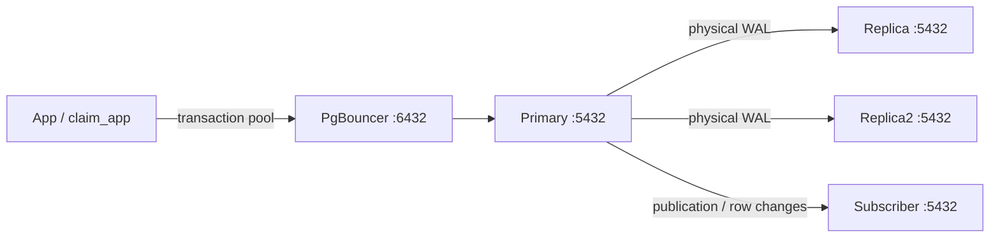

# Module 8 — Setup from Scratch: วางแผน → ตั้งค่า → ทดสอบ

อ้างอิง [คู่มือ Module 8 ฉบับเต็ม](../../module-08-replication.md) และ configuration ที่ใช้จริงใน repo นี้ รันคำสั่ง `make` จาก **root ของ `postgres-practices`** ส่วนบล็อก SQL ให้รันใน psql ของ node ที่ระบุ

เริ่มด้วย **Primary + Replica + PgBouncer** แล้วเพิ่ม Replica2 และ Logical Subscriber ตามลำดับ ใช้ Docker project/volumes ใหม่สำหรับการเริ่มจากศูนย์ และเก็บชุดเดิมไว้หากมีข้อมูลอยู่แล้ว



พอร์ตในภาพเป็น **พอร์ตภายใน Docker** ทุก PostgreSQL ใช้ 5432 ส่วน host ใช้พอร์ตคนละชุดตามขั้นที่ 1

## Step 1 — วางแผนก่อนตั้งค่า

| เรื่องที่ต้องตัดสินใจ | แผนของ Workshop นี้ |
| --- | --- |
| เครื่องที่รัน Docker | Laptop หรือเครื่อง Linux หลัง SSH; `127.0.0.1` หมายถึงเครื่องนั้น |
| PostgreSQL version | Physical nodes ใช้ PostgreSQL 18 image/digest เดียวกันตาม Compose |
| ขอบเขตข้อมูล | Database `claimsure`, schema `insurance` ใน project นี้ แยกจาก `claimsure_xx` และ Supabase |
| Project / storage | แต่ละกลุ่มใช้ `COMPOSE_PROJECT_NAME` และ named volumes ของตน |
| สิทธิ์ | `postgres` ดูแล Lab; `replicator` ส่ง WAL/อ่าน published tables; `claim_app` ทดสอบ app/RLS |
| Commit / RPO | เริ่ม asynchronous; ยอมรับว่า commit ล่าสุดที่ยังไม่ส่งถึง standby อาจสูญหายเมื่อ primary เสีย |
| WAL / disk | เผื่อพื้นที่ระหว่าง standby หยุด และติดตาม inactive slots / retained WAL |
| Pool connections | คิด backend budget ต่อคู่ user/database และเผื่อ SQL admin connections |
| Backup / failover | เตรียม backup/restore และ runbook แยก; DELETE ผิดสามารถตามไปถึง physical replicas ได้ด้วย |

จอง host ports ที่ว่างไว้ครบห้าพอร์ต แม้บาง service ยังไม่เปิด:

| Service | Host เริ่มต้น | ภายใน container | Named volume |
| --- | --- | --- | --- |
| `primary` | `127.0.0.1:55811` | 5432 | `primary_data` |
| `replica` | `127.0.0.1:55812` | 5432 | `replica_data` |
| `replica2` | `127.0.0.1:55813` | 5432 | `replica2_data` |
| `subscriber` | `127.0.0.1:55814` | 5432 | `subscriber_data` |
| `pgbouncer` | `127.0.0.1:55820` | 6432 | ไม่มี database volume; auth file อยู่ใน tmpfs |

ชื่อ volumes จริงมี Compose project เป็น prefix และ `PGDATA` ของ PostgreSQL ในชุดนี้คือ `/var/lib/postgresql/18/docker` หาก Docker อยู่บน server ให้ใช้ psql บน server หรือ SSH tunnel ตาม [CLI cheatsheet](workshop-command-line-th.md)

## Step 2 — จำให้ได้ว่า Configuration อยู่ตรงไหน

ทุก path ฝั่ง repo ในตารางอยู่ใต้ `labs/module08-replication/`:

| ไฟล์ | ตั้งอะไร / ใช้เมื่อไร |
| --- | --- |
| `.env` จาก [`.env.example`](../../module08-replication/.env.example) | Project name, host ports, admin/replication/app passwords |
| [`compose.yaml`](../../module08-replication/compose.yaml) | Images, port mapping, volumes, network, healthchecks, profiles และลำดับ dependencies |
| [`config/postgresql.conf`](../../module08-replication/config/postgresql.conf) | WAL, senders/slots, memory, connections และ standby query settings; mount เป็น `/lab/config/postgresql.conf` |
| [`config/pg_hba.conf`](../../module08-replication/config/pg_hba.conf) | ใครเชื่อมจากไหน ด้วย auth method ใด; `hba_file` ใน PostgreSQL config ชี้มาที่ไฟล์นี้ |
| [`init/01-replication.sh`](../../module08-replication/init/01-replication.sh) | สร้าง roles, grants, RLS และข้อมูลตัวอย่าง **เฉพาะตอน Primary volume ว่าง** |
| [`sql/schema.sql`](../../module08-replication/sql/schema.sql) | DDL ของ `insurance.claim` / `claim_payment`; ใช้เตรียม Subscriber ด้วย |
| [`node-entrypoint.sh`](../../module08-replication/node-entrypoint.sh) | Clone standby ที่ว่างด้วย base backup และสร้าง passfile ก่อน start |
| [`config/pgbouncer.ini`](../../module08-replication/config/pgbouncer.ini) | Backend destination, pool mode, pool limits และ auth file location |
| [`pgbouncer-entrypoint.sh`](../../module08-replication/pgbouncer-entrypoint.sh) | สร้าง `/tmp/m8-pgbouncer/users.txt` จาก secrets ใน environment ตอนเริ่ม Pooler |

หลัง clone จะมี `$PGDATA/standby.signal` และ recovery settings ใน `$PGDATA/postgresql.auto.conf` เช่น `primary_conninfo` / `primary_slot_name` ส่วน replication passfile อยู่ที่ `/var/lib/postgresql/replication.pgpass` สิทธิ์ 0600 ตัว entrypoint สร้างให้ ไม่ต้องใส่รหัสจริงลงไฟล์ config ใน repo

## Step 3 — ตรวจเครื่องและสร้าง .env

```bash
docker version
docker compose version
python3 --version
make --version
make lab8-init
```

ต้องมี Docker daemon ทำงาน, Compose v2 และ Python 3.10+ จากนั้นเปิด `labs/module08-replication/.env` แล้วตั้ง project/ports ของตน ตัวอย่างนี้ **แทน `xx` ด้วยเลขที่ได้รับก่อนเริ่ม**:

```dotenv
COMPOSE_PROJECT_NAME=postgres-practices-m8_xx
M8_PRIMARY_PORT=55811
M8_REPLICA_PORT=55812
M8_REPLICA2_PORT=55813
M8_SUBSCRIBER_PORT=55814
M8_POOL_PORT=55820
```

`init` สร้าง `M8_ADMIN_PASSWORD`, `M8_REPLICATION_PASSWORD`, `M8_APP_PASSWORD` ให้แล้วและเก็บไฟล์สิทธิ์ 0600 ถ้ามี `.env` อยู่จะเก็บค่าเดิมไว้ เก็บไฟล์นี้คู่กับ volumes; การแก้รหัสใน `.env` อย่างเดียวไม่ได้เปลี่ยนรหัสใน database ที่สร้างไว้แล้ว

ถ้ามี `.env` รุ่นเก่า `pg1/pg2/pg3` ให้ใช้ขั้นเปลี่ยน environment ในคู่มือเต็ม ไม่ลบ credentials/volumes เดิมเพื่อเริ่มใหม่

## Step 4 — ตรวจ PostgreSQL, HBA และสิทธิ์ก่อนเปิด

Template ตั้งไว้แล้ว ให้ตรวจเหตุผลของค่าหลักใน `config/postgresql.conf`:

| ค่าในชุด Lab | เหตุผล |
| --- | --- |
| `listen_addresses = '*'`, `port = 5432` | รับ connection ภายใน Docker network; host port mapping อยู่ใน Compose |
| `wal_level = logical` | รองรับ physical streaming และ publication ใน 8D; ถ้าทำเฉพาะ physical ใช้ `replica` ได้ |
| `max_wal_senders = 8` | เผื่อ streaming, base backup และ logical connections |
| `max_replication_slots = 8` | เผื่อสอง physical slots และ logical/synchronization slots |
| `hot_standby = on` | อ่านข้อมูลระหว่างเป็น physical standby |
| `synchronous_commit = on`, `synchronous_standby_names = ''` | Commit รอ local WAL แต่ยังไม่รอ standby จึงเป็น async ในแผนนี้ |
| `wal_keep_size = 64MB`, `max_slot_wal_keep_size = 256MB` | ค่าขนาดเล็กสำหรับทดลอง retention; ต้องตรวจ slot validity และ disk ระหว่าง outage |

`wal_keep_size` ไม่ใช่เพดานการใช้ disk ของ WAL และ slot retention limit ถูกประเมินที่ checkpoint จึงไม่ใช่การรับประกันว่า directory จะไม่เกินตัวเลขนั้น ค่าชุดนี้เป็นขนาด Lab; วาง disk budget จากอัตรา WAL และระยะ outage ที่รับได้เมื่อออกแบบระบบจริง

ใน `config/pg_hba.conf` ต้องมีทั้ง rule สำหรับ **replication protocol** ของ `replicator` และ rule สำหรับ connection เข้า database `claimsure` ซึ่งใช้กับ logical initial copy การอนุญาต HBA ยังต้องประกอบกับ role/grants:

| Login | สิทธิ์ที่ต้องมี |
| --- | --- |
| `replicator` | LOGIN + REPLICATION, CONNECT, schema USAGE และ SELECT บน published tables; Lab มี SELECT policy สำหรับอ่าน claim ตอน replication |
| `claim_app` | LOGIN, CONNECT, schema USAGE และ SELECT ที่อยู่ภายใต้ tenant RLS |
| `postgres` | Admin สำหรับตรวจ/เตรียม Lab |

HBA ใน Lab ใช้ SCRAM สำหรับ TCP และอนุญาต address `all` ภายใน network แยก หากวางบนหลาย host ให้ใช้ IP/CIDR ของ clients/replicas ตามจริงและออกแบบ TLS/firewall ด้วย; `local ... trust` ใน template ใช้กับ Unix socket ภายใน containers

## Step 5 — เปิดชุดหลักและเข้าใจลำดับ Bootstrap

```bash
make lab8-config
make lab8-pull
make up
make node-status
```

**ผ่านเมื่อ:** `primary`, `replica`, `pgbouncer` running/healthy; `replica2` และ `subscriber` ยังไม่ต้องเปิด

สิ่งที่เกิดขึ้นตามลำดับเมื่อ volumes ว่าง:

```text
Primary: initdb → สร้าง roles + schema/grants/RLS + seed
Replica: สร้าง replica_slot บน Primary
         → pg_basebackup -R -X stream --slot=replica_slot
         → standby.signal + primary_conninfo/primary_slot_name
         → start PostgreSQL → เริ่ม WAL receiver
Pooler:  สร้าง runtime auth file → ต่อไป primary:5432
```

หากทำเองโดยไม่ใช้ helper ก็ต้องเตรียม Primary/HBA/role/slot ก่อน clone **ลง PGDATA ว่างของ standby ที่หยุดอยู่** แล้วจึง start standby ใน repo นี้ `make up` ทำลำดับดังกล่าวให้แล้ว การเปิดซ้ำใช้ข้อมูลเดิม ไม่รัน init หรือ clone ทับ

## Step 6 — ทดสอบ Physical Replication (8A)

```bash
make sql-m8
make lab8-verify
make psql
```

ใน psql ของ **Primary**:

```sql
SELECT pg_is_in_recovery(); -- f
SELECT application_name, state, sync_state, sent_lsn, flush_lsn, replay_lsn
FROM pg_stat_replication;
SELECT slot_name, slot_type, active FROM pg_replication_slots;
SELECT rolname, rolcanlogin, rolreplication, rolsuper, rolbypassrls
FROM pg_roles WHERE rolname IN ('replicator', 'claim_app');
\q
```

**ผ่านเมื่อ:** sender `replica` เป็น `streaming`, `replica_slot` เป็น physical/active, `replicator` มี REPLICATION แต่ไม่เป็น superuser และ `claim_app` ไม่มี BYPASSRLS

เปิด **Replica**:

```bash
make replica
```

```sql
SELECT pg_is_in_recovery(); -- t
SELECT status, sender_host, slot_name FROM pg_stat_wal_receiver;
SELECT count(*) FROM insurance.claim; -- ชุดตั้งต้น 3
BEGIN;
CREATE TABLE lab_m8.must_be_readonly(id integer);
-- Expected: SQLSTATE 25006 / read-only transaction
ROLLBACK;
\q
```

`make lab8-verify` ต้องขึ้น PASS: ตัวตรวจเขียน probe จริงบน Primary, รอให้ standby replay, อ่าน probe และยืนยันว่า standby เขียนไม่ได้ การเชื่อมต่อได้หรือ healthcheck ผ่านยังไม่ครอบคลุมการทดสอบนี้

## Step 7 — เพิ่ม Replica2 แล้วทดสอบ Outage / Catch-up (8B–8C)

```bash
make node-add
make lab8-verify
make sql-m8
make node-down NODE=replica2
make sql-m8
make lab8-wal
make node-up NODE=replica2
make lab8-verify
make sql-m8
```

| จังหวะ | ผลที่ต้องเห็น |
| --- | --- |
| หลัง node-add | สอง physical senders; `replica_slot` / `replica2_slot` active |
| หลัง node-down | sender replica2 หาย แต่ `replica2_slot` ยังอยู่และ inactive |
| ระหว่างหยุด | `lab8-wal` เพิ่ม audit events 1,000 แถว; ดู retained WAL ของ slot |
| หลัง node-up | sender กลับ streaming, slot active, probe replay ผ่าน |

ใช้ `make psql` และ `make replica2` แยกกัน แล้วเทียบผล query นี้ **หลัง `lab8-verify` ผ่าน**:

```sql
SELECT count(*) FROM insurance.audit_event WHERE action = 'NODE_DOWN_WAL';
```

จำนวนต้องตรงกันทั้งสองฝั่ง ถ้าเริ่มใหม่และสร้าง WAL ครั้งเดียวจะเป็น 1,000 แถว; การสั่งซ้ำเพิ่มอีกครั้งละ 1,000 ถ้า standby หยุดนานจน slot/WAL ที่ต้องใช้ไม่พร้อม ให้ตรวจ slot state และวางแผน clone ใหม่ การ promote ไม่ใช่วิธีซ่อม replica ที่ตามไม่ทัน

## Step 8 — เปิด Logical Subscriber (8D)

```bash
make logical-up
make logical-verify
make subscriber
```

Helper สร้าง publication `claims_reporting` บน Primary → เปิด Subscriber → สร้าง matching tables จาก `sql/schema.sql` → สร้าง subscription `claims_reporting_sub` → รอ initial copy

ใน psql ของ **Subscriber**:

```sql
SELECT pg_is_in_recovery(); -- f: เป็นอีก cluster
SELECT system_identifier FROM pg_control_system();
SELECT count(*) FROM insurance.claim;         -- ชุดตั้งต้น 3
SELECT count(*) FROM insurance.claim_payment; -- ชุดตั้งต้น 3
SELECT to_regclass('insurance.audit_event');  -- NULL: ไม่ได้ publish ตารางนี้
SELECT subname, received_lsn, latest_end_lsn FROM pg_stat_subscription;
\q
```

**ผ่านเมื่อ:** initial data ครบทั้งสองตารางและ `logical-verify` ผ่าน INSERT/UPDATE/DELETE จริง โดย system identifier ของ Subscriber ต่างจาก Primary ส่วน physical replicas มี identifier เดียวกับ Primary

Logical replication ไม่ส่ง DDL, roles, RLS policies และ sequence state ให้เอง จึงต้องเตรียม Subscriber แยก รวมถึงสิทธิ์ของ app หากจะให้ app ใช้งาน Subscriber นี้

## Step 9 — ตั้งและทดสอบ PgBouncer / App Login (8E)

ตรวจ `config/pgbouncer.ini`: `claimsure = host=primary port=5432 dbname=claimsure`, `pool_mode = transaction`, `listen_port = 6432` และ runtime `auth_file` ตามตาราง Step 2

`max_client_conn = 1000` เป็นเพดาน client ที่ Pooler รับ ส่วน `default_pool_size = 40` และ `reserve_pool_size = 10` คิด **ต่อ user/database pool** ต้องวาง SQL backend budget ให้เหมาะกับ PostgreSQL `max_connections = 60` และเหลือที่ให้ admin/งานอื่น

```bash
make pool-verify
make pgbouncer
```

ใน psql ที่ Login เป็น **claim_app ผ่าน Pooler**:

```sql
SELECT session_user, current_user; -- claim_app ทั้งคู่
SELECT count(*) FROM insurance.claim; -- 0: ยังไม่มี context
BEGIN;
SET LOCAL app.tenant_id = '1';
SELECT claim_no, tenant_id FROM insurance.claim ORDER BY claim_no; -- 2 แถว
COMMIT;
SELECT count(*) FROM insurance.claim; -- 0: context จบพร้อม transaction
\q
```

**ผ่านเมื่อ:** `pool-verify` ยืนยันโหมด transaction, Login จริง และ tenant 1/2 เห็นข้อมูลตาม RLS ใช้ SET LOCAL ใน transaction ของแต่ละ request; tenant GUC ใน Lab เป็น context จำลองที่ SQL client ตั้งเองได้

ถ้ามี psql บนเครื่องที่รัน Docker สามารถตรวจ Pooler admin DB ได้ด้วย `psql -X -W -h 127.0.0.1 -p 55820 -U postgres -d pgbouncer` แล้วใช้ `SHOW CONFIG;`, `SHOW POOLS;`, `SHOW STATS;` ใช้รหัส `M8_ADMIN_PASSWORD` และพอร์ตจริงใน `.env`

## Step 10 — เปลี่ยน Configuration และเปิดต่ออย่างถูกวิธี

| สิ่งที่แก้ | วิธีให้มีผล |
| --- | --- |
| Host ports / environment ใน `.env` | รัน `up` เพื่อ recreate services ที่ config เปลี่ยน; optional nodes ใช้ `node-add` / `logical-up` เพิ่มด้วย; restart อย่างเดียวไม่อ่าน environment ใหม่ |
| `pg_hba.conf` | เรียก `SELECT pg_reload_conf();` บนแต่ละ PostgreSQL instance ที่ต้องโหลดค่า แล้วทดสอบ connection ใหม่ |
| PostgreSQL setting | ตรวจ `pg_settings.context` และ `pending_restart`; ค่า context `postmaster` ต้อง restart |
| Init script / seed / grants | ทำงานตอน Primary volume ว่างเท่านั้น; ฐานเดิมต้อง apply SQL/migration ตามสิทธิ์อย่างชัดเจน |
| Password ของฐานเดิม | เปลี่ยน credentials ที่ database และ Pooler ให้ตรงกันตามแผน rotation; การแก้ `.env` อย่างเดียวไม่ ALTER ROLE |
| PgBouncer ini | Reload จาก admin DB เมื่อรองรับ หรือ recreate Pooler; ทดสอบ `SHOW CONFIG` และ `pool-verify` อีกครั้ง |

ตรวจค่าที่ PostgreSQL ใช้จริงใน `make psql`:

```sql
SHOW config_file;
SHOW hba_file;
SHOW data_directory;
SELECT name, setting, context, pending_restart
FROM pg_settings
WHERE name IN ('wal_level','max_wal_senders','max_replication_slots',
              'synchronous_commit','synchronous_standby_names');
SELECT line_number, error FROM pg_hba_file_rules WHERE error IS NOT NULL;
```

ถ้าต้อง restart ทุก PostgreSQL node ของ Lab แบบควบคุม:

```bash
make stop
make up
make node-add        # ถ้าเคยเปิด Replica2
make logical-up      # ถ้าเคยเปิด Subscriber
make lab8-verify
make logical-verify  # เมื่อเลือกทำ 8D
make pool-verify
```

ใช้ `make down` เมื่อต้องการลบ containers/network โดยเก็บ volumes และ `.env` ไว้เปิดต่อ คำสั่งทั้งหมดนี้อ้างถึง project ของ Lab 8 ตาม `.env`

## Checklist ก่อนถือว่า Setup เสร็จ

- [ ] จด project, endpoints, credentials location และ volume ownership แล้ว
- [ ] Primary เขียนได้; physical standbys recovery=true และปฏิเสธ writes
- [ ] พิสูจน์ replay ด้วย `lab8-verify` ทั้งก่อนและหลัง replica outage
- [ ] อธิบายความต่างระหว่าง sender connection, slot และ retained WAL ได้
- [ ] ถ้าเลือก 8D: Subscriber มี cluster ID แยก และ logical row-change tests ผ่าน
- [ ] Pooler ใช้ transaction mode และทดสอบด้วย claim_app/RLS จริง
- [ ] รู้วิธี stop/resume พร้อมเก็บข้อมูล และมีแผน backup/restore แยก
- [ ] หากจะทำ primary failover ต้องมี detect → fence → promote → route → verify → rejoin เพิ่ม; Lab ชุดนี้ยัง route ไป `primary` คงที่

**เจอปัญหาให้ไล่:** container status → project/port mapping → config ที่โหลดจริง → role/password/HBA → slot/receiver/sender → replay ของข้อมูลจริง ดู SQL และขั้นแก้ปัญหาเพิ่มเติมใน [คู่มือเดิม](../../module-08-replication.md)

อ้างอิงทางการ: [PostgreSQL replication settings](https://www.postgresql.org/docs/18/runtime-config-replication.html), [Streaming replication](https://www.postgresql.org/docs/18/warm-standby.html#STREAMING-REPLICATION), [PgBouncer configuration](https://www.pgbouncer.org/config.html)
