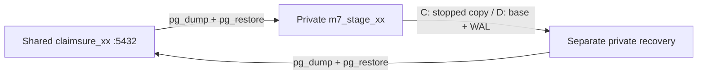

# Module 7 — Manual Lab C and D with original PostgreSQL commands

No `run-lab07.sh` invocation is required for this walkthrough. Run each numbered block in order in **one Bash terminal inside your own student SSH session**. Stop immediately on any command error, failed archive check or unexpected row set; fix the cause before continuing. All shared changes target only your own disposable `lab_m7_practice` schema. The private source and recovery clusters use a fresh `~/m7-manual.*` directory, separate from the wrappers' `~/m7`.

Paired slides: Module 7 (ส่วนแยกในต้นฉบับ: `docs/slides/module-07-backup-recovery.md`).

## Prerequisites and where to set things

- PostgreSQL **18** server/client tools, Bash, GNU coreutils; do not run initdb as root. Existing shared classroom database/credentials are required; students do not need sudo, Docker or shared-superuser access.
- M1 sets `STUDENT_NO` once (xx is a placeholder for your assigned number) and prompts privately for the assigned database password. M2 sets the shared host/port and derived connection arguments. Normal GUI connections use the shared host, `claimsure_xx`, `student_xx`, port 5432.
- Set `PG_BIN` to the server/client directory supplied by the instructor **before M1** if it is not `/usr/lib/postgresql/18/bin`. The optional classroom bundle uses `/usr/local/lib/claimsure-postgres18/usr/lib/postgresql/18/bin`; it also needs its matching library path (example below). Do not install/start a host service just to obtain the tools.

```bash
# OPTIONAL ONLY: classroom runtime bundle, before M1 (not for native packages).
export PG_BIN=/usr/local/lib/claimsure-postgres18/usr/lib/postgresql/18/bin
for library_dir in /usr/local/lib/claimsure-postgres18/usr/lib/*-linux-gnu; do
  test ! -d "$library_dir" || export LD_LIBRARY_PATH="$library_dir${LD_LIBRARY_PATH:+:$LD_LIBRARY_PATH}"
done
```

| Setting / file | Set it where | Activation |
| --- | --- | --- |
| Student number, credentials, arrays | Student Bash terminal, M1/M2 | Same terminal for every block; Bash variables do not exist inside a GUI SQL editor |
| `wal_level`, `archive_mode`, source socket/port | `$PRIMARY/manual-lab.conf`, included by `$PRIMARY/postgresql.conf` | Set before M4 first start; changing these later requires private-cluster restart |
| `archive_command` / archive path | Same source file | Before first start here; later edit + `pg_ctl -D "$PRIMARY" reload` is sufficient for this parameter |
| Recovery socket/port, `archive_mode=off` | `$C_RECOVERY/postgresql.auto.conf` or `$D_RECOVERY/postgresql.auto.conf` | Write into copied target before first start; never modify the retained backup copy |
| `restore_command`, target and `recovery.signal` | D recovery directory, D5 | Configure before starting archive recovery; merely reloading a running primary does not begin PITR |

The private `labadmin` role is created by initdb only in the private cluster. No role is added to the shared server. Private ports are 5900+xx and 6000+xx on a private Unix socket (source port = 5900 + student number; recovery port = 6000 + student number). Wrapper ports remain 5700+xx and 5800+xx. The private path is absolute without spaces/quotes, as on the classroom accounts. Base, WAL archive and recovery must belong to the same private cluster; never mix in the shared Docker server's WAL.

## Flow and expected evidence

### What the original commands do

| Command / argument | Meaning in these labs |
| --- | --- |
| `initdb -D ... -U labadmin` | Create the private cluster files and its private bootstrap superuser |
| `pg_ctl -D ... -m fast -w stop` / `pg_ctl -D ... -w start` | Control the specified private data directory; wait for completion |
| `pg_dump -Fc --schema=... -f ...` | Export one selected schema to a custom-format logical archive |
| `pg_restore --single-transaction --exit-on-error` | Restore atomically and fail on errors |
| `--clean --if-exists --schema=lab_m7_practice` | Replace the lab schema's selected objects from this complete practice archive |
| `pg_basebackup -D ... -Fp -Xs -c fast -P` | Plain physical cluster backup, streamed startup WAL, fast checkpoint and progress |
| `pg_verifybackup ...` | Validate physical base files against their manifest; later archived WAL is checked separately |
| `pg_create_restore_point(...)` | Record a named cluster WAL position after the staged row-4 transaction commits |
| `pg_switch_wal()` | Close the current WAL segment so archiving can process it; still wait for the archive file |
| Archive `%p` / `%f` | Source WAL path / segment filename; recovery `restore_command` copies archived `%f` to requested `%p` |

| Lab | Flow | Expected shared row IDs |
| --- | --- | --- |
| C | Capture → private stage → stop/copy/start → damage shared → recover copy → export/import | 1,2 → 1,3 → 1,2 (350.00) |
| D | Reset/stage → complete base → shared row4 + stage sync → mark/archive → damage + stage sync/archive → recover/pause → export/import | 1,2 → 1,2,4 → 1,3,4 → 1,2,4 (750.00) |

SQL is sent with `psql` in these Bash blocks, so copy the entire block including any heredoc terminator (`SQL` or `CONF`). Blocks using `pg_restore --clean --schema=lab_m7_practice` replace only the complete practice schema from the lab's own archive, in one transaction. Do not substitute an unrelated archive. Use the same session and do not run helper actions concurrently against this practice table.


## M0 — Lab C/D without wrappers: follow the real data flow



| Where | Login | Purpose |
| --- | --- | --- |
| Student SSH Terminal / Bash | Linux `studentxx` | All command blocks on the following pages |
| Shared PostgreSQL | DB `student_xx` | Own `claimsure_xx`, direct port 5432 |
| Private PostgreSQL | DB `labadmin` | Staging / physical recovery, own Unix socket |

Start **M1–M5 → C1–C5 → D1–D7 → Z1** in one Bash terminal. Every page has a matching block in `module07-manual-labs-c-d.md`.


## M1 — M1 · Set your account, PostgreSQL tools and password

**Run as your own Linux student account, without sudo.** Set your own number once:


<!-- MANUAL-BLOCK M1 -->
```bash
umask 077
STUDENT_NO=xx                       # CHANGE to your own 01–20
PG_BIN="${PG_BIN:-/usr/lib/postgresql/18/bin}"
export PATH="$PG_BIN:$PATH"
postgres --version                 # must be PostgreSQL 18
pg_dump --version
read -r -s -p "DB password for student_$STUDENT_NO: " PGPASSWORD
printf '\n'
export PGPASSWORD
```


## M2 — M2 · Set paths, ports and explicit connection arguments

**Same Bash terminal:** arrays below contain connection flags, not script calls.


<!-- MANUAL-BLOCK M2 -->
```bash
MAIN="claimsure_$STUDENT_NO"; STAGE="m7_stage_$STUDENT_NO"
SHARED_HOST="${LAB_DB_HOST:-127.0.0.1}"
SHARED_PORT="${M7_DB_PORT:-5432}"
LAB="$(mktemp -d "$HOME/m7-manual.XXXXXXXX")"
PRIMARY="$LAB/primary"; SOCKET="$LAB/sock"; WAL="$LAB/wal"
BACKUPS="$LAB/backups"; SOURCE_PORT=$((5900 + 10#$STUDENT_NO))
RECOVERY_PORT=$((6000 + 10#$STUDENT_NO))
mkdir -p "$SOCKET" "$WAL" "$BACKUPS" "$LAB/recovery"
SHARED=(-h "$SHARED_HOST" -p "$SHARED_PORT" -U "student_$STUDENT_NO")
PRIVATE=(-h "$SOCKET" -p "$SOURCE_PORT" -U labadmin)
RECOVERED=(-h "$SOCKET" -p "$RECOVERY_PORT" -U labadmin)
printf 'SAVE this workspace path: %s\n' "$LAB"
psql -X -v ON_ERROR_STOP=1 "${SHARED[@]}" -d "$MAIN" -c '\conninfo'
```


## M3 — M3 · Initialize a private cluster and write its config

**Edit location:** `$PRIMARY/manual-lab.conf`; included by `$PRIMARY/postgresql.conf`. No shared-server file is edited.


<!-- MANUAL-BLOCK M3 -->
```bash
initdb -D "$PRIMARY" -U labadmin --auth-local=trust --auth-host=reject \
  --encoding=UTF8 --locale=C
printf "\ninclude = 'manual-lab.conf'\n" >> "$PRIMARY/postgresql.conf"
cat > "$PRIMARY/manual-lab.conf" <<CONF
listen_addresses = ''
unix_socket_directories = '$SOCKET'
unix_socket_permissions = 0700
port = $SOURCE_PORT
shared_buffers = '32MB'
max_connections = 10
wal_level = replica
max_wal_senders = 4
archive_mode = on
archive_command = 'test ! -f $WAL/%f && cp %p $WAL/%f'
archive_timeout = '60s'
CONF
```


## M4 — M4 · Start staging and verify where the settings come from

`labadmin` is a superuser **only in this private cluster**. It uses trusted local authentication behind a private socket directory.

M3 writes settings before first start. Later changes to `wal_level`, `archive_mode`, socket directory or port require a private-cluster restart; `archive_command` alone can use reload. Shared server configuration stays unchanged.


<!-- MANUAL-BLOCK M4 -->
```bash
pg_ctl -D "$PRIMARY" -l "$LAB/primary.log" -w start
createdb "${PRIVATE[@]}" -T template0 "$STAGE"
psql -X -v ON_ERROR_STOP=1 "${PRIVATE[@]}" -d "$STAGE" <<'SQL'
SHOW config_file;
SELECT name,setting,context,sourcefile,pending_restart
FROM pg_settings WHERE name IN
 ('port','listen_addresses','wal_level','archive_mode','archive_command');
SELECT system_identifier FROM pg_control_system();
SQL
```


## M5 — M5 · Prepare repeatable practice rows with native SQL

Create a small SQL file for both labs; running it resets **only the disposable practice table** in your selected own database.


<!-- MANUAL-BLOCK M5 -->
```bash
cat > "$LAB/seed.sql" <<'SQL'
BEGIN;
CREATE SCHEMA IF NOT EXISTS lab_m7_practice;
CREATE TABLE IF NOT EXISTS lab_m7_practice.claim_event (
 event_id integer PRIMARY KEY, description text NOT NULL,
 amount numeric(12,2) NOT NULL
);
TRUNCATE lab_m7_practice.claim_event;
INSERT INTO lab_m7_practice.claim_event VALUES
 (1,'CLAIM_REGISTERED',100.00),(2,'CLAIM_APPROVED',250.00);
COMMIT;
TABLE lab_m7_practice.claim_event;
SQL
psql -X -v ON_ERROR_STOP=1 "${SHARED[@]}" -d "$MAIN" -f "$LAB/seed.sql"
```


## C1 — Lab C1 · Capture shared practice data into private staging

**Flow:** Shared `student_xx` → custom archive → private `labadmin`. Expected staging IDs: **1,2**.


<!-- MANUAL-BLOCK C1 -->
```bash
pg_dump "${SHARED[@]}" -d "$MAIN" -Fc --no-owner --no-acl \
  --schema=lab_m7_practice -f "$BACKUPS/c-stage.dump"
pg_restore --list "$BACKUPS/c-stage.dump"
psql -X -v ON_ERROR_STOP=1 "${PRIVATE[@]}" -d "$STAGE" \
  -c 'CREATE SCHEMA IF NOT EXISTS lab_m7_practice;'
pg_restore "${PRIVATE[@]}" -d "$STAGE" --single-transaction \
  --exit-on-error --no-owner --no-acl --schema=lab_m7_practice \
  --clean --if-exists "$BACKUPS/c-stage.dump"
psql -X -v ON_ERROR_STOP=1 "${PRIVATE[@]}" -d "$STAGE" \
  -c 'TABLE lab_m7_practice.claim_event;'
```


## C2 — Lab C2 · Stop, copy the entire private cluster, restart

**Only private staging stops.** The shared server on 5432 stays running. This is a cold-copy snapshot exercise.


<!-- MANUAL-BLOCK C2 -->
```bash
C_BACKUP="$BACKUPS/c-snapshot"
mkdir "$C_BACKUP"
pg_ctl -D "$PRIMARY" -m fast -w stop
cp -a "$PRIMARY" "$C_BACKUP/data"
pg_ctl -D "$PRIMARY" -l "$LAB/primary.log" -w start
(cd "$C_BACKUP"; find data -type f -print0 | sort -z | \
  xargs -0 sha256sum > SHA256SUMS)
(cd "$C_BACKUP"; sha256sum --quiet -c SHA256SUMS)
```


## C3 — Lab C3 · Commit loss on shared data, then copy the snapshot

Expected shared IDs after COMMIT: **1,3**. Restore into a **new directory**, not over the running source.


<!-- MANUAL-BLOCK C3 -->
```bash
psql -X -v ON_ERROR_STOP=1 "${SHARED[@]}" -d "$MAIN" <<'SQL'
BEGIN;
DELETE FROM lab_m7_practice.claim_event WHERE event_id=2;
INSERT INTO lab_m7_practice.claim_event VALUES (3,'AFTER_LOSS',999.00);
COMMIT;
SELECT * FROM lab_m7_practice.claim_event ORDER BY event_id;
SQL
C_RECOVERY="$LAB/recovery/c"
(cd "$C_BACKUP"; sha256sum --quiet -c SHA256SUMS)
cp -a "$C_BACKUP/data" "$C_RECOVERY"
```


## C4 — Lab C4 · Configure the recovered copy before first start

**Write:** `$C_RECOVERY/postgresql.auto.conf`. These overrides beat the copied source config. Snapshot restore needs no `recovery.signal`.


<!-- MANUAL-BLOCK C4 -->
```bash
cat > "$C_RECOVERY/postgresql.auto.conf" <<CONF
listen_addresses = ''
unix_socket_directories = '$SOCKET'
unix_socket_permissions = 0700
port = $RECOVERY_PORT
archive_mode = off
archive_command = ''
archive_library = ''
CONF
pg_ctl -D "$C_RECOVERY" -l "$LAB/c-recovery.log" -w start
psql -X -v ON_ERROR_STOP=1 "${RECOVERED[@]}" -d "$STAGE" \
  -c 'SELECT pg_is_in_recovery(); TABLE lab_m7_practice.claim_event;'
```


## C5 — Lab C5 · Export recovered rows and import to the shared database

The physical recovery contains IDs **1,2**. The final logical import makes them visible again in **your normal shared GUI connection**.


<!-- MANUAL-BLOCK C5 -->
```bash
pg_dump "${RECOVERED[@]}" -d "$STAGE" -Fc --no-owner --no-acl \
  --schema=lab_m7_practice -f "$BACKUPS/c-recovered.dump"
pg_restore --list "$BACKUPS/c-recovered.dump"
pg_restore "${SHARED[@]}" -d "$MAIN" --single-transaction \
  --exit-on-error --no-owner --no-acl --schema=lab_m7_practice \
  --clean --if-exists "$BACKUPS/c-recovered.dump"
psql -X -v ON_ERROR_STOP=1 "${SHARED[@]}" -d "$MAIN" \
  -c 'SELECT current_database(),current_user; TABLE lab_m7_practice.claim_event;'
pg_ctl -D "$C_RECOVERY" -m fast -w stop
```


## D1 — Lab D1 · Reset, stage, then finish the physical base backup

**Order matters:** baseline **1,2** → complete base → later row 4 → target → damage. Stage is refreshed explicitly.


<!-- MANUAL-BLOCK D1 -->
```bash
psql -X -v ON_ERROR_STOP=1 "${SHARED[@]}" -d "$MAIN" -f "$LAB/seed.sql"
pg_dump "${SHARED[@]}" -d "$MAIN" -Fc --no-owner --no-acl \
  --schema=lab_m7_practice -f "$BACKUPS/d-base-stage.dump"
pg_restore "${PRIVATE[@]}" -d "$STAGE" --single-transaction \
  --exit-on-error --no-owner --no-acl --schema=lab_m7_practice \
  --clean --if-exists "$BACKUPS/d-base-stage.dump"
D_BASE="$BACKUPS/d-base"
mkdir "$D_BASE"
pg_basebackup "${PRIVATE[@]}" -D "$D_BASE/data" -Fp -Xs -c fast -P
pg_verifybackup "$D_BASE/data"
```


## D2 — Lab D2 · Commit row 4 after the base and synchronize staging

Expected shared/staged IDs: **1,2,4**. Row 4 is the proof that recovery needs WAL **after** the base.


<!-- MANUAL-BLOCK D2 -->
```bash
psql -X -v ON_ERROR_STOP=1 "${SHARED[@]}" -d "$MAIN" -c \
 "INSERT INTO lab_m7_practice.claim_event VALUES (4,'AFTER_BASE_BEFORE_POINT',400.00);"
pg_dump "${SHARED[@]}" -d "$MAIN" -Fc --no-owner --no-acl \
  --schema=lab_m7_practice -f "$BACKUPS/d-point-stage.dump"
pg_restore "${PRIVATE[@]}" -d "$STAGE" --single-transaction \
  --exit-on-error --no-owner --no-acl --schema=lab_m7_practice \
  --clean --if-exists "$BACKUPS/d-point-stage.dump"
POINT="m7_${STUDENT_NO}_before_loss_$(date -u +%Y%m%dT%H%M%S)"
SEGMENT=$(psql -X -v ON_ERROR_STOP=1 "${PRIVATE[@]}" -d "$STAGE" -Atc \
  "SELECT pg_walfile_name(pg_create_restore_point('$POINT'));" )
printf '%s\n' "$POINT" > "$D_BASE/restore-point.name"
```


## D3 — Lab D3 · Close the WAL segment and wait for its archive

`pg_switch_wal()` requests a switch; successful SQL alone does not prove the archived file exists.


<!-- MANUAL-BLOCK D3 -->
```bash
psql -X -v ON_ERROR_STOP=1 "${PRIVATE[@]}" -d "$STAGE" \
  -c 'SELECT pg_switch_wal();'
for attempt in {1..30}; do
  test -s "$WAL/$SEGMENT" && break
  sleep 1
done
test -s "$WAL/$SEGMENT" || { echo 'STOP: inspect primary.log'; false; }
TARGET_TIME=$(psql -X -v ON_ERROR_STOP=1 "${PRIVATE[@]}" -d "$STAGE" \
  -Atc 'SELECT clock_timestamp();')
printf '%s\n' "$TARGET_TIME" > "$D_BASE/restore-point.time"
ls -l "$WAL/$SEGMENT"
```


## D4 — Lab D4 · Commit damage and archive staging WAL beyond the target

Expected shared/staged IDs: **1,3,4**. This later state must be in WAL so PITR can demonstrate excluding it.


<!-- MANUAL-BLOCK D4 -->
```bash
psql -X -v ON_ERROR_STOP=1 "${SHARED[@]}" -d "$MAIN" <<'SQL'
BEGIN;
DELETE FROM lab_m7_practice.claim_event WHERE event_id=2;
INSERT INTO lab_m7_practice.claim_event VALUES (3,'AFTER_LOSS',999.00);
COMMIT;
SQL
pg_dump "${SHARED[@]}" -d "$MAIN" -Fc --no-owner --no-acl \
  --schema=lab_m7_practice -f "$BACKUPS/d-after-loss.dump"
pg_restore "${PRIVATE[@]}" -d "$STAGE" --single-transaction \
  --exit-on-error --no-owner --no-acl --schema=lab_m7_practice \
  --clean --if-exists "$BACKUPS/d-after-loss.dump"
SEGMENT=$(psql -X -v ON_ERROR_STOP=1 "${PRIVATE[@]}" -d "$STAGE" \
  -Atc 'SELECT pg_walfile_name(pg_current_wal_insert_lsn());')
```


## D4b — Lab D4b · Confirm that the archive reaches past the target

The archive must remain available throughout recovery. Inspect failures before proceeding.


<!-- MANUAL-BLOCK D4b -->
```bash
psql -X -v ON_ERROR_STOP=1 "${PRIVATE[@]}" -d "$STAGE" \
  -c 'SELECT pg_switch_wal();'
for attempt in {1..30}; do
  test -s "$WAL/$SEGMENT" && break
  sleep 1
done
test -s "$WAL/$SEGMENT" || { echo 'STOP: archive incomplete'; false; }
psql -X -v ON_ERROR_STOP=1 "${PRIVATE[@]}" -d "$STAGE" \
  -c 'SELECT archived_count,last_archived_wal,failed_count,last_failed_wal FROM pg_stat_archiver;'
pg_verifybackup "$D_BASE/data"
D_RECOVERY="$LAB/recovery/d"
cp -a "$D_BASE/data" "$D_RECOVERY"
```


## D5 — Lab D5 · Write recovery settings in the copied target

**Edit only:** `$D_RECOVERY/postgresql.auto.conf`. Create `$D_RECOVERY/recovery.signal` **before starting**.


<!-- MANUAL-BLOCK D5 -->
```bash
cat > "$D_RECOVERY/postgresql.auto.conf" <<CONF
listen_addresses = ''
unix_socket_directories = '$SOCKET'
unix_socket_permissions = 0700
port = $RECOVERY_PORT
archive_mode = off
archive_command = ''
archive_library = ''
hot_standby = on
restore_command = 'cp $WAL/%f %p'
recovery_target_name = '$POINT'
recovery_target_timeline = 'current'
recovery_target_action = 'pause'
CONF
touch "$D_RECOVERY/recovery.signal"
pg_ctl -D "$D_RECOVERY" -l "$LAB/d-recovery.log" -w start
```


## D6 — Lab D6 · Wait for paused replay, then verify business rows

A successful connection is insufficient. Required: **in recovery + paused + IDs 1,2,4**.


<!-- MANUAL-BLOCK D6 -->
```bash
PAUSED=f
for attempt in {1..30}; do
  PAUSED=$(psql -X -v ON_ERROR_STOP=1 "${RECOVERED[@]}" -d "$STAGE" -Atc \
    "SELECT pg_get_wal_replay_pause_state()='paused';")
  test "$PAUSED" = t && break
  sleep 1
done
test "$PAUSED" = t || { echo 'STOP: inspect d-recovery.log'; false; }
psql -X -v ON_ERROR_STOP=1 "${RECOVERED[@]}" -d "$STAGE" -c \
 'SELECT pg_is_in_recovery(),pg_get_wal_replay_pause_state(),pg_last_xact_replay_timestamp();'
psql -X -v ON_ERROR_STOP=1 "${RECOVERED[@]}" -d "$STAGE" \
 -c 'SELECT * FROM lab_m7_practice.claim_event ORDER BY event_id;'
```


## D7 — Lab D7 · Export the paused result and import into claimsure_xx

Expected on shared port 5432: **1,2,4**, total **750.00**. Refresh GUI queries; end any older transaction.


<!-- MANUAL-BLOCK D7 -->
```bash
pg_dump "${RECOVERED[@]}" -d "$STAGE" -Fc --no-owner --no-acl \
  --schema=lab_m7_practice -f "$BACKUPS/d-recovered.dump"
pg_restore --list "$BACKUPS/d-recovered.dump"
pg_restore "${SHARED[@]}" -d "$MAIN" --single-transaction \
  --exit-on-error --no-owner --no-acl --schema=lab_m7_practice \
  --clean --if-exists "$BACKUPS/d-recovered.dump"
psql -X -v ON_ERROR_STOP=1 "${SHARED[@]}" -d "$MAIN" -c \
 'SELECT current_database(),current_user; SELECT * FROM lab_m7_practice.claim_event ORDER BY event_id; SELECT sum(amount) FROM lab_m7_practice.claim_event;'
```


## Z1 — After manual Labs C/D: stop only your private servers

Your restored shared data remains on 5432. Files are retained for review; the guided cleanup does not manage this separate manual workspace.


<!-- MANUAL-BLOCK Z1 -->
```bash
pg_ctl -D "$D_RECOVERY" -m fast -w stop
pg_ctl -D "$PRIMARY" -m fast -w stop
unset PGPASSWORD
printf 'Retained manual workspace: %s\n' "$LAB"
```


## Optional: recover by timestamp instead of name

After D7, stop the D recovery server. Copy the **original unchanged** `$D_BASE/data` to a NEW directory, e.g. `$LAB/recovery/d-time`. Repeat D5/D6 for that new directory with `recovery_target_time = '$TARGET_TIME'` **instead of** `recovery_target_name`; never configure both targets. `TARGET_TIME` was recorded with timezone after the named point and before the later staged loss. Keep `restore_command`, timeline `current`, action `pause`, and `recovery.signal`. Confirm replay paused and IDs 1,2,4 before exporting or importing. For another attempt create a fresh base, target and recovery directory; do not start an already-modified recovered copy as if it were the original base.

## How these commands map to the shell implementation

| Manual blocks | Wrapper action | Actual runner functions |
| --- | --- | --- |
| M3/M4 | automatic staging setup / sandbox-init | `sandbox_init`, `ensure_staging_source` |
| C1 | claimsure-snapshot-backup (capture) | `stage_shared_practice` |
| C2 | claimsure-snapshot-backup (snapshot) | `backup_cluster snapshot` |
| C3/C4 | claimsure-snapshot-restore (recover) | `restore_cluster snapshot` |
| C5 | claimsure-snapshot-restore (import) | `import_recovered_practice`, `logical_restore` |
| D1 | claimsure-pitr-backup | `stage_shared_practice`, `backup_cluster physical` |
| D2/D3 | claimsure-pitr-event / claimsure-pitr-mark | shared INSERT, `stage_shared_practice`, `mark` |
| D4/D4b/D5/D6 | claimsure-pitr-restore (recover) | stage latest loss, `mark`, `restore_cluster pitr` |
| D7 | claimsure-pitr-restore (import) | `import_recovered_practice`, `logical_restore` |

The wrappers also add workspace locks, student/path ownership guards, archive publication, checksums, saved latest pointers, automatic fresh recovery directories and cleanup tracking. This manual workspace intentionally does not fabricate their internal markers; use native pg_ctl to stop it. `module07-cleanup.sh` manages the wrapper workspace, not `m7-manual.*`.

If stopping after C, C5 already stops C recovery: stop only `$PRIMARY` and unset PGPASSWORD. After D, Z1 stops both private processes. Do not remove archived WAL while a retained base depends on it. Preserve the workspace until evidence is reviewed; no shared service restart is part of either lab.

## Troubleshooting

| Symptom | Check |
| --- | --- |
| Tool missing / library not found | M1 PG_BIN, native PG18 installation or runtime bundle library directory |
| Shared login fails | Own credentials, shared host and direct 5432; do not use private labadmin there |
| Copied target starts on source port | Write target postgresql.auto.conf BEFORE start; verify `sourcefile` |
| Archive check fails | `$LAB/primary.log`, pg_stat_archiver, archive directory permissions and file named by SEGMENT |
| PITR target not reached | Correct private base and WAL, base-before-target order, archive beyond target; `$LAB/d-recovery.log` |
| Recovery accepts SQL but is not paused | Wait/check D6; do not export/import until target and row evidence pass |
| GUI shows old data | Verify own shared database/5432, end older transaction, re-run query |

## PostgreSQL 18 references

- [Filesystem backup: complete stopped copy or consistent storage snapshot](https://www.postgresql.org/docs/18/backup-file.html)
- [pg_basebackup: cluster scope, replication and required WAL](https://www.postgresql.org/docs/18/app-pgbasebackup.html)
- [Continuous archiving and recovery targets](https://www.postgresql.org/docs/18/continuous-archiving.html)
- [WAL settings and activation](https://www.postgresql.org/docs/18/runtime-config-wal.html)
