<CaseCover :module-id="1" />

# Module 1<br>Basic SQL

## สร้างข้อมูล ClaimSure ที่ใช้ต่อทั้งคอร์ส

<footer class="cs-footer"><span>ClaimSure ต่อเนื่อง · คู่มือ ภาพรวม</span><span>1 / 35</span></footer>

<!--
Speaker notes:
บทนี้ใช้ฐานข้อมูล claimsure_xx และ schema claimsure จากบท 1–2 ต่อเนื่องกัน เปิดคู่มือบทนี้ไว้เพื่อทำ SQL/native commands ทีละขั้น ภาพปก: ./assets/module-01-basic-sql-cover-enterprise-blue.png

Source: ../labs/module-01-basic-sql.md · ภาพรวม
-->

---
layout: default
class: continuous-deck cs-module-one
---

# ภาพรวม · ข้อมูลชุดเดียวตลอดคอร์ส

<div class="cs-flow"><div><strong>customer</strong><small>ลูกค้า</small></div><span aria-hidden="true">→</span><div><strong>policy</strong><small>กรมธรรม์</small></div><span aria-hidden="true">→</span><div><strong>claim</strong><small>เคลม</small></div></div>


| บท | สิ่งที่สร้างต่อ |
| --- | --- |
| 1 | ข้อมูลตั้งต้นและ SQL พื้นฐาน |
| 2 | view / functions / procedure / รายงาน |
| 3–7, 9–10 | performance / security / recovery / search |

<footer class="cs-footer"><span>ClaimSure ต่อเนื่อง · คู่มือ ภาพรวม</span><span>2 / 35</span></footer>

<!--
Speaker notes:
เริ่มจาก customer-policy-claim ใน schema claimsure ของฐานข้อมูล claimsure_xx เดิมของนักเรียน บทนี้สร้างข้อมูลเล็กที่ตรวจผลด้วยตาได้ก่อนขยายในบท 3

Source: ../labs/module-01-basic-sql.md · ภาพรวม
-->

---
layout: default
class: continuous-deck cs-module-one cs-infographic
---

# เตรียมแล็บ · เส้นทางเชื่อมต่อฐานข้อมูล

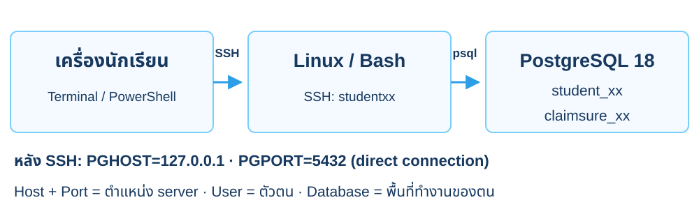

<p class="cs-concept-caption">SSH login: studentxx · DB login: student_xx · Database: claimsure_xx</p>

<footer class="cs-footer"><span>ClaimSure ต่อเนื่อง · ../labs/README.md · เตรียมการเชื่อมต่อ</span><span>3 / 35</span></footer>

<!--
Speaker notes:
อธิบายจากซ้ายไปขวา: เครื่องนักเรียน SSH เข้า Linux ก่อน แล้ว psql เชื่อมตรง PostgreSQL 127.0.0.1 จึงหมายถึงเครื่อง server หลัง SSH ใช้พอร์ต 5432 สำหรับชุด continuous หากอาจารย์แยกเครื่อง DB ให้เปลี่ยน PGHOST ตามที่ได้รับ หน้าถัดไปตั้ง environment จริง ดู make overview สำหรับขั้น SSH เต็ม ต้นฉบับภาพใช้ endpoint 6432 จึงวาดเส้นทางใหม่ให้ตรงห้องแล็บชุดนี้

Source: ../labs/README.md · เตรียมการเชื่อมต่อ
Visual reference: postgres-admin-labs/docs/slides/module-01-basic-sql.md
-->

---
layout: default
class: continuous-deck cs-module-one
---

# เตรียมแล็บ · ตั้งค่า connection ของตน

```bash
STUDENT_NO=xx
export PGHOST=127.0.0.1 PGPORT=5432
export PGUSER="student_$STUDENT_NO"
export PGDATABASE="claimsure_$STUDENT_NO"
export PGAPPNAME=case-m1
mkdir -p "$HOME/case-labs/evidence"
```


<p class="cs-takeaway">แทน xx ด้วยหมายเลขสองหลักของตน · PostgreSQL 18 · direct port 5432</p>

<footer class="cs-footer"><span>ClaimSure ต่อเนื่อง · คู่มือ README / เตรียมการเชื่อมต่อ</span><span>4 / 35</span></footer>

<!--
Speaker notes:
คำสั่ง Bash ทำหลัง SSH เข้าบัญชีของตนตาม README ของคู่มือ นักเรียนแต่ละคนใช้ฐานข้อมูลของตน ไม่ใช้ superuser และไม่ตั้ง password เป็น literal ใน command history

Source: ../labs/module-01-basic-sql.md · README / เตรียมการเชื่อมต่อ
-->

---
layout: default
class: continuous-deck cs-module-one
---

# เตรียมแล็บ · แยก Bash ออกจาก psql

```bash
read -r -s -p "Database password: " PGPASSWORD
printf '\n'
export PGPASSWORD
psql -X -v ON_ERROR_STOP=1
```


```sql
\conninfo
SELECT current_database(),current_user;
SET TIME ZONE 'Asia/Bangkok';
```


<p class="cs-takeaway">บล็อก bash อยู่ Terminal · บล็อก sql อยู่ prompt ของ psql</p>

<footer class="cs-footer"><span>ClaimSure ต่อเนื่อง · คู่มือ README / เตรียมการเชื่อมต่อ</span><span>5 / 35</span></footer>

<!--
Speaker notes:
บล็อกบนอ่านรหัสโดยไม่แสดงหน้าจอ ส่วนบล็อกล่างเริ่มเมื่อเข้า psql แล้ว ใช้ q ออกจาก psql ไม่พิมพ์ SQL ลง Bash ทุก terminal ใหม่ต้องตั้ง environment/รหัสผ่านของตน

Source: ../labs/module-01-basic-sql.md · README / เตรียมการเชื่อมต่อ
-->

---
layout: default
class: continuous-deck cs-module-one cs-fundamental cs-infographic cs-connection-concept
---

# PostgreSQL Connection Route

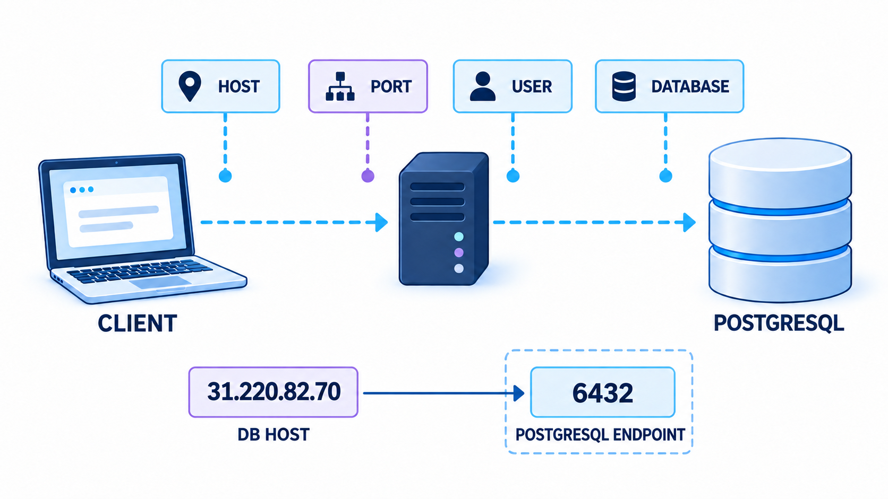

<div class="concept-caption">
  <span>Client chooses a server</span>
  <span>Role proves identity</span>
  <span>Database selects the workspace</span>
</div>

<p class="connection-example-note">ภาพใช้ตัวอย่าง endpoint 6432 · แล็บนี้หลัง SSH ใช้ 127.0.0.1:5432 ตามค่าที่อาจารย์กำหนด</p>

<footer class="cs-footer"><span>ClaimSure ต่อเนื่อง · Fundamental ก่อน Lab 1A · Connection</span><span>6 / 35</span></footer>

<!--
Speaker notes:
อธิบาย connection เป็นที่อยู่และตัวตนก่อนเริ่มกลุ่มคำสั่ง SQL: Host เลือกเครื่อง server และ Port เลือก endpoint ที่รับ connection บนเครื่องนั้น User คือ PostgreSQL login role ที่ต้องยืนยันตัวตน ส่วน Database เลือกพื้นที่ข้อมูลที่จะทำงานด้วย Role เดียวอาจได้รับสิทธิ์เชื่อมต่อได้หลายฐาน จึงต้องตรวจสิทธิ์ CONNECT และ grants ที่อาจารย์เตรียมไว้ด้วย ไม่ถือว่าชื่อมี suffix เหมือนกันแล้วได้สิทธิ์โดยอัตโนมัติ
ในห้องเรียน student_xx ใช้ claimsure_xx และเปลี่ยนเลขให้ตรงกับของตน แยก SSH login studentxx ออกจาก database role student_xx ใช้ผล current_database(), current_user และ backslash conninfo จากหน้าก่อนยืนยัน connection จริง
ภาพต้นฉบับใช้ 31.220.82.70 และ endpoint 6432 เพื่อเล่าแนวคิด ไม่คัด IP/port ในภาพมาแทน environment ของแล็บ continuous นี้ หลัง SSH เข้าเครื่อง server แล้ว 127.0.0.1 หมายถึงเครื่อง server และชุดนี้เชื่อม PostgreSQL โดยตรงพอร์ต 5432 หากอาจารย์กำหนด DB แยกเครื่องให้ใช้ PGHOST/PGPORT ที่ได้รับ
Source: ../labs/README.md · เตรียมการเชื่อมต่อ
Visual reference: postgres-admin-labs/docs/slides/module-01-basic-sql.md · PostgreSQL Connection Route
Image: ./assets/module-01-connection-concept-enterprise-blue-v2.png
-->

---
layout: default
class: continuous-deck cs-module-one cs-fundamental
---

# 1A · Fundamental: กลุ่มคำสั่ง SQL

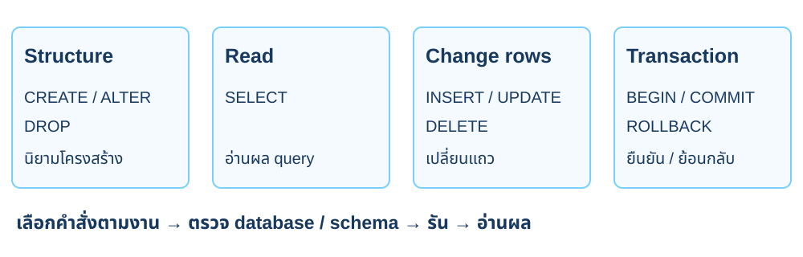

<p class="cs-concept-caption">SELECT ก็อยู่ภายใต้ transaction และสิทธิ์ของ connection</p>

<footer class="cs-footer"><span>ClaimSure ต่อเนื่อง · Fundamental ก่อน Lab 1A</span><span>7 / 35</span></footer>

<!--
Speaker notes:
อ้างอิงคู่มือ labs/module-01-basic-sql.md หัวข้อ 1A · อธิบายแนวคิดหน้านี้ก่อนเริ่มคำสั่งแล็บ
ตารางนี้จัดกลุ่มตามงานเพื่อช่วยอ่านแล็บ ไม่ได้บอกว่า SELECT เป็นคำสั่งที่ไม่เคยถือ lock คำสั่งอ่านก็อยู่ภายใต้ transaction และสิทธิ์ของ connection

Sources:
- https://www.postgresql.org/docs/18/tutorial-sql.html
- https://www.postgresql.org/docs/18/tutorial-transactions.html
-->

---
layout: default
class: continuous-deck cs-module-one cs-fundamental
---

# 1A · Fundamental: Relational model

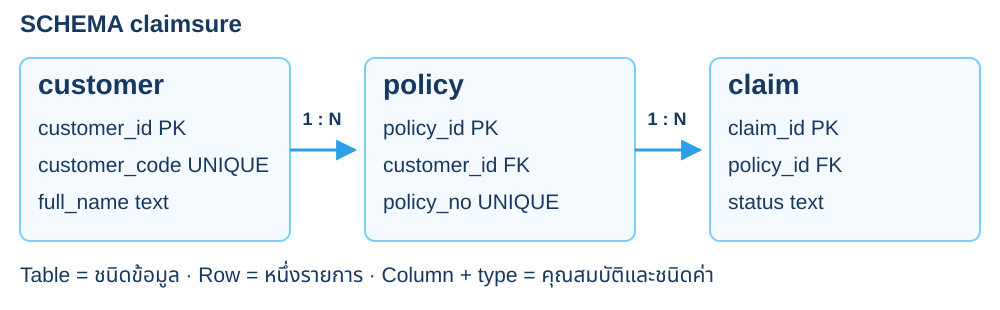

<p class="cs-concept-caption">PK ระบุแถว · FK อ้าง parent · ลำดับแถวต้องกำหนดด้วย ORDER BY</p>

<footer class="cs-footer"><span>ClaimSure ต่อเนื่อง · Fundamental ก่อน Lab 1A</span><span>8 / 35</span></footer>

<!--
Speaker notes:
อ้างอิงคู่มือ labs/module-01-basic-sql.md หัวข้อ 1A · อธิบายแนวคิดหน้านี้ก่อนเริ่มคำสั่งแล็บ
คิดจากข้อมูลที่ต้องเก็บและความสัมพันธ์ก่อนเขียน CREATE TABLE รหัสหลักระบุ logical row ส่วน foreign key อ้าง parent ที่มีอยู่ การคืนแถวตามลำดับต้องระบุ ORDER BY

Sources:
- https://www.postgresql.org/docs/18/tutorial-concepts.html
- https://www.postgresql.org/docs/18/ddl-constraints.html
-->

---
layout: default
class: continuous-deck cs-module-one
---

# Lab 1A · Database, schema และ table

| ระดับ | ตัวอย่าง | หน้าที่ |
| --- | --- | --- |
| Database | claimsure_xx | ขอบเขตฐานข้อมูลของนักเรียน xx |
| Schema | claimsure | namespace ของ objects ในคอร์ส |
| Table | claimsure.claim | ข้อมูลเคลมที่ SQL อ้างถึง |


```sql
CREATE SCHEMA IF NOT EXISTS claimsure;
```

<footer class="cs-footer"><span>ClaimSure ต่อเนื่อง · คู่มือ Lab 1A</span><span>9 / 35</span></footer>

<!--
Speaker notes:
อ้างอิงคู่มือ labs/module-01-basic-sql.md หัวข้อ 1A
ชื่อ claimsure_xx เป็น database ส่วน claimsure เป็น schema คนละระดับ ระบุ schema.table ให้ชัด ไม่อาศัย search_path โดยไม่ตรวจ

Source: ../labs/module-01-basic-sql.md · 1A
-->

---
layout: default
class: continuous-deck cs-module-one
---

# Lab 1A · ความสัมพันธ์ customer → policy → claim

<div class="cs-flow"><div><strong>CUS-001</strong><small>ลูกค้า Anan Chai</small></div><span aria-hidden="true">→</span><div><strong>POL-001 / 002</strong><small>AUTO / HOME</small></div><span aria-hidden="true">→</span><div><strong>CLM-L1-001–004</strong><small>เคลมในกรมธรรม์ของลูกค้า</small></div></div>


<p class="cs-takeaway">CUS-002 → POL-003 → 005/006 · CUS-003 ยังไม่มีกรมธรรม์</p>

<footer class="cs-footer"><span>ClaimSure ต่อเนื่อง · คู่มือ Lab 1A</span><span>10 / 35</span></footer>

<!--
Speaker notes:
อ้างอิงคู่มือ labs/module-01-basic-sql.md หัวข้อ 1A
หนึ่งลูกค้ามีได้หลายกรมธรรม์ กรมธรรม์มีได้หลายเคลม ไม่บังคับว่าลูกค้าทุกคนต้องมีกรมธรรม์ CUS-003 ใช้สอน LEFT JOIN และการหาคนที่ยังไม่มีเคลม

Source: ../labs/module-01-basic-sql.md · 1A–1B
-->

---
layout: default
class: continuous-deck cs-module-one
---

# Lab 1A · Constraints ที่ฐานข้อมูลบังคับ

| Constraint | ตัวอย่างในเคส |
| --- | --- |
| PRIMARY KEY | customer_id / policy_id / claim_id |
| FOREIGN KEY | policy.customer_id → customer |
| FOREIGN KEY | claim.policy_id → policy |
| UNIQUE | customer_code / policy_no / claim_no |
| NOT NULL / CHECK | ค่าจำเป็น / status / ยอดไม่ติดลบ |


<p class="cs-takeaway">ตรวจที่ฐานข้อมูล แม้ application ส่ง SQL ตรงมา</p>

<footer class="cs-footer"><span>ClaimSure ต่อเนื่อง · คู่มือ Lab 1A</span><span>11 / 35</span></footer>

<!--
Speaker notes:
อ้างอิงคู่มือ labs/module-01-basic-sql.md หัวข้อ 1A
Identity สร้างรหัสตัวเลขให้แต่ยังใช้ business code อ้างเคลมในบทเรียน UNIQUE กับ NOT NULL เป็นคนละเงื่อนไข email UNIQUE ในตัวอย่างยังรับ NULL ได้

Source: ../labs/module-01-basic-sql.md · 1A
-->

---
layout: default
class: continuous-deck cs-module-one
---

# Lab 1A · สร้าง customer

```sql
CREATE TABLE IF NOT EXISTS claimsure.customer (
 customer_id bigint GENERATED ALWAYS AS IDENTITY PRIMARY KEY,
 customer_code text NOT NULL UNIQUE,
 full_name text NOT NULL,
 email text UNIQUE,
 created_at timestamptz NOT NULL DEFAULT now()
);
```


<p class="cs-takeaway">เก็บ identity ภายใน และ customer_code สำหรับอ้างในตัวอย่าง</p>

<footer class="cs-footer"><span>ClaimSure ต่อเนื่อง · คู่มือ Lab 1A</span><span>12 / 35</span></footer>

<!--
Speaker notes:
อ้างอิงคู่มือ labs/module-01-basic-sql.md หัวข้อ 1A
ไม่ต้องส่ง customer_id ตอน INSERT เพราะเป็น GENERATED ALWAYS การข้ามเลขจาก rollback เป็นเรื่องปกติ ไม่เดาว่า CUS-001 ต้องมี ID เท่ากับ 1

Source: ../labs/module-01-basic-sql.md · 1A
-->

---
layout: default
class: continuous-deck cs-module-one
---

# Lab 1A · สร้าง policy ที่อ้าง customer

```sql
CREATE TABLE IF NOT EXISTS claimsure.policy (
 policy_id bigint GENERATED ALWAYS AS IDENTITY PRIMARY KEY,
 policy_no text NOT NULL UNIQUE,
 customer_id bigint NOT NULL REFERENCES claimsure.customer,
 product_code text NOT NULL,
 starts_on date NOT NULL, ends_on date NOT NULL,
 status text NOT NULL
  CHECK(status IN ('ACTIVE','EXPIRED','CANCELLED')),
 CHECK(ends_on >= starts_on)
);
```

<footer class="cs-footer"><span>ClaimSure ต่อเนื่อง · คู่มือ Lab 1A</span><span>13 / 35</span></footer>

<!--
Speaker notes:
อ้างอิงคู่มือ labs/module-01-basic-sql.md หัวข้อ 1A
REFERENCES customer อ้าง primary key ของ parent การเพิ่ม policy ก่อนมี customer ที่อ้างถึงจะไม่ผ่าน FK วันที่สิ้นสุดต้องไม่ก่อนวันที่เริ่ม

Source: ../labs/module-01-basic-sql.md · 1A
-->

---
layout: default
class: continuous-deck cs-module-one
---

# Lab 1A · สร้าง claim ที่อ้าง policy

```sql
CREATE TABLE IF NOT EXISTS claimsure.claim (
 claim_id bigint GENERATED ALWAYS AS IDENTITY PRIMARY KEY,
 claim_no text NOT NULL UNIQUE,
 policy_id bigint NOT NULL REFERENCES claimsure.policy,
 status text NOT NULL CHECK(status IN
  ('NEW','REVIEW','APPROVED','REJECTED','PAID')),
 incident_at timestamptz NOT NULL,
 estimated_amount numeric(14,2) NOT NULL
  CHECK(estimated_amount >= 0),
 approved_amount numeric(14,2) CHECK(approved_amount >= 0),
 created_at timestamptz NOT NULL DEFAULT now()
);
```

<footer class="cs-footer"><span>ClaimSure ต่อเนื่อง · คู่มือ Lab 1A</span><span>14 / 35</span></footer>

<!--
Speaker notes:
อ้างอิงคู่มือ labs/module-01-basic-sql.md หัวข้อ 1A
ใช้ timestamptz สำหรับเวลาที่เกิดเหตุ ยอด approved เป็น NULL ได้เมื่อยังไม่ทราบ ไม่ตีความ NULL ว่าเท่ากับศูนย์ ตรวจโครงสร้างด้วย d claimsure.claim ตามคู่มือ

Source: ../labs/module-01-basic-sql.md · 1A
-->

---
layout: default
class: continuous-deck cs-module-one cs-infographic
---

# Lab 1A · สรุป Schema และตาราง

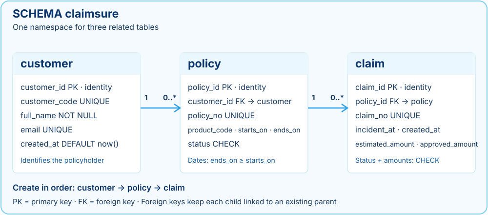

<p class="cs-concept-caption">สร้างตามลำดับ customer → policy → claim · FK เชื่อมลูกกับ parent ที่มีอยู่</p>

<footer class="cs-footer"><span>ClaimSure ต่อเนื่อง · คู่มือ Lab 1A</span><span>15 / 35</span></footer>

<!--
Speaker notes:
อ้างอิงคู่มือ labs/module-01-basic-sql.md หัวข้อ 1A
ดัดแปลง SVG ต้นฉบับโดยเปลี่ยน schema insurance เป็น claimsure ให้ตรงคู่มือชุด continuous ลูกค้าหนึ่งคนมีศูนย์หรือหลายกรมธรรม์ แต่ละกรมธรรม์มีศูนย์หรือหลายเคลม FK ของตารางลูกต้องอ้าง parent ที่มีอยู่ ใช้ key จริงจากฐาน ไม่เดาว่า identity เริ่มจากเลขใด approved_amount เป็น NULL ได้จนกว่าจะตัดสินใจ

Source: ../labs/module-01-basic-sql.md · 1A
Visual reference: postgres-admin-labs/docs/slides/module-01-basic-sql.md
-->

---
layout: default
class: continuous-deck cs-module-one cs-fundamental
---

# 1B · Fundamental: NULL และตรรกะสามค่า

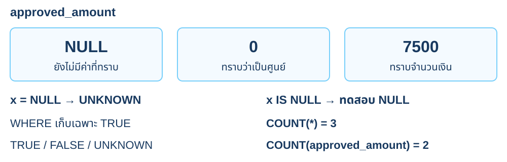

<p class="cs-concept-caption">ตัวอย่าง 3 แถว · NULL ต่างจาก 0 · COUNT(column) ไม่นับ NULL</p>

<footer class="cs-footer"><span>ClaimSure ต่อเนื่อง · Fundamental ก่อน Lab 1B</span><span>16 / 35</span></footer>

<!--
Speaker notes:
อ้างอิงคู่มือ labs/module-01-basic-sql.md หัวข้อ 1B · อธิบายแนวคิดหน้านี้ก่อนเริ่มคำสั่งแล็บ
SQL comparisons อาจให้ TRUE, FALSE หรือ UNKNOWN การเทียบ NULL จึงต่างจากเทียบศูนย์ LEFT JOIN สร้างฝั่งที่ไม่มีคู่เป็น NULL ทำให้ COUNT(claim_id) กับ COUNT(*) ต่างกัน

Sources:
- https://www.postgresql.org/docs/18/functions-comparison.html
- https://www.postgresql.org/docs/18/functions-aggregate.html
-->

---
layout: default
class: continuous-deck cs-module-one
---

# Lab 1B · เพิ่มลูกค้าสามรายให้รันซ้ำได้

```sql
INSERT INTO claimsure.customer(customer_code,full_name,email)
VALUES
 ('CUS-001','Anan Chai','anan@example.com'),
 ('CUS-002','Mali Dee','mali@example.com'),
 ('CUS-003','Nok No-Claim','nok@example.com')
ON CONFLICT(customer_code) DO UPDATE
SET full_name=EXCLUDED.full_name,email=EXCLUDED.email
RETURNING customer_id,customer_code,full_name;
```


<p class="cs-takeaway">INSERT parent ก่อน child · ไม่เพิ่มรหัสเดิมซ้ำ</p>

<footer class="cs-footer"><span>ClaimSure ต่อเนื่อง · คู่มือ Lab 1B</span><span>17 / 35</span></footer>

<!--
Speaker notes:
อ้างอิงคู่มือ labs/module-01-basic-sql.md หัวข้อ 1B
ON CONFLICT อาศัย UNIQUE customer_code และอัปเดตแถวเดิม รหัส identity อาจข้ามเลขได้แม้ seed ซ้ำ อย่าใช้ลำดับ identity เป็น business meaning

Source: ../labs/module-01-basic-sql.md · 1B
-->

---
layout: default
class: continuous-deck cs-module-one
---

# Lab 1B · จับคู่ policy กับลูกค้าด้วย code

| policy_no | customer_code | product |
| --- | --- | --- |
| POL-001 | CUS-001 | AUTO |
| POL-002 | CUS-001 | HOME |
| POL-003 | CUS-002 | TRAVEL |


```sql
SELECT v.policy_no,c.customer_id
FROM (VALUES ('POL-001','CUS-001'),('POL-002','CUS-001'),
             ('POL-003','CUS-002')) v(policy_no,customer_code)
JOIN claimsure.customer c USING(customer_code);
```


<p class="cs-takeaway">ใช้ INSERT policy เต็มใน 1B ซึ่งกำหนดวันเริ่ม/สิ้นสุดไว้ครบ</p>

<footer class="cs-footer"><span>ClaimSure ต่อเนื่อง · คู่มือ Lab 1B</span><span>18 / 35</span></footer>

<!--
Speaker notes:
อ้างอิงคู่มือ labs/module-01-basic-sql.md หัวข้อ 1B
SELECT นี้แสดงวิธีค้น FK จาก code ไม่เดา customer_id ต้องรัน INSERT policy ในคู่มือ 1B ก่อนเพิ่ม claim มีสามกรมธรรม์ที่เชื่อมสองลูกค้า CUS-003 จึงยังไม่มี policy

Source: ../labs/module-01-basic-sql.md · 1B
-->

---
layout: default
class: continuous-deck cs-module-one
---

# Lab 1B · เคลมตั้งต้นก่อน UPDATE

| claim_no | policy | status | estimated | approved |
| --- | --- | --- | --- | --- |
| CLM-L1-001 | POL-001 | NEW | 15,000 | NULL |
| CLM-L1-002 | POL-001 | REVIEW | 22,000 | NULL |
| CLM-L1-003 | POL-002 | APPROVED | 35,000 | 30,000 |
| CLM-L1-004 | POL-002 | PAID | 8,000 | 7,500 |
| CLM-L1-005 | POL-003 | NEW | 12,000 | NULL |
| CLM-L1-006 | POL-003 | REJECTED | 18,000 | 0 |

<footer class="cs-footer"><span>ClaimSure ต่อเนื่อง · คู่มือ Lab 1B</span><span>19 / 35</span></footer>

<!--
Speaker notes:
อ้างอิงคู่มือ labs/module-01-basic-sql.md หัวข้อ 1B
นี่คือสถานะ seed 1B ก่อน 1D เคลม 001 จะเปลี่ยนเป็น REVIEW ภายหลัง วันที่เกิดเหตุอยู่ Jan/Feb/Mar 2026 เดือนละสองแถวและใช้ต่อในบท 10

Source: ../labs/module-01-basic-sql.md · 1B
-->

---
layout: default
class: continuous-deck cs-module-one
---

# Lab 1B · INSERT claim โดยค้น policy_id

ตัวอย่างหนึ่งเคลม · รัน seed หกแถวจากคู่มือ 1B ให้ครบก่อนทำ 1C

```sql
INSERT INTO claimsure.claim
 (claim_no,policy_id,status,incident_at,estimated_amount)
SELECT 'CLM-L1-001',policy_id,'NEW',
       TIMESTAMPTZ '2026-01-10 09:00+07',15000
FROM claimsure.policy WHERE policy_no='POL-001'
ON CONFLICT(claim_no) DO UPDATE
SET policy_id=EXCLUDED.policy_id,status=EXCLUDED.status,
 incident_at=EXCLUDED.incident_at,
 estimated_amount=EXCLUDED.estimated_amount;
```

<footer class="cs-footer"><span>ClaimSure ต่อเนื่อง · คู่มือ Lab 1B</span><span>20 / 35</span></footer>

<!--
Speaker notes:
อ้างอิงคู่มือ labs/module-01-basic-sql.md หัวข้อ 1B
ตัวอย่างแสดง INSERT SELECT สำหรับแถวเดียวที่ approved_amount ยัง NULL ใช้ VALUES/INSERT หกแถวเต็มใน 1B เพื่อให้จำนวนและข้อมูลตรงกันก่อนเรียนต่อ

Source: ../labs/module-01-basic-sql.md · 1B
-->

---
layout: default
class: continuous-deck cs-module-one cs-fundamental
---

# 1C · Fundamental: ลำดับคิดของ SELECT

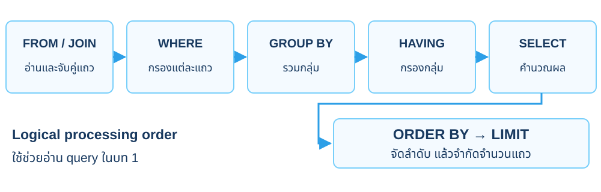

<p class="cs-concept-caption">เป็น logical model ของ query ในบทนี้ ไม่ใช่ลำดับ physical plan</p>

<footer class="cs-footer"><span>ClaimSure ต่อเนื่อง · Fundamental ก่อน Lab 1C</span><span>21 / 35</span></footer>

<!--
Speaker notes:
อ้างอิงคู่มือ labs/module-01-basic-sql.md หัวข้อ 1C · อธิบายแนวคิดหน้านี้ก่อนเริ่มคำสั่งแล็บ
Planner อาจเลือก physical execution ต่างจากลำดับที่เขียน SQL ตารางนี้ย่อเฉพาะ clauses ที่ใช้ในบท 1 ฟังก์ชัน window และ DISTINCT มีรายละเอียดลำดับเพิ่มเติมในบท 2

Sources:
- https://www.postgresql.org/docs/18/sql-select.html
-->

---
layout: default
class: continuous-deck cs-module-one cs-infographic cs-fundamental
---

# 1C · Fundamental: โครงสร้างคำสั่ง SQL

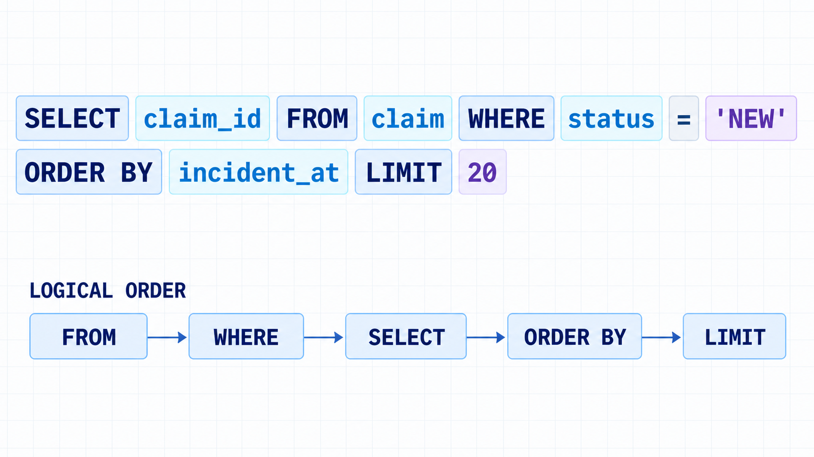

<p class="cs-concept-caption">Navy: keyword · Cyan: identifier · Violet: literal</p>

<footer class="cs-footer"><span>ClaimSure ต่อเนื่อง · Fundamental ก่อน Lab 1C</span><span>22 / 35</span></footer>

<!--
Speaker notes:
อ้างอิงคู่มือ labs/module-01-basic-sql.md หัวข้อ 1C · อธิบายแนวคิดหน้านี้ก่อนเริ่มคำสั่งแล็บ
แยกคำสั่งสำคัญ ชื่อ objects และค่าคงที่ ภาพเป็นตัวอย่าง syntax ของ SELECT ไม่ใช่ query ที่ต้องวางรันตามภาพ ชื่อ claim ในภาพเป็นชื่อแบบย่อ ในแล็บจริงใช้ claimsure.claim และระบุ ORDER BY ให้เหมาะสม หากต้องเลือกลำดับที่มีค่าเวลาเท่ากันให้เติม stable key ลำดับด้านล่างเป็นแบบย่อสำหรับ query ไม่มี GROUP BY ดูหน้า Fundamentals สำหรับ GROUP BY และ HAVING ภาพคัดลอกจากต้นฉบับโดยไม่แก้

Source: ../labs/module-01-basic-sql.md · 1C
Visual reference: postgres-admin-labs/docs/slides/module-01-basic-sql.md
-->

---
layout: default
class: continuous-deck cs-module-one
---

# Lab 1C · SELECT และ ORDER BY

```sql
SELECT claim_no,status,estimated_amount
FROM claimsure.claim
ORDER BY claim_no;

SELECT claim_no,status FROM claimsure.claim
WHERE status='NEW' ORDER BY claim_no;
```


<p class="cs-takeaway">ก่อน 1D: NEW คือ 001 และ 005 · ORDER BY ทำให้ลำดับแน่นอน</p>

<footer class="cs-footer"><span>ClaimSure ต่อเนื่อง · คู่มือ Lab 1C</span><span>23 / 35</span></footer>

<!--
Speaker notes:
อ้างอิงคู่มือ labs/module-01-basic-sql.md หัวข้อ 1C
ไม่มี ORDER BY ไม่รับประกันลำดับผล เปรียบเทียบ SELECT ทั้งหมดกับ WHERE หลังทำ 1D เคลม 001 ไม่ NEW แล้ว จึงเหลือ NEW แค่ 005

Source: ../labs/module-01-basic-sql.md · 1C
-->

---
layout: default
class: continuous-deck cs-module-one
---

# Lab 1C · อ่านผล NULL เทียบกับยอด 0

| approved_amount | ความหมายในตัวอย่าง | วิธีค้น |
| --- | --- | --- |
| NULL | ยังไม่มีค่าที่อนุมัติ | IS NULL |
| 0 | ทราบค่าแล้วว่าเป็นศูนย์ | = 0 |
| 30,000 | มีค่าที่อนุมัติแล้ว | = 30000 |


```sql
SELECT claim_no,approved_amount FROM claimsure.claim
WHERE approved_amount IS NULL ORDER BY claim_no;
```


<p class="cs-takeaway">NULL ใน seed: 001 / 002 / 005 · ค่า 0 คือ 006</p>

<footer class="cs-footer"><span>ClaimSure ต่อเนื่อง · คู่มือ Lab 1C</span><span>24 / 35</span></footer>

<!--
Speaker notes:
ตัวอย่างเสริมของ 1C สำหรับอ่าน approved_amount ที่เตรียมใน 1B ใช้ SELECT บนข้อมูลเดิม ไม่เปลี่ยนลำดับขั้นในคู่มือ
อ้างอิงคู่มือ labs/module-01-basic-sql.md หัวข้อ 1C
ไม่ใช้ = NULL เพื่อหาค่าว่าง เพราะการเทียบกับ NULL ให้ unknown ประเด็น NULL กับศูนย์นี้สำคัญต่อสูตรภาษีในบท 2 โดยเฉพาะ rejected claim 006

Source: ../labs/module-01-basic-sql.md · 1C / ต่อบท 2
-->

---
layout: default
class: continuous-deck cs-module-one cs-fundamental
---

# 1D–1E · Fundamental: Transaction / ACID

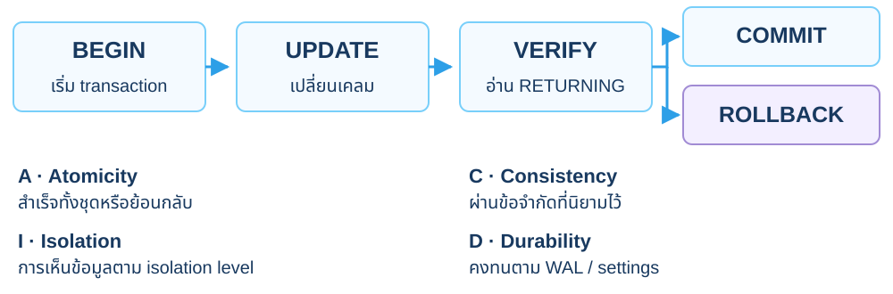

<p class="cs-concept-caption">psql มัก autocommit ทีละคำสั่ง · ใช้ BEGIN เมื่อต้องทดลองแล้ว ROLLBACK</p>

<footer class="cs-footer"><span>ClaimSure ต่อเนื่อง · Fundamental ก่อน Lab 1D–1E</span><span>25 / 35</span></footer>

<!--
Speaker notes:
อ้างอิงคู่มือ labs/module-01-basic-sql.md หัวข้อ 1D–1E · อธิบายแนวคิดหน้านี้ก่อนเริ่มคำสั่งแล็บ
Consistency ไม่ได้ทำให้กฎธุรกิจที่ยังไม่เขียนเกิดขึ้นเอง Isolation ไม่ได้หมายความว่าทุก session เห็นค่าเดียวกันทุกเวลา บท 1 ใช้ COMMIT เก็บสถานะ REVIEW และ ROLLBACK เก็บเคลมที่ทดลองลบไว้

Sources:
- https://www.postgresql.org/docs/18/tutorial-transactions.html
- https://www.postgresql.org/docs/18/wal-intro.html
-->

---
layout: default
class: continuous-deck cs-module-one
---

# Lab 1D · UPDATE เคลมแล้ว COMMIT

```sql
BEGIN;
UPDATE claimsure.claim SET status='REVIEW'
WHERE claim_no='CLM-L1-001' AND status='NEW'
RETURNING claim_no,status;
COMMIT;

SELECT claim_no,status FROM claimsure.claim
WHERE claim_no='CLM-L1-001';
```


<p class="cs-takeaway">001 อยู่ REVIEW หลัง COMMIT · รอบถัดไปอาจ UPDATE 0 แถว</p>

<footer class="cs-footer"><span>ClaimSure ต่อเนื่อง · คู่มือ Lab 1D</span><span>26 / 35</span></footer>

<!--
Speaker notes:
อ้างอิงคู่มือ labs/module-01-basic-sql.md หัวข้อ 1D
เงื่อนไข status ป้องกันการเปลี่ยนซ้ำแบบไม่ตรงสถานะ รันครั้งแรกได้หนึ่งแถว รันซ้ำอาจไม่มีแถวเพราะค่าเดิมเปลี่ยนแล้ว เก็บ REVIEW นี้ไว้สำหรับบท 2–10

Source: ../labs/module-01-basic-sql.md · 1D
-->

---
layout: default
class: continuous-deck cs-module-one
---

# Lab 1E · DELETE แล้ว ROLLBACK

```sql
BEGIN;
DELETE FROM claimsure.claim
WHERE claim_no='CLM-L1-006' AND status='REJECTED'
RETURNING claim_no,status;
ROLLBACK;

SELECT count(*) AS expected_1 FROM claimsure.claim
WHERE claim_no='CLM-L1-006';
```


<p class="cs-takeaway">DELETE 1 ไม่ได้แปลว่าการลบถูกยืนยัน · ตรวจแถวหลัง rollback</p>

<footer class="cs-footer"><span>ClaimSure ต่อเนื่อง · คู่มือ Lab 1E</span><span>27 / 35</span></footer>

<!--
Speaker notes:
อ้างอิงคู่มือ labs/module-01-basic-sql.md หัวข้อ 1E
การทดลองนี้ลบภายใน transaction แล้ว rollback เก็บหกเคลมไว้ ไม่ใช้คำสั่ง DELETE นอก BEGIN ถ้าตั้งใจจะย้อนคืนด้วย rollback

Source: ../labs/module-01-basic-sql.md · 1E
-->

---
layout: default
class: continuous-deck cs-module-one cs-infographic cs-fundamental
---

# 1F · Fundamental: JOIN / Set operations

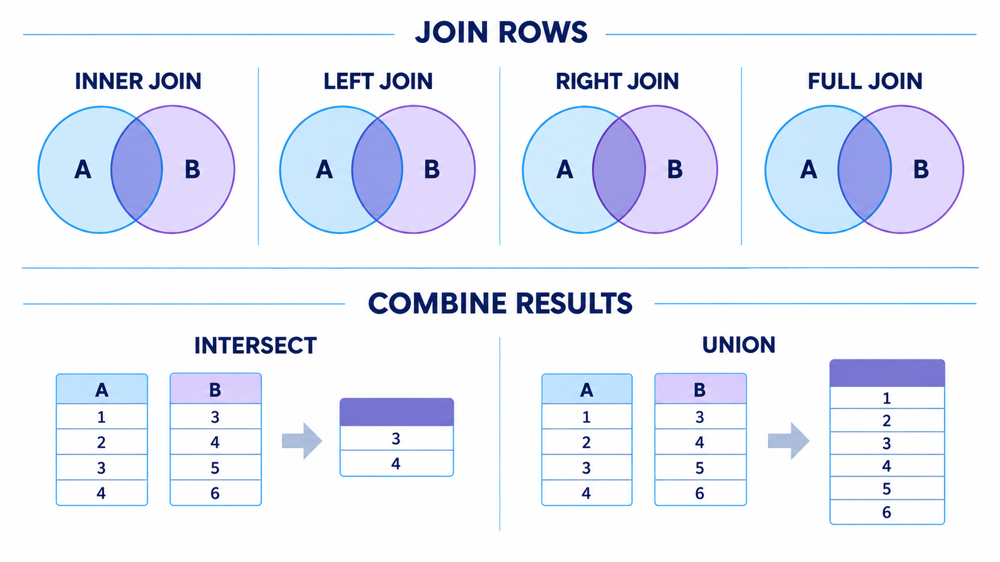

<p class="cs-concept-caption">JOIN จับคู่แถว · Set operations รวมแถว · วงกลมช่วยจำ ต้องตรวจผล query จริง</p>

<footer class="cs-footer"><span>ClaimSure ต่อเนื่อง · Fundamental ก่อน Lab 1F</span><span>28 / 35</span></footer>

<!--
Speaker notes:
อ้างอิงคู่มือ labs/module-01-basic-sql.md หัวข้อ 1F · อธิบายแนวคิดหน้านี้ก่อนเริ่มคำสั่งแล็บ
วงกลมด้านบนเป็นเพียงภาพช่วยจำ ไม่แสดงผลจริงหรือจำนวนแถวของ JOIN ให้ตัดสินจาก matching condition และฝั่งที่ต้องรักษา INNER เก็บคู่ที่ match; LEFT รักษาฝั่งซ้าย; RIGHT รักษาฝั่งขวา; FULL รักษาทั้งสองฝั่ง key ที่ซ้ำอาจเพิ่มจำนวนคู่ได้ ส่วน UNION/INTERSECT รวม result rows ที่จำนวนคอลัมน์และชนิดข้อมูลเข้ากันได้ โดยค่าปริยายตัด duplicate ภาพคัดลอกจากต้นฉบับโดยไม่แก้

Source: ../labs/module-01-basic-sql.md · 1F
Visual reference: postgres-admin-labs/docs/slides/module-01-basic-sql.md
-->

---
layout: default
class: continuous-deck cs-module-one
---

# Lab 1F · JOIN ลูกค้า กรมธรรม์ และเคลม

```sql
SELECT c.full_name,p.policy_no,cl.claim_no,cl.status
FROM claimsure.customer c
JOIN claimsure.policy p USING(customer_id)
LEFT JOIN claimsure.claim cl USING(policy_id)
ORDER BY c.full_name,p.policy_no,cl.claim_no;
```


<div class="cs-flow"><div><strong>customer_id</strong><small>เชื่อมลูกค้ากับกรมธรรม์</small></div><span aria-hidden="true">→</span><div><strong>policy_id</strong><small>เชื่อมกรมธรรม์กับเคลม</small></div></div>

<footer class="cs-footer"><span>ClaimSure ต่อเนื่อง · คู่มือ Lab 1F</span><span>29 / 35</span></footer>

<!--
Speaker notes:
อ้างอิงคู่มือ labs/module-01-basic-sql.md หัวข้อ 1F
INNER JOIN กับ policy ทำให้ลูกค้าที่ไม่มี policy เช่น CUS-003 ไม่ปรากฏใน query นี้ แม้ตอน claim จะเป็น LEFT JOIN ต้องพิจารณา join path ทั้งเส้น

Source: ../labs/module-01-basic-sql.md · 1F
-->

---
layout: default
class: continuous-deck cs-module-one
---

# Lab 1F · หาลูกค้าที่ไม่มีเคลมด้วย LEFT JOIN

```sql
SELECT c.customer_code,c.full_name
FROM claimsure.customer c
LEFT JOIN claimsure.policy p USING(customer_id)
LEFT JOIN claimsure.claim cl USING(policy_id)
GROUP BY c.customer_id,c.customer_code,c.full_name
HAVING count(cl.claim_id)=0
ORDER BY c.customer_code;
```


<p class="cs-takeaway">ได้ CUS-003 · COUNT(claim_id) ไม่เท่ากับ COUNT(*) ใน LEFT JOIN</p>

<footer class="cs-footer"><span>ClaimSure ต่อเนื่อง · คู่มือ Lab 1F</span><span>30 / 35</span></footer>

<!--
Speaker notes:
อ้างอิงคู่มือ labs/module-01-basic-sql.md หัวข้อ 1F
LEFT JOIN เก็บ customer ที่ไม่มีคู่ไว้ด้วยแถว NULL นับ claim_id ที่ไม่ NULL เพื่อให้คนไม่มีเคลมเป็นศูนย์ COUNT(*) จะนับแถว placeholder ด้วย

Source: ../labs/module-01-basic-sql.md · 1F
-->

---
layout: default
class: continuous-deck cs-module-one
---

# Lab 1F · UNION และ INTERSECT ของ status

| ชุด A | ชุด B | ผล |
| --- | --- | --- |
| NEW, REVIEW | REVIEW, APPROVED | มี REVIEW ร่วมกัน |
| A INTERSECT B | เฉพาะสมาชิกที่อยู่ทั้งคู่ | REVIEW |
| A UNION B | รวมแล้วตัดค่าซ้ำ | APPROVED / NEW / REVIEW |


```sql
WITH a(status) AS (VALUES ('NEW'),('REVIEW')),
     b(status) AS (VALUES ('REVIEW'),('APPROVED'))
SELECT status FROM a INTERSECT SELECT status FROM b;
```

<footer class="cs-footer"><span>ClaimSure ต่อเนื่อง · คู่มือ Lab 1F</span><span>31 / 35</span></footer>

<!--
Speaker notes:
อ้างอิงคู่มือ labs/module-01-basic-sql.md หัวข้อ 1F
ชุด status มาจากโดเมนของ claim UNION ตัดค่าซ้ำ ส่วน UNION ALL ถ้าต้องการเก็บซ้ำมีพฤติกรรมต่างกัน คู่มือ 1F มี query ของ UNION ให้รันเพิ่ม

Source: ../labs/module-01-basic-sql.md · 1F
-->

---
layout: default
class: continuous-deck cs-module-one cs-infographic cs-fundamental
---

# 1G · Fundamental: ลำดับการรวมข้อมูล

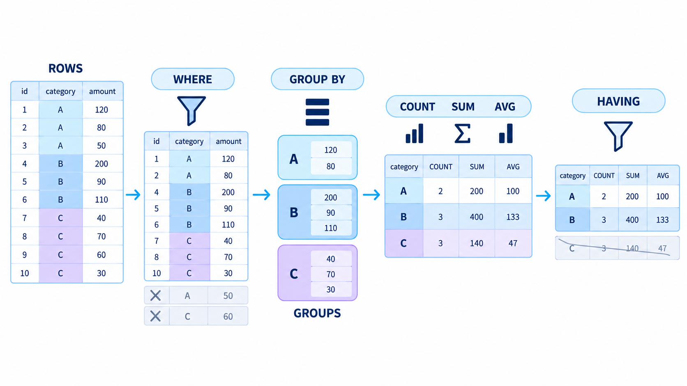

<p class="cs-concept-caption">WHERE กรองแถว → GROUP BY จัดกลุ่ม → COUNT / SUM / AVG → HAVING กรองกลุ่ม</p>

<footer class="cs-footer"><span>ClaimSure ต่อเนื่อง · Fundamental ก่อน Lab 1G</span><span>32 / 35</span></footer>

<!--
Speaker notes:
อ้างอิงคู่มือ labs/module-01-basic-sql.md หัวข้อ 1G · อธิบายแนวคิดหน้านี้ก่อนเริ่มคำสั่งแล็บ
อ่านภาพซ้ายไปขวาเป็นตัวอย่าง category A/B/C ไม่ใช่จำนวนเคลมจริงของแล็บ ตัวอย่างกรองค่า 50 และ 60 ออกก่อนรวมกลุ่ม แล้วแสดง HAVING ที่ตัดกลุ่ม C ภาพปัดค่า AVG เป็นจำนวนเต็ม เช่น 400/3 ประมาณ 133 ไม่ใช่ precision ที่ query PostgreSQL รับประกัน หน้าถัดไปใช้ข้อมูล claimsure.claim จริงและอ่านผลของตน ไม่คัดตัวเลขในภาพมาอ้าง ภาพคัดลอกจากต้นฉบับโดยไม่แก้

Source: ../labs/module-01-basic-sql.md · 1G
Visual reference: postgres-admin-labs/docs/slides/module-01-basic-sql.md
-->

---
layout: default
class: continuous-deck cs-module-one
---

# Lab 1G · GROUP BY จำนวนและยอดต่อ status

```sql
SELECT status,count(*) AS claim_count,
 sum(estimated_amount) AS estimated_total,
 avg(estimated_amount) AS estimated_average
FROM claimsure.claim
GROUP BY status ORDER BY status;
```


| หลัง 1D | จำนวน | ยอด estimated |
| --- | --- | --- |
| REVIEW | 2 | 37,000 |
| NEW | 1 | 12,000 |
| APPROVED / PAID / REJECTED | อย่างละ 1 | 35,000 / 8,000 / 18,000 |

<footer class="cs-footer"><span>ClaimSure ต่อเนื่อง · คู่มือ Lab 1G</span><span>33 / 35</span></footer>

<!--
Speaker notes:
อ้างอิงคู่มือ labs/module-01-basic-sql.md หัวข้อ 1G
GROUP BY ยุบรายละเอียดเป็นหนึ่งแถวต่อ status สถิติหลัง 1D ต่างจาก seed เพราะ 001 เปลี่ยนเป็น REVIEW อย่าบวก AVG ของแต่ละกลุ่มเพื่อเป็นค่าเฉลี่ยรวม

Source: ../labs/module-01-basic-sql.md · 1G
-->

---
layout: default
class: continuous-deck cs-module-one
---

# Lab 1G · HAVING กรองผลรวมตามลูกค้า

```sql
SELECT c.customer_code,c.full_name,
 count(cl.claim_id) AS total_claims,
 sum(cl.estimated_amount) AS total_estimated
FROM claimsure.customer c
JOIN claimsure.policy p USING(customer_id)
JOIN claimsure.claim cl USING(policy_id)
GROUP BY c.customer_id,c.customer_code,c.full_name
HAVING count(cl.claim_id)>=2
ORDER BY total_estimated DESC;
```


<p class="cs-takeaway">CUS-001: 4 เคลม / 80,000 · CUS-002: 2 เคลม / 30,000</p>

<footer class="cs-footer"><span>ClaimSure ต่อเนื่อง · คู่มือ Lab 1G</span><span>34 / 35</span></footer>

<!--
Speaker notes:
อ้างอิงคู่มือ labs/module-01-basic-sql.md หัวข้อ 1G
WHERE กรองแถวก่อนรวม ส่วน HAVING กรองกลุ่มหลังรวม CUS-003 ไม่เข้ากลุ่มนี้ ยอดนี้เป็น estimated ไม่ใช่ยอดอนุมัติหรือฐานภาษีของบท 2

Source: ../labs/module-01-basic-sql.md · 1G
-->

---
layout: default
class: continuous-deck cs-module-one
---

# Lab 1G · ตรวจผลและส่งต่อบท 2

```sql
SELECT
 (SELECT count(*) FROM claimsure.customer) AS customers,
 (SELECT count(*) FROM claimsure.policy) AS policies,
 (SELECT count(*) FROM claimsure.claim) AS claims;
SELECT claim_no,status,estimated_amount,approved_amount
FROM claimsure.claim WHERE claim_no='CLM-L1-001';
```


<p class="cs-takeaway">3 / 3 / 6 · 001 = REVIEW / 15,000 / NULL · เก็บตารางไว้</p>

<footer class="cs-footer"><span>ClaimSure ต่อเนื่อง · คู่มือ Lab 1G</span><span>35 / 35</span></footer>

<!--
Speaker notes:
อ้างอิงคู่มือ labs/module-01-basic-sql.md หัวข้อ 1G
อย่า DROP ตารางหรือ schema หลังบทนี้ ถ้าต้องการคืน seed ให้ทำ 1B และ 1D ตามลำดับใหม่ บท 2 จะใช้ข้อมูลจริงชุดนี้สร้าง view/functions/procedure

Source: ../labs/module-01-basic-sql.md · 1G / คืนค่าและทำซ้ำ
-->

