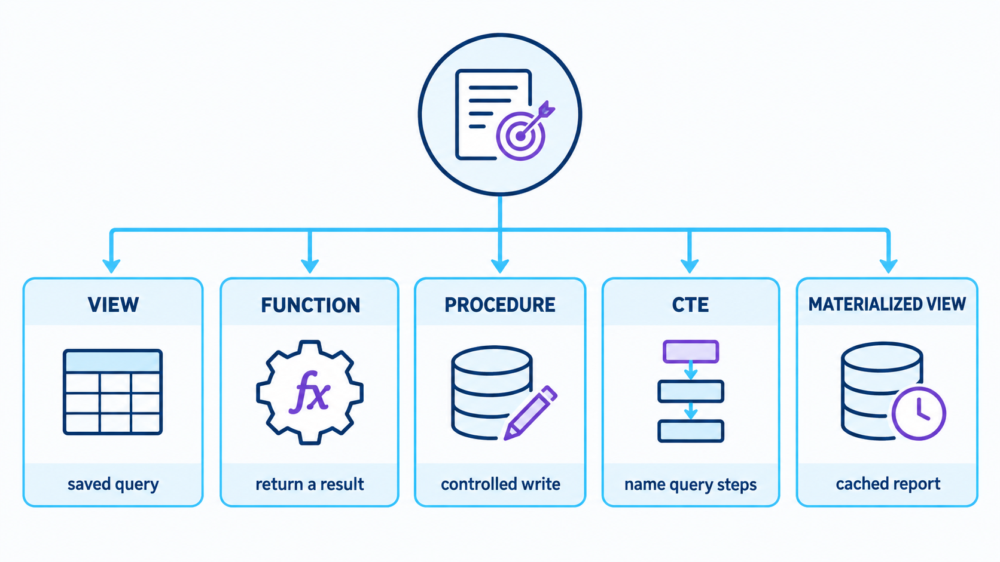
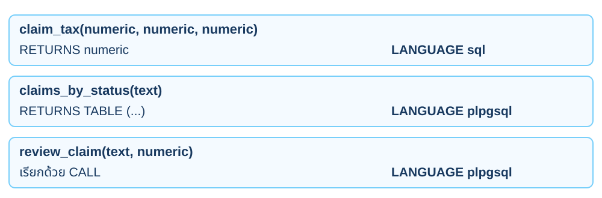
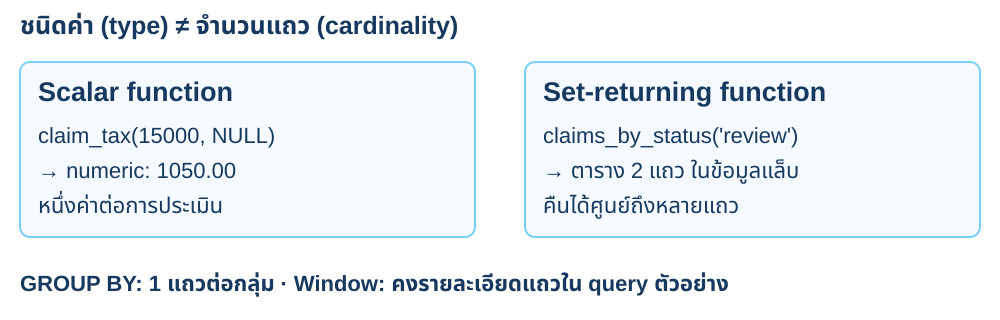
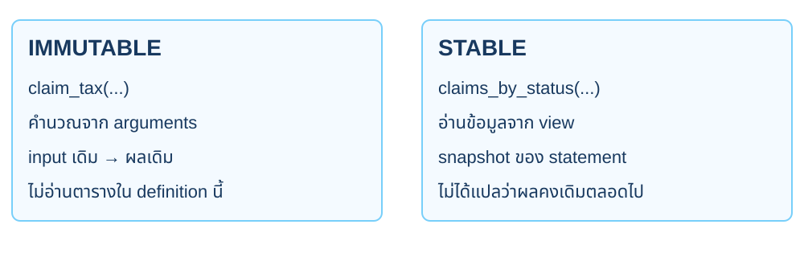
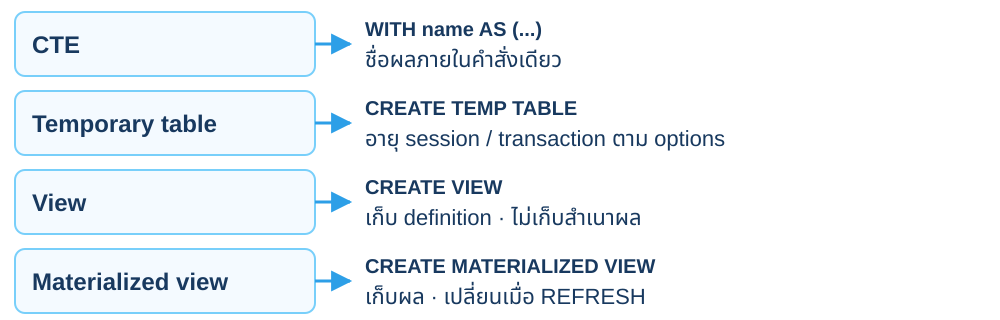
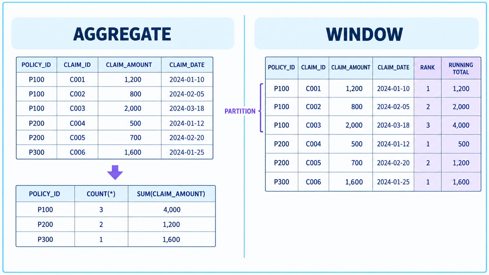
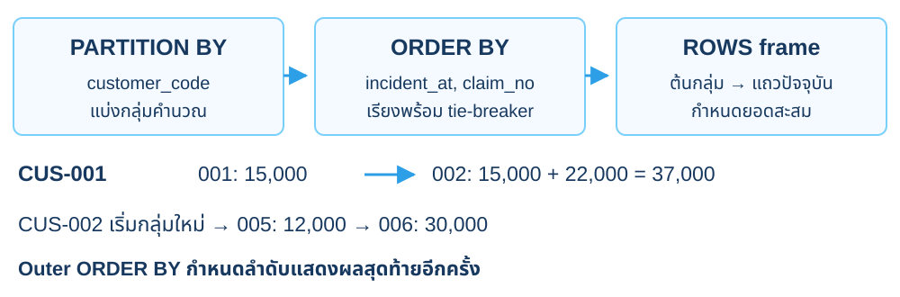
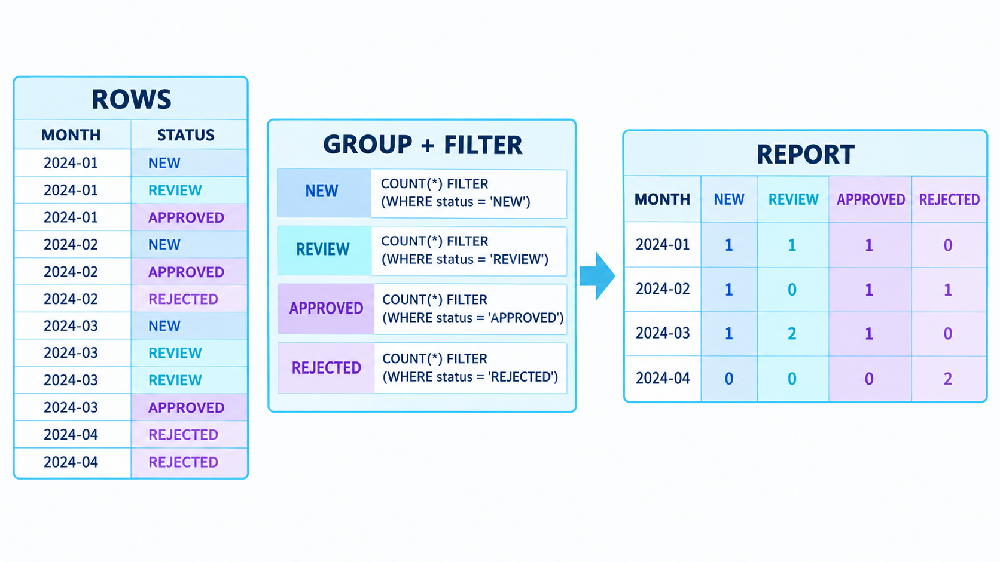
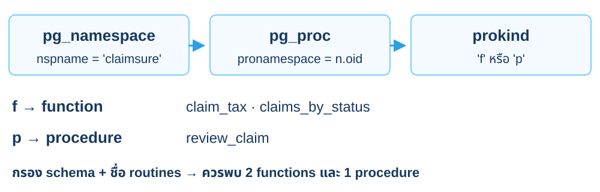

<CaseCover :module-id="2" />

# Module 2<br>Advanced SQL

## ต่อยอดเคลมเดิมเป็นรายงานและ routines

<footer class="cs-footer"><span>ClaimSure ต่อเนื่อง · คู่มือ ภาพรวม</span><span>1 / 34</span></footer>

<!--
Speaker notes:
บทนี้ใช้ฐานข้อมูล claimsure_xx และ schema claimsure จากบท 1–2 ต่อเนื่องกัน เปิดคู่มือบทนี้ไว้เพื่อทำ SQL/native commands ทีละขั้น ภาพปก: ./assets/module-02-advanced-sql-cover-enterprise-blue.png

Source: ../labs/module-02-advanced-sql.md · ภาพรวม
-->

---
layout: default
class: continuous-deck cs-module-two
---

# เตรียมแล็บ · รับข้อมูลหลังบท 1

<div class="cs-metrics"><div><b>3</b><span>customers</span></div><div><b>3</b><span>policies</span></div><div><b>6</b><span>claims</span></div></div>


<p class="cs-takeaway">CLM-L1-001 = REVIEW / 15,000 / approved NULL</p>

<footer class="cs-footer"><span>ClaimSure ต่อเนื่อง · คู่มือ เตรียมก่อน 2A</span><span>2 / 34</span></footer>

<!--
Speaker notes:
บท 1 ต้องทำ UPDATE COMMIT ใน 1D และ DELETE ROLLBACK ใน 1E ครบ ทำให้ REVIEW สองเคลมคือ 001 และ 002 บทนี้ใช้ schema/tables เดิม ไม่สร้างข้อมูลชุดใหม่

Source: ../labs/module-02-advanced-sql.md · เตรียมก่อน 2A
-->

---
layout: default
class: continuous-deck cs-module-two
---

# เตรียมแล็บ · ตรวจ prerequisite ก่อน 2A

```sql
\pset pager off
SET TIME ZONE 'Asia/Bangkok';
SELECT current_database(),current_user;
SELECT to_regclass('claimsure.claim') AS prerequisite;
SELECT count(*) AS expected_6 FROM claimsure.claim;
SELECT claim_no,status FROM claimsure.claim
WHERE status='REVIEW' ORDER BY claim_no;
```


<p class="cs-takeaway">prerequisite ไม่เป็น NULL · REVIEW มี 001 และ 002</p>

<footer class="cs-footer"><span>ClaimSure ต่อเนื่อง · คู่มือ เตรียมก่อน 2A</span><span>3 / 34</span></footer>

<!--
Speaker notes:
ใช้ psql -X -v ON_ERROR_STOP=1 ของ student ใน claimsure_xx ตาม README ถ้ายังไม่มีตารางให้ทำบท 1 ก่อน ไม่สร้างตารางว่างเพื่อให้ query ผ่าน

Source: ../labs/module-02-advanced-sql.md · เตรียมก่อน 2A
-->

---
layout: default
class: continuous-deck cs-module-two cs-fundamental cs-infographic
---

# 2A · Fundamental: เลือก database object



<p class="cs-concept-caption">View: อ่าน · Function: คืนผล · Procedure: งานเขียน · CTE: ลำดับ query</p>

<footer class="cs-footer"><span>ClaimSure ต่อเนื่อง · Fundamental ก่อน Lab 2A</span><span>5 / 34</span></footer>

<!--
Speaker notes:
อ้างอิงคู่มือ labs/module-02-advanced-sql.md หัวข้อ 2A · อธิบายก่อนเริ่มคำสั่งแล็บ
ภาพอ้างอิงสรุปการเลือก object ตามงาน View เก็บ query definition, function คืนค่า scalar หรือชุดแถว ส่วน procedure เรียกด้วย CALL และใช้ transaction ของผู้เรียกในแล็บนี้ CTE ใช้ตั้งชื่อขั้นของ statement และ materialized view เก็บผลที่ต้อง refresh โดย materialized view จะทดลองจริงในบท 3 การเลือก function หรือ procedure ต้องดู behavior จริงด้วย เพราะ function บางชนิดเขียนข้อมูลได้ ภาพนี้เป็นแนวทางเลือกตามเคส ไม่ใช่ข้อห้ามของ PostgreSQL

Source: ../labs/module-02-advanced-sql.md · 2A
Visual reference: postgres-admin-labs/docs/slides/module-02-advanced-sql.md
-->

---
layout: default
class: continuous-deck cs-module-two
---

# 2A–2D · เลือก object ให้ตรงงาน

| Object | ตัวอย่างในบทนี้ | เรียกด้วย |
| --- | --- | --- |
| View | claim_detail_v: JOIN ข้อมูลอ่าน | SELECT … FROM view |
| Scalar function | claim_tax(): สูตรภาษี | SELECT function(…) |
| Set-returning function | claims_by_status(): คืนหลายแถว | SELECT … FROM function(…) |
| Procedure | review_claim(): แก้เคลม | CALL procedure(…) |

<footer class="cs-footer"><span>ClaimSure ต่อเนื่อง · คู่มือ Lab 2A–2D</span><span>6 / 34</span></footer>

<!--
Speaker notes:
อ้างอิงคู่มือ labs/module-02-advanced-sql.md หัวข้อ 2A–2D
เลือก object ตามงาน ไม่ย้ายทุก SQL เข้า procedure View ซ่อนรายละเอียด join ส่วน function ใช้เป็น expression หรือชุดแถวได้ Procedure ในตัวอย่างเป็น SECURITY INVOKER และอยู่ใน transaction ของผู้เรียก

Source: ../labs/module-02-advanced-sql.md · ภาพรวม
-->

---
layout: default
class: continuous-deck cs-module-two cs-fundamental
---

# 2A · Fundamental: View เป็นสัญญาอ่าน

<div class="cs-flow"><div><strong>customer + policy + claim</strong><small>JOIN เดิมจากบท 1</small></div><span aria-hidden="true">→</span><div><strong>claim_detail_v</strong><small>คอลัมน์ที่รายงานต้องใช้</small></div><span aria-hidden="true">→</span><div><strong>SELECT</strong><small>อ่านผ่านชื่อเดียว</small></div></div>


<p class="cs-takeaway">View ไม่เก็บสำเนาข้อมูล · อ่านตาม transaction visibility</p>

<footer class="cs-footer"><span>ClaimSure ต่อเนื่อง · Fundamental ก่อน Lab 2A</span><span>7 / 34</span></footer>

<!--
Speaker notes:
อ้างอิงคู่มือ labs/module-02-advanced-sql.md หัวข้อ 2A · อธิบายก่อนเริ่มคำสั่งแล็บ
ใช้คอลัมน์ explicit เพื่อให้สัญญาการอ่านชัด บท 3 เพิ่มคอลัมน์ใน claim แล้ว view นี้ยังแสดงคอลัมน์เดิมตาม definition ไม่อ้างว่า view ทำให้ query เร็วขึ้นเอง

Source: ../labs/module-02-advanced-sql.md · 2A
-->

---
layout: default
class: continuous-deck cs-module-two
---

# Lab 2A · สร้าง claim_detail_v จากสามตาราง

```sql
CREATE OR REPLACE VIEW claimsure.claim_detail_v AS
SELECT cl.claim_id,cl.claim_no,cl.status,cl.incident_at,
 cl.estimated_amount,cl.approved_amount,
 p.policy_no,p.product_code,c.customer_code,c.full_name
FROM claimsure.claim cl
JOIN claimsure.policy p USING(policy_id)
JOIN claimsure.customer c USING(customer_id);
```

<footer class="cs-footer"><span>ClaimSure ต่อเนื่อง · คู่มือ Lab 2A</span><span>8 / 34</span></footer>

<!--
Speaker notes:
อ้างอิงคู่มือ labs/module-02-advanced-sql.md หัวข้อ 2A
คอลัมน์และลำดับตรงคู่มือ 2A ใช้ CREATE OR REPLACE เพื่อแก้ definition เดิมได้ภายใต้ข้อจำกัดของ PostgreSQL View นี้ใช้ต่อใน functions และรายงานบท 3

Source: ../labs/module-02-advanced-sql.md · 2A
-->

---
layout: default
class: continuous-deck cs-module-two
---

# Lab 2A · อ่านเคลมผ่าน view เดียว

```sql
SELECT claim_no,customer_code,policy_no,status
FROM claimsure.claim_detail_v ORDER BY claim_no;
```


| customer | policy | seed claims |
| --- | --- | --- |
| CUS-001 | POL-001 | 001 / 002 |
| CUS-001 | POL-002 | 003 / 004 |
| CUS-002 | POL-003 | 005 / 006 |


<p class="cs-takeaway">ยังมีหกเคลม · CUS-003 ไม่มี claim จึงไม่อยู่ใน view นี้</p>

<footer class="cs-footer"><span>ClaimSure ต่อเนื่อง · คู่มือ Lab 2A</span><span>9 / 34</span></footer>

<!--
Speaker notes:
อ้างอิงคู่มือ labs/module-02-advanced-sql.md หัวข้อ 2A
View ใช้ INNER JOIN และเริ่มจาก claim ลูกค้าที่ไม่มีเคลมไม่ปรากฏ หากต้องการรายชื่อลูกค้าทั้งหมดต้องออกแบบ LEFT JOIN รายงานอื่น ไม่ถือว่าแถวลูกค้าถูกลบ

Source: ../labs/module-02-advanced-sql.md · 2A
-->

---
layout: default
class: continuous-deck cs-module-two cs-fundamental
---

# 2B–2D · Fundamental: Signature ของ routine



<p class="cs-concept-caption">ชื่อ + ชนิด input แยก overload · Function ใช้ SELECT · Procedure ใช้ CALL</p>

<footer class="cs-footer"><span>ClaimSure ต่อเนื่อง · Fundamental ก่อน Lab 2B–2D</span><span>10 / 34</span></footer>

<!--
Speaker notes:
อ้างอิงคู่มือ labs/module-02-advanced-sql.md หัวข้อ 2B–2D · อธิบายก่อนเริ่มคำสั่งแล็บ
ชนิด input สำคัญต่อการเลือก overload ชื่อ parameter ช่วยให้คนอ่านเข้าใจแต่ไม่แทนชนิดข้อมูล Procedure ในแล็บไม่มี COMMIT ภายใน จึง rollback จากผู้เรียกได้

Sources:
- https://www.postgresql.org/docs/18/sql-createfunction.html
- https://www.postgresql.org/docs/18/sql-createprocedure.html
-->

---
layout: default
class: continuous-deck cs-module-two cs-fundamental
---

# 2B–2C · Fundamental: Cardinality ของผล



<p class="cs-concept-caption">ชนิดค่าและจำนวนแถว เป็นคนละมิติที่ต้องออกแบบ</p>

<footer class="cs-footer"><span>ClaimSure ต่อเนื่อง · Fundamental ก่อน Lab 2B–2C</span><span>11 / 34</span></footer>

<!--
Speaker notes:
อ้างอิงคู่มือ labs/module-02-advanced-sql.md หัวข้อ 2B–2C · อธิบายก่อนเริ่มคำสั่งแล็บ
RETURNS numeric กับ RETURNS TABLE มีข้อตกลงต่างกัน Window ไม่ยุบแถวเหมือน GROUP BY แต่ query รอบนอกยังสามารถกรองหรือจำกัดจำนวนแถวได้

Sources:
- https://www.postgresql.org/docs/18/xfunc-sql.html
- https://www.postgresql.org/docs/18/tutorial-window.html
-->

---
layout: default
class: continuous-deck cs-module-two
---

# Lab 2B · ฐานภาษีใช้ approved ก่อน estimated

| estimated | approved | ฐานคำนวณ | ภาษี 7% |
| --- | --- | --- | --- |
| 15,000 | NULL | 15,000 | 1,050 |
| 35,000 | 30,000 | 30,000 | 2,100 |
| 18,000 | 0 | 0 | 0 |


<p class="cs-takeaway">COALESCE ใช้ค่าที่ไม่ NULL · ค่า 0 ต้องยังเป็น 0</p>

<footer class="cs-footer"><span>ClaimSure ต่อเนื่อง · คู่มือ Lab 2B</span><span>12 / 34</span></footer>

<!--
Speaker notes:
อ้างอิงคู่มือ labs/module-02-advanced-sql.md หัวข้อ 2B
ใช้สูตรที่กำหนดสำหรับเคสฝึก approved 0 ของ rejected claim 006 ต้องไม่ถูกแทนด้วย estimated 18000 การ clamp ค่าติดลบใน function เป็นส่วนของสูตรตัวอย่าง

Source: ../labs/module-02-advanced-sql.md · 2B
-->

---
layout: default
class: continuous-deck cs-module-two
---

# Lab 2B · Scalar function claim_tax()

```sql
CREATE OR REPLACE FUNCTION claimsure.claim_tax(
 p_estimated numeric,p_approved numeric,
 p_tax_rate numeric DEFAULT 0.07
) RETURNS numeric
LANGUAGE sql IMMUTABLE PARALLEL SAFE
RETURN round(
 greatest(coalesce(p_approved,p_estimated,0),0)*p_tax_rate,
 2
);
```


<p class="cs-takeaway">รับค่า → คำนวณ → คืน numeric หนึ่งค่า</p>

<footer class="cs-footer"><span>ClaimSure ต่อเนื่อง · คู่มือ Lab 2B</span><span>13 / 34</span></footer>

<!--
Speaker notes:
อ้างอิงคู่มือ labs/module-02-advanced-sql.md หัวข้อ 2B
ฟังก์ชันคำนวณจาก arguments ไม่อ่านตาราง จึงประกาศ IMMUTABLE ตาม definition นี้ PARALLEL SAFE ไม่ได้บังคับ query ให้ใช้ parallel plan

Source: ../labs/module-02-advanced-sql.md · 2B
-->

---
layout: default
class: continuous-deck cs-module-two
---

# Lab 2B · ตรวจสูตรกับหกเคลมเดิม

```sql
SELECT claim_no,
 claimsure.claim_tax(estimated_amount,approved_amount) AS tax
FROM claimsure.claim ORDER BY claim_no;
```


| เคลม | ภาษี | เคลม | ภาษี |
| --- | --- | --- | --- |
| 001 | 1,050 | 004 | 525 |
| 002 | 1,540 | 005 | 840 |
| 003 | 2,100 | 006 | 0 |

<footer class="cs-footer"><span>ClaimSure ต่อเนื่อง · คู่มือ Lab 2B</span><span>14 / 34</span></footer>

<!--
Speaker notes:
อ้างอิงคู่มือ labs/module-02-advanced-sql.md หัวข้อ 2B
เทียบ expression ที่เขียนเต็มกับ function ในคู่มือ 2B ทุกแถวต้องเท่ากัน เป็น arithmetic ของ dataset นี้ ไม่ใช้ยอด estimated รวมคูณ 7% เพราะบางเคลมมี approved ต่างจาก estimated

Source: ../labs/module-02-advanced-sql.md · 2B
-->

---
layout: default
class: continuous-deck cs-module-two cs-fundamental
---

# 2C · Fundamental: Volatility ของ function



<p class="cs-concept-caption">Volatility เป็นสัญญากับ planner ไม่ใช่ป้ายรับประกันความเร็ว</p>

<footer class="cs-footer"><span>ClaimSure ต่อเนื่อง · Fundamental ก่อน Lab 2C</span><span>15 / 34</span></footer>

<!--
Speaker notes:
อ้างอิงคู่มือ labs/module-02-advanced-sql.md หัวข้อ 2C · อธิบายก่อนเริ่มคำสั่งแล็บ
Volatility เป็นสัญญากับ planner ไม่ใช่ป้ายรับประกันว่าเร็วกว่า STABLE ไม่ได้แปลว่าฟังก์ชันไม่เปลี่ยนผลตลอดอายุฐานข้อมูล

Source: ../labs/module-02-advanced-sql.md · 2B–2C
-->

---
layout: default
class: continuous-deck cs-module-two
---

# Lab 2C · Function ที่คืนชุดแถว

```sql
CREATE OR REPLACE FUNCTION
claimsure.claims_by_status(p_status text)
RETURNS TABLE(claim_no text,customer_name text,
 estimated_amount numeric)
LANGUAGE plpgsql STABLE AS $function$
BEGIN
 RETURN QUERY
 SELECT v.claim_no,v.full_name,v.estimated_amount
 FROM claimsure.claim_detail_v v
 WHERE v.status=upper(p_status)
 ORDER BY v.incident_at DESC;
END
$function$;
```

<footer class="cs-footer"><span>ClaimSure ต่อเนื่อง · คู่มือ Lab 2C</span><span>16 / 34</span></footer>

<!--
Speaker notes:
อ้างอิงคู่มือ labs/module-02-advanced-sql.md หัวข้อ 2C
อ่านผ่าน view เดิม RETURNS TABLE นิยามคอลัมน์ผลลัพธ์ RETURN QUERY คืนชุดแถว และ upper ทำให้ input review ตัวเล็กตรงกับ REVIEW ในข้อมูล

Source: ../labs/module-02-advanced-sql.md · 2C
-->

---
layout: default
class: continuous-deck cs-module-two
---

# Lab 2C · เรียก function แบบตาราง

```sql
SELECT * FROM claimsure.claims_by_status('review')
ORDER BY claim_no;
```


| claim_no | customer_name | estimated |
| --- | --- | --- |
| CLM-L1-001 | Anan Chai | 15,000 |
| CLM-L1-002 | Anan Chai | 22,000 |


<p class="cs-takeaway">สองแถวจากสถานะหลังบท 1D</p>

<footer class="cs-footer"><span>ClaimSure ต่อเนื่อง · คู่มือ Lab 2C</span><span>17 / 34</span></footer>

<!--
Speaker notes:
อ้างอิงคู่มือ labs/module-02-advanced-sql.md หัวข้อ 2C
Outer ORDER BY กำหนดลำดับผลที่ผู้ใช้เห็น ไม่อาศัยลำดับภายใน function อย่างเดียว ฟังก์ชันคืนหลายแถวไม่ใช่ scalar expression หนึ่งค่า

Source: ../labs/module-02-advanced-sql.md · 2C
-->

---
layout: default
class: continuous-deck cs-module-two cs-fundamental
---

# 2D · Fundamental: ขั้นตอน review เคลม

<div class="cs-flow"><div><strong>ตรวจจำนวนเงิน</strong><small>ปฏิเสธค่าติดลบ</small></div><span aria-hidden="true">→</span><div><strong>UPDATE claim</strong><small>APPROVED + approved_amount</small></div><span aria-hidden="true">→</span><div><strong>ตรวจ FOUND</strong><small>ไม่พบเคลมให้ error</small></div></div>


<p class="cs-takeaway">CALL แก้ข้อมูลจริง · ตัวอย่างใช้ transaction ของผู้เรียก</p>

<footer class="cs-footer"><span>ClaimSure ต่อเนื่อง · Fundamental ก่อน Lab 2D</span><span>18 / 34</span></footer>

<!--
Speaker notes:
อ้างอิงคู่มือ labs/module-02-advanced-sql.md หัวข้อ 2D · อธิบายก่อนเริ่มคำสั่งแล็บ
review_claim เป็น SECURITY INVOKER ใช้สิทธิ์ผู้เรียก ไม่มีการ bypass grants/RLS และไม่มี COMMIT ภายใน ดังนั้นผู้เรียกยัง rollback การทดลองนี้ได้

Source: ../labs/module-02-advanced-sql.md · 2D
-->

---
layout: default
class: continuous-deck cs-module-two
---

# Lab 2D · สร้าง review_claim()

```sql
CREATE OR REPLACE PROCEDURE claimsure.review_claim(
 p_claim_no text,p_approved_amount numeric)
LANGUAGE plpgsql SECURITY INVOKER AS $procedure$
BEGIN
 IF p_approved_amount < 0 THEN
  RAISE EXCEPTION 'approved amount must not be negative';
 END IF;
 UPDATE claimsure.claim
 SET status='APPROVED',approved_amount=p_approved_amount
 WHERE claim_no=p_claim_no;
 IF NOT FOUND THEN
  RAISE EXCEPTION 'claim % not found',p_claim_no;
 END IF;
END
$procedure$;
```

<footer class="cs-footer"><span>ClaimSure ต่อเนื่อง · คู่มือ Lab 2D</span><span>19 / 34</span></footer>

<!--
Speaker notes:
อ้างอิงคู่มือ labs/module-02-advanced-sql.md หัวข้อ 2D
definition ตรง 2D ตรวจ FOUND ทันทีหลัง UPDATE เพื่อให้รู้ว่าไม่มี claim ที่ code นี้ ไม่ใช้ RAISE เมื่อ UPDATE ถูกต้องตามปกติ ไม่อ้างว่าทุก validation ที่ production ต้องมีถูกครอบคลุมแล้ว

Source: ../labs/module-02-advanced-sql.md · 2D
-->

---
layout: default
class: continuous-deck cs-module-two
---

# Lab 2D · CALL แล้ว ROLLBACK คืนสถานะเดิม

```sql
BEGIN;
CALL claimsure.review_claim('CLM-L1-001',14000.00);
SELECT claim_no,status,approved_amount FROM claimsure.claim
WHERE claim_no='CLM-L1-001';
ROLLBACK;
SELECT claim_no,status,approved_amount FROM claimsure.claim
WHERE claim_no='CLM-L1-001';
```


<p class="cs-takeaway">ใน transaction: APPROVED / 14,000 · หลัง rollback: REVIEW / NULL</p>

<footer class="cs-footer"><span>ClaimSure ต่อเนื่อง · คู่มือ Lab 2D</span><span>20 / 34</span></footer>

<!--
Speaker notes:
อ้างอิงคู่มือ labs/module-02-advanced-sql.md หัวข้อ 2D
อย่า commit การทดลองนี้ เพราะบท 3 รับต่อ 001 ที่ยัง REVIEW และ approved NULL ทดสอบผลหลัง rollback ด้วย SELECT ไม่ดูเพียงข้อความ CALL

Source: ../labs/module-02-advanced-sql.md · 2D
-->

---
layout: default
class: continuous-deck cs-module-two cs-fundamental
---

# 2E · Fundamental: CTE และอายุของผลลัพธ์



<p class="cs-concept-caption">WITH ไม่รับประกันว่าจะ materialize เสมอ · เลือกจากอายุและ freshness</p>

<footer class="cs-footer"><span>ClaimSure ต่อเนื่อง · Fundamental ก่อน Lab 2E</span><span>21 / 34</span></footer>

<!--
Speaker notes:
อ้างอิงคู่มือ labs/module-02-advanced-sql.md หัวข้อ 2E · อธิบายก่อนเริ่มคำสั่งแล็บ
CTE แบบไม่ recursive และไม่มี side effects อาจถูก fold เข้า query รอบนอกได้ตามเงื่อนไข ใช้ความต่างเรื่องอายุและ freshness เลือก object ก่อนตัดสินใจเรื่อง performance

Sources:
- https://www.postgresql.org/docs/18/queries-with.html
- https://www.postgresql.org/docs/18/rules-materializedviews.html
-->

---
layout: default
class: continuous-deck cs-module-two cs-fundamental
---

# 2E · Fundamental: รวมยอดแล้วจัดอันดับ

<div class="cs-flow"><div><strong>claim_detail_v</strong><small>รายละเอียดหกเคลม</small></div><span aria-hidden="true">→</span><div><strong>claim_totals</strong><small>รวมภาษีต่อลูกค้า</small></div><span aria-hidden="true">→</span><div><strong>ranked</strong><small>dense_rank ตามยอด</small></div></div>


<p class="cs-takeaway">CTE เป็นชื่อผลลัพธ์ภายในคำสั่ง ไม่สร้างตารางถาวร</p>

<footer class="cs-footer"><span>ClaimSure ต่อเนื่อง · Fundamental ก่อน Lab 2E</span><span>22 / 34</span></footer>

<!--
Speaker notes:
อ้างอิงคู่มือ labs/module-02-advanced-sql.md หัวข้อ 2E · อธิบายก่อนเริ่มคำสั่งแล็บ
ใช้สูตร claim_tax เดิม ขั้นแรกเหลือหนึ่งแถวต่อลูกค้าที่มีเคลม ขั้น ranked จัดอันดับลูกค้า ไม่ใช่อันดับเคลมแต่ละแถว ไม่สรุปว่า WITH บังคับ materialize เสมอ

Source: ../labs/module-02-advanced-sql.md · 2E
-->

---
layout: default
class: continuous-deck cs-module-two
---

# Lab 2E · รวมภาษีแล้วจัดอันดับลูกค้า

```sql
WITH claim_totals AS (
 SELECT customer_code,full_name,count(*) AS claim_count,
  sum(claimsure.claim_tax(estimated_amount,
                          approved_amount)) AS tax_total
 FROM claimsure.claim_detail_v
 GROUP BY customer_code,full_name
), ranked AS (
 SELECT *,dense_rank() OVER(ORDER BY tax_total DESC) AS tax_rank
 FROM claim_totals
)
SELECT * FROM ranked ORDER BY tax_rank,customer_code;
```


<p class="cs-takeaway">CUS-001 = 5,215 อันดับ 1 · CUS-002 = 840 อันดับ 2</p>

<footer class="cs-footer"><span>ClaimSure ต่อเนื่อง · คู่มือ Lab 2E</span><span>23 / 34</span></footer>

<!--
Speaker notes:
อ้างอิงคู่มือ labs/module-02-advanced-sql.md หัวข้อ 2E
CUS-003 ไม่ปรากฏเพราะ view เริ่มจาก claim ถ้ารายงานต้องมีลูกค้ายอดศูนย์ต้องออกแบบ query เพิ่ม ยอดรวมภาษีสองลูกค้าคือ 6055 ตามสูตรในแล็บ

Source: ../labs/module-02-advanced-sql.md · 2E
-->

---
layout: default
class: continuous-deck cs-module-two cs-fundamental cs-infographic
---

# 2F · Fundamental: GROUP BY กับ Window



<p class="cs-concept-caption">ภาพตัวอย่างใช้ policy · แล็บจริง: GROUP BY 2 แถว / Window 6 แถว</p>

<footer class="cs-footer"><span>ClaimSure ต่อเนื่อง · Fundamental ก่อน Lab 2F</span><span>24 / 34</span></footer>

<!--
Speaker notes:
อ้างอิงคู่มือ labs/module-02-advanced-sql.md หัวข้อ 2F · อธิบายก่อนเริ่มคำสั่งแล็บ
ภาพต้นฉบับใช้ policy P100/P200/P300 และค่าตัวอย่าง ไม่ใช่ seed ClaimSure ของแล็บนี้ ภาพแสดง 3 กลุ่มและรายละเอียด 6 แถว แต่แล็บจริง GROUP BY customer ได้ 2 กลุ่ม ส่วน Window ยังคง 6 เคลม ตัวเลขในภาพไม่ใช่ผลที่ต้องคัดลงรายงาน ช่อง RANK ในภาพเป็นตัวอย่างลำดับ ไม่ใช่การยืนยันว่าต้องใช้ rank() แทน row_number()
PARTITION BY ใน OVER เป็นการแบ่งกลุ่มสำหรับ window ไม่ใช่ table partitioning ของบท 3/10 อย่าสับสนคำว่า partition สองบริบท

Source: ../labs/module-02-advanced-sql.md · 2F
-->

---
layout: default
class: continuous-deck cs-module-two cs-fundamental
---

# 2F · Fundamental: องค์ประกอบของ Window



<p class="cs-concept-caption">Window partition แบ่งกลุ่มคำนวณ · table partition แบ่งที่เก็บข้อมูล</p>

<footer class="cs-footer"><span>ClaimSure ต่อเนื่อง · Fundamental ก่อน Lab 2F</span><span>25 / 34</span></footer>

<!--
Speaker notes:
อ้างอิงคู่มือ labs/module-02-advanced-sql.md หัวข้อ 2F · อธิบายก่อนเริ่มคำสั่งแล็บ
ระบุ tie-breaker ให้ลำดับที่ต้องการแน่นอน Frame และ peer rows มีผลกับยอดสะสม ตัวอย่างบทนี้กำหนด ROWS ชัดเจน ไม่อาศัย default frame ที่อาจรวม peers

Sources:
- https://www.postgresql.org/docs/18/tutorial-window.html
-->

---
layout: default
class: continuous-deck cs-module-two
---

# Lab 2F · row_number เริ่มใหม่ต่อ customer

```sql
SELECT customer_code,claim_no,incident_at,
 row_number() OVER (
  PARTITION BY customer_code
  ORDER BY incident_at,claim_no
 ) AS claim_sequence
FROM claimsure.claim_detail_v
ORDER BY customer_code,claim_sequence;
```


<p class="cs-takeaway">CUS-001 ได้ 1–4 · CUS-002 เริ่มใหม่ที่ 1–2</p>

<footer class="cs-footer"><span>ClaimSure ต่อเนื่อง · คู่มือ Lab 2F</span><span>26 / 34</span></footer>

<!--
Speaker notes:
อ้างอิงคู่มือ labs/module-02-advanced-sql.md หัวข้อ 2F
กำหนด tie-breaker claim_no เมื่อเวลาซ้ำให้ลำดับแน่นอน row_number ให้ลำดับแถวไม่ใช่ dense_rank ตามยอด และไม่เปลี่ยน identity claim_id จริง

Source: ../labs/module-02-advanced-sql.md · 2F
-->

---
layout: default
class: continuous-deck cs-module-two
---

# Lab 2F · ยอดสะสมด้วย ROWS frame

```sql
SELECT customer_code,claim_no,estimated_amount,
 sum(estimated_amount) OVER (
  PARTITION BY customer_code
  ORDER BY incident_at,claim_no
  ROWS BETWEEN UNBOUNDED PRECEDING AND CURRENT ROW
 ) AS running_estimated
FROM claimsure.claim_detail_v
ORDER BY customer_code,incident_at,claim_no;
```


<p class="cs-takeaway">แต่ละ customer เริ่มสะสมใหม่ · ระบุ frame ให้ชัด</p>

<footer class="cs-footer"><span>ClaimSure ต่อเนื่อง · คู่มือ Lab 2F</span><span>27 / 34</span></footer>

<!--
Speaker notes:
อ้างอิงคู่มือ labs/module-02-advanced-sql.md หัวข้อ 2F
ROWS บอก frame ตามแถวในลำดับที่กำหนด ยอดนี้ใช้ estimated_amount ไม่ใช่ฐานภาษีที่เลือก approved ก่อน estimated

Source: ../labs/module-02-advanced-sql.md · 2F
-->

---
layout: default
class: continuous-deck cs-module-two
---

# Lab 2F · ตรวจยอดสะสมของหกเคลม

| customer | claim | estimated | running estimated |
| --- | --- | --- | --- |
| CUS-001 | 001 | 15,000 | 15,000 |
| CUS-001 | 002 | 22,000 | 37,000 |
| CUS-001 | 003 | 35,000 | 72,000 |
| CUS-001 | 004 | 8,000 | 80,000 |
| CUS-002 | 005 | 12,000 | 12,000 |
| CUS-002 | 006 | 18,000 | 30,000 |

<footer class="cs-footer"><span>ClaimSure ต่อเนื่อง · คู่มือ Lab 2F</span><span>28 / 34</span></footer>

<!--
Speaker notes:
อ้างอิงคู่มือ labs/module-02-advanced-sql.md หัวข้อ 2F
ยังมีหกแถวและยอดเริ่มใหม่เมื่อ customer เปลี่ยน ค่า 0 ของ approved ในเคลม 006 ไม่ทำให้ estimated 18000 หายไป เพราะกำลังรวมคนละคอลัมน์

Source: ../labs/module-02-advanced-sql.md · 2F
-->

---
layout: default
class: continuous-deck cs-module-two cs-fundamental cs-infographic
---

# 2G · Fundamental: Pivot ด้วย FILTER



<p class="cs-concept-caption">ภาพใช้ MONTH เป็นแถว · แล็บ 2G ใช้ customer และไม่รวม NEW</p>

<footer class="cs-footer"><span>ClaimSure ต่อเนื่อง · Fundamental ก่อน Lab 2G</span><span>29 / 34</span></footer>

<!--
Speaker notes:
อ้างอิงคู่มือ labs/module-02-advanced-sql.md หัวข้อ 2G · อธิบายก่อนเริ่มคำสั่งแล็บ
อ่านภาพซ้ายไปขวา: หมวด status กลายเป็นคอลัมน์ผ่าน aggregate FILTER ภาพต้นฉบับใช้เดือนปี 2024 และ status NEW/REVIEW/APPROVED/REJECTED ส่วนคู่มือ 2G ใช้ customer_code และ REVIEW/APPROVED/PAID/REJECTED จึงไม่แสดง NEW อย่าคัดค่าตัวอย่างในภาพเป็นผลจริง ใช้ตารางผลแล็บในหน้าถัดไป ไม่เพิ่ม crosstab เพราะไม่ใช่ขั้นในคู่มือ continuous

Source: ../labs/module-02-advanced-sql.md · 2G
Visual reference: postgres-admin-labs/docs/slides/module-02-advanced-sql.md
-->

---
layout: default
class: continuous-deck cs-module-two
---

# Lab 2G · Pivot status ด้วย FILTER

```sql
SELECT customer_code,
 count(*) FILTER(WHERE status='REVIEW') AS review_count,
 count(*) FILTER(WHERE status='APPROVED') AS approved_count,
 count(*) FILTER(WHERE status='PAID') AS paid_count,
 count(*) FILTER(WHERE status='REJECTED') AS rejected_count
FROM claimsure.claim_detail_v
GROUP BY customer_code ORDER BY customer_code;
```


<p class="cs-takeaway">FILTER แต่ละคอลัมน์เลือกแถวภายในกลุ่ม customer</p>

<footer class="cs-footer"><span>ClaimSure ต่อเนื่อง · คู่มือ Lab 2G</span><span>30 / 34</span></footer>

<!--
Speaker notes:
อ้างอิงคู่มือ labs/module-02-advanced-sql.md หัวข้อ 2G
เปลี่ยน status ที่เลือกเป็นคอลัมน์โดยใช้ aggregate FILTER ไม่ต้องสร้างตาราง pivot ใหม่ Query นี้ไม่ได้รวม NEW ในสี่คอลัมน์

Source: ../labs/module-02-advanced-sql.md · 2G
-->

---
layout: default
class: continuous-deck cs-module-two
---

# Lab 2G · ตรวจ status ที่รวมในรายงาน

| customer | REVIEW | APPROVED | PAID | REJECTED |
| --- | --- | --- | --- | --- |
| CUS-001 | 2 | 1 | 1 | 0 |
| CUS-002 | 0 | 0 | 0 | 1 |


<p class="cs-takeaway">CUS-002 ยังมี NEW อีก 1 เคลม ซึ่ง query นี้ไม่ได้แสดง</p>

<footer class="cs-footer"><span>ClaimSure ต่อเนื่อง · คู่มือ Lab 2G</span><span>31 / 34</span></footer>

<!--
Speaker notes:
อ้างอิงคู่มือ labs/module-02-advanced-sql.md หัวข้อ 2G
ผลรวมคอลัมน์ FILTER ไม่จำเป็นต้องเท่าจำนวน claim ทั้งหมด เพราะเลือกเพียงสี่ status นี่ไม่ใช่ข้อมูลหาย ให้เทียบกับ GROUP BY status ในบท 1

Source: ../labs/module-02-advanced-sql.md · 2G
-->

---
layout: default
class: continuous-deck cs-module-two cs-fundamental
---

# 2H · Fundamental: Catalog และ prokind



<p class="cs-concept-caption">pg_proc เก็บ routines · prokind แยก function กับ procedure</p>

<footer class="cs-footer"><span>ClaimSure ต่อเนื่อง · Fundamental ก่อน Lab 2H</span><span>32 / 34</span></footer>

<!--
Speaker notes:
อ้างอิงคู่มือ labs/module-02-advanced-sql.md หัวข้อ 2H · อธิบายก่อนเริ่มคำสั่งแล็บ
อธิบาย join namespace ก่อนอ่าน query ใน 2H ใช้ schema และชื่อ routine จำกัดขอบเขตตามคู่มือ prokind f หมายถึง function และ p หมายถึง procedure สำหรับสาม objects ของบทนี้ View ไม่อยู่ใน pg_proc ต้องดู relation catalogs เมื่อถามถึง view

Source: ../labs/module-02-advanced-sql.md · 2H
Visual reference: postgres-admin-labs/docs/slides/module-02-advanced-sql.md
-->

---
layout: default
class: continuous-deck cs-module-two
---

# Lab 2H · ตรวจชนิด function และ procedure

```sql
SELECT p.proname,
 CASE p.prokind WHEN 'f' THEN 'function'
                WHEN 'p' THEN 'procedure' END AS kind
FROM pg_proc p
JOIN pg_namespace n ON n.oid=p.pronamespace
WHERE n.nspname='claimsure'
 AND p.proname IN ('claim_tax','claims_by_status',
                  'review_claim')
ORDER BY kind,p.proname;
```


<p class="cs-takeaway">function 2 ชื่อ · procedure 1 ชื่อ</p>

<footer class="cs-footer"><span>ClaimSure ต่อเนื่อง · คู่มือ Lab 2H</span><span>33 / 34</span></footer>

<!--
Speaker notes:
อ้างอิงคู่มือ labs/module-02-advanced-sql.md หัวข้อ 2H
กรอง schema และชื่อ routines เพื่อไม่รวมของบทอื่น Query ที่ pg_proc ไม่แสดง view เพราะ view อยู่ใน relation catalogs ไม่ใช่ routine

Source: ../labs/module-02-advanced-sql.md · 2H
-->

---
layout: default
class: continuous-deck cs-module-two
---

# สรุป 2A–2H · ส่งต่อฐานเดียวกันให้บท 3

<div class="cs-metrics"><div><b>6</b><span>claim เดิมยังอยู่</span></div><div><b>2 + 1</b><span>functions + procedure</span></div><div><b>1</b><span>claim_detail_v</span></div></div>


<p class="cs-takeaway">เก็บ objects ทั้งหมด · 001 ต้องยัง REVIEW / 15,000 / NULL</p>

<footer class="cs-footer"><span>ClaimSure ต่อเนื่อง · คู่มือ Lab 2A–2H</span><span>34 / 34</span></footer>

<!--
Speaker notes:
อ้างอิงคู่มือ labs/module-02-advanced-sql.md หัวข้อ 2A–2H
อย่าทำ optional cleanup ของคู่มือเมื่อจะเรียนต่อ บท 3 จะขยาย claim เป็น 100006 แถว ใช้ claim_detail_v และ claim_tax นี้สร้างรายงานต่อ โดยยังเก็บหกเคลมเดิมไว้

Source: ../labs/module-02-advanced-sql.md · ส่งต่อ
-->

