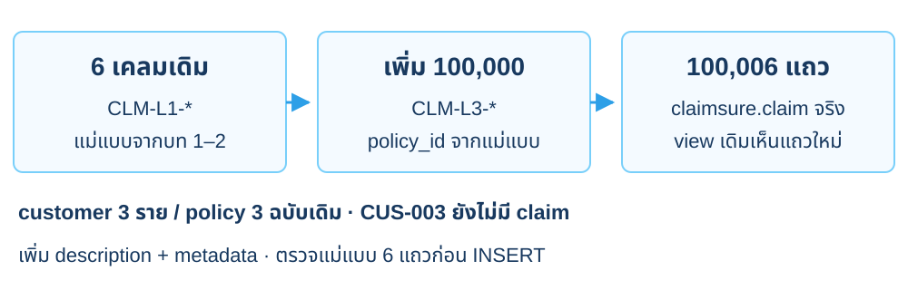
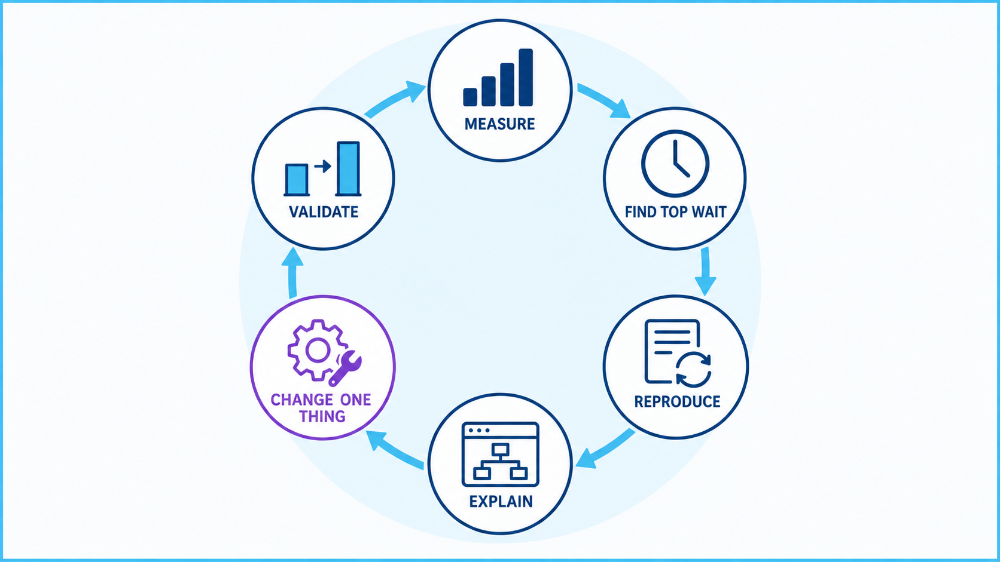
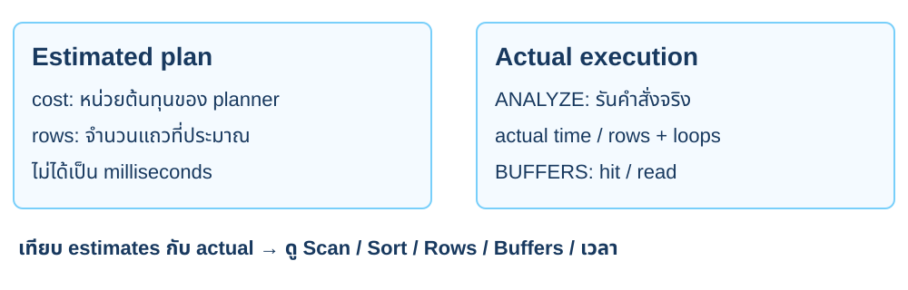
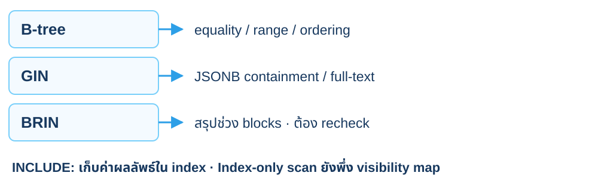
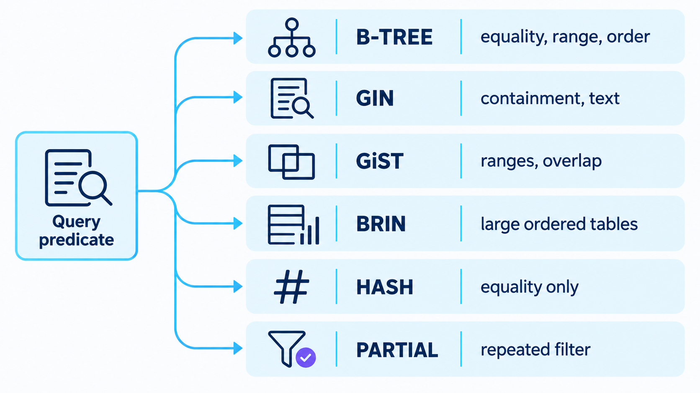
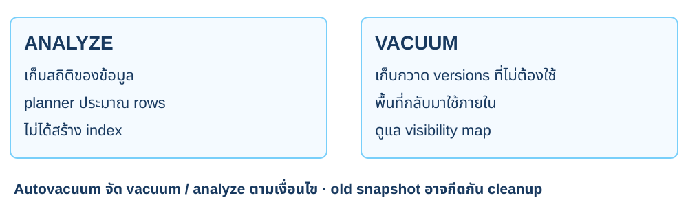
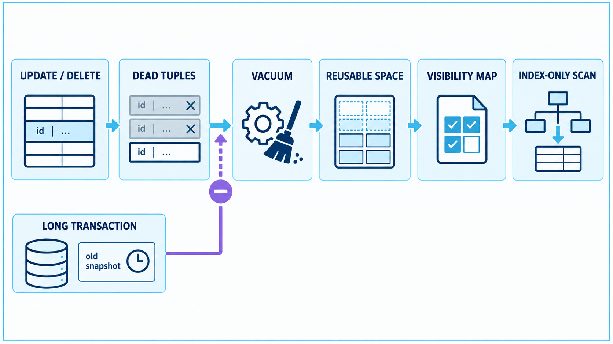
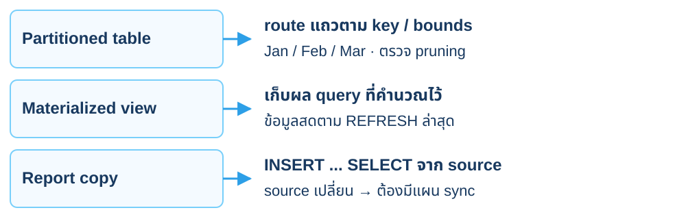
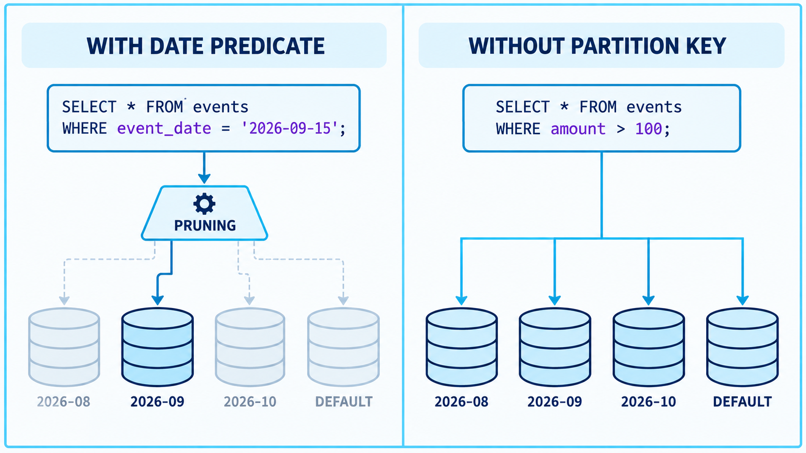
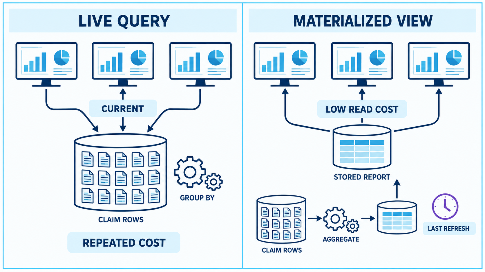

<CaseCover :module-id="3" />

# Module 3<br>Performance Tuning

## รายงานเคลมชุดเดิม เมื่อข้อมูลเพิ่มขึ้น

<footer class="cs-footer"><span>ClaimSure ต่อเนื่อง · คู่มือ ภาพรวม</span><span>1 / 27</span></footer>

<!--
Speaker notes:
บทนี้ใช้ฐานข้อมูล claimsure_xx และ schema claimsure จากบท 1–2 ต่อเนื่องกัน เปิดคู่มือบทนี้ไว้เพื่อทำ SQL/native commands ทีละขั้น ภาพปก: ./assets/module-03-performance-tuning-cover-enterprise-blue.png

Source: ../labs/module-03-performance-tuning.md · ภาพรวม
-->

---
layout: default
class: continuous-deck cs-module-three cs-fundamental
---

# 3A · Fundamental: ตรวจข้อมูลต่อเนื่อง

<div class="cs-flow"><div><strong>customer</strong><small>ลูกค้า 3 ราย</small></div><span aria-hidden="true">→</span><div><strong>policy</strong><small>กรมธรรม์ 3 ฉบับ</small></div><span aria-hidden="true">→</span><div><strong>claim</strong><small>เคลม 6 แถว</small></div></div>


| Object เดิม | บทบาทในบทนี้ |
| --- | --- |
| claim_detail_v | JOIN ลูกค้า กรมธรรม์ และเคลม |
| claim_tax() | สูตรภาษีเดียวกับรายงานบท 2 |

<footer class="cs-footer"><span>ClaimSure ต่อเนื่อง · Fundamental ก่อน Lab 3A</span><span>2 / 27</span></footer>

<!--
Speaker notes:
อ้างอิงคู่มือ labs/module-03-performance-tuning.md หัวข้อ 3A · อธิบายก่อนคำสั่งแล็บที่เกี่ยวข้อง
ต้องทำ 1D แล้ว CLM-L1-001 จึงอยู่ REVIEW เปิด query ผ่าน claim_detail_v และ claim_tax ก่อนเพิ่มข้อมูล เพื่อยืนยันว่าไม่ได้เริ่ม dataset ใหม่

Source: ../labs/module-03-performance-tuning.md · 3A
-->

---
layout: default
class: continuous-deck cs-module-three
---

# Lab 3A · ตรวจหกเคลมเดิมและ routines

| claim_no | กรมธรรม์ | status หลังบท 1 | estimated |
| --- | --- | --- | --- |
| CLM-L1-001 | POL-001 | REVIEW | 15,000 |
| CLM-L1-002 | POL-001 | REVIEW | 22,000 |
| CLM-L1-003 | POL-002 | APPROVED | 35,000 |
| CLM-L1-004 | POL-002 | PAID | 8,000 |
| CLM-L1-005 | POL-003 | NEW | 12,000 |
| CLM-L1-006 | POL-003 | REJECTED | 18,000 |

<footer class="cs-footer"><span>ClaimSure ต่อเนื่อง · คู่มือ Lab 3A</span><span>3 / 27</span></footer>

<!--
Speaker notes:
อ้างอิงคู่มือ labs/module-03-performance-tuning.md หัวข้อ 3A
รหัส claim_no เป็นจุดอ้างอิงตลอดคอร์ส ไม่เดาว่า identity claim_id เท่ากับเลขท้ายเคลม CUS-001 ถือ POL-001 และ POL-002 ส่วน CUS-002 ถือ POL-003

Source: ../labs/module-03-performance-tuning.md · 3A
-->

---
layout: default
class: continuous-deck cs-module-three cs-fundamental
---

# 3B · Fundamental: ขยาย workload จากแม่แบบ



<p class="cs-concept-caption">รัน 3B เต็มจากคู่มือ · จำนวนรวมนี้ใช้เมื่อเริ่มจาก seed ของคอร์ส</p>

<footer class="cs-footer"><span>ClaimSure ต่อเนื่อง · Fundamental ก่อน Lab 3B</span><span>4 / 27</span></footer>

<!--
Speaker notes:
อ้างอิงคู่มือ labs/module-03-performance-tuning.md หัวข้อ 3B · อธิบายก่อนคำสั่งแล็บที่เกี่ยวข้อง
เพิ่ม description และ metadata บน claim จริง แถวใหม่อ้าง policy_id จากแม่แบบหกแถว ไม่สร้าง claim_perf แยก จำนวนนี้ใช้เมื่อเริ่มจาก seed ของคอร์สเท่านั้น

Source: ../labs/module-03-performance-tuning.md · 3B
-->

---
layout: default
class: continuous-deck cs-module-three
---

# Lab 3B · จับคู่เคลมใหม่กับแม่แบบ

หลังเตรียม `cs_m3_template` ตาม 3B ลองอ่าน mapping ก่อนเพิ่มข้อมูล

```sql
SELECT 'CLM-L3-'||lpad(g::text,6,'0') AS new_claim,
 t.template_no,t.policy_id,t.status
FROM generate_series(1,12) g
JOIN cs_m3_template t ON t.template_no=1+((g-1)%6)
ORDER BY g;
```


<p class="cs-takeaway">รัน INSERT เต็มในคู่มือ 3B เพื่อให้ workload ตรงกัน</p>

<footer class="cs-footer"><span>ClaimSure ต่อเนื่อง · คู่มือ Lab 3B</span><span>5 / 27</span></footer>

<!--
Speaker notes:
อ้างอิงคู่มือ labs/module-03-performance-tuning.md หัวข้อ 3B
หน้านี้เป็น SELECT ดู mapping เท่านั้น ใช้ INSERT เต็มในคู่มือเพื่อสร้าง description/metadata และ distribution ที่ถูกต้อง ไม่สร้าง bulk claims ด้วยตัวอย่างย่อคนละแบบ

Source: ../labs/module-03-performance-tuning.md · 3B
-->

---
layout: default
class: continuous-deck cs-module-three cs-fundamental cs-infographic
---

# 3C · Fundamental: วัดผลก่อนปรับ



<p class="cs-concept-caption">Workload เดิม → วัด → เปลี่ยนหนึ่งอย่าง → วัดซ้ำ · อย่างน้อย 3 รอบต่อช่วง</p>

<footer class="cs-footer"><span>ClaimSure ต่อเนื่อง · Fundamental ก่อน Lab 3C</span><span>6 / 27</span></footer>

<!--
Speaker notes:
อ้างอิงคู่มือ labs/module-03-performance-tuning.md หัวข้อ 3C · อธิบายก่อนคำสั่งแล็บที่เกี่ยวข้อง
เริ่มจาก query ที่ต้องการให้ดีขึ้นและสภาพก่อนเปลี่ยน แยกความต่างจาก cache, concurrency และ distribution ออกจากผลของ index ไม่ถือว่าเวลาหนึ่งรอบเป็นข้อพิสูจน์

Sources:
- https://www.postgresql.org/docs/18/performance-tips.html
- https://www.postgresql.org/docs/18/using-explain.html
-->

---
layout: default
class: continuous-deck cs-module-three cs-fundamental
---

# 3C · Fundamental: Estimated เทียบ Actual



<p class="cs-concept-caption">EXPLAIN ANALYZE รันจริง · buffer read อาจผ่าน OS cache</p>

<footer class="cs-footer"><span>ClaimSure ต่อเนื่อง · Fundamental ก่อน Lab 3C</span><span>7 / 27</span></footer>

<!--
Speaker notes:
อ้างอิงคู่มือ labs/module-03-performance-tuning.md หัวข้อ 3C · อธิบายก่อนคำสั่งแล็บที่เกี่ยวข้อง
ดู actual rows/time ร่วมกับ loops และ filter การประมาณผิดอาจเกี่ยวกับสถิติหรือ distribution ไม่ใช่แปลว่า planner เสีย คำสั่ง DML ที่ใส่ ANALYZE ต้องพิจารณา transaction และผลข้างเคียง

Sources:
- https://www.postgresql.org/docs/18/sql-explain.html
- https://www.postgresql.org/docs/18/using-explain.html
-->

---
layout: default
class: continuous-deck cs-module-three cs-fundamental
---

# 3C · Fundamental: Index และ INCLUDE



<p class="cs-concept-caption">Index เพิ่มพื้นที่และงานเขียน · มี index ไม่ได้แปลว่าต้องใช้ทุก query</p>

<footer class="cs-footer"><span>ClaimSure ต่อเนื่อง · Fundamental ก่อน Lab 3C</span><span>8 / 27</span></footer>

<!--
Speaker notes:
อ้างอิงคู่มือ labs/module-03-performance-tuning.md หัวข้อ 3C · อธิบายก่อนคำสั่งแล็บที่เกี่ยวข้อง
Planner เปรียบเทียบต้นทุนตาม selectivity และขนาดข้อมูล BRIN เป็น lossy summary ที่ต้อง recheck ส่วน index-only scan ยังพึ่ง visibility map จึงไม่ได้เกิดเพียงเพราะมี INCLUDE

Sources:
- https://www.postgresql.org/docs/18/indexes-types.html
- https://www.postgresql.org/docs/18/indexes-index-only-scans.html
-->

---
layout: default
class: continuous-deck cs-module-three
---

# Lab 3C · เก็บแผนก่อนสร้าง index

```sql
SELECT policy_id AS target_policy
FROM claimsure.policy WHERE policy_no='POL-001' \gset

EXPLAIN (ANALYZE,BUFFERS,SETTINGS)
SELECT claim_id,claim_no,incident_at,estimated_amount
FROM claimsure.claim
WHERE policy_id=:target_policy AND status='REVIEW'
ORDER BY incident_at DESC LIMIT 50;
```


<p class="cs-takeaway">จด Scan · Sort · Rows · Buffers · Execution Time</p>

<footer class="cs-footer"><span>ClaimSure ต่อเนื่อง · คู่มือ Lab 3C</span><span>9 / 27</span></footer>

<!--
Speaker notes:
อ้างอิงคู่มือ labs/module-03-performance-tuning.md หัวข้อ 3C
อ่าน policy_id จาก policy_no โดยตรง รัน query เดิมอย่างน้อยสามครั้ง จด median และจำนวน buffer ไม่ตัดสินจากเวลาครั้งเดียว

Source: ../labs/module-03-performance-tuning.md · 3C
-->

---
layout: default
class: continuous-deck cs-module-three
---

# Lab 3C · Partial covering index สำหรับ REVIEW

```sql
CREATE INDEX cs_claim_review_policy_time
ON claimsure.claim(policy_id,incident_at DESC)
INCLUDE(claim_id,claim_no,estimated_amount)
WHERE status='REVIEW';
ANALYZE claimsure.claim;
```


<div class="cs-flow"><div><strong>policy_id</strong><small>กรองกรมธรรม์</small></div><span aria-hidden="true">→</span><div><strong>incident_at</strong><small>คืนเคลมใหม่ก่อน</small></div><span aria-hidden="true">→</span><div><strong>INCLUDE</strong><small>ค่าที่ SELECT ต้องอ่าน</small></div></div>

<footer class="cs-footer"><span>ClaimSure ต่อเนื่อง · คู่มือ Lab 3C</span><span>10 / 27</span></footer>

<!--
Speaker notes:
อ้างอิงคู่มือ labs/module-03-performance-tuning.md หัวข้อ 3C
รัน EXPLAIN หน้าเดิมอีกครั้ง predicate ต้องตรงกับ partial index การได้ index-only scan ขึ้นกับ visibility map ด้วย Index เพิ่มต้นทุนเขียนและพื้นที่

Source: ../labs/module-03-performance-tuning.md · 3C
-->

---
layout: default
class: continuous-deck cs-module-three cs-fundamental cs-infographic
---

# 3D · Fundamental: เลือก index ตาม operator



<p class="cs-concept-caption">เลือก method จาก operator · Partial คือ predicate เพิ่มเติมของ index</p>

<footer class="cs-footer"><span>ClaimSure ต่อเนื่อง · Fundamental ก่อน Lab 3D</span><span>11 / 27</span></footer>

<!--
Speaker notes:
อ้างอิงคู่มือ labs/module-03-performance-tuning.md หัวข้อ 3D · อธิบายก่อนคำสั่งแล็บที่เกี่ยวข้อง
ภาพแสดงแนวเลือก access method จาก operator และรูปข้อมูล สำหรับชุด continuous ใช้ expression B-tree กับ lower(claim_no), GIN jsonb_path_ops กับ containment และ BRIN กับ incident_at ที่ต้องตรวจ correlation ภาพรวม GiST และ Hash ไว้เพื่ออ้างอิง ไม่เพิ่มการทดลองที่ไม่มีใน 3D Partial เป็นรูปแบบใช้ predicate จำกัดแถว ไม่ใช่ index method แยกอีกชนิดหนึ่ง อย่าปิด sequential scan เพื่อบังคับผลให้เหมือนภาพ

Source: ../labs/module-03-performance-tuning.md · 3D
Visual reference: postgres-admin-labs/docs/slides/module-03-performance-tuning.md
-->

---
layout: default
class: continuous-deck cs-module-three cs-fundamental
---

# 3D · Fundamental: Query และ index ที่ตรงกัน

| Query | Index | สิ่งที่ต้องดู |
| --- | --- | --- |
| policy + REVIEW + ORDER BY | Partial B-tree + INCLUDE | กรองและคืน 50 แถว |
| lower(claim_no) = … | Expression B-tree | expression ตรงกัน |
| metadata @> … | GIN jsonb_path_ops | รองรับ containment |
| incident_at เป็นช่วง | BRIN | physical order สัมพันธ์กับเวลา |


<p class="cs-takeaway">Query ที่คืนหลายแถวอาจเลือก sequential scan ได้</p>

<footer class="cs-footer"><span>ClaimSure ต่อเนื่อง · Fundamental ก่อน Lab 3D</span><span>12 / 27</span></footer>

<!--
Speaker notes:
อ้างอิงคู่มือ labs/module-03-performance-tuning.md หัวข้อ 3D · อธิบายก่อนคำสั่งแล็บที่เกี่ยวข้อง
ไม่บังคับ enable_seqscan=off เพื่อให้ดูเหมือนสำเร็จ BRIN ไม่เหมาะกับทุก distribution และ GIN ไม่แทน B-tree equality ทุก operator

Source: ../labs/module-03-performance-tuning.md · 3D
-->

---
layout: default
class: continuous-deck cs-module-three
---

# Lab 3D · Expression และ GIN บน claim เดิม

```sql
CREATE INDEX cs_claim_lower_no
ON claimsure.claim(lower(claim_no));
CREATE INDEX cs_claim_metadata_gin
ON claimsure.claim USING gin(metadata jsonb_path_ops);

EXPLAIN (ANALYZE,BUFFERS)
SELECT claim_no FROM claimsure.claim
WHERE lower(claim_no)=lower('CLM-L3-001000');
```

<footer class="cs-footer"><span>ClaimSure ต่อเนื่อง · คู่มือ Lab 3D</span><span>13 / 27</span></footer>

<!--
Speaker notes:
อ้างอิงคู่มือ labs/module-03-performance-tuning.md หัวข้อ 3D
คู่มือ 3D มี BRIN และ containment query เพิ่ม เปรียบเทียบ operator กับชนิด index จากแผนจริง metadata/description ใช้ต่อในบท 10

Source: ../labs/module-03-performance-tuning.md · 3D
-->

---
layout: default
class: continuous-deck cs-module-three cs-fundamental
---

# 3D · Fundamental: Statistics และ row versions



<p class="cs-concept-caption">Manual VACUUM ไม่ใช่ autovacuum · ไม่รับประกันว่าไฟล์จะเล็กลง</p>

<footer class="cs-footer"><span>ClaimSure ต่อเนื่อง · Fundamental ก่อน Lab 3D</span><span>14 / 27</span></footer>

<!--
Speaker notes:
อ้างอิงคู่มือ labs/module-03-performance-tuning.md หัวข้อ 3D · อธิบายก่อนคำสั่งแล็บที่เกี่ยวข้อง
ANALYZE ไม่ใช่การสร้าง index ส่วน ordinary VACUUM ไม่รับประกันว่าไฟล์จะเล็กลง Old snapshots อาจทำให้บาง versions ยังเก็บไว้ต้องใช้งานต่อ

Sources:
- https://www.postgresql.org/docs/18/planner-stats.html
- https://www.postgresql.org/docs/18/routine-vacuuming.html
-->

---
layout: default
class: continuous-deck cs-module-three cs-fundamental cs-infographic
---

# 3D · Fundamental: วงจร VACUUM



<p class="cs-concept-caption">VACUUM ช่วยคืนพื้นที่ภายในและ visibility map · long transaction อาจชะลอ cleanup</p>

<footer class="cs-footer"><span>ClaimSure ต่อเนื่อง · Fundamental ก่อน Lab 3D</span><span>15 / 27</span></footer>

<!--
Speaker notes:
อ้างอิงคู่มือ labs/module-03-performance-tuning.md หัวข้อ 3D · อธิบายก่อนคำสั่งแล็บที่เกี่ยวข้อง
ภาพเป็นแนวคิดการดูแล row versions ไม่ใช่ผลวัดของฐานนักเรียน การ UPDATE/DELETE เกิด versions เก่าที่จะเก็บกวาดได้เมื่อไม่จำเป็นต่อ snapshot แล้ว VACUUM ช่วยดูแล visibility map แต่ไม่ได้รับประกันว่า plan จะเป็น index-only scan หลังรันทุกครั้ง และไม่ใช่การคืน disk space ทั้งหมดให้ OS ขั้น 3D ใช้ manual VACUUM (ANALYZE) ไม่สรุปว่าเห็น autovacuum รอบใหม่แล้ว และไม่เพิ่มค่า autovacuum จากต้นฉบับโดยไม่มีในคู่มือ

Source: ../labs/module-03-performance-tuning.md · 3D
Visual reference: postgres-admin-labs/docs/slides/module-03-performance-tuning.md
-->

---
layout: default
class: continuous-deck cs-module-three
---

# Lab 3D · วัดต้นทุน index และทำ maintenance

```sql
SELECT indexrelname,idx_scan,
 pg_size_pretty(pg_relation_size(indexrelid)) AS bytes
FROM pg_stat_user_indexes
WHERE relid='claimsure.claim'::regclass;

VACUUM (ANALYZE) claimsure.claim;
```


<p class="cs-takeaway">Manual VACUUM ไม่ใช่ autovacuum และไม่รับประกันว่าไฟล์จะเล็กลง</p>

<footer class="cs-footer"><span>ClaimSure ต่อเนื่อง · คู่มือ Lab 3D</span><span>16 / 27</span></footer>

<!--
Speaker notes:
อ้างอิงคู่มือ labs/module-03-performance-tuning.md หัวข้อ 3D
อ่านสถิติเฉพาะ claim สถิติอาจช้าหรือเป็นค่าประมาณ เปรียบเทียบขนาดและต้นทุนเขียนกับประโยชน์การอ่านก่อนเก็บ index

Source: ../labs/module-03-performance-tuning.md · 3D
-->

---
layout: default
class: continuous-deck cs-module-three cs-fundamental
---

# 3E · Fundamental: Partition และผลรายงาน



<p class="cs-concept-caption">cs_claim_report แบ่งตามเดือน · claim หลักยังเป็นตารางเดิม</p>

<footer class="cs-footer"><span>ClaimSure ต่อเนื่อง · Fundamental ก่อน Lab 3E</span><span>17 / 27</span></footer>

<!--
Speaker notes:
อ้างอิงคู่มือ labs/module-03-performance-tuning.md หัวข้อ 3E · อธิบายก่อนคำสั่งแล็บที่เกี่ยวข้อง
Partitioning ไม่ใช่ผลสรุปและไม่ได้ทำให้ทุก query เร็วขึ้น การคัดลอก source ไป report เป็นอีกเรื่องหนึ่งกับการ route ภายใน partitioned table ต้องมีแผนปรับข้อมูลอนุพันธ์หลัง restore ด้วย

Sources:
- https://www.postgresql.org/docs/18/ddl-partitioning.html
- https://www.postgresql.org/docs/18/rules-materializedviews.html
-->

---
layout: default
class: continuous-deck cs-module-three cs-fundamental
---

# 3E · Fundamental: รายงานสำเนาจาก claim

<div class="cs-flow"><div><strong>claim</strong><small>ข้อมูลหลัก</small></div><span aria-hidden="true">→</span><div><strong>cs_claim_report</strong><small>สำเนาสำหรับอ่าน</small></div><span aria-hidden="true">→</span><div><strong>Jan / Feb / Mar</strong><small>partition ตาม incident_at</small></div></div>


| ข้อมูล | การเปลี่ยนแปลง |
| --- | --- |
| claim_detail_v | อ่านค่าปัจจุบันจาก claim |
| cs_claim_report | คงค่าตอน INSERT จนกว่าจะ sync ใหม่ |

<footer class="cs-footer"><span>ClaimSure ต่อเนื่อง · Fundamental ก่อน Lab 3E</span><span>18 / 27</span></footer>

<!--
Speaker notes:
อ้างอิงคู่มือ labs/module-03-performance-tuning.md หัวข้อ 3E · อธิบายก่อนคำสั่งแล็บที่เกี่ยวข้อง
รายงาน partition SELECT มาจาก claim เดิม สำเนาไม่สดเองหลัง UPDATE ต้องมีแผน sync

Source: ../labs/module-03-performance-tuning.md · 3E
-->

---
layout: default
class: continuous-deck cs-module-three cs-fundamental cs-infographic
---

# 3E · Fundamental: Partition pruning



<p class="cs-concept-caption">ภาพเป็น events / ก.ย. 2026 · แล็บ 3E ใช้ cs_claim_report / ก.พ. 2026</p>

<footer class="cs-footer"><span>ClaimSure ต่อเนื่อง · Fundamental ก่อน Lab 3E</span><span>19 / 27</span></footer>

<!--
Speaker notes:
อ้างอิงคู่มือ labs/module-03-performance-tuning.md หัวข้อ 3E · อธิบายก่อนคำสั่งแล็บที่เกี่ยวข้อง
ภาพต้นฉบับใช้ events และเดือน 08–10 พร้อม default partition เป็นเพียงตัวอย่างแนวคิด ชุด continuous ใช้ cs_claim_report ที่ range incident_at มกราคมถึงมีนาคม 2026 และไม่มี default partition อย่าวาง SQL จากภาพเป็นคำสั่งแล็บ ใช้ช่วงครึ่งเปิดตามคู่มือ 3E: >= กุมภาพันธ์ และ < มีนาคม ตรวจ child relation ที่ถูกอ่านจาก EXPLAIN เพื่อยืนยัน pruning ไม่ใช่แค่เห็นคำว่า partition ใน DDL

Source: ../labs/module-03-performance-tuning.md · 3E
Visual reference: postgres-admin-labs/docs/slides/module-03-performance-tuning.md
-->

---
layout: default
class: continuous-deck cs-module-three
---

# Lab 3E · Partition key และ primary key

```sql
CREATE TABLE claimsure.cs_claim_report (
 claim_id bigint NOT NULL, policy_id bigint NOT NULL,
 status text NOT NULL, incident_at timestamptz NOT NULL,
 estimated_amount numeric(14,2) NOT NULL,
 PRIMARY KEY(claim_id,incident_at)
) PARTITION BY RANGE(incident_at);

CREATE TABLE claimsure.cs_claim_report_2026_02
PARTITION OF claimsure.cs_claim_report
FOR VALUES FROM ('2026-02-01 00:00+07')
             TO ('2026-03-01 00:00+07');
```

<footer class="cs-footer"><span>ClaimSure ต่อเนื่อง · คู่มือ Lab 3E</span><span>20 / 27</span></footer>

<!--
Speaker notes:
อ้างอิงคู่มือ labs/module-03-performance-tuning.md หัวข้อ 3E
แสดง parent และหนึ่ง partition สร้างเดือนมกราคม/มีนาคมด้วยบล็อก 3E ก่อนโหลด ขอบเขตบนไม่รวมวันที่เท่ากัน

Source: ../labs/module-03-performance-tuning.md · 3E
-->

---
layout: default
class: continuous-deck cs-module-three
---

# Lab 3E · ตรวจ pruning ของกุมภาพันธ์

```sql
EXPLAIN (ANALYZE,BUFFERS)
SELECT count(*),sum(estimated_amount)
FROM claimsure.cs_claim_report
WHERE incident_at >= '2026-02-01 00:00+07'
  AND incident_at <  '2026-03-01 00:00+07';

SELECT tableoid::regclass,count(*)
FROM claimsure.cs_claim_report GROUP BY tableoid;
```


<p class="cs-takeaway">Plan ควรตัดเดือนอื่นออก · tableoid บอกที่เก็บจริง</p>

<footer class="cs-footer"><span>ClaimSure ต่อเนื่อง · คู่มือ Lab 3E</span><span>21 / 27</span></footer>

<!--
Speaker notes:
อ้างอิงคู่มือ labs/module-03-performance-tuning.md หัวข้อ 3E
ตรวจทั้ง routing และ pruning ถ้าไม่มี predicate ตาม partition key อาจอ่านหลาย partitions จึงไม่ใช่ว่าทุก query เร็วขึ้น

Source: ../labs/module-03-performance-tuning.md · 3E
-->

---
layout: default
class: continuous-deck cs-module-three cs-fundamental cs-infographic
---

# 3F · Fundamental: Live เทียบ Materialized



<p class="cs-concept-caption">Live query คำนวณตามข้อมูลที่มองเห็น · Materialized view อ่านผลที่ REFRESH ไว้</p>

<footer class="cs-footer"><span>ClaimSure ต่อเนื่อง · Fundamental ก่อน Lab 3F</span><span>22 / 27</span></footer>

<!--
Speaker notes:
อ้างอิงคู่มือ labs/module-03-performance-tuning.md หัวข้อ 3F · อธิบายก่อนคำสั่งแล็บที่เกี่ยวข้อง
ภาพแสดง trade-off ของงานอ่าน live report ทำ JOIN/aggregate ตาม query ส่วน materialized view ย้ายต้นทุนไปตอนสร้างหรือ refresh ไม่ได้เร็วกว่าเสมอสำหรับทุก workload และไม่ refresh อัตโนมัติ แล็บ 3F ใช้ claim_detail_v และ claim_tax เดิม กำหนด grain เป็น month_start/customer_code/status แล้วพิสูจน์ stale/refresh ด้วย estimated +100 และภาษีกลุ่ม +7.00 ใน transaction ที่ rollback กลับ

Source: ../labs/module-03-performance-tuning.md · 3F
Visual reference: postgres-admin-labs/docs/slides/module-03-performance-tuning.md
-->

---
layout: default
class: continuous-deck cs-module-three cs-fundamental
---

# 3F · Fundamental: ข้อมูลสดและผลสรุปที่เก็บไว้

| สิ่งที่อ่าน | ข้อมูลมาจากไหน | หลัง UPDATE claim |
| --- | --- | --- |
| claim_detail_v | JOIN ตารางหลักทุกครั้ง | เปลี่ยนตาม transaction visibility |
| cs_monthly_claim_summary | ผลคำนวณที่เก็บไว้ | คงค่าเดิมจน REFRESH |


<p class="cs-takeaway">ใช้ claim_tax() เดิมทั้งรายงานสดและผลสรุป</p>

<footer class="cs-footer"><span>ClaimSure ต่อเนื่อง · Fundamental ก่อน Lab 3F</span><span>23 / 27</span></footer>

<!--
Speaker notes:
อ้างอิงคู่มือ labs/module-03-performance-tuning.md หัวข้อ 3F · อธิบายก่อนคำสั่งแล็บที่เกี่ยวข้อง
นำสูตรภาษีบท 2 มาใช้ซ้ำ ไม่คัดลอกสูตรหลายเวอร์ชัน ตัดสิน freshness และรอบ refresh ให้ชัด

Source: ../labs/module-03-performance-tuning.md · 3F
-->

---
layout: default
class: continuous-deck cs-module-three
---

# Lab 3F · สร้างผลสรุปภาษีรายเดือน

```sql
CREATE MATERIALIZED VIEW
claimsure.cs_monthly_claim_summary AS
SELECT date_trunc('month',incident_at
 AT TIME ZONE 'Asia/Bangkok')::date AS month_start,
 customer_code,status,count(*) AS claim_count,
 sum(claimsure.claim_tax(estimated_amount,
                         approved_amount)) AS total_tax
FROM claimsure.claim_detail_v
GROUP BY 1,2,3;
```

<footer class="cs-footer"><span>ClaimSure ต่อเนื่อง · คู่มือ Lab 3F</span><span>24 / 27</span></footer>

<!--
Speaker notes:
อ้างอิงคู่มือ labs/module-03-performance-tuning.md หัวข้อ 3F
คู่มือสร้าง unique index ของ summary key ด้วย ระบุ timezone ของเดือนให้ชัด แถวสรุปหนึ่งกลุ่มไม่ใช่หนึ่ง claim

Source: ../labs/module-03-performance-tuning.md · 3F
-->

---
layout: default
class: continuous-deck cs-module-three
---

# Lab 3F · UPDATE / REFRESH / ROLLBACK

| ช่วง | claim สด | ผลสรุปที่เก็บไว้ |
| --- | --- | --- |
| ก่อน UPDATE | estimated 15,000 | ค่าเดิม |
| หลัง UPDATE ใน transaction | estimated 15,100 | ยังเท่าเดิม |
| หลัง REFRESH | ภาษีเคลม 1,057 | ภาษีกลุ่มเพิ่ม 7.00 |
| หลัง ROLLBACK | กลับ 15,000 | กลับผลสรุปเดิม |


<p class="cs-takeaway">ทดสอบ CLM-L1-001 ซึ่ง approved_amount เป็น NULL</p>

<footer class="cs-footer"><span>ClaimSure ต่อเนื่อง · คู่มือ Lab 3F</span><span>25 / 27</span></footer>

<!--
Speaker notes:
อ้างอิงคู่มือ labs/module-03-performance-tuning.md หัวข้อ 3F
ภาษีเดิม 1050 การเพิ่ม estimated 100 เพิ่มภาษี 7 เป็น expected arithmetic จากสูตรบท 2 ไม่ใช่ benchmark timing

Source: ../labs/module-03-performance-tuning.md · 3F
-->

---
layout: default
class: continuous-deck cs-module-three
---

# สรุป 3C–3F · หลักฐานก่อนตัดสินใจ

| สิ่งที่เก็บ | ก่อน | หลัง |
| --- | --- | --- |
| Query / parameter | คำสั่งเดิม | คำสั่งเดิม |
| Plan / rows / buffers | วัดจริง | วัดจริง |
| เวลาอย่างน้อย 3 รอบ | median | median |
| ต้นทุน | ขนาดและงานเขียนเดิม | ขนาดและงานเขียนเพิ่ม |


<p class="cs-takeaway">เก็บ index เมื่อช่วย workload ที่วัด และรับต้นทุนเขียนได้</p>

<footer class="cs-footer"><span>ClaimSure ต่อเนื่อง · คู่มือ Lab 3C–3F</span><span>26 / 27</span></footer>

<!--
Speaker notes:
อ้างอิงคู่มือ labs/module-03-performance-tuning.md หัวข้อ 3C–3F
ไม่คัดเลขเวลาจากเครื่องอื่น เปรียบเทียบเงื่อนไขเดียวกันและเก็บแผนเป็นหลักฐาน

Source: ../labs/module-03-performance-tuning.md · 3C–3F
-->

---
layout: default
class: continuous-deck cs-module-three
---

# สรุป 3A–3F · ตรวจข้อมูลที่ส่งต่อบท 4

```sql
SELECT count(*) AS expected_100006 FROM claimsure.claim;
SELECT count(*) AS expected_6
FROM claimsure.claim_detail_v
WHERE claim_no LIKE 'CLM-L1-%';
```


<p class="cs-takeaway">เก็บตารางหลัก · view/functions · indexes · description/metadata</p>

<footer class="cs-footer"><span>ClaimSure ต่อเนื่อง · คู่มือ Lab 3A–3F</span><span>27 / 27</span></footer>

<!--
Speaker notes:
อ้างอิงคู่มือ labs/module-03-performance-tuning.md หัวข้อ 3A–3F
ไม่ cleanup ตารางหลัก บท 4 ทดลองสิทธิ์บน claim และ view ชุดนี้ต่อ

Source: ../labs/module-03-performance-tuning.md · ส่งต่อ
-->

