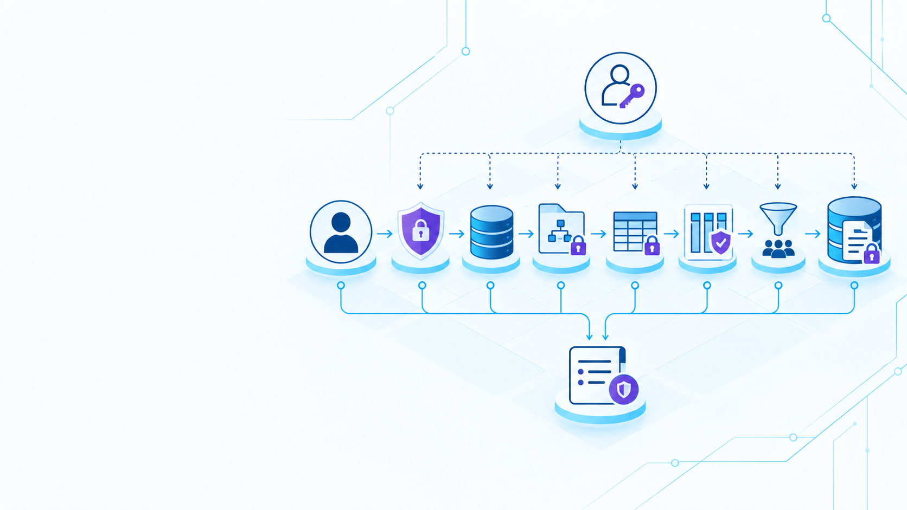
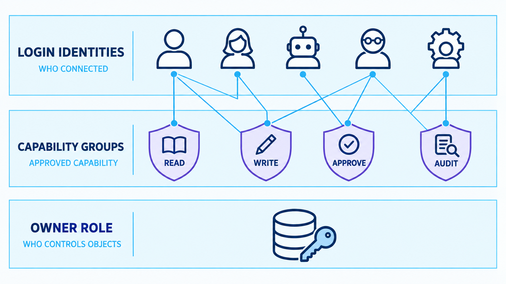
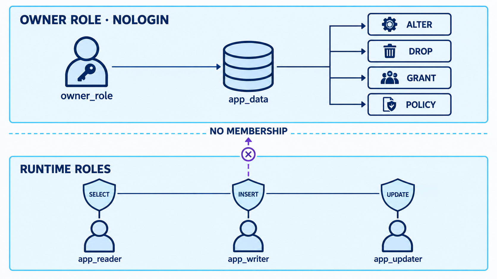
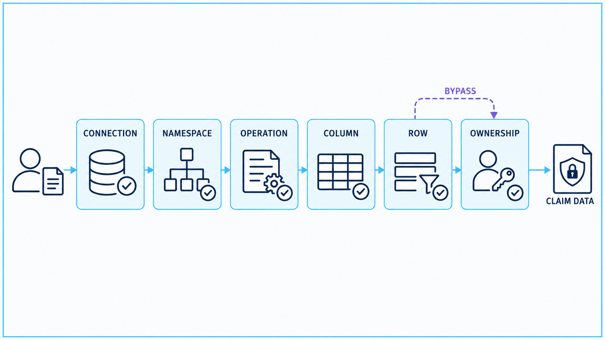
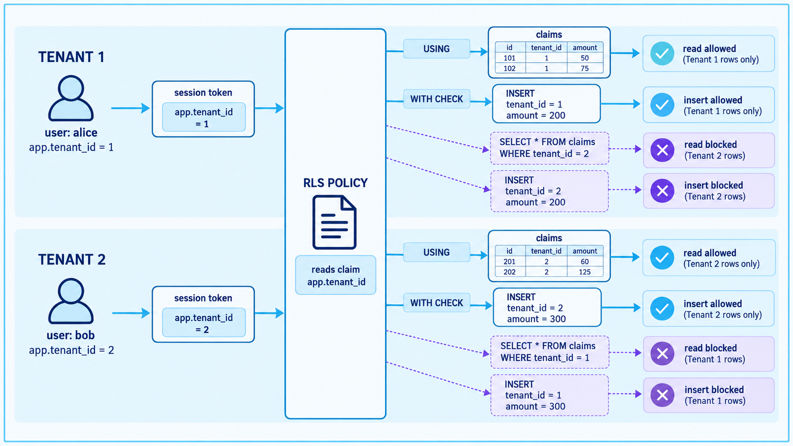

# Module 4: Security และ User Management

## พื้นฐาน เป้าหมาย Lab และหลักฐาน: จาก Bootstrap จนผู้เรียนจัดการผ่าน Owner ได้

<!--
Speaker notes:
- ชุดนี้ใช้เป็นคู่มือสอนประกอบ Pure SQL โดยตรง ทุก Lab เชื่อมหลักการกับผลที่ต้องพิสูจน์
- postgres ใช้เฉพาะช่วง 0 และ 4A จากนั้นใช้ student_xx กับบัญชีปกติของนักเรียน
- ก่อนทำจริงเปลี่ยน xx ทุกแห่งเป็นเลขนักเรียน และอ่าน LOGIN กับ START/END ทุกครั้ง
Source SQL: ../labs/module04-security-th/04-security-user-management.sql
-->

---
layout: default
class: pure-lab thai-deck
---

# กรณีศึกษาเดียวกับเป้าหมาย Security แปดด้าน

| Lab | พื้นฐาน | เป้าหมาย |
| --- | --- | --- |
| 4A | Identity และ Delegation | สร้าง Roles แล้วส่งต่อการจัดการ Lab ให้ผู้เรียน |
| 4B | Ownership และ Namespaces | สร้าง Objects ของ Lab ภายใต้ Owner |
| 4C | Privileges และ Membership | อนุญาตงานที่กำหนด และปฏิเสธ CREATE ใน Schema |
| 4D | Row-level Security | จำกัด Claim ตาม Tenant ที่กำลังใช้งาน |
| 4E | Column Privileges | แยกสิทธิ์เข้าถึงชื่อ ข้อมูลติดต่อ Status และยอดเงิน |
| 4F | การเรียก Routine และ Audit | มอบหมายงานโดยยังปกป้องหลักฐาน |
| 4G | Default Privileges | ให้สิทธิ์ Objects ที่ Owner จะสร้างในอนาคต |
| 4H | Effective Permissions | ตรวจ Grants, Membership, Ownership และ RLS |

<!--
Speaker notes:
- สไลด์ชุดนี้เดินตาม Pure SQL โดยตรง ไม่ใช้ลำดับของไฟล์ psql เวอร์ชันเดิม
- แต่ละ Lab ตอบคำถามด้านสิทธิ์หนึ่งเรื่อง แล้วพิสูจน์ด้วยผลสำเร็จและผลปฏิเสธ
- ให้ผู้เรียนเล่าหลักการก่อนรัน และใช้ผล Query ยืนยันหลังรัน
Source SQL: ../labs/module04-security-th/04-security-user-management.sql
-->

---
layout: default
class: pure-lab thai-deck
---

# อ่าน SQL Block ก่อนรัน

**เป้าหมาย:** รัน Statements ให้ถูกชุดด้วย Login ที่ถูกต้อง

~~~sql
-- START 4D.2 | App reads and inserts its tenant's claims
-- LOGIN: B = claim_app_xx
BEGIN;
-- ...the complete source block...
ROLLBACK;
-- END 4D.2
~~~

- เปิด `labs/module04-security-th/04-security-user-management.sql`
- แทน `xx` ทุกจุดด้วยหมายเลขผู้เรียนสองหลักก่อนรัน
- เลือก **START → END** ให้ครบหนึ่ง Block และให้ SQL Editor อยู่ในโหมด Auto-commit
- สลับ Connection ตาม **LOGIN** แล้วรัน Blocks ตามลำดับใน Source

ตัวอย่างบนสไลด์ใช้ประกอบแนวคิด **ลงมือรัน Source Block ให้ครบ** รวมขอบเขต Transaction

CLI: `make slides MODULE=4:th PORT=3046` เปิดสไลด์นี้
คู่มือทีละขั้น: `labs/module-04-security-user-management-th.md`
Source SQL: `labs/module04-security-th/04-security-user-management.sql` เลือกรันทีละ START/END ตาม Login

<!--
Speaker notes:
- อ่าน LOGIN และ Expected result ก่อนเลือก SQL ทุกครั้ง อย่าเลือก Execute All เพราะมีหลาย Login และ Expected error
- xx ในไฟล์นี้เป็นข้อความแทนเลขนักเรียน ต้องแก้ชื่อ Role, Schema, Database และ Marker ให้ตรงกัน
- Code บนสไลด์เป็นคำอธิบาย ไม่ใช่ชุดทดแทนที่ให้รันซ้ำหลัง Source block
Source SQL: ../labs/module04-security-th/04-security-user-management.sql
-->

---
layout: default
class: pure-lab thai-deck
---

# ห้า Connections ใช้ Database ของผู้เรียนเดียวกัน

| Connection | Login | หน้าที่ |
| --- | --- | --- |
| **A** | `postgres` | ใช้ Setup **เฉพาะ 0 และ 4A** |
| **S** | `student_xx` | จัดการ Lab นี้ตั้งแต่ 4B ถึง 4H |
| **B** | `claim_app_xx` | ทดสอบพฤติกรรมของ Application |
| **C** | `internal_auditor_xx` | ทดสอบการอ่านหลักฐานและ Columns ที่อนุญาต |
| **D** | `manager_th_xx` | ทดสอบการแก้ Status ที่ได้รับอนุญาต |

ทุก Connection ใช้ `claimsure_xx` บน Host และ Port เดียวกัน

`role_claimsure_owner_xx` เป็น **NOLOGIN** โดย Connection S ใช้ `SET LOCAL ROLE` เพื่อ Activate ระหว่างทำ DDL

<!--
Speaker notes:
- A ใช้ตอน Bootstrap ให้จบต้นบท จากนั้น S คือ Connection ผู้ดูแล Lab ของนักเรียนเอง
- B C D ต้อง Login จริง เพื่อไม่ให้ Superuser กลบผลการทดสอบสิทธิ์
- Owner ไม่ใช่ Login เพิ่มอีกบัญชี แต่เป็น Role ที่ S เปลี่ยนไปใช้ชั่วคราว
Source SQL: ../labs/module04-security-th/04-security-user-management.sql
-->

---
layout: default
class: pure-lab thai-deck
---

# พื้นฐาน: Privilege แต่ละแบบมีขอบเขตของตน

| คำถาม | กลไก |
| --- | --- |
| ใครผ่านการยืนยันตัวตน | Login และ HBA/Password Authentication |
| Login นี้เชื่อมต่อที่นี่ได้หรือไม่ | Database `CONNECT` |
| อ้างชื่อ Object นี้ได้หรือไม่ | Schema `USAGE` |
| อ่านหรือเปลี่ยนข้อมูลนี้ได้หรือไม่ | สิทธิ์ระดับ Table หรือ Column |
| เข้าถึงแถวใดได้บ้างภายใต้สิทธิ์ที่มี | RLS policy |
| สร้าง ให้สิทธิ์ หรือ ALTER Object นี้ได้หรือไม่ | Ownership |

`CONNECT` ไม่ได้ให้ SELECT และ Schema USAGE ไม่ได้ให้สิทธิ์ใน Table

Owner ดูแล DDL ส่วน Runtime Identity ทำเฉพาะงานกับข้อมูลที่ได้รับอนุญาต

<!--
Speaker notes:
- สิทธิ์หลายระดับตอบคนละคำถาม อย่า GRANT เพิ่มแบบเดาสุ่มจน Error หาย
- แยก Authentication, Object privileges และ RLS ออกจากกันก่อน
- Ownership เป็นอำนาจควบคุมโครงสร้าง ไม่ใช่สิทธิ์อ่านเขียนตามปกติ
Source SQL: ../labs/module04-security-th/04-security-user-management.sql
Reference: https://www.postgresql.org/docs/18/ddl-priv.html
-->

---
layout: default
class: pure-lab thai-deck
---

# Lab 0: ตรวจ Identity สำหรับ Setup

SQL 0 · LOGIN postgres · เลือก START / END ให้ครบ Block

**พื้นฐาน:** ชื่อ Database ไม่ได้บอกว่า Login เป็นใคร

**เป้าหมาย:** ยืนยัน Administrator, Database เป้าหมาย และเวอร์ชัน PostgreSQL ก่อนสร้างสิ่งใด

~~~sql
SELECT current_database(), session_user, current_user,
       current_database() = 'claimsure_xx' AS correct_database,
       current_user = session_user AND rolsuper AS administrator,
       current_setting('server_version_num')::int >= 180000
         AS postgresql_18
FROM pg_roles WHERE rolname = current_user;
~~~

**ผ่านเมื่อ:** ทั้งสามค่าเป็น true หากค่าใดเป็น false ให้แก้ Connection ก่อนทำ Lab 4A

<!--
Speaker notes:
- Prompt ที่มีชื่อ claimsure_xx บอก Database แต่ไม่ได้บอกว่าเป็น postgres
- เริ่มจากตรวจผู้ใช้จริงก่อน เพื่อไม่ให้กลับไปเจอ Permission denied ที่การสร้าง Role
- ใช้ผลสามช่องเป็นเงื่อนไขหยุด หากไม่ผ่านยังไม่ทำขั้นถัดไป
Source SQL: ../labs/module04-security-th/04-security-user-management.sql
SQL steps: 0
-->

---
layout: default
class: pure-lab infographic-slide thai-deck
---

# ก่อน Lab 4A: โครงสร้าง Roles

แนวคิด · LOGIN ระบุผู้เรียก · กลุ่ม NOLOGIN รวมความสามารถ · Owner ควบคุม Objects

ชื่อที่ใช้ใน Lab: <code>claim_app_xx</code> → <code>role_claimsure_write_xx</code> → <code>role_claimsure_read_xx</code>ส่วน Owner คือ <code>role_claimsure_owner_xx</code>ภาพแสดงประเภทของ Role ส่วน Membership ที่ใช้จริงกำหนดใน 4A.4

<!--
Speaker notes:
- ไล่ภาพจากบนลงล่าง: Login บอกว่าใครเชื่อมต่อ Group รวมสิทธิ์ที่อนุญาต และ Owner คุมโครงสร้าง Object
- เส้นในภาพเป็นตัวอย่างความสัมพันธ์ ไม่ใช่ Membership ที่ต้องสร้างตามทุกเส้น ให้ใช้คำสั่งจริงใน 4A.4
- ก่อน GRANT ต้องสร้าง Role ให้ครบก่อน Lab 4A จึงเริ่มที่ตัวตนแล้วค่อยมอบสิทธิ์
Source SQL: ../labs/module04-security-th/04-security-user-management.sql
Related lab: 4A.1–4A.4
-->

---
layout: default
class: pure-lab thai-deck
---

# Lab 4A: แยก Identity, Capability และ Ownership

SQL 4A.1, 4A.2, 4A.3, 4A.4 · LOGIN postgres · เลือก START / END ให้ครบ Block

**เป้าหมาย:** สร้าง Identities แล้วมอบหมายให้ผู้เรียนจัดการ Lab ของตน

| ประเภท | ตัวอย่าง | ความหมาย |
| --- | --- | --- |
| LOGIN | `claim_app_xx` | ผู้ที่ใช้เชื่อมต่อ |
| กลุ่มความสามารถแบบ NOLOGIN | `role_claimsure_write_xx` | ชุด Privileges ที่นำไปใช้ซ้ำได้ |
| Owner แบบ NOLOGIN | `role_claimsure_owner_xx` | ผู้ควบคุม Objects ของ Lab |
| Login ของผู้เรียนที่มีอยู่แล้ว | `student_xx` | ผู้ที่ Activate Owner ได้อย่างชัดเจน |

**ลำดับ:** สร้าง 11 Roles → ตรวจ Attributes → ตั้ง Password สาม Logins → ส่งต่อการจัดการ Lab

การสร้าง Role **ไม่ได้** ให้สิทธิ์ใน Table และชื่อ Role ว่า owner ก็ยังไม่มี Ownership จนกว่าจะสร้างหรือโอน Objects ให้

<!--
Speaker notes:
- สร้างตัวตนให้มีอยู่ก่อน GRANT ทุกตัว แล้วตรวจ Login กับ Group ว่าเป็นคนละหน้าที่
- มี 11 Role ใหม่ ส่วน student_xx มีอยู่จากระบบชั้นเรียนอยู่แล้ว
- ชื่อ Role ไม่ใช่อำนาจ สิทธิ์เกิดจาก Attribute, Membership, Grant และ Ownership
Source SQL: ../labs/module04-security-th/04-security-user-management.sql
SQL steps: 4A.1, 4A.2, 4A.3, 4A.4
-->

---
layout: two-cols-header
layoutClass: pure-lab thai-deck
class: pure-lab-column
---

# Lab 4A: สร้าง Roles และตรวจขอบเขต

SQL 4A.1, 4A.2, 4A.3 · LOGIN postgres · เลือก START / END ให้ครบ Block

::left::

**ตัวอย่าง Statements จาก 4A.1**

~~~sql
CREATE ROLE role_claimsure_owner_xx NOLOGIN;
CREATE ROLE role_claimsure_read_xx NOLOGIN;
CREATE ROLE role_claimsure_write_xx NOLOGIN;
CREATE ROLE claim_app_xx
  LOGIN INHERIT NOSUPERUSER
  NOCREATEDB NOCREATEROLE NOBYPASSRLS;
~~~

รัน Block ให้ครบเพื่อสร้าง Roles ทั้ง 11 และ Lab Markers

::right::

**หลักฐานจาก 4A.2**

- ทั้ง 11 Roles มี Lab Marker ของผู้เรียน
- Owner และ Groups มี `rolcanlogin = false`
- Runtime Roles ไม่มี SUPERUSER, CREATEROLE หรือ BYPASSRLS

**Passwords ใน 4A.3**

แทน Password Placeholders ของ App, Auditor และ Manager ทั้งสามค่าก่อนทำ ALTER ROLE

Passwords เหล่านี้ใช้ Login จริงสำหรับ Connections B, C และ D

<!--
Speaker notes:
- อย่ารันเพียงสี่ CREATE จากสไลด์ เพราะ SQL จริงสร้าง 11 Role ให้ครบก่อนใช้งาน
- ใช้ Marker สำหรับดูเฉพาะ Role ของ Lab และตรวจว่ารันด้วยเลขท้ายของตน
- Password ในไฟล์เป็น Placeholder ให้เปลี่ยนก่อน Execute และเก็บ Login ผู้ดูแลแยกจาก App
Source SQL: ../labs/module04-security-th/04-security-user-management.sql
SQL steps: 4A.1, 4A.2, 4A.3
-->

---
layout: default
class: pure-lab thai-deck
---

# Lab 4A.4: ส่งต่อสิทธิ์โดยไม่ให้ Superuser

SQL 4A.4 · LOGIN postgres · เลือก START / END ให้ครบ Block

**เป้าหมาย:** ให้ผู้เรียนจัดการ Schema ผ่าน Owner Role ที่ต้อง Activate โดยตั้งใจ

~~~sql
CREATE SCHEMA IF NOT EXISTS lab_m4_xx
  AUTHORIZATION role_claimsure_owner_xx;

GRANT role_claimsure_owner_xx TO student_xx
WITH INHERIT FALSE, SET TRUE, ADMIN FALSE;
~~~

| Membership Option | ผลที่เกิดขึ้น |
| --- | --- |
| `INHERIT FALSE` | ผู้เรียนไม่ได้ใช้ Owner Privileges โดยอัตโนมัติ |
| `SET TRUE` | ผู้เรียนสามารถ Activate Owner ได้โดยตั้งใจ |
| `ADMIN FALSE` | ผู้เรียนให้ Owner Membership นี้ต่อแก่ผู้อื่นไม่ได้ |

4A.4 เตรียม Database CONNECT และ Membership ของ Runtime Groups ด้วย

**จบ Setup ของ Administrator ที่นี่ จากนั้นใช้ Connection S**

<!--
Speaker notes:
- ขั้นนี้คือคำตอบของ Error must be able to SET ROLE ที่เคยเจอ ต้องให้ postgres ส่งมอบสิทธิ์ก่อน
- ไม่ให้ SUPERUSER หรือ CREATEROLE กับนักเรียน แต่ให้ SET เฉพาะ Owner ของ Lab นี้
- Schema สร้างไว้โดยผู้ดูแลแล้ว จึงไม่ต้องให้ CREATE บน Database เพื่อสร้าง Schema ในบทถัดไป
Source SQL: ../labs/module04-security-th/04-security-user-management.sql
SQL steps: 4A.4
Reference: https://www.postgresql.org/docs/18/role-membership.html
-->

---
layout: default
class: pure-lab infographic-slide thai-deck
---

# ก่อน Lab 4B: Ownership และ Runtime Access

แนวคิด · ใช้ Owner จัดการ Objects · Application Logins ได้เฉพาะสิทธิ์กับข้อมูลที่อนุญาต

ในตัวอย่างนี้ <code>owner_role</code> หมายถึง <code>role_claimsure_owner_xx</code>ส่วน Runtime App/Auditor/Manager ไม่มี Owner Membership <code>student_xx</code> เป็นผู้จัดการ Lab โดยมี Membership แบบ <code>SET TRUE</code>, <code>INHERIT FALSE</code> ที่กำหนดไว้อย่างชัดเจน

<!--
Speaker notes:
- กุญแจด้านบนคืออำนาจจัดการ Object ส่วนด้านล่างคือสิทธิ์ใช้ข้อมูล จึงแยก Owner ออกจากบัญชี Application
- NO MEMBERSHIP ในภาพใช้กับ Runtime roles ไม่ได้หมายถึง student_xx ซึ่งได้รับสิทธิ์ SET เป็น Owner ใน 4A.4
- Lab 4B ให้ Login เป็น student_xx แล้วใช้ SET LOCAL ROLE เพื่อสร้างตารางในนาม Owner โดยไม่เป็น Superuser
Source SQL: ../labs/module04-security-th/04-security-user-management.sql
Related lab: 4B.1–4B.3
-->

---
layout: default
class: pure-lab thai-deck
---

# Lab 4B: Activate Owner ก่อนทำ DDL

SQL 4B.1 · LOGIN student_xx · เลือก START / END ให้ครบ Block

**พื้นฐาน:** Login Identity อาจต่างจาก Role ที่ใช้รันคำสั่งจริง

**เป้าหมาย:** สร้าง Tables ในนาม `role_claimsure_owner_xx` ด้วย Connection S

~~~sql
SELECT session_user, current_user,
       pg_has_role(session_user, 'role_claimsure_owner_xx', 'SET')
         AS can_set_owner;
~~~

**4B.1 ผ่านเมื่อ:** ทั้งสอง User เป็น `student_xx`, can_set_owner เป็น true, ผู้เรียนไม่ใช่ Superuser และ Schema ของ Owner มีอยู่แล้ว

~~~sql
BEGIN;
SET LOCAL ROLE role_claimsure_owner_xx;
SELECT session_user, current_user;
COMMIT;
~~~

ภายใน Transaction: student / owner หลัง COMMIT: student / student

<!--
Speaker notes:
- เปลี่ยน Connection จริงเป็น student_xx ก่อน แล้วตรวจว่าการส่งมอบ 4A.4 สำเร็จ
- can_set_owner เป็น false ให้ย้อนตรวจ 4A.4 ไม่แก้โดยยกนักเรียนเป็น Superuser
- SET LOCAL ROLE อยู่เฉพาะ Transaction จึงต้องใส่ใหม่ในทุกชุด DDL
Source SQL: ../labs/module04-security-th/04-security-user-management.sql
SQL steps: 4B.1
-->

---
layout: default
class: pure-lab thai-deck
---

# Lab 4B: สร้าง Objects ใน Namespace ของผู้เรียน

SQL 4B.2 · LOGIN student_xx · เลือก START / END ให้ครบ Block

**เป้าหมาย:** เตรียม Objects สามรายการเดียวกันสำหรับ Labs ที่ตามมา

| Object | เหตุผลที่ต้องมี | ใช้ใน Lab |
| --- | --- | --- |
| `lab_m4_xx.claim_secure` | Claims ของสอง Tenants | C, D, E, F, H |
| `lab_m4_xx.policyholder_secure` | ชื่อที่เปิดให้อ่านกับข้อมูลติดต่อที่จำกัดสิทธิ์ | E |
| `lab_m4_xx.claim_audit` | หลักฐานการเปลี่ยนข้อมูลทางธุรกิจ | F, H |

**รูปแบบการรัน 4B.2**

~~~sql
BEGIN;
SET LOCAL ROLE role_claimsure_owner_xx;
-- CREATE the three tables; revoke PUBLIC access
COMMIT;
~~~

**ผ่านเมื่อ:** Tables และ Identity Sequences เป็นของ Owner ไม่ใช่ App

<!--
Speaker notes:
- อธิบายว่าแต่ละตารางสร้างเพื่อทดลองอะไร จะได้ไม่รู้สึกว่าเปลี่ยนตัวอย่างกลางบท
- S เปลี่ยนเป็น Owner ก่อน CREATE เพื่อให้ Ownership ตรงกับแบบที่ออกแบบไว้
- ยังไม่เปิด RLS ในขั้นนี้ เพื่อให้เปรียบเทียบก่อนและหลังใน Lab C กับ D
Source SQL: ../labs/module04-security-th/04-security-user-management.sql
SQL steps: 4B.2
-->

---
layout: default
class: pure-lab thai-deck
---

# Lab 4B: เตรียม Baseline สำหรับตรวจผล

SQL 4B.3 · LOGIN student_xx · เลือก START / END ให้ครบ Block

**เป้าหมาย 4B.3:** เตรียมข้อมูลเพื่อทดสอบการมองเห็นซ้ำได้

| Tenant | Claim | Status เริ่มต้น |
| --- | --- | --- |
| 101 | `SEC-101-001` | NEW |
| 101 | `SEC-101-002` | UNDER_REVIEW |
| 202 | `SEC-202-001` | NEW |

~~~sql
SELECT tenant_id, count(*) AS claims
FROM lab_m4_xx.claim_secure
GROUP BY tenant_id ORDER BY tenant_id;
~~~

**ผ่านเมื่อ:** Tenant 101 มี **2** Claims และ Tenant 202 มี **1** Claim

Policyholder Seed เป็นข้อมูลจำลอง Lab E ใช้ชื่อ Email และ Phone เพื่อทดสอบสิทธิ์ระดับ Column

<!--
Speaker notes:
- จำฐานสามแถวนี้ให้ได้ Lab C ต้องเห็นสาม ส่วน Lab D เมื่อใช้ Tenant 101 ต้องเหลือสอง
- Tenant ID เป็นข้อมูลธุรกิจในตัวอย่าง ไม่ต้องเปลี่ยน 101 เป็นเลขนักเรียน
- เลขนักเรียนใช้กับชื่อ Login, Role, Database, Schema และ Marker เท่านั้น
Source SQL: ../labs/module04-security-th/04-security-user-management.sql
SQL steps: 4B.3
-->

---
layout: default
class: pure-lab infographic-slide thai-deck
---

# ก่อน Lab 4C: ขอบเขต Object Permissions

แนวคิด · ระบุขอบเขตของ Permission ก่อนให้สิทธิ์

4C ตรวจ <strong>CONNECT → schema USAGE → table/column privileges</strong>ส่วน RLS อยู่ใน 4D และ Ownership ใช้ควบคุมการจัดการ Object การทำ SELECT/INSERT/UPDATE ปกติไม่จำเป็นต้องเป็น Owner ภาพนี้แสดงขอบเขตสิทธิ์ ไม่ใช่หกขั้นที่ทุกคำสั่งต้องผ่านตามลำดับ

<!--
Speaker notes:
- ใช้ภาพถามทีละขอบเขตว่าเชื่อมต่อได้ไหม อ้างชื่อตารางได้ไหม และทำ Operation ที่ต้องการได้ไหม
- Lab 4C ให้ CONNECT ไว้แล้ว จากนั้นเพิ่ม USAGE กับสิทธิ์ Table ผ่าน Group แล้วทดสอบด้วย claim_app_xx จริง
- Ownership ไม่ใช่ประตูสุดท้ายที่ทุก SELECT ต้องผ่าน และลูกศร BYPASS ไม่ใช่สิทธิ์ที่เรามอบให้ App ใน Lab นี้
Source SQL: ../labs/module04-security-th/04-security-user-management.sql
Related lab: 4C.1–4C.6
-->

---
layout: default
class: pure-lab thai-deck
---

# Lab 4C: Membership เชื่อม Login เข้ากับความสามารถ

SQL 4C.1, 4C.2, 4C.3 · LOGIN student_xx · เลือก START / END ให้ครบ Block

**เป้าหมาย:** อธิบายว่าทำไม App จึงได้รับ Effective Privileges

~~~mermaid
flowchart LR
  App["claim_app_xx"] --> Write["role_claimsure_write_xx"]
  Write --> Read["role_claimsure_read_xx"]
  Write -. INSERT / UPDATE .-> Claim["lab_m4_xx.claim_secure"]
  Read -. SELECT .-> Claim
  classDef security fill:#eaf7ff,stroke:#43b7ef,color:#0b356b,stroke-width:1.5px
  class App,Write,Read,Claim security
  linkStyle default stroke:#147dc1,color:#0b356b
~~~

Membership ถูกเตรียมไว้ใน **4A.4** ส่วน **4C.2** จะให้ Object Privileges แก่ Groups เหล่านั้น

Login ได้สิทธิ์ผ่านการสืบทอดเมื่อทั้งสาย Membership **และ** Object Grants ของ Group อนุญาต

<!--
Speaker notes:
- ลูกศร App ไป Write ไป Read คือ Membership ไม่ใช่การคัดลอกคำสั่ง GRANT ไปไว้ที่ App
- ตอน 4A.4 สมาชิกมีแล้ว แต่ยังไม่มี Table privileges จน Owner ให้ใน 4C.2
- แยก GRANT role TO user ออกจาก GRANT SELECT ON table TO role ให้ชัด
Source SQL: ../labs/module04-security-th/04-security-user-management.sql
SQL steps: 4C.1, 4C.2, 4C.3
Reference: https://www.postgresql.org/docs/18/role-membership.html
-->

---
layout: two-cols-header
layoutClass: pure-lab thai-deck
class: pure-lab-column
---

# Lab 4C: สร้างสาย Object Privileges

SQL 4C.1, 4C.2, 4C.3 · LOGIN student_xx · เลือก START / END ให้ครบ Block

::left::

**4C.1:** ตรวจ CONNECT ที่เตรียมจาก Bootstrap

**4C.2:** Activate Owner แล้วให้สิทธิ์ดังนี้

~~~sql
GRANT USAGE ON SCHEMA lab_m4_xx
TO role_claimsure_read_xx, role_claimsure_write_xx,
   role_claimsure_approve_xx, role_claimsure_audit_xx;

GRANT SELECT ON lab_m4_xx.claim_secure
TO role_claimsure_read_xx;

GRANT INSERT, UPDATE
ON lab_m4_xx.claim_secure
TO role_claimsure_write_xx;
~~~

::right::

**4C.3:** ตรวจ Membership ที่มีอยู่

| จุดตรวจสิทธิ์ | สิทธิ์ที่ App ควรมี |
| --- | --- |
| Database | CONNECT |
| Schema | USAGE |
| Claims | SELECT, INSERT, UPDATE |
| การสร้าง Schema | ไม่มี CREATE |
| Owner role | ไม่มี Membership |

4C.2 ให้ Sequence USAGE แยกต่างหาก การ INSERT ลง Identity อย่างเดียวไม่ได้พิสูจน์ว่าจำเป็นต้องมี Grant ของ Sequence

<!--
Speaker notes:
- การตรวจ CONNECT กับ Membership ทำในนาม S ส่วน GRANT สิทธิ์ Object ทำเป็น Owner
- ไม่มี GRANT Membership ใหม่ในขั้นนี้ เพราะ postgres เตรียมให้จบที่ 4A.4 แล้ว
- Sequence เป็น Object อีกชนิด แต่ตัวอย่าง Identity INSERT ไม่ใช่หลักฐานว่าต้องมี Sequence USAGE
Source SQL: ../labs/module04-security-th/04-security-user-management.sql
SQL steps: 4C.1, 4C.2, 4C.3
-->

---
layout: default
class: pure-lab thai-deck
---

# Lab 4C: พิสูจน์ทั้งผลที่อนุญาตและปฏิเสธ

SQL 4C.4, 4C.5, 4C.6 · LOGIN claim_app_xx · เลือก START / END ให้ครบ Block

**เปิด Connection B เป็น App ด้วย Password ของ App**

| Source Block | งานที่ทำ | หลักฐานที่คาดว่าจะได้ |
| --- | --- | --- |
| **4C.4** | SELECT ข้อมูล Claims | ได้ข้อมูลตั้งต้นสามแถว เพราะยังไม่เปิด RLS |
| **4C.4** | INSERT Claim สำหรับ Lab | สำเร็จ จากนั้น ROLLBACK จะยกเลิก |
| **4C.5** | CREATE TABLE ใน Schema ของ Owner | ถูกปฏิเสธด้วย SQLSTATE **42501** |
| **4C.6** | ROLLBACK | ล้างสถานะ Transaction ที่ล้มเหลว |

~~~sql
SELECT session_user, current_user;
~~~

ทั้งสองค่าต้องเป็น `claim_app_xx` หลัง ROLLBACK Login จริงยังคงเป็น App

<!--
Speaker notes:
- ใช้ Connection B จริง ไม่ใช่ postgres ที่อ่านตารางได้อยู่แล้ว
- ผลสามแถวตอนนี้เป็นผลที่ถูกต้อง เพราะ RLS ยังไม่ได้ตั้ง
- เมื่อ 4C.5 ถูกปฏิเสธให้เลือก 4C.6 แยกรันทันที ไม่ปล่อยให้ Transaction ค้าง
Source SQL: ../labs/module04-security-th/04-security-user-management.sql
SQL steps: 4C.4, 4C.5, 4C.6
-->

---
layout: default
class: pure-lab infographic-slide thai-deck
---

# ก่อน Lab 4D: แยก Tenant ด้วย RLS

แนวคิด · USING กรองแถวที่มีอยู่ · WITH CHECK ตรวจค่าของแถวที่จะเขียน

Tenants 1/2 ในภาพตรงกับ Tenants ใน Lab คือ <strong>101/202</strong>การอ่านข้าม Tenant ไม่พบแถวที่ตรงกัน ส่วน INSERT ข้าม Tenant จะเกิด Error <code>app.tenant_id</code> เป็น Context สำหรับสอน ไม่ใช่ Token ที่ยืนยันตัวตนแล้ว ต้องให้ Trusted Code เป็นผู้กำหนด

<!--
Speaker notes:
- อ่านภาพเป็นสองงาน: USING เลือกแถวที่มองเห็น ส่วน WITH CHECK ตรวจค่าของแถวที่จะเพิ่มหรือแก้
- ภาพใช้ Tenant 1 และ 2 แต่ข้อมูลใน SQL ใช้ 101 และ 202 คำว่า read blocked ในภาพหมายถึงแถวถูกกรอง ไม่ใช่ SELECT ต้องเกิด Error
- คำว่า session token ในภาพเป็นภาพแทน Context เท่านั้น ค่า app.tenant_id ใน Lab ผู้ใช้ตั้งเองได้ จึงยังไม่ใช่ขอบเขตความปลอดภัยสำหรับ Client ที่ไม่น่าเชื่อถือ
Source SQL: ../labs/module04-security-th/04-security-user-management.sql
Related lab: 4D.1–4D.5
-->

---
layout: default
class: pure-lab thai-deck
---

# Lab 4D: ตรวจ Object Permissions ก่อน Row Permissions

SQL 4D.1, 4D.2, 4D.3, 4D.4, 4D.5 · LOGIN student_xx → claim_app_xx · เลือก START / END ให้ครบ Block

**เป้าหมาย:** คงสิทธิ์ใน Table เดิม แต่จำกัดแถวตาม Tenant

| กลไก | คำถาม |
| --- | --- |
| INSERT / UPDATE / SELECT ระดับ Table | อนุญาตให้รันงานนี้หรือไม่ |
| Policy `USING` | มองเห็นหรือเลือกแถวเดิมใดเป็นเป้าหมายได้ |
| Policy `WITH CHECK` | เขียนค่าใหม่แบบใดได้บ้าง |

RLS ไม่ได้เติม Table Privileges ที่ขาดอยู่

Table ที่เปิด RLS แต่ไม่มี Policy ที่ใช้ได้จะ **Default Deny** ส่วน Superuser และ BYPASSRLS ข้าม RLS ได้ Owner ก็ข้ามตามปกติ เว้นแต่กำหนด FORCE

<!--
Speaker notes:
- Lab C เปิด Operation ส่วน Lab D จำกัดแถวที่ Operation นั้นแตะได้
- USING ตรวจแถวเดิม WITH CHECK ตรวจค่าที่จะเขียน ไม่ใช่สองชื่อของสิ่งเดียวกัน
- จึงต้องทดสอบด้วย App ที่ไม่มี Superuser, BYPASSRLS หรือ Ownership
Source SQL: ../labs/module04-security-th/04-security-user-management.sql
SQL steps: 4D.1, 4D.2, 4D.3, 4D.4, 4D.5
Reference: https://www.postgresql.org/docs/18/ddl-rowsecurity.html
-->

---
layout: default
class: pure-lab thai-deck
---

# Lab 4D.1: ติดตั้ง Tenant Policy

SQL 4D.1 · LOGIN student_xx · เลือก START / END ให้ครบ Block

**S Activate Owner แล้วรัน Policy Block ให้ครบ**

~~~sql
ALTER TABLE lab_m4_xx.claim_secure ENABLE ROW LEVEL SECURITY;
ALTER TABLE lab_m4_xx.claim_secure FORCE ROW LEVEL SECURITY;

CREATE POLICY claim_tenant_access ON lab_m4_xx.claim_secure
TO role_claimsure_read_xx, role_claimsure_write_xx,
   role_claimsure_approve_xx, role_claimsure_owner_xx
USING (
  tenant_id = nullif(current_setting('app.tenant_id', true), '')::bigint
)
WITH CHECK (
  tenant_id = nullif(current_setting('app.tenant_id', true), '')::bigint
);
~~~

รวม Owner ใน Policy เพื่อรองรับ Routine ที่ใช้ FORCE RLS ใน Lab F

เมื่อ Context ขาดหายหรือว่าง จะไม่ตรงกับ Tenant ใด

<!--
Speaker notes:
- กลับมา Connection S และทำใน Transaction ของ Owner ตาม Source block
- อย่าเปลี่ยน Policy ไปใช้ Role คนละเลข เพราะจะไม่ตรงกับ Membership ที่เตรียมไว้
- Owner อยู่ใน Policy เพื่อให้ Function ใน 4F นับ Tenant ได้แม้เปิด FORCE RLS
Source SQL: ../labs/module04-security-th/04-security-user-management.sql
SQL steps: 4D.1
-->

---
layout: default
class: pure-lab thai-deck
---

# Lab 4D: ทดสอบขอบเขตการอ่านและเขียนของ Tenant

SQL 4D.2, 4D.3, 4D.4 · LOGIN claim_app_xx · เลือก START / END ให้ครบ Block

**4D.2:** เริ่ม Transaction แล้วตั้ง Tenant เป็น 101

~~~sql
SELECT set_config('app.tenant_id', '101', true);
SELECT claim_no, tenant_id
FROM lab_m4_xx.claim_secure ORDER BY claim_no;
~~~

| Source Block | การทดสอบ | ผลที่คาดหวัง |
| --- | --- | --- |
| **4D.2** | อ่านข้อมูล Tenant 101 | พบ Claim ตั้งต้นที่ตรงกันสองแถว |
| **4D.2** | INSERT ให้ Tenant 101 | อนุญาต แล้ว ROLLBACK ตัวอย่างนี้ |
| **4D.3** | INSERT ให้ Tenant 202 ขณะ Context เป็น 101 | WITH CHECK ปฏิเสธด้วย **42501** |
| **4D.4** | กู้สถานะ | ROLLBACK Transaction ที่ล้มเหลว |

เปรียบเทียบ: **ก่อน RLS มี 3 แถว → เมื่อ Context เป็น Tenant 101 เห็น 2 แถว**

<!--
Speaker notes:
- เทียบ Query เดิมกับ Lab C เพื่อเห็นผลของการเพิ่ม Policy อย่างเดียว
- ตั้งค่า true ใน set_config หมายถึง Local ต่อ Transaction จึงต้องใส่ BEGIN ก่อน
- ค่าที่ INSERT ข้าม Tenant ถูกปฏิเสธ แม้ App จะมี INSERT บน Table แล้ว
Source SQL: ../labs/module04-security-th/04-security-user-management.sql
SQL steps: 4D.2, 4D.3, 4D.4
-->

---
layout: default
class: pure-lab thai-deck
---

# Lab 4D.5: Context ไม่ใช่หลักฐานยืนยันตัวตน

SQL 4D.5 · LOGIN claim_app_xx · เลือก START / END ให้ครบ Block

**เป้าหมาย:** แยกกรณีไม่มี Context ออกจากการอนุญาต Tenant ที่เชื่อถือได้

~~~sql
BEGIN;
SELECT set_config('app.tenant_id', '', true);
SELECT count(*) AS visible_claims
FROM lab_m4_xx.claim_secure;
ROLLBACK;
~~~

**ผ่านเมื่อ:** visible_claims เป็น **0**

SQL Client ตั้ง Custom GUCs ได้ Lab นี้สาธิตวิธีที่ Policy ประเมิน Context ส่วน Application จริงต้องตรวจสิทธิ์ Tenant ก่อนกำหนด Context

<!--
Speaker notes:
- ค่าว่างต้องไม่กลายเป็นการเห็นข้อมูลทุก Tenant จึงทดสอบศูนย์แถวให้ชัด
- GUC ไม่ได้พิสูจน์ว่าผู้ใช้เป็น Tenant นั้นจริง เพราะ SQL client ตั้งเองได้
- ย้ำ Scope ว่าเป็น Lab อธิบาย Policy evaluation ไม่ใช่กลไก Authentication สำเร็จรูป
Source SQL: ../labs/module04-security-th/04-security-user-management.sql
SQL steps: 4D.5
-->

---
layout: default
class: pure-lab infographic-slide thai-deck
---

# ก่อน Lab 4E: ขอบเขตระดับ Column และ Row

แนวคิด · แม้อ่านแถวได้ บาง Columns ในแถวนั้นก็ยังจำกัดสิทธิ์ได้

4E: Auditor อ่าน Columns ของชื่อที่อนุญาต ส่วน Manager แก้ Status แต่แก้ยอดเงินไม่ได้ Grant ระดับ Table อาจให้สิทธิ์ทุก Column อยู่แล้ว จึงต้องถอนสิทธิ์ที่กว้างกว่าก่อนจำกัด Column ส่วน Ownership แยกจาก Runtime Access และการข้าม RLS ไม่ใช่อำนาจทำ DDL

<!--
Speaker notes:
- กลับมาดูภาพเดิมโดยชี้ Column: เห็นแถวได้ไม่ได้แปลว่าอ่านหรือแก้ได้ทุกช่อง
- สิทธิ์ระดับ Table กับ Column เป็นทางให้สิทธิ์ที่อาจทับกัน ไม่ใช่ต้องผ่านทั้งสองประตูเสมอ ถ้ายังมี SELECT ทั้ง Table การจำกัด Column อย่างเดียวไม่ทำให้สิทธิ์เดิมหาย
- Lab 4E ทดสอบด้วย Auditor และ Manager จริง โดยไม่ใช้ Owner และไม่ให้ BYPASSRLS เพื่อให้เห็นขอบเขตที่ตั้งไว้
Source SQL: ../labs/module04-security-th/04-security-user-management.sql
Related lab: 4E.1–4E.7
-->

---
layout: default
class: pure-lab thai-deck
---

# Lab 4E: แยกสิทธิ์ระดับ Column ออกจาก Row

SQL 4E.1, 4E.2, 4E.3, 4E.4, 4E.5, 4E.6, 4E.7 · LOGIN student_xx / Auditor / Manager · เลือก START / END ให้ครบ Block

**เป้าหมาย:** ให้แต่ละหน้าที่เข้าถึงเฉพาะ Fields ที่จำเป็น

| Identity | Object | อนุญาต | ปฏิเสธ |
| --- | --- | --- | --- |
| Auditor | `policyholder_secure` | Identifier, Tenant และชื่อ | Email และ Phone |
| Manager | `claim_secure` | UPDATE status, updated_at | UPDATE amount |

Grant ระดับ Table ที่กว้างกว่า รวมถึงที่สืบทอดจาก Group อื่น ทำให้การจำกัด Column ที่แคบกว่าไม่ได้ผล

Claim Policy ยังกรองแถวของ Manager ตาม Tenant ส่วนตาราง Policyholder **ไม่ได้กรอง Tenant ในแบบฝึกหัดนี้**

<!--
Speaker notes:
- Column grant จำกัดว่าข้อมูลช่องใด ส่วน RLS จำกัดแถวใด จึงเป็นคนละแกน
- ก่อนให้เฉพาะ Column ต้องเอา Table-wide grant ที่ทับอยู่ และตรวจสิทธิ์ผ่าน Group อื่นด้วย
- อย่าอธิบายว่า RLS ป้องกันทุก Table เพราะ Source เปิด RLS เฉพาะ claim_secure
Source SQL: ../labs/module04-security-th/04-security-user-management.sql
SQL steps: 4E.1, 4E.2, 4E.3, 4E.4, 4E.5, 4E.6, 4E.7
-->

---
layout: two-cols-header
layoutClass: pure-lab thai-deck
class: pure-lab-column
---

# Lab 4E.1: ให้สิทธิ์เฉพาะ Columns ที่อนุญาต

SQL 4E.1 · LOGIN student_xx · เลือก START / END ให้ครบ Block

::left::

**Owner ตั้งค่าสำหรับ Audit Group**

~~~sql
REVOKE SELECT
ON lab_m4_xx.policyholder_secure
FROM role_claimsure_audit_xx;

GRANT SELECT (
  policyholder_id, tenant_id, full_name
)
ON lab_m4_xx.policyholder_secure
TO role_claimsure_audit_xx;
~~~

::right::

**Owner ตั้งค่าสำหรับ Approval Group**

~~~sql
GRANT SELECT ON lab_m4_xx.claim_secure
TO role_claimsure_approve_xx;

REVOKE UPDATE ON lab_m4_xx.claim_secure
FROM role_claimsure_approve_xx;

GRANT UPDATE (status, updated_at)
ON lab_m4_xx.claim_secure
TO role_claimsure_approve_xx;
~~~

SELECT รองรับ Predicates และ Fields ใน RETURNING ที่ Manager ใช้

<!--
Speaker notes:
- ทั้งสองฝั่งเป็นส่วนของ Source block เดียว ให้ S ใช้ Owner และรันให้ครบ Transaction
- Auditor กับ Manager มี Membership จาก 4A.4 แล้ว ตอนนี้จึงเริ่มได้ความสามารถของ Group
- Manager มี SELECT เพื่ออ่าน WHERE กับ RETURNING แต่ยัง UPDATE ได้เฉพาะ Column ที่กำหนด
Source SQL: ../labs/module04-security-th/04-security-user-management.sql
SQL steps: 4E.1
-->

---
layout: default
class: pure-lab thai-deck
---

# Lab 4E: ทดสอบด้วย Login จริงทั้งสองบัญชี

SQL 4E.2, 4E.3, 4E.4, 4E.5, 4E.6, 4E.7 · LOGIN internal_auditor_xx / manager_th_xx · เลือก START / END ให้ครบ Block

| Blocks | Login | การทำงาน | ผลที่เกิดขึ้น |
| --- | --- | --- | --- |
| **4E.2** | `internal_auditor_xx` | อ่าน Identifier และชื่อ | อนุญาต |
| **4E.3 → 4E.4** | Auditor เดิม | อ่านข้อมูลติดต่อ → ROLLBACK | ถูกปฏิเสธด้วย 42501 |
| **4E.5** | `manager_th_xx` | Tenant 101: แก้ Status | เปลี่ยนหนึ่งแถว แล้ว ROLLBACK |
| **4E.6 → 4E.7** | Manager เดิม | แก้ยอดเงิน → ROLLBACK | ถูกปฏิเสธด้วย 42501 |

**ตรวจ:** session_user และ current_user ต้องเป็น Login ปกติที่เลือกไว้

การปฏิเสธต้องเกิดกับงานที่ตั้งใจทดสอบ ไม่ใช่เพราะพิมพ์ชื่อ Role, Table หรือ Column ผิด

<!--
Speaker notes:
- แยก Connection C กับ D จริง และตรวจผู้ใช้ก่อนเลือก SQL แต่ละชุด
- Manager ต้องตั้ง Tenant context ใหม่ใน Transaction ของแต่ละ Test
- Error ที่ถูกต้องคือ 42501 ไม่ใช่ Syntax error หรือ Table not found
Source SQL: ../labs/module04-security-th/04-security-user-management.sql
SQL steps: 4E.2, 4E.3, 4E.4, 4E.5, 4E.6, 4E.7
-->

---
layout: default
class: pure-lab thai-deck
---

# Lab 4F: ควบคุมขอบเขตการรัน

SQL 4F.1, 4F.2 · LOGIN student_xx · เลือก START / END ให้ครบ Block

**เป้าหมาย:** อธิบายผู้เรียก Function Owner และ Actor ที่บันทึกใน Audit

| Identity | ความหมาย |
| --- | --- |
| `session_user` | Login ที่ผ่าน Authentication และใช้เป็น Audit Actor |
| `current_user` ขณะเรียก | App ที่กำลังทำงานทางธุรกิจ |
| Owner ของ SECURITY DEFINER Function | Privileges ที่ใช้ภายใน Routine |

Routine ใช้ Owner Privileges ได้โดยไม่ต้องให้ Owner Membership แก่ App

ใช้ชื่อ Objects ที่เชื่อถือได้ กำหนด search_path คงที่ และให้ EXECUTE อย่างตั้งใจ ส่วน Owner ของ Routine ที่นับข้อมูลยังต้องทำตาม FORCE RLS

<!--
Speaker notes:
- แยกว่าใคร Login ใครเรียก และ Function ใช้สิทธิ์ใครภายใน อย่าปนสามตัวนี้
- SECURITY DEFINER ไม่ได้ทำให้ App กลายเป็น Owner เมื่อ Function จบจะคืนบทบาทผู้เรียก
- search_path กับ EXECUTE เป็นส่วนของขอบเขตสิทธิ์ ต้องอธิบายคู่กับ Function body
Source SQL: ../labs/module04-security-th/04-security-user-management.sql
SQL steps: 4F.1, 4F.2
Reference: https://www.postgresql.org/docs/18/sql-createfunction.html
-->

---
layout: default
class: pure-lab thai-deck
---

# Lab 4F.1–4F.2: สร้าง Routines และ Trigger

SQL 4F.1, 4F.2 · LOGIN student_xx · เลือก START / END ให้ครบ Block

**4F.1:** สร้าง Routine นับข้อมูล Tenant ถอนสิทธิ์ PUBLIC แล้วให้ EXECUTE แก่ Read Group

**4F.2:** สร้าง Audit Routine และ Trigger แล้วให้เฉพาะ Audit Group อ่านหลักฐานด้วย SELECT

~~~mermaid
flowchart LR
  App["App UPDATE"] --> Claim["claim_secure"]
  Claim --> Trigger["Audit trigger"]
  Trigger --> Function["Owner routine"]
  Function --> Audit["claim_audit"]
  Auditor["Auditor SELECT"] --> Audit
  classDef security fill:#eaf7ff,stroke:#43b7ef,color:#0b356b,stroke-width:1.5px
  class App,Claim,Trigger,Function,Audit,Auditor security
  linkStyle default stroke:#147dc1,color:#0b356b
~~~

App ไม่มี Grant ให้เขียน Audit Table โดยตรง รัน CREATE FUNCTION แต่ละตัวให้ครบจนถึง COMMIT ของ Source Block

<!--
Speaker notes:
- 4F.1 สร้าง Function ก่อน GRANT EXECUTE; 4F.2 สร้าง Trigger function ก่อนติด Trigger
- App แก้ Table ธุรกิจ ส่วน Trigger เรียก Function ของ Owner ไปบันทึก Audit
- ไม่ต้องเพิ่มสิทธิ์ DELETE หรือ UPDATE ที่ Audit ให้ App เพื่อให้ Trigger ทำงาน
Source SQL: ../labs/module04-security-th/04-security-user-management.sql
SQL steps: 4F.1, 4F.2
-->

---
layout: default
class: pure-lab thai-deck
---

# Lab 4F.3: COMMIT ก่อนให้ Login อื่นอ่าน

SQL 4F.3 · LOGIN claim_app_xx · เลือก START / END ให้ครบ Block

**เป้าหมาย:** ให้ Connection C เห็นทั้งการ UPDATE ทางธุรกิจและ Audit Evidence

~~~sql
BEGIN;
SELECT set_config('app.tenant_id', '101', true);
SELECT lab_m4_xx.claim_count_for_current_tenant()
  AS tenant_claims;

UPDATE lab_m4_xx.claim_secure
SET status = 'UNDER_REVIEW', updated_at = clock_timestamp()
WHERE claim_no = 'SEC-101-001'
RETURNING claim_no, status;
COMMIT;
~~~

**ผ่านเมื่อ:** Routine คืนค่า **2** และ UPDATE กระทบ Claim **1** แถว

Block นี้ตั้งใจ COMMIT เพราะ Auditor อีก Connection อ่าน Audit Row ที่ App ยังไม่ Commit ไม่ได้

<!--
Speaker notes:
- จุดนี้ต่างจาก Test ก่อนหน้าที่ Rollback เพราะกำลังจะให้ Auditor อีก Connection อ่านหลักฐาน
- UPDATE กับ Audit อยู่ Transaction เดียวกัน จึงต้อง Commit ก่อนจึงจะเห็นจาก C
- อย่าเปลี่ยน COMMIT เป็น ROLLBACK แล้วคาดว่า Auditor จะเห็นแถวทดลอง
Source SQL: ../labs/module04-security-th/04-security-user-management.sql
SQL steps: 4F.3
-->

---
layout: default
class: pure-lab thai-deck
---

# Lab 4F.4–4F.6: ปกป้องและตรวจหลักฐาน

SQL 4F.4, 4F.5, 4F.6 · LOGIN claim_app_xx → internal_auditor_xx · เลือก START / END ให้ครบ Block

| Block | Login | ผลที่คาดหวัง |
| --- | --- | --- |
| **4F.4** | `claim_app_xx` | DELETE Audit ถูกปฏิเสธด้วย 42501 |
| **4F.5** | App เดิม | ROLLBACK Transaction ของ DELETE ที่ล้มเหลว |
| **4F.6** | `internal_auditor_xx` | อ่านหลักฐาน UPDATE ที่ Commit แล้ว |

~~~sql
SELECT event_time, actor, role_setting, operation, claim_id
FROM lab_m4_xx.claim_audit
ORDER BY audit_id DESC LIMIT 5;
~~~

**ผ่านเมื่อ:** Actor เป็น `claim_app_xx` และ Operation เป็น UPDATE เมื่อ Login เป็น App โดยตรง role_setting มักเป็น `none`

ROLLBACK ของ DELETE ที่ล้มเหลวไม่ยกเลิก UPDATE ที่ Commit ไปก่อนหน้า

<!--
Speaker notes:
- 4F.3 Commit ไปแล้ว ส่วน 4F.4 เป็น Transaction ใหม่ที่ลบไม่สำเร็จ การ Rollback รอบนี้ไม่ย้อน 4F.3
- actor มาจาก session_user จึงเป็น App จริง ไม่ใช่ postgres แบบ Demo ที่ใช้ SET ROLE
- role_setting เป็น none ได้ตามปกติ เพราะ Login จริงไม่ได้สั่ง SET ROLE
Source SQL: ../labs/module04-security-th/04-security-user-management.sql
SQL steps: 4F.4, 4F.5, 4F.6
-->

---
layout: default
class: pure-lab thai-deck
---

# Lab 4G: Defaults อิงผู้สร้าง Object ในอนาคต

SQL 4G.1, 4G.2 · LOGIN student_xx → claim_app_xx · เลือก START / END ให้ครบ Block

**เป้าหมาย:** อ่านตารางใหม่ได้โดยไม่ต้อง GRANT ให้ตารางนั้นด้วยตนเอง

| กติกา | ผลที่เกิดใน Lab |
| --- | --- |
| Defaults เป็นของผู้ที่จะสร้าง Object | ตั้งค่าในขณะใช้ Role `role_claimsure_owner_xx` |
| Defaults ไม่มีผลย้อนหลัง | Tables เดิมยังคง Grants เดิม |
| Defaults ไม่ได้สร้าง Row Policies | Tables ที่มีข้อมูลอ่อนไหวในอนาคตต้องตรวจแยก |

**ลำดับ:** S Activate Owner → ตั้ง Defaults → สร้างและ Seed future_note → Commit

**ทดสอบ:** B อ่านตารางใหม่ผ่าน Membership App → Write → Read

<!--
Speaker notes:
- Default privileges ไม่ได้ผูกกับคน Login ต้นทาง แต่ดู Role ที่ CREATE จริง
- จึงต้องตั้ง Defaults และ CREATE ในบทบาท Owner เดียวกัน
- การเปิด Default SELECT ไม่ได้แปลว่าตารางอนาคตมี RLS ให้เอง
Source SQL: ../labs/module04-security-th/04-security-user-management.sql
SQL steps: 4G.1, 4G.2
Reference: https://www.postgresql.org/docs/18/sql-alterdefaultprivileges.html
-->

---
layout: default
class: pure-lab thai-deck
---

# Lab 4G.1: ตั้ง Defaults ก่อนสร้าง Object

SQL 4G.1 · LOGIN student_xx · เลือก START / END ให้ครบ Block

**ตัวอย่าง Statements ภายใน Transaction ของ Owner**

~~~sql
ALTER DEFAULT PRIVILEGES IN SCHEMA lab_m4_xx
GRANT SELECT ON TABLES TO role_claimsure_read_xx;

CREATE TABLE lab_m4_xx.future_note (
  note_id bigint GENERATED ALWAYS AS IDENTITY PRIMARY KEY,
  message text NOT NULL
);
~~~

Block เต็มตั้ง Sequence Defaults และเพิ่มข้อความตัวอย่างด้วย

**ผ่านเมื่อ:** ผู้สร้างเป็น Owner และ Default Table Grant มีผลขณะ CREATE

<!--
Speaker notes:
- ตัวอย่างสร้าง Table หลัง ALTER DEFAULT PRIVILEGES เพื่อให้เห็นเหตุและผลตรง ๆ
- ให้รัน Source 4G.1 ทั้งชุด เพราะยังมี BEGIN, SET LOCAL ROLE, INSERT และ COMMIT
- Table นี้เป็นข้อความสาธิต ไม่ใช่ตารางข้อมูลลับที่สมมติว่าป้องกันด้วย RLS แล้ว
Source SQL: ../labs/module04-security-th/04-security-user-management.sql
SQL steps: 4G.1
-->

---
layout: default
class: pure-lab thai-deck
---

# Lab 4G.2: พิสูจน์ Grant ของ Table ใหม่

SQL 4G.2 · LOGIN claim_app_xx · เลือก START / END ให้ครบ Block

**Connection B: ไม่ต้อง GRANT เพิ่มบน future_note**

~~~sql
SELECT note_id, message
FROM lab_m4_xx.future_note;
~~~

**คาดหวัง:** ข้อมูลตัวอย่างหนึ่งแถว

อธิบายเส้นทางสิทธิ์ให้ครบ

`claim_app_xx` → `role_claimsure_write_xx` → `role_claimsure_read_xx` → Default SELECT บน Table ที่ Owner สร้าง

การอ่านสำเร็จต้องเกิดจากสายสิทธิ์ที่ตั้งไว้ ไม่ใช่เพราะใช้ Connection ของ Superuser ทดสอบ

<!--
Speaker notes:
- ให้ App อ่านจริงโดยไม่กลับไป GRANT บน future_note เพิ่มหลัง CREATE
- ถามผู้เรียนว่าสิทธิ์มาจากไหน ต้องตอบได้ถึง Default ของ Owner ไม่ใช่เพราะเป็นนักเรียนเลขเดียวกัน
- ผลหนึ่งแถวมาจาก INSERT ของ 4G.1
Source SQL: ../labs/module04-security-th/04-security-user-management.sql
SQL steps: 4G.2
-->

---
layout: default
class: pure-lab thai-deck
---

# Lab 4H.1: ตรวจ Effective Permission Matrix

SQL 4H.1 · LOGIN student_xx · เลือก START / END ให้ครบ Block

**เป้าหมาย:** ตรวจขอบเขตที่ต้องการ รวมถึงสิทธิ์ที่ตั้งใจไม่ให้

| ความสามารถของ App | ผลที่คาดหวัง |
| --- | --- |
| Database CONNECT | true |
| Schema USAGE | true |
| Schema CREATE | **false** |
| Claim SELECT | true |
| Audit DELETE | **false** |
| Owner Membership | **false** |

S Activate Owner ใน 4H.1 เพื่ออ้างชื่อ Table แบบ Qualified ระหว่างตรวจสอบ

การตรวจระบุ `claim_app_xx` โดยตรง Owner Privileges ของผู้เรียกไม่ใช้แทน Identity ที่กำลังทดสอบ

<!--
Speaker notes:
- true ทุกช่องไม่ใช่เป้าหมาย false สามช่องคือขอบเขตที่ตั้งใจออกแบบไว้
- S ใช้ Owner ชั่วคราวเพื่อ Resolve ชื่อตารางในการเรียก has_table_privilege
- ฟังก์ชันตรวจสิทธิ์ระบุ App เป็นผู้ถูกตรวจชัดเจน จึงไม่ใช่ดูว่า Owner ทำได้หรือไม่
Source SQL: ../labs/module04-security-th/04-security-user-management.sql
SQL steps: 4H.1
-->

---
layout: default
class: pure-lab thai-deck
---

# Lab 4H.2: ตรวจ Membership, Ownership และ RLS

SQL 4H.2 · LOGIN student_xx · เลือก START / END ให้ครบ Block

**เป้าหมาย:** เชื่อมพฤติกรรมที่เห็นใน C–G เข้ากับค่าที่กำหนดไว้จริง

| หลักฐาน | ผลที่คาดหวัง |
| --- | --- |
| Memberships ของ Runtime | Suffix ผู้เรียนถูกต้องและไม่มี ADMIN |
| Student → Owner | รับ Delegation จาก 4A.4 และตรวจสิทธิ์ SET ใน 4B.1 |
| Ownership ของ Tables | `role_claimsure_owner_xx` |
| claim_secure RLS | เปิดใช้งานและกำหนด FORCE |
| App → owner | ไม่มี Membership ตามที่ตรวจใน 4H.1 |

ใช้ `pg_auth_members` ตรวจสาย Membership และใช้ `pg_class` / `pg_namespace` ตรวจ Ownership กับ RLS Flags

Membership Query แสดง Members ที่มี Lab Marker ส่วน Login เดิมของผู้เรียนตรวจแยกใน 4B.1 ให้รัน 4H.2 หลังออกจาก Transaction ของ Owner แล้ว

<!--
Speaker notes:
- การไม่มี ADMIN ไม่ได้แปลว่าไม่มีสิทธิ์อ่าน เพราะ INHERIT กับ SET เป็นคนละตัวเลือก
- Owner membership ของ S มีไว้สำหรับจัดการ Lab แต่ไม่ส่งต่อไป App
- รวม Catalog evidence กับ Positive/Negative tests จึงอธิบายได้ว่าผลเกิดจากการตั้งค่าใด
Source SQL: ../labs/module04-security-th/04-security-user-management.sql
SQL steps: 4H.2
-->

---
layout: default
class: pure-lab thai-deck
---

# Errors ที่คาดไว้ห้ากรณี และ Recovery Blocks ห้าชุด

| งานที่ไม่อนุญาต | Error Block | Recovery Block | Login |
| --- | --- | --- | --- |
| CREATE ใน Schema ของ Owner | 4C.5 | **4C.6** | App |
| INSERT ข้าม Tenant | 4D.3 | **4D.4** | App |
| อ่าน Email/Phone | 4E.3 | **4E.4** | Auditor |
| แก้ยอดเงิน Claim | 4E.6 | **4E.7** | Manager |
| ลบ Audit Evidence | 4F.4 | **4F.5** | App |

การปฏิเสธที่คาดหวังทุกกรณีเป็น **SQLSTATE 42501** เมื่อเห็น Error แล้วให้เลือก Recovery Block ถัดไปแยกรัน

~~~sql
ROLLBACK;
~~~

หากเป็น Error อื่น ให้หยุดแล้วตรวจ Block, Login, ชื่อที่อ้างอิง และสิ่งที่ต้องเตรียมก่อน

<!--
Speaker notes:
- ทำ Error ให้เป็นส่วนของการเรียนรู้ ไม่ใช่เห็น Error แล้วถือว่า Script เสียทุกครั้ง
- Transaction ที่ล้มเหลวต้องกู้ก่อน ส่วน Login จริงยังเป็นบัญชีเดิมหลัง Rollback
- ถ้าเป็น Syntax error หรือ Object ไม่พบ อย่าเดินต่อเหมือนเป็น Expected denial
Source SQL: ../labs/module04-security-th/04-security-user-management.sql
-->

---
layout: default
class: pure-lab thai-deck
---

# ตรวจความเข้าใจ: อธิบายหลักฐานของแต่ละ Lab

| Lab | คำถามสำหรับผู้เรียน |
| --- | --- |
| 4A | ทำไม Student จึง Activate Owner ได้ แต่ App ทำไม่ได้ |
| 4B | Table ที่สร้างหลัง SET LOCAL ROLE เป็นของใคร |
| 4C | ทำไม CONNECT อย่างเดียวจึงไม่ให้ SELECT |
| 4D | ทำไมจาก Claims สามแถวจึงมองเห็นเพียงสองแถว |
| 4E | ทำไม Manager แก้ Status ได้แต่แก้ยอดเงินไม่ได้ |
| 4F | ทำไม App ต้อง Commit ก่อน Auditor อ่าน |
| 4G | Defaults ของ Role ใดมีผลกับ Table ใหม่ |
| 4H | ผล false ข้อใดพิสูจน์ขอบเขตที่ตั้งใจไว้ |

ทุกคำตอบต้องระบุ **Login, Effective Role, Source Block และผลที่คาดหวัง**

<!--
Speaker notes:
- ให้ผู้เรียนตอบจากผลที่เห็นจริงใน Lab ไม่ท่องเพียงชื่อสิทธิ์
- หากอธิบายได้ว่าทำอะไรใน Login ใดและต้องไม่ทำอะไร แสดงว่าเชื่อมหลักการกับคำสั่งได้
- ปิดด้วยการย้ำว่า postgres จบหลัง 4A.4 และขอบเขต Lab ที่เหลืออยู่กับนักเรียน
Source SQL: ../labs/module04-security-th/04-security-user-management.sql
-->
