<CaseCover :module-id="4" />

# Module 4<br>Security

## ให้พนักงานเห็นเคลมของลูกค้าที่รับผิดชอบ

<footer class="cs-footer"><span>ClaimSure ต่อเนื่อง · คู่มือ ภาพรวม</span><span>1 / 29</span></footer>

<!--
Speaker notes:
บทนี้ใช้ฐานข้อมูล claimsure_xx และ schema claimsure จากบท 1–2 ต่อเนื่องกัน เปิดคู่มือบทนี้ไว้เพื่อทำ SQL/native commands ทีละขั้น ภาพปก: ./assets/module-04-security-cover-enterprise-blue.png

Source: ../labs/module-04-security.md · ภาพรวม
-->

---
layout: default
class: continuous-deck cs-module-four cs-fundamental
---

# 4.0 · Fundamental: ตัวตน สิทธิ์ และเจ้าของ

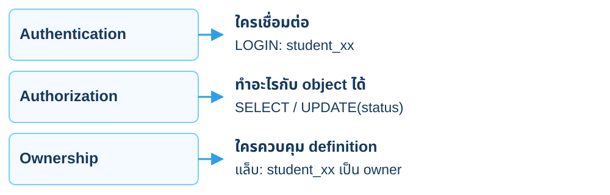

<p class="cs-concept-caption">GRANT ALL ไม่ใช่การโอน ownership · Role เป็นระดับ cluster</p>

<footer class="cs-footer"><span>ClaimSure ต่อเนื่อง · Fundamental ก่อน Lab 4.0</span><span>2 / 29</span></footer>

<!--
Speaker notes:
อ้างอิงคู่มือ labs/module-04-security.md หัวข้อ 4.0 · อธิบายก่อนคำสั่งแล็บที่เกี่ยวข้อง
Role เป็นระดับ cluster ส่วน privileges ผูกกับ objects ใน database สิทธิ์แก้ definition/drop มีที่มาจาก ownership ไม่เท่ากับการได้รับ grants ปกติ

Sources:
- https://www.postgresql.org/docs/18/user-manag.html
- https://www.postgresql.org/docs/18/ddl-priv.html
-->

---
layout: default
class: continuous-deck cs-module-four cs-fundamental cs-infographic
---

# 4.0 · Fundamental: โครงสร้าง roles

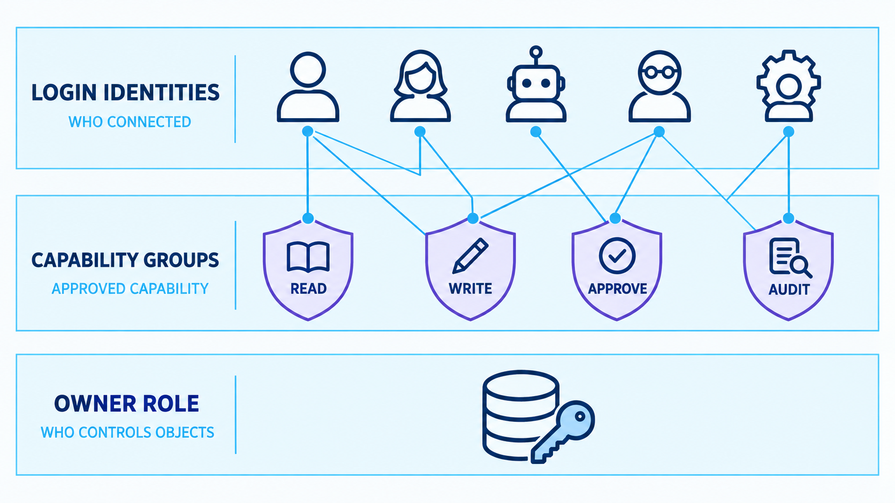

<p class="cs-concept-caption">LOGIN ระบุตัวตน · กลุ่มรวมสิทธิ์ · แล็บ: student_xx → actor → reader</p>

<footer class="cs-footer"><span>ClaimSure ต่อเนื่อง · Fundamental ก่อน Lab 4.0</span><span>3 / 29</span></footer>

<!--
Speaker notes:
อ้างอิงคู่มือ labs/module-04-security.md หัวข้อ 4.0 · อธิบายก่อนคำสั่งแล็บที่เกี่ยวข้อง
ภาพเป็นการจัดหมวด identity/capability/ownership ไม่ใช่รายการ roles ที่ต้องสร้างทุกชื่อหรือทุกเส้น ในชุด continuous ใช้ student_xx เป็น login และ owner ของ objects เดิม; cs_actor_xx และ cs_reader_xx เป็น NOLOGIN roles ที่อาจารย์เตรียมใน 4.0 ห้ามสร้าง owner/app/manager/auditor ของต้นฉบับเพิ่มตามภาพ และไม่ให้ CREATEROLE หรือ SUPERUSER แก่นักเรียน

Source: ../labs/module-04-security.md · 4.0
Visual reference: postgres-admin-labs/docs/slides/module-04-security-user-management.md
-->

---
layout: default
class: continuous-deck cs-module-four cs-fundamental
---

# 4.0 · Fundamental: student / actor / reader

<div class="cs-flow"><div><strong>student_xx</strong><small>login / เจ้าของ objects</small></div><span aria-hidden="true">→</span><div><strong>cs_actor_xx</strong><small>SET ROLE เพื่อทดลอง</small></div><span aria-hidden="true">→</span><div><strong>cs_reader_xx</strong><small>สิทธิ์อ่านที่ actor สืบทอด</small></div></div>


<p class="cs-takeaway">Instructor เตรียม NOLOGIN roles · ไม่ให้ CREATEROLE แก่นักเรียน</p>

<footer class="cs-footer"><span>ClaimSure ต่อเนื่อง · Fundamental ก่อน Lab 4.0</span><span>4 / 29</span></footer>

<!--
Speaker notes:
อ้างอิงคู่มือ labs/module-04-security.md หัวข้อ 4.0 · อธิบายก่อนคำสั่งแล็บที่เกี่ยวข้อง
Student เป็นสมาชิก actor แบบ INHERIT FALSE SET TRUE ส่วน actor สืบทอด reader แบบ INHERIT TRUE SET TRUE แยกชื่อตามเลขนักเรียน

Source: ../labs/module-04-security.md · 4.0
-->

---
layout: default
class: continuous-deck cs-module-four
---

# Lab 4.0 · Instructor เตรียม role membership

```sql
GRANT :"reader_role" TO :"actor_role"
WITH INHERIT TRUE, SET TRUE;
GRANT :"actor_role" TO :"student_role"
WITH INHERIT FALSE, SET TRUE;
```


| ตัวแปรจากคู่มือ 4.0 | แทน xx ด้วยหมายเลขของตน |
| --- | --- |
| reader_role | cs_reader_xx |
| actor_role | cs_actor_xx |
| student_role | student_xx |

<footer class="cs-footer"><span>ClaimSure ต่อเนื่อง · คู่มือ Lab 4.0</span><span>5 / 29</span></footer>

<!--
Speaker notes:
อ้างอิงคู่มือ labs/module-04-security.md หัวข้อ 4.0
สร้าง NOLOGIN roles และตัวแปรด้วย 4.0 ก่อน GRANT ไม่ทำส่วนเตรียมด้วยบัญชีนักเรียน ไม่มอบ SUPERUSER

Source: ../labs/module-04-security.md · 4.0
-->

---
layout: default
class: continuous-deck cs-module-four cs-fundamental cs-infographic
---

# 4A · Fundamental: Ownership กับ runtime

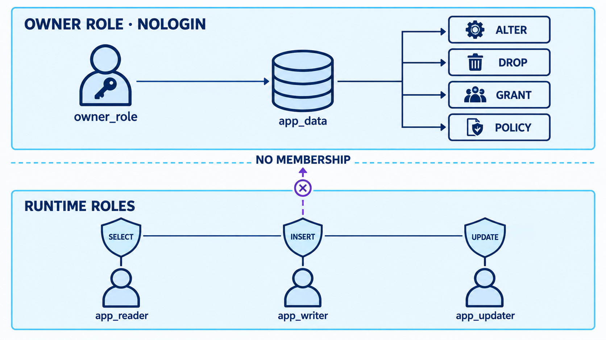

<p class="cs-concept-caption">ภาพ: owner แยกจาก runtime · แล็บนี้ student_xx เป็น owner</p>

<footer class="cs-footer"><span>ClaimSure ต่อเนื่อง · Fundamental ก่อน Lab 4A</span><span>6 / 29</span></footer>

<!--
Speaker notes:
อ้างอิงคู่มือ labs/module-04-security.md หัวข้อ 4A · อธิบายก่อนคำสั่งแล็บที่เกี่ยวข้อง
ภาพแยก NOLOGIN owner จาก runtime roles เพื่ออธิบายความต่างระหว่าง ownership กับ grants แต่แล็บ continuous ไม่ย้าย owner ไป role ใหม่: student_xx ยังคงเป็นเจ้าของ customer/policy/claim และ SET ROLE เป็น actor เพื่อลองสิทธิ์แคบลง อย่าโอน ownership ตามภาพ อ่าน ACL/RLS เดิมใน 4A ก่อนเปลี่ยนและเก็บไว้เทียบ 4F

Source: ../labs/module-04-security.md · 4A
Visual reference: postgres-admin-labs/docs/slides/module-04-security-user-management.md
-->

---
layout: default
class: continuous-deck cs-module-four
---

# Lab 4A · ตรวจ objects เดิมก่อนเปลี่ยนสิทธิ์

<div class="cs-flow"><div><strong>customer</strong><small>CUS-001 / CUS-002</small></div><span aria-hidden="true">→</span><div><strong>policy</strong><small>POL-001 ถึง 003</small></div><span aria-hidden="true">→</span><div><strong>claim</strong><small>100,006 แถว</small></div></div>


<p class="cs-takeaway">ใช้ CLM-L1-* หกเคลมเป็นจุดตรวจ · ไม่ทดสอบด้วย superuser</p>

<footer class="cs-footer"><span>ClaimSure ต่อเนื่อง · คู่มือ Lab 4A</span><span>7 / 29</span></footer>

<!--
Speaker notes:
อ้างอิงคู่มือ labs/module-04-security.md หัวข้อ 4A
ทำบท 3 ก่อน บทนี้ทดลองบน claim จริง ทุกชุดคืนค่าใน transaction ไม่สร้าง security_claim แยก นักเรียนต้องเป็นเจ้าของ objects เดิม

Source: ../labs/module-04-security.md · 4A
-->

---
layout: default
class: continuous-deck cs-module-four
---

# Lab 4A · เตรียมตัวแปรใน student connection

```sql
SELECT 'cs_reader_'||right(session_user,2) AS reader_role,
       'cs_actor_'||right(session_user,2) AS actor_role \gset
SELECT customer_id AS customer_a FROM claimsure.customer
WHERE customer_code='CUS-001' \gset
SELECT policy_id AS policy_a FROM claimsure.policy
WHERE policy_no='POL-001' \gset
SELECT policy_id AS policy_b FROM claimsure.policy
WHERE policy_no='POL-003' \gset
```

<p class="cs-takeaway">ใช้ student connection · ทำ 4A เต็มเพื่อเก็บ ACL/RLS ก่อนทดลอง</p>

<footer class="cs-footer"><span>ClaimSure ต่อเนื่อง · คู่มือ Lab 4A</span><span>8 / 29</span></footer>

<!--
Speaker notes:
อ้างอิงคู่มือ labs/module-04-security.md หัวข้อ 4A
หลังอาจารย์ทำ 4.0 กลับมา Bash และ psql ของ student ตาม README ไม่ใช้ connection postgres ค้างต่อจากขั้น instructor ตัวแปร reader_role/actor_role และ customer_a/policy_a/policy_b ใช้ใน 4B–4F ทุก \gset เป็น meta-command ของ psql ให้วางตามลำดับ ตรวจว่าอ่านได้หนึ่งแถวต่อ business key คำสั่งนี้ไม่เปลี่ยนสิทธิ์หรือข้อมูล ให้รัน SELECT ACL/RLS ที่เหลือในคู่มือ 4A และบันทึกค่าเดิมไว้เพื่อเทียบตอนจบ

Source: ../labs/module-04-security.md · 4A
-->

---
layout: default
class: continuous-deck cs-module-four cs-fundamental
---

# 4B · Fundamental: Login กับ effective role

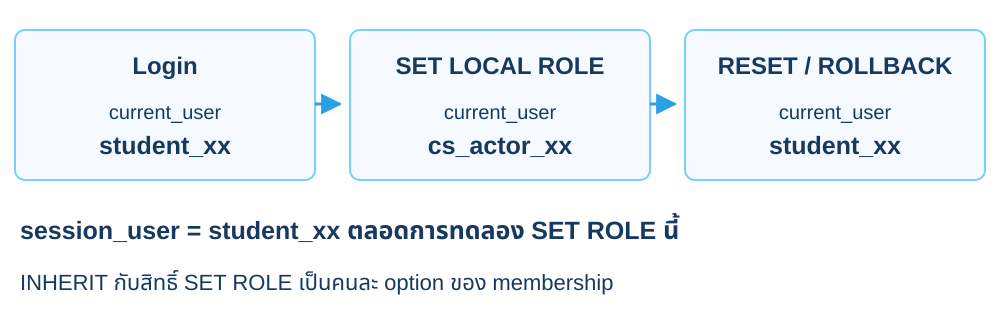

<p class="cs-concept-caption">NOLOGIN role รับสิทธิ์ได้ · SET LOCAL ROLE ต้องอยู่ใน transaction</p>

<footer class="cs-footer"><span>ClaimSure ต่อเนื่อง · Fundamental ก่อน Lab 4B</span><span>9 / 29</span></footer>

<!--
Speaker notes:
อ้างอิงคู่มือ labs/module-04-security.md หัวข้อ 4B · อธิบายก่อนคำสั่งแล็บที่เกี่ยวข้อง
session_user ในการทดลอง SET ROLE นี้ยังเป็น login เริ่มต้น ส่วน current_user เป็น security context ปัจจุบัน การสืบทอด privileges กับสิทธิ์ SET ROLE เป็นคนละ option ของ membership

Sources:
- https://www.postgresql.org/docs/18/functions-info.html
- https://www.postgresql.org/docs/18/role-membership.html
-->

---
layout: default
class: continuous-deck cs-module-four cs-fundamental cs-infographic
---

# 4B · Fundamental: ขอบเขตของสิทธิ์

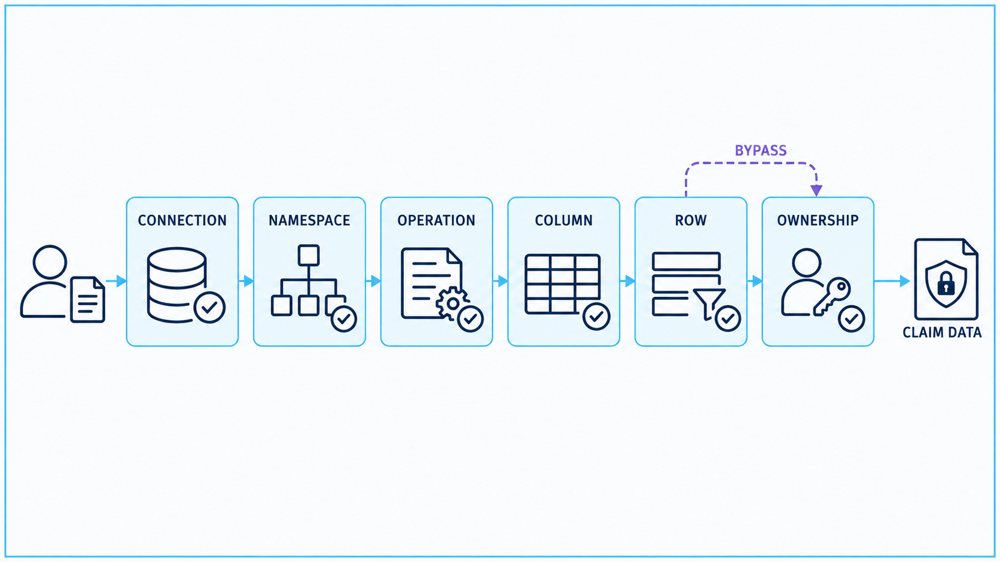

<p class="cs-concept-caption">ภาพเป็นแผนที่ขอบเขตสิทธิ์ · SELECT ปกติไม่ต้องเป็น owner</p>

<footer class="cs-footer"><span>ClaimSure ต่อเนื่อง · Fundamental ก่อน Lab 4B</span><span>10 / 29</span></footer>

<!--
Speaker notes:
อ้างอิงคู่มือ labs/module-04-security.md หัวข้อ 4B · อธิบายก่อนคำสั่งแล็บที่เกี่ยวข้อง
ภาพแสดงขอบเขต connection/namespace/operation/column/row/ownership ไม่ใช่หกด่านที่ทุก SELECT ต้องผ่านตามลำดับ Ownership ควบคุม DDL และ grants ไม่ใช่สิทธิ์ที่ต้องแจกให้ runtime users เพื่ออ่านตาราง ลูกศร BYPASS เป็นเพียงภาพช่วยจำ ต้องดู owner, FORCE RLS และ SUPERUSER/BYPASSRLS ตามจริง แล็บ 4B แยก schema กับ table, 4C direct sequence, 4D row policy และ 4E column privilege

Source: ../labs/module-04-security.md · 4B
Visual reference: postgres-admin-labs/docs/slides/module-04-security-user-management.md
-->

---
layout: default
class: continuous-deck cs-module-four cs-fundamental
---

# 4B–4E · Fundamental: แยก permission scopes

| ชั้น | ตัวอย่าง | ถ้าไม่ผ่าน |
| --- | --- | --- |
| Schema | USAGE บน claimsure | เข้า object ไม่ได้ |
| Table | SELECT บน claim | อ่านไม่ได้ |
| Column | UPDATE(status) | แก้ estimated_amount ไม่ได้ |
| Row | Policy ตาม customer | อ่าน/เขียนข้ามลูกค้าไม่ได้ |
| Function / sequence | EXECUTE / direct nextval | เรียก object นั้นไม่ได้ |

<footer class="cs-footer"><span>ClaimSure ต่อเนื่อง · Fundamental ก่อน Lab 4B–4E</span><span>11 / 29</span></footer>

<!--
Speaker notes:
อ้างอิงคู่มือ labs/module-04-security.md หัวข้อ 4B–4E · อธิบายก่อนคำสั่งแล็บที่เกี่ยวข้อง
42501 เหมือนกันได้แต่ขาดสิทธิ์ต่าง object อ่านชื่อ object ไม่เพิ่มสิทธิ์กว้างเพื่อแก้ทุกชั้นพร้อมกัน

Source: ../labs/module-04-security.md · 4B–4E
-->

---
layout: default
class: continuous-deck cs-module-four
---

# Lab 4B · Schema gate และ expected error

```sql
BEGIN;
REVOKE USAGE ON SCHEMA claimsure FROM PUBLIC;
SET LOCAL ROLE :"actor_role";
SAVEPOINT schema_gate;
\set ON_ERROR_STOP off
SELECT claim_no FROM claimsure.claim LIMIT 1;
\echo Expected 42501; actual :SQLSTATE
ROLLBACK TO SAVEPOINT schema_gate;
\set ON_ERROR_STOP on
ROLLBACK;
```

<footer class="cs-footer"><span>ClaimSure ต่อเนื่อง · คู่มือ Lab 4B</span><span>12 / 29</span></footer>

<!--
Speaker notes:
อ้างอิงคู่มือ labs/module-04-security.md หัวข้อ 4B
เตรียมตัวแปร 4A ก่อน ทำใน transaction เพื่อไม่ให้ REVOKE PUBLIC ค้างบน schema ร่วม ROLLBACK คืน role และ ACL เดิม

Source: ../labs/module-04-security.md · 4B
-->

---
layout: default
class: continuous-deck cs-module-four
---

# Lab 4B · Schema USAGE แล้วจึง SELECT

```sql
GRANT USAGE ON SCHEMA claimsure TO :"reader_role";
GRANT SELECT ON claimsure.claim TO :"reader_role";
SET LOCAL ROLE :"actor_role";
SELECT claim_no,status FROM claimsure.claim
WHERE claim_no LIKE 'CLM-L1-%' ORDER BY claim_no;
```


<p class="cs-takeaway">ทำใน BEGIN/ROLLBACK ของ 4B · actor อ่านผ่าน reader ได้หกแถว</p>

<footer class="cs-footer"><span>ClaimSure ต่อเนื่อง · คู่มือ Lab 4B</span><span>13 / 29</span></footer>

<!--
Speaker notes:
อ้างอิงคู่มือ labs/module-04-security.md หัวข้อ 4B
คู่มือให้ลอง SELECT หลัง grant schema แต่ก่อน grant table เพื่อเห็น table gate แล้ว grant SELECT จึงเห็นหกแถว ไม่รัน SET LOCAL ROLE นอก transaction

Source: ../labs/module-04-security.md · 4B
-->

---
layout: default
class: continuous-deck cs-module-four cs-fundamental
---

# 4C · Fundamental: Identity กับ sequence

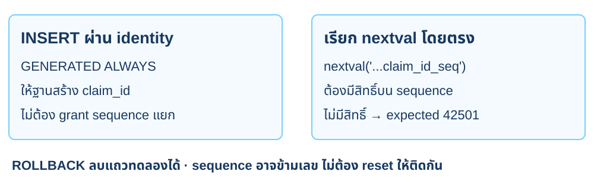

<p class="cs-concept-caption">แยก identity INSERT ออกจาก direct nextval · อ่าน SQLSTATE จาก object ที่ถูกตรวจ</p>

<footer class="cs-footer"><span>ClaimSure ต่อเนื่อง · Fundamental ก่อน Lab 4C</span><span>14 / 29</span></footer>

<!--
Speaker notes:
อ้างอิงคู่มือ labs/module-04-security.md หัวข้อ 4C · อธิบายก่อนคำสั่งแล็บที่เกี่ยวข้อง
อธิบายกติกาของ claim_id ที่สร้างด้วย GENERATED ALWAYS AS IDENTITY ในชุดนี้ก่อนทำ 4C ไม่ใช้กฎ bigserial มาสรุปเหมารวม ทดสอบ INSERT ที่ให้ identity สร้าง id เทียบ direct nextval ภายใต้ actor ใช้ SAVEPOINT รอบ expected error และทำ ROLLBACK ตอนจบ Sequence อาจข้ามเลขตามการเรียก ไม่ reset sequence เพราะลำดับเลขไม่ใช่ business key

Source: ../labs/module-04-security.md · 4C
Visual reference: postgres-admin-labs/docs/slides/module-04-security-user-management.md
-->

---
layout: default
class: continuous-deck cs-module-four
---

# Lab 4C · เทียบ identity INSERT กับ nextval

| การเรียก | USAGE บน sequence |
| --- | --- |
| INSERT ปล่อย identity สร้าง claim_id | ไม่ต้อง grant แยกสำหรับ identity |
| SELECT nextval('…claim_claim_id_seq') | ต้องมี sequence privilege |


<p class="cs-takeaway">claim_id เดิมเป็น GENERATED ALWAYS AS IDENTITY</p>

<footer class="cs-footer"><span>ClaimSure ต่อเนื่อง · คู่มือ Lab 4C</span><span>15 / 29</span></footer>

<!--
Speaker notes:
อ้างอิงคู่มือ labs/module-04-security.md หัวข้อ 4C
อย่าเหมารวมกฎ bigserial กับ identity INSERT CLM-SEC-DEMO แล้ว rollback ส่วน direct nextval ต้องได้ 42501 ก่อน grant Sequence อาจข้ามเลขแม้ rollback

Source: ../labs/module-04-security.md · 4C
-->

---
layout: default
class: continuous-deck cs-module-four cs-fundamental
---

# 4D · Fundamental: Object privilege กับ RLS

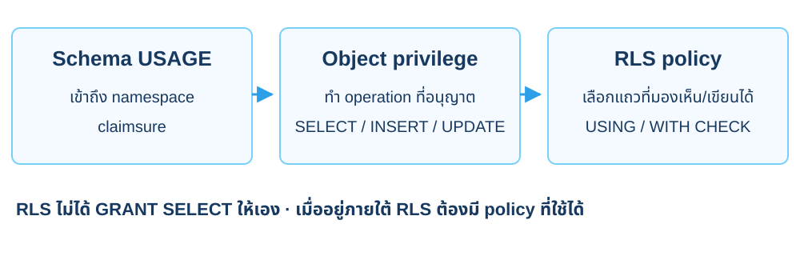

<p class="cs-concept-caption">RLS ไม่ให้ object privilege แทน GRANT · ใช้ actor ที่ไม่ใช่ superuser ทดสอบ</p>

<footer class="cs-footer"><span>ClaimSure ต่อเนื่อง · Fundamental ก่อน Lab 4D</span><span>16 / 29</span></footer>

<!--
Speaker notes:
อ้างอิงคู่มือ labs/module-04-security.md หัวข้อ 4D · อธิบายก่อนคำสั่งแล็บที่เกี่ยวข้อง
เมื่อเปิด RLS แล้วไม่มี applicable policy ปกติจะ default deny สำหรับ row access ที่อยู่ภายใต้ RLS Owner มัก bypass จนใช้ FORCE ส่วน superuser/BYPASSRLS ยัง bypass จึงไม่ใช้ทดสอบผล learner roles

Sources:
- https://www.postgresql.org/docs/18/ddl-rowsecurity.html
-->

---
layout: default
class: continuous-deck cs-module-four cs-fundamental
---

# 4D · Fundamental: Trusted context

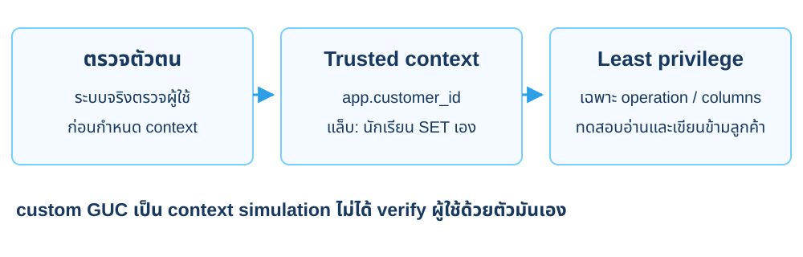

<p class="cs-concept-caption">app.customer_id ที่นักเรียน SET เอง เป็น context จำลอง</p>

<footer class="cs-footer"><span>ClaimSure ต่อเนื่อง · Fundamental ก่อน Lab 4D</span><span>17 / 29</span></footer>

<!--
Speaker notes:
อ้างอิงคู่มือ labs/module-04-security.md หัวข้อ 4D · อธิบายก่อนคำสั่งแล็บที่เกี่ยวข้อง
ค่า custom GUC ไม่ได้ verify ผู้ใช้ด้วยตัวมันเอง แล็บใช้เพื่อเห็นผล row policy ระบบจริงต้องมี trust boundary ของ gateway/connection และไม่เปิดให้ client เปลี่ยนตัวตนที่ policy เชื่อโดยอิสระ

Sources:
- https://www.postgresql.org/docs/18/runtime-config-custom.html
- https://www.postgresql.org/docs/18/ddl-priv.html
-->

---
layout: default
class: continuous-deck cs-module-four cs-fundamental cs-infographic
---

# 4D · Fundamental: แยกขอบเขตลูกค้าด้วย RLS

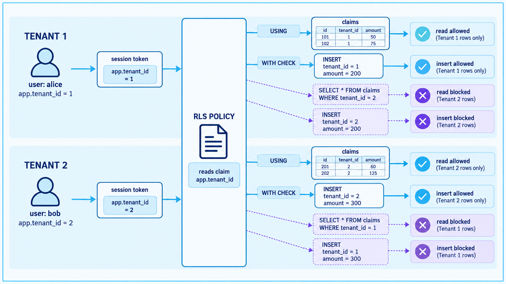

<p class="cs-concept-caption">ภาพใช้ app.tenant_id · แล็บใช้ app.customer_id · GUC ไม่ใช่ token ยืนยันตัวตน</p>

<footer class="cs-footer"><span>ClaimSure ต่อเนื่อง · Fundamental ก่อน Lab 4D</span><span>18 / 29</span></footer>

<!--
Speaker notes:
อ้างอิงคู่มือ labs/module-04-security.md หัวข้อ 4D · อธิบายก่อนคำสั่งแล็บที่เกี่ยวข้อง
ภาพมี tenant 1/2 และ session token เป็นตัวอย่างแนวคิด ไม่ใช่ credential ที่ตรวจแล้วของแล็บนี้ ให้ map เป็น CUS-001/CUS-002 ตาม relationship policy.customer_id โดยใช้ app.customer_id ที่อ่าน identity จากข้อมูลจริง ไม่เดาเลข id USING ทำให้การอ่านเห็นเฉพาะแถวที่เข้า policy; การอ่านข้ามขอบเขตอาจคืนศูนย์แถว ไม่ใช่ permission error ทุกครั้ง WITH CHECK ปฏิเสธ INSERT ข้ามลูกค้าด้วย expected 42501 custom GUC ที่ client ตั้งเองไม่ใช่ authentication

Source: ../labs/module-04-security.md · 4D
Visual reference: postgres-admin-labs/docs/slides/module-04-security-user-management.md
-->

---
layout: default
class: continuous-deck cs-module-four
---

# Lab 4D · Customer ของ policy เป็นขอบเขต

| ลูกค้า | กรมธรรม์ | เคลมตั้งต้นที่เห็น |
| --- | --- | --- |
| CUS-001 | POL-001 / POL-002 | 001, 002, 003, 004 |
| CUS-002 | POL-003 | 005, 006 |
| CUS-003 | ไม่มีใน seed | ไม่มีเคลม |


<p class="cs-takeaway">policy_id เชื่อม claim กับ customer</p>

<footer class="cs-footer"><span>ClaimSure ต่อเนื่อง · คู่มือ Lab 4D</span><span>19 / 29</span></footer>

<!--
Speaker notes:
อ้างอิงคู่มือ labs/module-04-security.md หัวข้อ 4D
ตรวจรหัส CLM-L1-* เพราะจำนวนรวมมี bulk claims จากบท 3 CUS-001 ต้องไม่สามารถ INSERT ของ POL-003 ได้

Source: ../labs/module-04-security.md · 4D
-->

---
layout: default
class: continuous-deck cs-module-four
---

# Lab 4D · Policy บน claim จริง

```sql
ALTER TABLE claimsure.claim ENABLE ROW LEVEL SECURITY;
ALTER TABLE claimsure.claim FORCE ROW LEVEL SECURITY;
CREATE POLICY cs_customer_access ON claimsure.claim
USING(policy_id IN (
 SELECT policy_id FROM claimsure.policy
 WHERE customer_id=nullif(
  current_setting('app.customer_id',true),'')::bigint))
WITH CHECK(policy_id IN (
 SELECT policy_id FROM claimsure.policy
 WHERE customer_id=nullif(
  current_setting('app.customer_id',true),'')::bigint));
```

<footer class="cs-footer"><span>ClaimSure ต่อเนื่อง · คู่มือ Lab 4D</span><span>20 / 29</span></footer>

<!--
Speaker notes:
อ้างอิงคู่มือ labs/module-04-security.md หัวข้อ 4D
ทำใน transaction 4D พร้อม grants ของ policy/customer ที่ policy และ view ใช้ USING กรองอ่าน WITH CHECK ตรวจแถวใหม่ FORCE ใช้กับ owner เมื่อไม่ได้ bypass

Source: ../labs/module-04-security.md · 4D
-->

---
layout: default
class: continuous-deck cs-module-four
---

# Lab 4D · View ใช้สิทธิ์ของผู้เรียก

```sql
ALTER VIEW claimsure.claim_detail_v
SET(security_invoker=true);
SET LOCAL ROLE :"actor_role";
SELECT set_config('app.customer_id',:'customer_a',true);
SELECT customer_code,claim_no,status
FROM claimsure.claim_detail_v
WHERE claim_no LIKE 'CLM-L1-%' ORDER BY claim_no;
```


<p class="cs-takeaway">CUS-001 เห็น CLM-L1-001 ถึง 004</p>

<footer class="cs-footer"><span>ClaimSure ต่อเนื่อง · คู่มือ Lab 4D</span><span>21 / 29</span></footer>

<!--
Speaker notes:
อ้างอิงคู่มือ labs/module-04-security.md หัวข้อ 4D
ทำใน transaction 4D customer_a อ่านจาก CUS-001 ไม่เดา identity security_invoker ใช้สิทธิ์ของผู้เรียก ต้อง grant คอลัมน์ในตารางประกอบที่ view ใช้ด้วย

Source: ../labs/module-04-security.md · 4D
-->

---
layout: default
class: continuous-deck cs-module-four
---

# Lab 4D · GUC เป็น context จำลอง

<div class="cs-flow"><div><strong>ผู้ใช้ที่ตรวจแล้ว</strong><small>ระบบจริงตรวจตัวตน</small></div><span aria-hidden="true">→</span><div><strong>app.customer_id</strong><small>แล็บตั้งเองได้</small></div><span aria-hidden="true">→</span><div><strong>RLS policy</strong><small>กรองตาม context</small></div></div>


<p class="cs-takeaway">การตั้ง GUC เองไม่ใช่ authentication</p>

<footer class="cs-footer"><span>ClaimSure ต่อเนื่อง · คู่มือ Lab 4D</span><span>22 / 29</span></footer>

<!--
Speaker notes:
อ้างอิงคู่มือ labs/module-04-security.md หัวข้อ 4D
WITH CHECK ปฏิเสธ policy_b ของ CUS-002 ภายใต้ customer_a แต่ context ที่ client ปลอมได้ไม่ใช่ production security จบด้วย ROLLBACK ถอด policy/grants

Source: ../labs/module-04-security.md · 4D
-->

---
layout: default
class: continuous-deck cs-module-four cs-fundamental
---

# 4E · Fundamental: Invoker / Definer / Audit

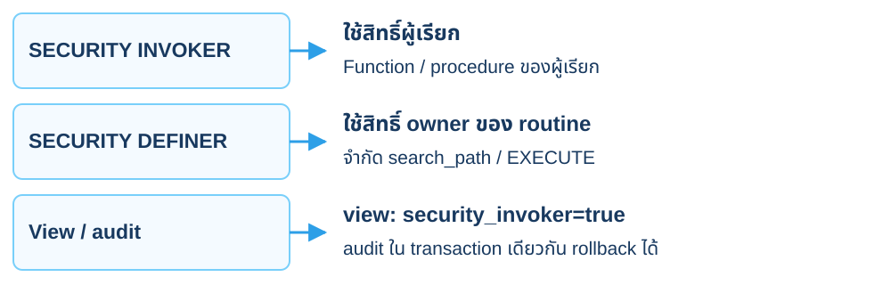

<p class="cs-concept-caption">Definer ไม่ได้แปลว่า bypass RLS เสมอ · audit ในแล็บ rollback ได้</p>

<footer class="cs-footer"><span>ClaimSure ต่อเนื่อง · Fundamental ก่อน Lab 4E</span><span>23 / 29</span></footer>

<!--
Speaker notes:
อ้างอิงคู่มือ labs/module-04-security.md หัวข้อ 4E · อธิบายก่อนคำสั่งแล็บที่เกี่ยวข้อง
Definer ไม่ได้แปลว่าจะ bypass RLS เสมอ ต้องดูสิทธิ์ owner และ FORCE ด้วย Audit table ที่เขียนใน transaction เดียวกันไม่ใช่ external immutable journal แล็บทดลองแล้ว rollback ทั้งเคลมและ audit objects

Sources:
- https://www.postgresql.org/docs/18/sql-createfunction.html
- https://www.postgresql.org/docs/18/sql-createview.html
- https://www.postgresql.org/docs/18/trigger-definition.html
-->

---
layout: default
class: continuous-deck cs-module-four
---

# Lab 4E · อนุญาต UPDATE เฉพาะ status

```sql
GRANT UPDATE(status) ON claimsure.claim
TO :"actor_role";
SET LOCAL ROLE :"actor_role";

UPDATE claimsure.claim SET status='APPROVED'
WHERE claim_no='CLM-L1-001';
-- Expected 42501 for the column not granted:
UPDATE claimsure.claim SET estimated_amount=0
WHERE claim_no='CLM-L1-001';
```


<p class="cs-takeaway">ใช้ transaction + SAVEPOINT ของ 4E แล้ว ROLLBACK</p>

<footer class="cs-footer"><span>ClaimSure ต่อเนื่อง · คู่มือ Lab 4E</span><span>24 / 29</span></footer>

<!--
Speaker notes:
อ้างอิงคู่มือ labs/module-04-security.md หัวข้อ 4E
UPDATE หลัง SET LOCAL ROLE actor และ grants ของ 4E คำสั่งที่สองเป็น expected error ใช้ SAVEPOINT และปิด ON_ERROR_STOP ตามคู่มือ ไม่ทิ้ง aborted transaction

Source: ../labs/module-04-security.md · 4E
-->

---
layout: default
class: continuous-deck cs-module-four
---

# Lab 4E · ตรวจ audit และ ROLLBACK

<div class="cs-flow"><div><strong>CLM-L1-001</strong><small>REVIEW → APPROVED</small></div><span aria-hidden="true">→</span><div><strong>AFTER UPDATE</strong><small>cs_audit_claim()</small></div><span aria-hidden="true">→</span><div><strong>cs_claim_audit</strong><small>old/new + session_user</small></div></div>


<p class="cs-takeaway">หนึ่ง UPDATE สำเร็จ → หนึ่ง audit row ใน transaction ทดสอบ</p>

<footer class="cs-footer"><span>ClaimSure ต่อเนื่อง · คู่มือ Lab 4E</span><span>25 / 29</span></footer>

<!--
Speaker notes:
อ้างอิงคู่มือ labs/module-04-security.md หัวข้อ 4E
สร้าง audit objects ด้วย 4E ฟังก์ชัน SECURITY DEFINER ระบุ search_path/revoke PUBLIC ชัด หลังดู audit ต้อง ROLLBACK คืน REVIEW และถอด trigger ก่อนบท 5

Source: ../labs/module-04-security.md · 4E
-->

---
layout: default
class: continuous-deck cs-module-four cs-fundamental
---

# 4F · Fundamental: Default privileges

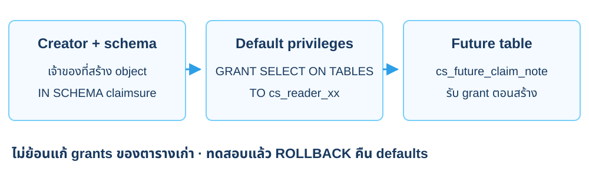

<p class="cs-concept-caption">Defaults ผูกกับผู้สร้างและ schema · ตารางเดิมต้อง GRANT แยก</p>

<footer class="cs-footer"><span>ClaimSure ต่อเนื่อง · Fundamental ก่อน Lab 4F</span><span>26 / 29</span></footer>

<!--
Speaker notes:
อ้างอิงคู่มือ labs/module-04-security.md หัวข้อ 4F · อธิบายก่อนคำสั่งแล็บที่เกี่ยวข้อง
ALTER DEFAULT PRIVILEGES ของ owner ที่จะสร้างตารางกำหนดสิทธิ์เริ่มต้นให้ objects ในอนาคตตาม schema ที่ระบุ ไม่แก้ ACL ตารางเก่าย้อนหลัง แล็บ 4F ทำใน transaction เดียวกับสร้าง cs_future_claim_note ให้นักเรียนลองอ่านด้วย actor แล้ว rollback ทั้ง defaults และ object หลังจบต้องเทียบ schema ACL และ RLS กับก่อนทดลอง

Source: ../labs/module-04-security.md · 4F
Visual reference: postgres-admin-labs/docs/slides/module-04-security-user-management.md
-->

---
layout: default
class: continuous-deck cs-module-four
---

# Lab 4F · สิทธิ์ของ object ที่สร้างภายหลัง

```sql
BEGIN;
ALTER DEFAULT PRIVILEGES IN SCHEMA claimsure
GRANT SELECT ON TABLES TO :"reader_role";
CREATE TABLE claimsure.cs_future_claim_note(note text);
ROLLBACK;
```


<p class="cs-takeaway">เป็น default ของผู้สร้าง · ไม่ย้อน grant ตารางเก่า</p>

<footer class="cs-footer"><span>ClaimSure ต่อเนื่อง · คู่มือ Lab 4F</span><span>27 / 29</span></footer>

<!--
Speaker notes:
อ้างอิงคู่มือ labs/module-04-security.md หัวข้อ 4F
4F ให้ actor อ่าน note ที่เพิ่งสร้าง แล้ว rollback ทั้ง object และ default privileges ไม่ให้ grants ค้างไปยังตารางบทอื่น

Source: ../labs/module-04-security.md · 4F
-->

---
layout: default
class: continuous-deck cs-module-four
---

# สรุป 4B–4F · หลักฐานที่ต้องตรวจ

| จุดทดสอบ | ผลที่คาด |
| --- | --- |
| Schema / table / direct sequence | 42501 คนละ object |
| RLS เขียนข้าม customer | 42501 จาก WITH CHECK |
| Column estimated_amount | 42501 เมื่อ grant แค่ status |
| Seed claims ของ CUS-001 | 4 แถวผ่าน view |
| หลัง rollback | ACL/RLS/view options กลับค่าเดิม |

<footer class="cs-footer"><span>ClaimSure ต่อเนื่อง · คู่มือ Lab 4B–4F</span><span>28 / 29</span></footer>

<!--
Speaker notes:
อ้างอิงคู่มือ labs/module-04-security.md หัวข้อ 4B–4F
เก็บ error และ SQLSTATE พร้อมแถวที่เห็นจริง ไม่ใช้ superuser ตัดสิน RLS

Source: ../labs/module-04-security.md · 4B–4F
-->

---
layout: default
class: continuous-deck cs-module-four
---

# Lab 4F · คืนสิทธิ์แล้วส่งต่อบท 5

```sql
SELECT relacl,relrowsecurity,relforcerowsecurity
FROM pg_class WHERE oid='claimsure.claim'::regclass;
SELECT count(*) AS expected_100006 FROM claimsure.claim;
```


<p class="cs-takeaway">จบทุก transaction · Instructor ลบเฉพาะ roles ของบทนี้</p>

<footer class="cs-footer"><span>ClaimSure ต่อเนื่อง · คู่มือ Lab 4F</span><span>29 / 29</span></footer>

<!--
Speaker notes:
อ้างอิงคู่มือ labs/module-04-security.md หัวข้อ 4F
เทียบ ACL/RLS กับ 4A ถ้ามีค่าเดิมจากงานอื่นต้องกลับค่านั้น ไม่ใช้ DROP OWNED/DROP SCHEMA

Source: ../labs/module-04-security.md · 4F / ส่งต่อ
-->

