<div class="cover-art">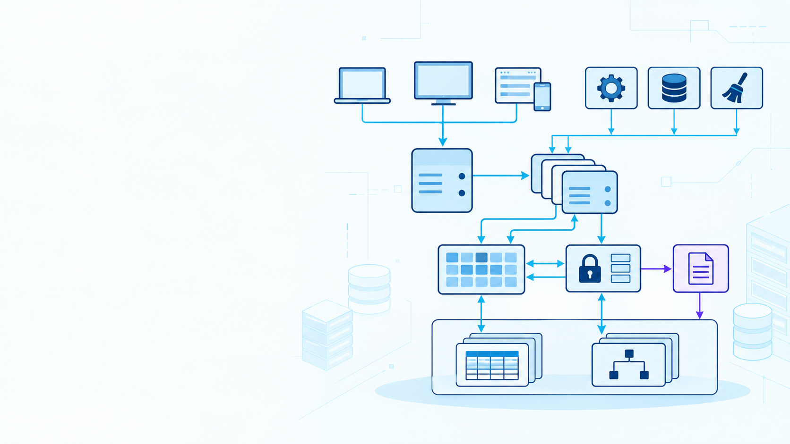</div>

# Module 5: PostgreSQL Architecture

## เรียนรู้องค์ประกอบหลักผ่านการสังเกต Workflow ของ Claim ใน ClaimSure

<!--
Speaker notes:
- บทนี้เราจะตามงานแก้ไขเคลมหนึ่งรายการ เพื่อดูว่า PostgreSQL ใช้ส่วนใดบ้างตั้งแต่รับคำสั่งจนเก็บข้อมูลได้อย่างปลอดภัย
- ชี้ภาพรวมจาก Client ไป Backend, Memory, WAL และ Data files แล้วบอกว่าจะค่อย ๆ ทดลองดูแต่ละส่วน
- ให้ผู้เรียนจำเส้นทางของงานก่อน ยังไม่ต้องจำชื่อทุก Process
-->

---
layout: default
class: module-five overflow-y-auto thai-deck
---


# แผนที่ Lab ของ Module 5

| Lab | สิ่งที่ศึกษา | หลักฐานสำคัญ |
| --- | --- | --- |
| 5A | Connections และ Memory | `pg_backend_pid()`, `pg_stat_activity`, `SHOW` |
| 5B | Background Processes | ประเภท Backend และ Statistics ของ WAL/Checkpoint |
| 5C | Shared Memory และ Locks | `pg_locks` และ Transaction ที่แก้ Claim |
| 5D | Heap Pages และสถานะ Tuple | `ctid`, `xmin`, `xmax` และ Table Statistics |
| 5E | MVCC snapshots | อ่านและแก้ CLM-L1-005 ด้วยสอง Sessions |
| 5F | WAL และ Durable Commit | ส่วนต่าง LSN และ WAL Files |
| 5G | Storage และ PGDATA | Data Directory และเส้นทางไฟล์ Relation |


<!--
Speaker notes:
- แผนที่นี้บอกว่าแต่ละ Lab จะใช้หลักฐานอะไรตอบคำถาม เช่น ใครเชื่อมต่ออยู่ ใครถือ Lock และข้อมูลถูกเก็บที่ไหน
- ไล่จาก Connection → Process → Memory → Tuple → Snapshot → WAL → Storage
- ทุกครั้งให้ถามว่า “เราจะใช้ Query ไหนพิสูจน์สิ่งที่อธิบายอยู่?”
-->

---
layout: default
class: module-five thai-deck
---


# โครงสร้าง PostgreSQL Server

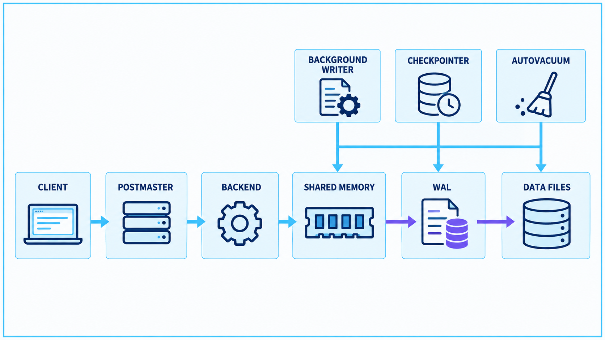

<div class="concept-caption">
  <span>หนึ่ง Backend ต่อ Connection</span><span>ใช้ Shared State เพื่อประสานการทำงาน</span><span>WAL รองรับ Durable Commit</span>
</div>

<!--
Speaker notes:
- มอง PostgreSQL เหมือนทีมทำงาน: Postmaster รับการเชื่อมต่อ แล้ว Backend ประจำ Connection ทำคำสั่ง SQL
- ชี้ Shared memory เป็นพื้นที่ทำงานร่วมกัน ส่วน WAL เป็นบันทึกที่ช่วยกู้คืน และ Data files เป็นที่เก็บหน้าข้อมูล
- การ COMMIT สำเร็จไม่ได้แปลว่า Heap page ถูกเขียนลง Data file แล้วเสมอไป
-->

---
layout: two-cols-header
layoutClass: module-five overflow-y-auto thai-deck
---


# Connection Manager

::left::

**แนวคิด**

- Postmaster รอรับ Clients
- แต่ละ Connection ที่รับเข้ามามี Backend Process ของตน
- ทำ Authentication ก่อนรัน SQL
- จำนวน Connections คืองานจริงที่ Server ต้องรับผิดชอบ

**ตัวอย่าง ClaimSure**

Application Role เชื่อมต่อเป็น `claim_app` เพื่ออ่านและแก้ข้อมูล Claim

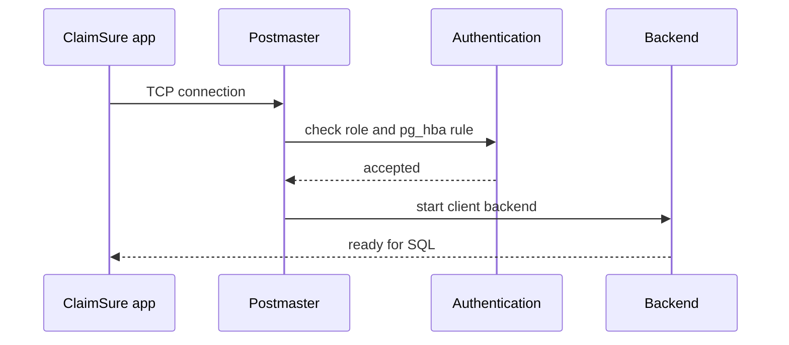

::right::

```sql
SELECT pg_backend_pid() AS my_pid,
       current_user,
       current_database();

SELECT pid, usename, application_name,
       client_addr, state
FROM pg_stat_activity
WHERE datname = current_database()
ORDER BY pid;
```

<!--
Speaker notes:
- Connection เปรียบเหมือนเปิดช่องบริการหนึ่งช่อง เมื่อเชื่อมต่อโดยตรงจะมี Backend process ประจำช่องนั้น
- ชี้ pg_backend_pid() ว่าเป็นหมายเลข Process ของเรา แล้วใช้ pg_stat_activity ดู Connection อื่น
- ต้องผ่าน Authentication ก่อนรัน SQL และ Connection ที่เปิดค้างก็ยังใช้ทรัพยากร
-->

---
layout: two-cols-header
layoutClass: module-five overflow-y-auto thai-deck
---


# Lab 5A: สังเกต Connections

::left::

**ลงมือทำ**

1. เปิด `psql` หนึ่ง Session เป็น `postgres`
2. เปิด `psql` อีกหนึ่ง Session เป็น `postgres` (observer)
3. เปรียบเทียบ Backend PID ของแต่ละ Session
4. ค้นหาทั้งสอง Sessions ใน `pg_stat_activity`

**ตรวจสอบ**

- แต่ละ Session มี PID ต่างกัน
- Session ที่ Idle ยังใช้ Backend อยู่
- เห็น Role และ Database ใน Activity

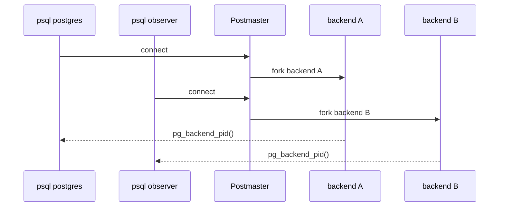

::right::

```bash
PGAPPNAME=module5-a psql -X
PGAPPNAME=module5-observer psql -X
```

```sql
SELECT pg_backend_pid();

SELECT pid, usename, state,
       query_start, query
FROM pg_stat_activity
WHERE datname = current_database()
ORDER BY pid;
```

<!--
Speaker notes:
- ให้เปิด psql สองหน้าต่างพร้อมกัน แล้วรัน pg_backend_pid() เพื่อเปรียบเทียบ PID
- ชี้ว่าแต่ละ Session มี PID ต่างกัน และยังพบ Session ที่เป็น idle ใน pg_stat_activity
- Lab นี้พิสูจน์ว่า Connection มีต้นทุน จึงต้องวางแผนจำนวน Connection และการใช้ Pool
-->

---
layout: default
class: module-five background-process-infographic thai-deck
---


# Background Processes ของ Postmaster

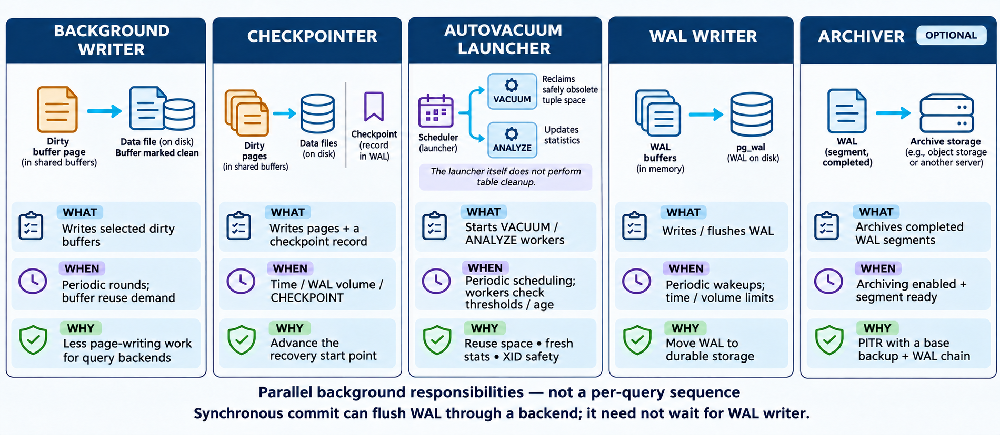

<!--
Speaker notes:
- อ่านแต่ละการ์ดเป็นสามคำถาม: ทำอะไร ทำเมื่อไร และทำไปเพื่ออะไร ทั้งห้าตัวทำงานตามหน้าที่ของตน ไม่ใช่ลำดับที่ทุก Query ต้องวิ่งผ่าน
- Background writer เขียน Dirty buffers บางส่วนตามรอบและความต้องการใช้ Buffer เพื่อเตรียม Buffer ที่สะอาด ช่วยลดงานเขียนหน้าที่ Backend ของผู้ใช้ต้องทำเอง
- Checkpointer เขียนหน้าและบันทึก Checkpoint เมื่อถึงเวลา ปริมาณ WAL ใกล้เกณฑ์ หรือมีคำสั่ง CHECKPOINT เพื่อเลื่อนจุดเริ่ม REDO ให้ใหม่ขึ้น งานนี้ไม่ใช่การลบ Tuple เก่า
- Autovacuum launcher เริ่ม Workers ตามรอบ แล้ว Workers ตรวจว่าตารางถึงเกณฑ์หรือมีอายุ Transaction ID มากพอให้ทำ VACUUM/ANALYZE หรือไม่ เป้าหมายคือคืนพื้นที่ที่ปลอดภัยให้ใช้ซ้ำ ปรับ Statistics และป้องกัน Transaction ID วนรอบ
- WAL writer เขียนและ Flush WAL ตามรอบและเงื่อนไขเวลา/ปริมาณ เพื่อให้ WAL ถึง Durable storage แต่ Synchronous COMMIT ไม่จำเป็นต้องรอ WAL writer เพราะ Backend จัดการ Flush ได้ด้วย
- Archiver ทำงานเมื่อเปิด Archiving และมี WAL segment ที่พร้อมเก็บ ส่งไป Archive เพื่อใช้กู้คืนตามเวลา โดยต้องมี Base backup และ WAL ต่อเนื่องประกอบกัน Archive อย่างเดียวไม่ใช่ Backup ครบชุด
References:
- https://www.postgresql.org/docs/18/runtime-config-resource.html#RUNTIME-CONFIG-RESOURCE-BACKGROUND-WRITER
- https://www.postgresql.org/docs/18/wal-configuration.html
- https://www.postgresql.org/docs/18/routine-vacuuming.html#AUTOVACUUM
- https://www.postgresql.org/docs/18/runtime-config-wal.html
- https://www.postgresql.org/docs/18/continuous-archiving.html
-->

---
layout: two-cols-header
layoutClass: module-five thai-deck
---


# Lab 5B: หลักฐานของ Background Processes

::left::

**สถานการณ์**

ClaimSure มีการ UPDATE Claim บ่อยในช่วงอนุมัติตอนเช้า

**สังเกต**

- มี Background Writer และ Checkpointer
- Autovacuum Workers อาจปรากฏเฉพาะเมื่อจำเป็น
- Statistics ของ WAL และ Checkpoint เปลี่ยนตามเวลา

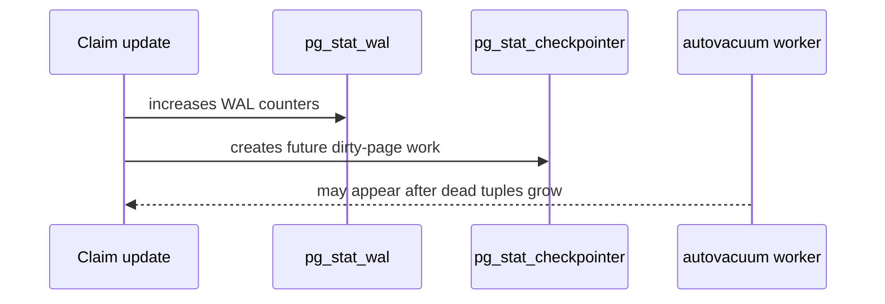

::right::

```sql
SELECT * FROM pg_stat_bgwriter;
SELECT * FROM pg_stat_checkpointer;
SELECT * FROM pg_stat_wal;

SELECT pid, backend_type, state,
       wait_event_type, wait_event
FROM pg_stat_activity
WHERE backend_type LIKE '%writer%'
   OR backend_type LIKE '%checkpoint%'
   OR backend_type LIKE '%autovacuum%';
```

<!--
Speaker notes:
- ให้ผู้เรียนดูทั้งรายชื่อ Process และตัวเลขสถิติ เพื่อเชื่อมว่าใครทำงานและทำงานมากขึ้นแค่ไหน
- รัน pg_stat_activity ดู backend_type แล้วเปรียบเทียบ pg_stat_wal และ pg_stat_checkpointer ก่อนกับหลังทำงาน
- ไม่พบ Autovacuum worker ในขณะนั้นไม่ได้แปลว่าระบบเสีย เพราะ Worker เริ่มตามความจำเป็น
-->

---
layout: default
class: module-five overflow-y-auto thai-deck
---


# Shared Memory

PostgreSQL Backends ประสานงานผ่าน Shared Memory แต่ละ Session ไม่ได้ถือสำเนา Database ของตนเอง

| ส่วน | หน้าที่ระหว่าง UPDATE Claim |
| --- | --- |
| shared buffers | เก็บ Table/Index Pages ที่ Backend อ่านหรือเปลี่ยน |
| lock manager | ป้องกันงานระดับ Row, Table และ Transaction ที่ขัดแย้งกัน |
| WAL buffers | เก็บ Records สำหรับ Durability ก่อน Flush WAL |

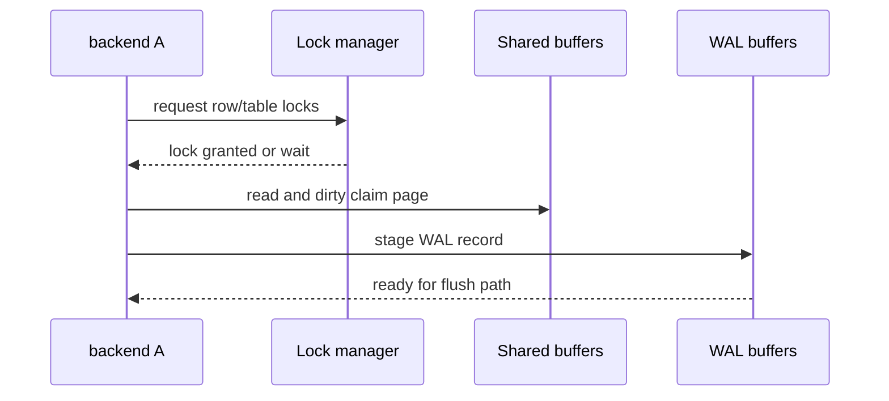

```sql
SHOW shared_buffers;
SHOW wal_buffers;
SHOW max_connections;
SHOW work_mem;
```

<!--
Speaker notes:
- Shared memory เหมือนโต๊ะกลาง: Shared buffers เก็บหน้าข้อมูล, Lock manager ประสานการเข้าถึง และ WAL buffers พักบันทึกการเปลี่ยนแปลง
- ชี้ว่า Backend หลายตัวใช้พื้นที่เหล่านี้ร่วมกัน แทนการมีสำเนาฐานข้อมูลทั้งหมดแยกคนละชุด
- work_mem ต่างออกไป เพราะเป็นงบต่อการทำงานบางชนิด เช่น Sort หรือ Hash; Query เดียวอาจใช้หลายก้อน
-->

---
layout: two-cols-header
layoutClass: module-five overflow-y-auto thai-deck
---


# Lab 5C: Shared Memory ระหว่าง UPDATE Claim

::left::

**Columns ของ Claim**

`claim_id`, `claim_no`, `policy_id`, `status`, `incident_at`, `estimated_amount`, `approved_amount`, `created_at`

**ทดลอง UPDATE แบบควบคุม**

- อ่าน Claims กลุ่ม `CLM-L1` ทั้งหกรายการ
- `CLM-L1-005` มี Status เป็น `NEW`
- เปลี่ยน Status เป็น `REVIEW`
- ตรวจ Locks แล้ว ROLLBACK
- แถวนั้นกลับเป็น `NEW`

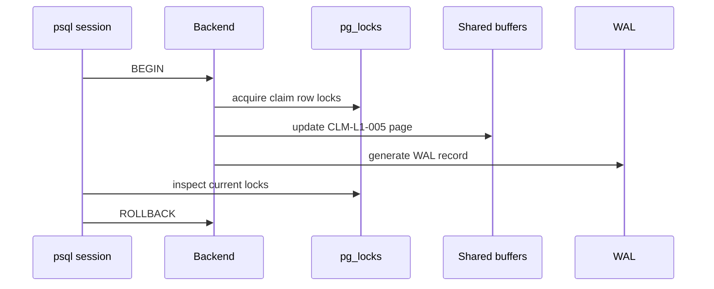

::right::

```sql
SELECT claim_id, claim_no, policy_id, status,
       incident_at, estimated_amount,
       approved_amount, created_at
FROM claimsure.claim
ORDER BY claim_id;

BEGIN;

UPDATE claimsure.claim
SET status = 'REVIEW'
WHERE claim_no = 'CLM-L1-005'
RETURNING claim_id, claim_no, policy_id, status,
          incident_at, estimated_amount,
          approved_amount, created_at;

SELECT locktype, relation::regclass,
       mode, granted
FROM pg_locks
WHERE pid = pg_backend_pid()
ORDER BY locktype, mode;

ROLLBACK;
```

<!--
Speaker notes:
- ตารางเคลมมี claim_id, claim_no, policy_id, status, incident_at, estimated_amount, approved_amount และ created_at ไม่มี updated_at
- เริ่มจากอ่านหกแถว CLM-L1 แล้วเปิด Transaction แก้ CLM-L1-005 จาก NEW เป็น REVIEW ค้างไว้ เพื่อดู Lock
- ชี้ WHERE pid = pg_backend_pid() ว่าเลือกดู Lock ของ Session เราเอง แล้วจบด้วย ROLLBACK ซึ่งคืนสถานะ NEW
- pg_locks ไม่ได้แสดงทุก Row lock เป็นรายการตรง ๆ; ROLLBACK ย้อนผลข้อมูล แต่ไม่ได้ลบประวัติ WAL ที่เกิดไปแล้ว
-->

---
layout: default
class: module-five thai-deck
---


# Heap Pages และ Tuple Versions

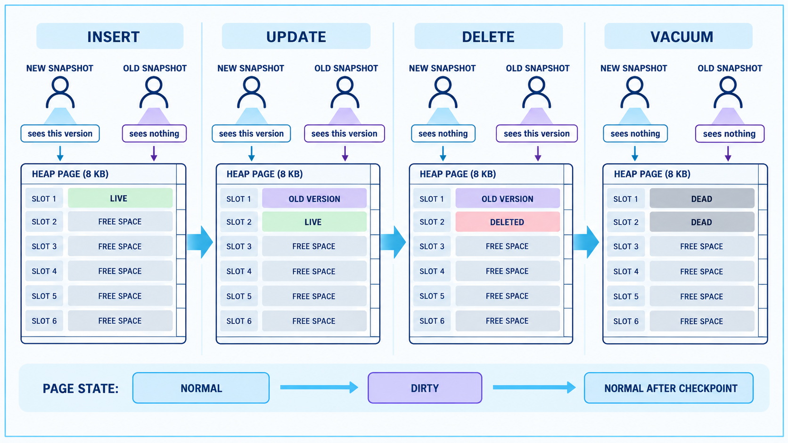

<div class="concept-caption">
  <span>Dirty เป็นสถานะของ Page</span><span>Live และ Dead เป็นสถานะของ Tuple</span><span>Snapshot กำหนดว่ามองเห็น Version ใด</span>
</div>

<!--
Speaker notes:
- Page เหมือนหน้ากระดาษหนึ่งหน้า ส่วน Tuple คือข้อมูลแต่ละเวอร์ชันที่อยู่ในหน้านั้น
- ชี้ UPDATE ว่าสร้างเวอร์ชันใหม่ ขณะที่ Snapshot เก่าอาจยังต้องอ่านเวอร์ชันเดิม
- Dirty เป็นสถานะของ Page; Live หรือ Dead เป็นเรื่องของ Tuple และ VACUUM คืนพื้นที่ได้เมื่อไม่มีใครต้องใช้เวอร์ชันนั้นแล้ว
-->

---
layout: default
class: module-five tuple-states-infographic thai-deck
---


# Lab 5D: สถานะ Data Page และ Tuple

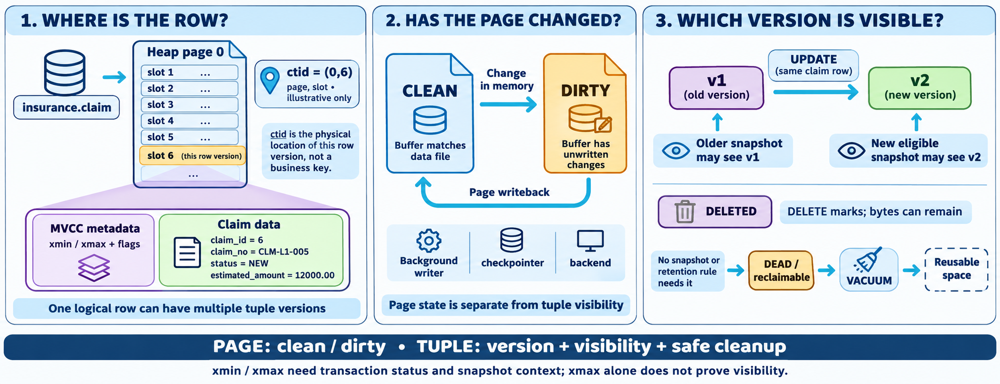

```sql
SELECT ctid, xmin, xmax, claim_id, claim_no, policy_id, status,
       incident_at, estimated_amount, approved_amount, created_at
FROM claimsure.claim WHERE claim_no = 'CLM-L1-005';
```

<!--
Speaker notes:
- อ่านภาพจากซ้ายไปขวาเป็นสามคำถามแยกกัน: ข้อมูลอยู่ที่ไหน Page เปลี่ยนหรือยัง และ Snapshot นี้เห็น Tuple เวอร์ชันใด
- ซ้าย: claimsure.claim มีหลาย Heap pages แต่ละหน้ามีหลาย Tuple versions ขยาย CLM-L1-005 ให้เห็น Metadata ของ MVCC แยกจากค่าคอลัมน์ เช่น claim_id, status และ estimated_amount
- ctid=(0,6) เป็นเพียงตัวอย่างพิกัด Page/Slot ของเวอร์ชัน ไม่ใช่ Business key หรือค่าจริงจาก Server และอาจเปลี่ยนเมื่อ UPDATE ให้รัน SELECT ด้านล่างเพื่ออ่านค่าจริงพร้อมคอลัมน์ทั้งหมด
- กลาง: Clean คือ Buffer page ตรงกับไฟล์ ส่วน Dirty คือมีการเปลี่ยนในหน่วยความจำที่ยังไม่เขียนกลับ Background writer, Checkpointer หรือ Backend สามารถเขียนหน้าได้ Dirty ไม่ได้หมายถึง Tuple ตาย
- ขวา: UPDATE สร้าง v2 และอาจยังต้องเก็บ v1 ให้ Snapshot เก่า ส่วน DELETE ทำเครื่องหมายลบแต่ยังไม่ลบ Bytes ทันที เมื่อไม่มี Snapshot หรือเงื่อนไขการเก็บรักษาใดต้องใช้แล้ว จึงคืนพื้นที่ด้วย VACUUM ได้
- xmin บอก Transaction ที่สร้างเวอร์ชัน ส่วน xmax ต้องอ่านร่วมกับ Transaction status, Flags และ Snapshot อย่าใช้เลข xmax ค่าเดียวตัดสินว่าแถวมองเห็นได้หรือไม่
References:
- https://www.postgresql.org/docs/18/ddl-system-columns.html
- https://www.postgresql.org/docs/18/storage-page-layout.html
- https://www.postgresql.org/docs/18/routine-vacuuming.html
-->

---
layout: two-cols-header
layoutClass: module-five thai-deck
---


# Lab 5D.1: วงจรชีวิต Page

::left::

**เส้นทางปกติ**

- Query อ่าน Page เข้าสู่ Shared Buffers
- `INSERT`, `UPDATE` หรือ `DELETE` เปลี่ยนสำเนาใน Buffer
- Page กลายเป็น Dirty
- Flush WAL เพื่อ Commit
- Checkpoint เขียน Dirty Page ภายหลัง
- ตาราง `claim` นี้มี `created_at` โดยไม่มี `updated_at`
- COMMIT ด้านล่างบันทึกค่า `created_at` ใหม่ให้ `CLM-L1-005`
- `status` ยังคงเป็น `NEW`

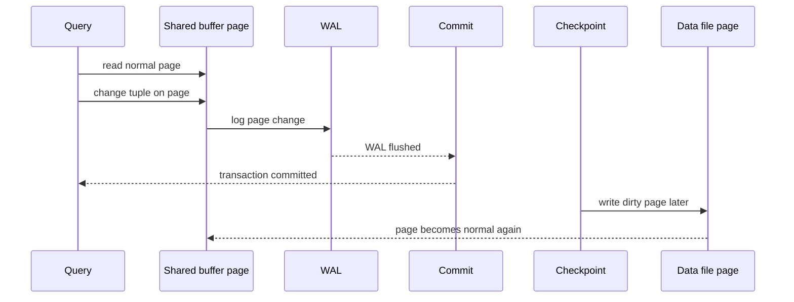

::right::

```sql
SHOW shared_buffers;

SELECT pg_current_wal_insert_lsn() AS before_lsn;

BEGIN;
UPDATE claimsure.claim
SET created_at = clock_timestamp()
WHERE claim_no = 'CLM-L1-005'
RETURNING ctid, xmin, xmax,
          claim_no, status, created_at;
COMMIT;

SELECT pg_current_wal_insert_lsn() AS after_lsn;
```

<!--
Speaker notes:
- เล่าเส้นทางหนึ่งรอบ: อ่าน Page เข้า Shared buffers → แก้ข้อมูลจน Dirty → Flush WAL เพื่อ COMMIT → เขียน Page กลับภายหลัง
- ชี้ LSN ก่อนและหลังเป็นตำแหน่งในสาย WAL ส่วน ctid เป็นตำแหน่ง Tuple และ xmin/xmax เป็นข้อมูลช่วยตัดสินการมองเห็น
- ตารางนี้ไม่มี updated_at จึงเขียน created_at ของ CLM-L1-005; status ยังเป็น NEW
- เมื่อใช้ Commit แบบ Synchronous ตามปกติ ต้อง Flush WAL แต่ไม่ต้องเขียน Heap page ทันที; ผู้เขียน Page อาจเป็น Background writer, Checkpointer หรือ Backend
-->

---
layout: default
class: module-five thai-deck
---


# อ่านสถานะของ Logical Row หนึ่งรายการ


<!--
Speaker notes:
- Order id = 1 ยังเป็นรายการเดียว แม้ UPDATE แล้วมี v1 = 1000 กับ v2 = 1200 เก็บอยู่สองเวอร์ชัน
- ชี้ภาพบนว่า Snapshot เก่าอาจเห็น v1 ส่วน Snapshot ใหม่ที่มีสิทธิ์เห็นจะได้ v2; แต่ละ Snapshot เห็นได้ไม่เกินหนึ่งเวอร์ชันของรายการนี้
- ชี้ภาพล่างแยกอีกเรื่อง: Page ยัง Dirty ได้แม้ WAL ทำให้ COMMIT ทนต่อการล่มแล้ว; ตัวอย่างวางสอง Tuple ใน Page เดียว แต่ของจริงอาจอยู่คนละ Page

Source: ../labs/module05-architecture/upstream.json (original architecture-data-flow tutorial)
-->

---
layout: two-cols-header
layoutClass: module-five thai-deck
---


# Lab 5D.2: INSERT สร้าง Live Tuple ใหม่

::left::

**สิ่งที่เกิดขึ้น**

`INSERT` หาพื้นที่ว่างบน Heap Page แล้วสร้าง Tuple Version ใหม่

**การเปลี่ยนสถานะ**

```text
before: [free space]
after:  [live tuple xmin=insert_tx]
page:   normal -> dirty -> normal after checkpoint
```

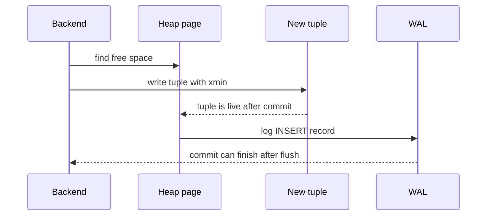

::right::

```sql
BEGIN;

INSERT INTO claimsure.audit_event (
  tenant_id, actor, action,
  entity_type, entity_id, details
)
VALUES (
  1, current_user, 'PAGE_STATE_LAB',
  'claim', 'CLM-1001',
  '{"activity":"insert"}'::jsonb
)
RETURNING ctid, xmin, xmax,
          event_id, action;

ROLLBACK;
```

<!--
Speaker notes:
- INSERT คือหาที่ว่างใน Heap page แล้วสร้าง Tuple ใหม่ พร้อมข้อมูลว่า Transaction ใดเป็นผู้สร้าง
- ชี้ RETURNING ให้เห็น ctid และ xmin ของข้อมูลที่เพิ่งเพิ่ม; Transaction ของเราอ่านสิ่งที่ตัวเองเพิ่มได้
- ตัวอย่างนี้จบด้วย ROLLBACK เพื่อทดลองซ้ำได้ จึงไม่ได้เก็บแถวนี้ถาวร; หาก COMMIT แล้ว Snapshot ที่เหมาะสมจึงเห็นข้อมูลใหม่
-->

---
layout: default
class: module-five architecture-task thai-deck
---


# INSERT ขั้น 1–4: สร้าง Tuple

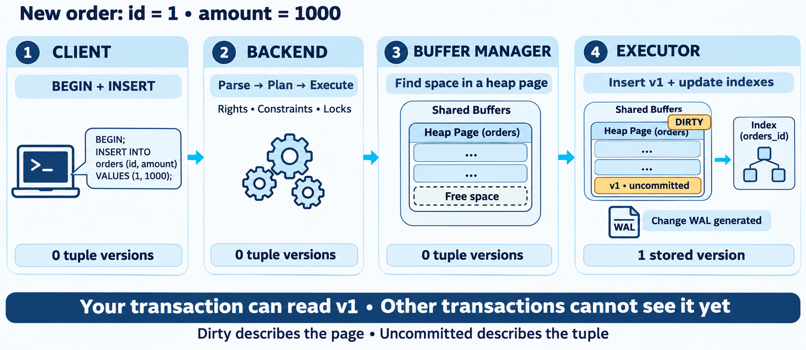

<!--
Speaker notes:
- ไล่ภาพ 1–4: Client ส่ง INSERT → Backend เตรียมแผน → Buffer manager หา Page → Executor เพิ่ม Tuple และดูแล Index
- ก่อนเพิ่มมีศูนย์เวอร์ชันของ Order ใหม่นี้ หลังเพิ่มมี v1 หนึ่งเวอร์ชัน และ Page ที่เปลี่ยนเป็น Dirty
- ตอนนี้ v1 ยังไม่ COMMIT: Session เราอ่านได้ แต่ Session อื่นยังมองไม่เห็น; เลขขั้นเป็นภาพสอน ไม่ใช่ลำดับย่อยตายตัวของการแก้ Page กับสร้าง WAL

Source: ../labs/module05-architecture/upstream.json (original architecture-data-flow tutorial)
Source steps: insert 1–4
-->

---
layout: default
class: module-five architecture-task thai-deck
---


# INSERT ขั้น 5–8: Commit และ Write Back

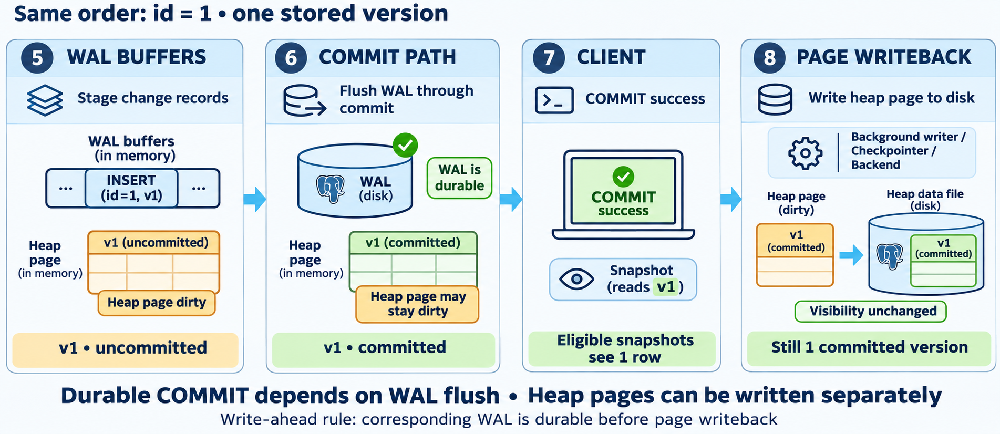

<!--
Speaker notes:
- ต่อภาพ 5–8: บันทึกการเปลี่ยนแปลงอยู่ใน WAL buffers → Flush ถึง Commit record → แจ้ง Client ว่าสำเร็จ → เขียน Page กลับแยกต่างหาก
- ชี้ว่า v1 เปลี่ยนจาก Uncommitted เป็น Committed แต่ยังเป็น Tuple เดิมหนึ่งเวอร์ชัน และ Heap page อาจยัง Dirty
- สมมติเปิด fsync กับ synchronous_commit และไม่มีการรอ Standby เพิ่ม; Page อาจถูกเขียนก่อนหรือหลัง COMMIT แต่ต้องมี WAL ที่เกี่ยวข้องบน Disk ก่อนเสมอ

Source: ../labs/module05-architecture/upstream.json (original architecture-data-flow tutorial)
Source steps: insert 5–8
-->

---
layout: two-cols-header
layoutClass: module-five thai-deck
---


# Lab 5D.3: UPDATE เก็บ Tuple เก่าและสร้าง Tuple ใหม่

::left::

**สิ่งที่เกิดขึ้น**

PostgreSQL ไม่เขียนทับแถวเก่า ณ ตำแหน่งเดิม แต่สร้าง Tuple Version ใหม่

**การเปลี่ยนสถานะ**

```text
before: [live tuple status=NEW]
after:  [old tuple xmax=update_tx]
        + [new live tuple xmin=update_tx]
page:   dirty until checkpoint
```

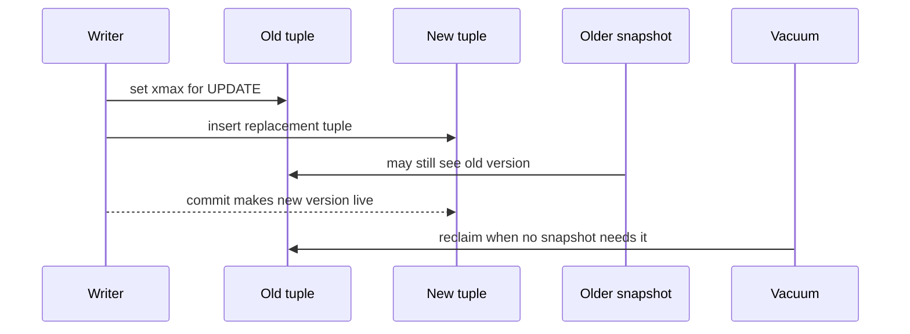

::right::

```sql
BEGIN;

SELECT ctid, xmin, xmax, claim_no, status
FROM claimsure.claim
WHERE claim_no = 'CLM-L1-005';

UPDATE claimsure.claim
SET status = 'REVIEW'
WHERE claim_no = 'CLM-L1-005'
RETURNING ctid, xmin, xmax,
          claim_no, status;

ROLLBACK;
```

<!--
Speaker notes:
- UPDATE เปรียบเหมือนเขียนฉบับแก้ไขใหม่ โดยยังเก็บฉบับเดิมไว้ให้ผู้อ่านที่เริ่มก่อนหน้า
- ให้ดู ctid, xmin และ xmax ก่อนกับหลัง UPDATE แล้วชี้ว่าเกิด Tuple เวอร์ชันใหม่ ไม่ใช่เพิ่มเคลมอีกใบ
- เวอร์ชันเก่าจะถูกคืนพื้นที่ได้เมื่อไม่มี Snapshot ต้องใช้; ctid เปลี่ยนได้ จึงไม่ควรใช้แทน Business key
-->

---
layout: default
class: module-five architecture-task thai-deck
---


# UPDATE ขั้น 1–4: เก็บของเก่าและสร้างของใหม่

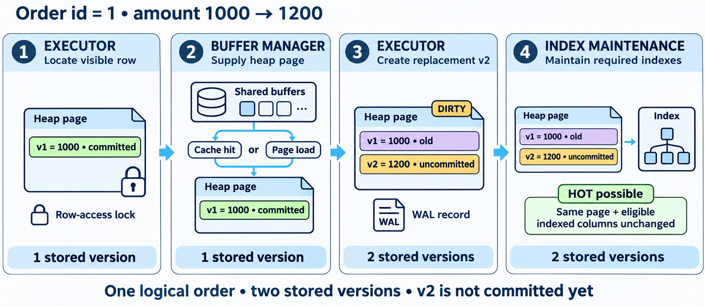

<!--
Speaker notes:
- เริ่มจาก Order เดิม v1 = 1000 จากนั้น UPDATE สร้าง v2 = 1200 ที่ยังไม่ COMMIT และเก็บ v1 ไว้
- นับให้ดูว่าเป็นหนึ่ง Order แต่มีสอง Tuple versions; เวอร์ชันใหม่ยังต้องดูแล Index ตามที่จำเป็น
- HOT อาจช่วยเลี่ยง Index entry ใหม่ได้เมื่อเงื่อนไขครบ เช่น มีพื้นที่ใน Page เดิมและไม่ได้แก้ Column ที่ขัดเงื่อนไข HOT

Source: ../labs/module05-architecture/upstream.json (original architecture-data-flow tutorial)
Source steps: update 1–4
-->

---
layout: default
class: module-five architecture-task thai-deck
---


# UPDATE ขั้น 5–7: เลือก Version ตาม Snapshot

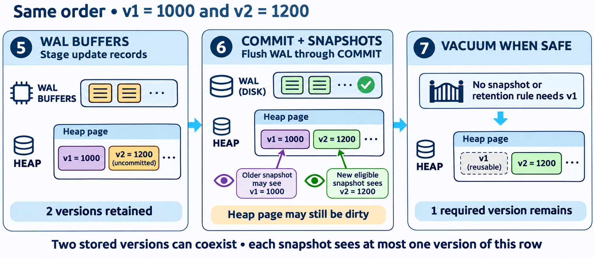

<!--
Speaker notes:
- หลัง Flush WAL และ COMMIT แล้ว Snapshot ใหม่ที่เหมาะสมเห็น 1200 แต่ Snapshot เก่าอาจยังเห็น 1000
- เปรียบเหมือนผู้อ่านถือเอกสารคนละฉบับ: Repeatable Read คง Snapshot เดิม ส่วน Read Committed ใช้ Snapshot ใหม่ในแต่ละคำสั่ง
- VACUUM คืนพื้นที่ v1 ได้เมื่อไม่มี Snapshot หรือเงื่อนไขการเก็บรักษาอื่นต้องใช้; Transaction ที่เปิดนานจึงทำให้การเก็บกวาดช้าได้

Source: ../labs/module05-architecture/upstream.json (original architecture-data-flow tutorial)
Source steps: update 5–7
-->

---
layout: two-cols-header
class: compact-code
layoutClass: module-five thai-deck compact-code
---


# Lab 5D.4: DELETE และการมองเห็นของ SELECT

::left::

**สถานะหลัง DELETE**

```text
before: [live tuple]
after:  [deleted tuple xmax=delete_tx]
later:  [dead tuple] -> vacuum reuses space
```

**พฤติกรรมของ SELECT**

- Snapshot เห็น Tuples ที่ใช้ได้สำหรับช่วงเวลาของ Transaction นั้น
- ข้าม Tuple Versions ที่ถูกลบหรือมองไม่เห็น
- Snapshots เก่ายังอาจเห็น Versions เก่า

::right::

```sql
BEGIN;
INSERT INTO claimsure.audit_event (
    tenant_id, actor, action, entity_type, entity_id, details
)
VALUES (1, current_user, 'PAGE_STATE_LAB', 'claim', 'CLM-1001',
        '{"activity":"delete"}'::jsonb)
RETURNING event_id AS delete_event_id \gset

SAVEPOINT before_delete;
DELETE FROM claimsure.audit_event
WHERE event_id = :delete_event_id
RETURNING ctid, xmin, xmax, event_id, action;

SELECT count(*) AS visible_after_delete
FROM claimsure.audit_event WHERE event_id = :delete_event_id;
ROLLBACK TO SAVEPOINT before_delete;
SELECT count(*) AS visible_after_undo_delete
FROM claimsure.audit_event WHERE event_id = :delete_event_id;

ROLLBACK;
```

<!--
Speaker notes:
- DELETE เริ่มจากทำเครื่องหมายว่าข้อมูลถูกลบ ยังไม่ได้หยิบ Tuple ออกจาก Page ทันที
- ให้ดู DELETE ... RETURNING แล้วแยกว่าจำนวนแถวที่ Query เห็น กับพื้นที่ที่ยังเก็บอยู่ เป็นคนละเรื่อง
- n_live_tup และ n_dead_tup เป็นค่าประมาณ ไม่ใช่ภาพทันทีของแต่ละ Tuple; ตัวอย่าง ROLLBACK ทำให้การลบไม่ถูกเก็บถาวร
-->

---
layout: default
class: module-five architecture-task thai-deck
---


# DELETE ขั้น 1–3: ทำเครื่องหมายบน Tuple

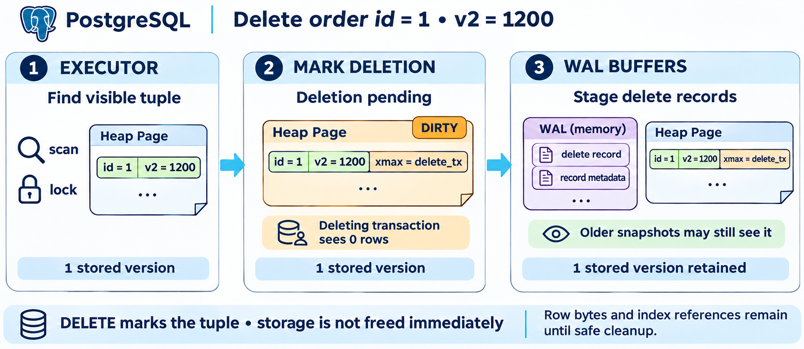

<!--
Speaker notes:
- ไล่สามขั้น: หาแถวที่มองเห็น → ทำเครื่องหมายลบ → สร้างบันทึก WAL ของการลบ
- ชี้ว่าหลังสั่ง DELETE ยังมี Tuple เก็บอยู่หนึ่งเวอร์ชัน พร้อมสถานะว่าการลบกำลังรอ COMMIT
- Transaction ที่ลบเห็นผลของตัวเอง แต่ Session อื่นใช้ Snapshot กับสถานะ Transaction ตัดสิน; อย่าเพิ่งเรียกพื้นที่นี้ว่าพร้อมนำกลับมาใช้

Source: ../labs/module05-architecture/upstream.json (original architecture-data-flow tutorial)
Source steps: delete 1–3
-->

---
layout: default
class: module-five architecture-task thai-deck
---


# DELETE ขั้น 4–6: มองไม่เห็น แล้วจึงนำพื้นที่กลับมาใช้

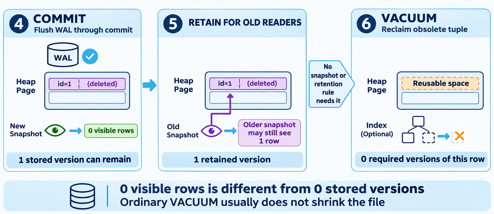

<!--
Speaker notes:
- เมื่อการลบ COMMIT แล้ว Snapshot ใหม่ที่เหมาะสมเห็นศูนย์แถว แต่ Tuple เดิมอาจยังอยู่บน Page
- ชี้ว่าต้องรอให้ผู้อ่านเก่าไม่ต้องใช้ก่อน VACUUM จึงคืนพื้นที่ให้ INSERT ครั้งต่อไปนำมาใช้ได้
- ศูนย์แถวที่มองเห็นไม่ได้แปลว่าศูนย์ Tuple ที่เก็บอยู่ และ VACUUM ปกติเน้นคืนพื้นที่ใช้ซ้ำ ไม่ได้ทำให้ไฟล์เล็กลงเสมอ

Source: ../labs/module05-architecture/upstream.json (original architecture-data-flow tutorial)
Source steps: delete 4–6
-->

---
layout: default
class: module-five architecture-task thai-deck
---


# SELECT ขั้น 1–3: วาง Plan และอ่าน Cache

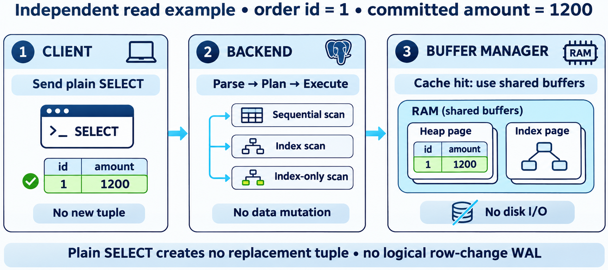

<!--
Speaker notes:
- ตัวอย่าง SELECT นี้เริ่มใหม่จาก Order ที่มีอยู่แล้ว ไม่ใช่อ่านต่อจากตัวอย่างที่เพิ่ง DELETE สำเร็จ
- ไล่ Client ส่งคำสั่ง → Planner เลือกวิธี Scan → Buffer manager หา Page; ถ้าอยู่ใน Shared buffers ก็ใช้ได้เลย
- SELECT ปกติไม่สร้าง Tuple เวอร์ชันใหม่; ตัวอย่างนี้ไม่รวม SELECT FOR UPDATE หรือ Function ที่เขียนข้อมูล

Source: ../labs/module05-architecture/upstream.json (original architecture-data-flow tutorial)
Source steps: select 1–3
-->

---
layout: default
class: module-five architecture-task thai-deck
---


# SELECT ขั้น 4–6: ตรวจ Visibility

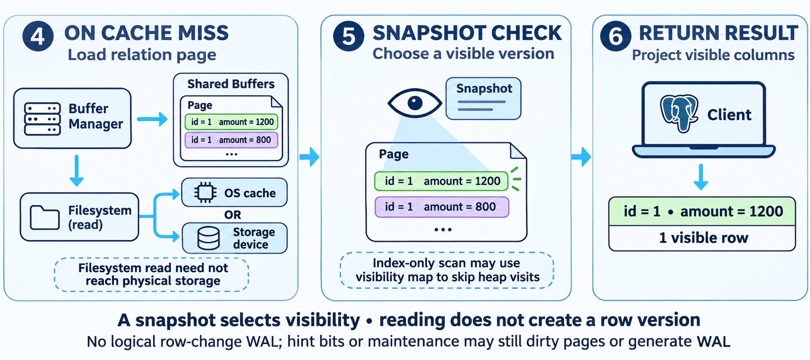

<!--
Speaker notes:
- ถ้า Page ไม่อยู่ใน Shared buffers ต้องอ่านเพิ่ม จากนั้นตรวจว่า Tuple เวอร์ชันใดตรงกับ Snapshot แล้วส่งผลกลับ
- ชี้ว่าอ่านจาก Filesystem อาจได้จาก OS cache จึงไม่ได้หมายความว่าต้องอ่านอุปกรณ์เก็บข้อมูลจริงทุกครั้ง
- Index-only scan บางกรณีใช้ Visibility map เพื่อลดการอ่าน Heap; SELECT ไม่แก้แถวโดยตรง แต่การตั้ง Hint bits อาจทำให้ Page Dirty และบางกรณีเกิด WAL ได้

Source: ../labs/module05-architecture/upstream.json (original architecture-data-flow tutorial)
Source steps: select 4–6
-->

---
layout: default
class: module-five architecture-task thai-deck
---


# Lab 5D.5: เชื่อม Activity กับสถานะ Tuple

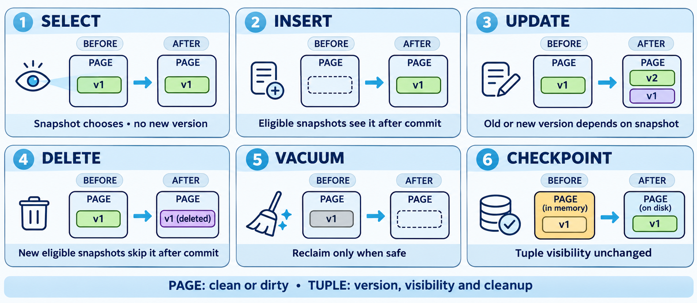

<!--
Speaker notes:
- ใช้ตารางนี้ทบทวน: INSERT เพิ่มเวอร์ชัน, UPDATE สร้างเวอร์ชันใหม่, DELETE ทำเครื่องหมาย และ SELECT เลือกสิ่งที่ Snapshot เห็น
- ถามผู้เรียนว่า “CHECKPOINT เปลี่ยนสิ่งที่ Query มองเห็นไหม?” คำตอบคือไม่ เพราะเป็นงานเขียน Page ไม่ใช่เปลี่ยน Visibility
- แยกสองแกนให้ชัด: Page ดู Clean/Dirty ส่วน Tuple ดูการมองเห็นและความพร้อมให้ VACUUM คืนพื้นที่
-->

---
layout: two-cols-header
layoutClass: module-five thai-deck
---


# Lab 5E: ตัวอย่าง MVCC

::left::

**แนวคิด**

Readers ไม่ขวาง Writers เพราะ PostgreSQL สร้าง Row Versions และให้แต่ละ Transaction ใช้ Snapshot

**ตัวอย่าง ClaimSure**

Session A ยังเห็น Status เดิมของ CLM-L1-005 จนกว่าจะจบ Repeatable Read Transaction

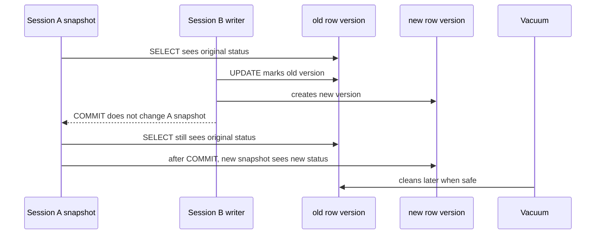

::right::

```sql
-- Session A
BEGIN ISOLATION LEVEL REPEATABLE READ;
SELECT xmin, xmax, ctid,
       claim_no, status
FROM claimsure.claim
WHERE claim_no = 'CLM-L1-005';

-- Session B
BEGIN;
UPDATE claimsure.claim
SET status = 'REVIEW'
WHERE claim_no = 'CLM-L1-005';
COMMIT;

-- Session A
SELECT claim_no, status
FROM claimsure.claim
WHERE claim_no = 'CLM-L1-005';
COMMIT;

-- Session A: new snapshot
SELECT claim_no, status
FROM claimsure.claim
WHERE claim_no = 'CLM-L1-005';
```

<!--
Speaker notes:
- ให้ A เปิด Repeatable Read และ SELECT ก่อน แล้วให้ B UPDATE พร้อม COMMIT จากนั้นกลับไป SELECT ที่ A อีกครั้ง
- ชี้ว่า A ยังเห็นค่าเดิม; หลัง A จบ Transaction แล้ว SELECT ใหม่จึงเห็นค่าที่ B เปลี่ยน
- การอ่านปกติไม่ขวางการแก้แถวด้วย Row lock แต่ยังมี Lock ชนิดอื่นได้; ctid ไม่ใช่รหัสถาวร และ Snapshot ที่ค้างนานอาจหน่วง VACUUM
-->

---
layout: default
class: module-five thai-deck
---


# WAL ต้องมาก่อน Data-page Writeback

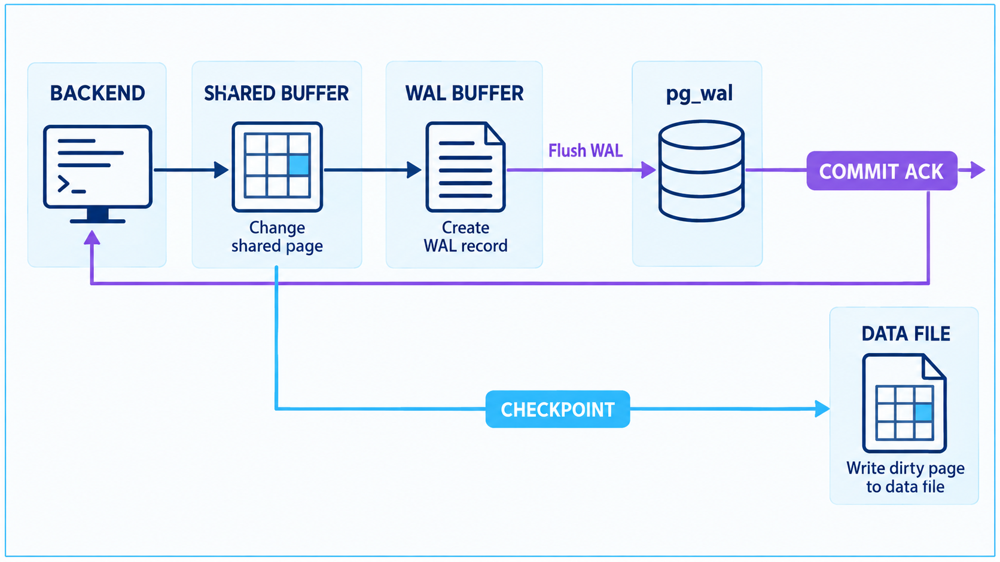

<div class="concept-caption">
  <span>เปลี่ยน Shared Page</span><span>Flush WAL ก่อนตอบรับ Commit</span><span>Checkpoint เขียน Page ภายหลัง</span>
</div>

<!--
Speaker notes:
- WAL เหมือนสมุดบันทึกที่เขียนให้ปลอดภัยก่อน จึงตอบกลับได้ว่างาน COMMIT แล้ว แม้ Heap page ยังไม่ถูกเขียนกลับ
- ชี้ลูกศรแยกสองทาง: ทาง Flush WAL เพื่อความทนทาน และทางเขียน Data page เพื่อให้ไฟล์ตามการเปลี่ยนแปลงทัน
- ในโหมด Synchronous ปกติ ต้อง Flush ถึง Commit record ก่อนแจ้งสำเร็จ; ก่อนเขียน Data page ต้องมี WAL ที่เกี่ยวข้องบน Disk แล้ว
-->

---
layout: two-cols-header
layoutClass: module-five thai-deck
---


# Lab 5F: ตัวอย่าง WAL

::left::

**แนวคิด**

COMMIT มี Durability เมื่อ Flush WAL แล้ว ส่วน Table Page เขียนภายหลังผ่าน Checkpoint ได้

**ตัวอย่าง ClaimSure**

เพิ่ม Audit Events แล้ววัดว่า Batch นี้สร้าง WAL เท่าไร

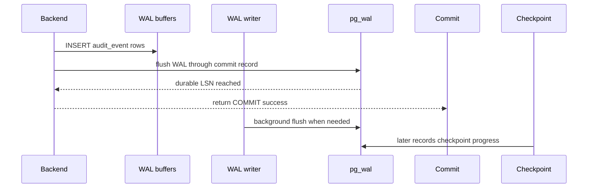

::right::

```bash
make lab5 LAB_NO=5F
```

```text
sample start LSN
INSERT 1,000 events + record event IDs
COMMIT (synchronous_commit = on)
measure WAL delta + verify flush LSN
DELETE only this batch's event IDs
```

ผล: rows_inserted = 1000, WAL > 0,
และ batch_wal_flushed = true

<!--
Speaker notes:
- Lab นี้ทำให้เห็นว่าเพิ่ม Audit event หนึ่งชุดแล้วมี WAL เกิดขึ้นจริง โดยวัดส่วนต่างของตำแหน่ง LSN
- ใช้ SQL ฉบับเต็มจาก lab5 ซึ่งอ่าน LSN ก่อน INSERT เป็นอีก Statement และเก็บ IDs เพื่อ cleanup เฉพาะรอบนี้ ชี้ rows_inserted=1000, WAL delta และ batch_wal_flushed=true
- LSN เป็นค่าทั้ง Cluster งานอื่นที่เกิดพร้อมกันอาจรวมในผลวัดด้วย; เพิ่ม Index มักเพิ่มภาระเขียนและ WAL จึงควรทดลองเปรียบเทียบ
-->

---
layout: two-cols-header
class: compact-table compact-code
layoutClass: module-five thai-deck compact-table compact-code
---


# Lab 5G: ตัวอย่าง Storage และ PGDATA

::left::

| รายการ | ความหมาย | คำสั่งใน Lab |
| --- | --- | --- |
| data directory | Root ของ Cluster | `SHOW data_directory` |
| database OID | Identity ของ Storage ใน Database | Query จาก `pg_database` |
| relation path | เส้นทางไฟล์ Table | `pg_relation_filepath()` |
| WAL directory | Stream สำหรับ Crash Recovery | ตรวจ `pg_wal` ผ่าน SQL |

::right::

```sql
SHOW data_directory;

SELECT oid, datname
FROM pg_database
ORDER BY oid;

SELECT pg_relation_filepath(
         'claimsure.claim'
       ) AS claim_file,
       pg_size_pretty(
         pg_total_relation_size('claimsure.claim')
       ) AS claim_size;
```

<!--
Speaker notes:
- PGDATA คือที่เก็บข้อมูลของ Cluster ส่วน Database กับ Table มีตัวระบุที่ช่วยตามไปยังไฟล์จริง
- ชี้ SHOW data_directory, OID ใน pg_database และ pg_relation_filepath() เพื่อเชื่อมชื่อ Table กับเส้นทางไฟล์
- ให้ตรวจผ่าน SQL ตามสิทธิ์ อย่าแก้ไฟล์ใน PGDATA หรือลบ pg_wal เองเพื่อคืนพื้นที่ เพราะอาจทำให้กู้ข้อมูลไม่ได้
-->

---
layout: default
class: module-five architecture-task thai-deck
---


# Maintenance ขั้น 1–4: Pages และ Versions

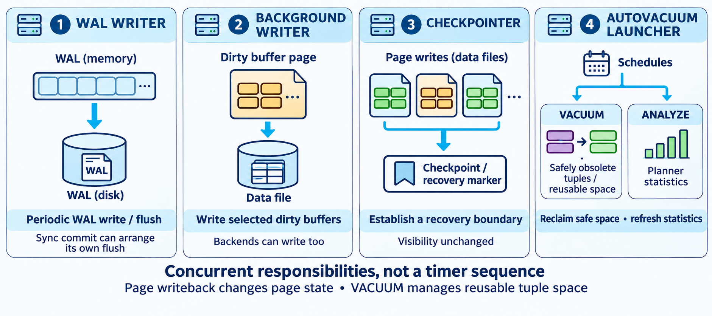

<!--
Speaker notes:
- แยกหน้าที่ทีมดูแล: WAL writer ดู WAL, Background writer ช่วยเขียน Dirty page, Checkpointer สร้างจุดกู้คืน และ Autovacuum จัดการเวอร์ชันเก่า
- ชี้ ANALYZE ว่าอัปเดตสถิติให้ Planner ส่วน VACUUM คืนพื้นที่ที่ปลอดภัยแล้ว; ทั้งสองงานมีหน้าที่ต่างกัน
- เลขขั้นบอกหน้าที่ ไม่ใช่ให้ Process ทำงานเรียงคิว; Page writeback ไม่เปลี่ยน Visibility และ VACUUM ไม่สร้างแถวธุรกิจเวอร์ชันใหม่

Source: ../labs/module05-architecture/upstream.json (original architecture-data-flow tutorial)
Source steps: background 1–4
-->

---
layout: default
class: module-five architecture-task thai-deck
---


# Recovery ขั้น 5–7: เก็บรักษาและ Replay WAL

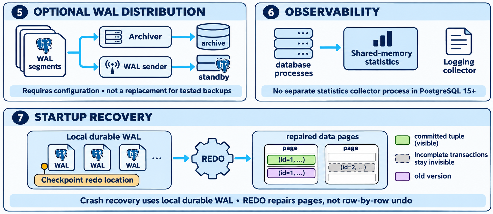

<!--
Speaker notes:
- Archiver เก็บ WAL และ Replication ส่ง WAL ไป Standby เมื่อกำหนดไว้ ส่วน Crash recovery ใช้ WAL ที่ปลอดภัยอยู่แล้วเพื่อซ่อมหน้า
- ชี้ว่า Recovery เริ่ม Replay จากตำแหน่ง Redo ของ Checkpoint; Transaction ที่ยังไม่ COMMIT จะไม่กลายเป็นข้อมูลที่มองเห็น
- นี่คือ REDO ไม่ใช่ Undo ทีละแถว; PostgreSQL 15 ขึ้นไปไม่มี Statistics collector process แยก และมี Replication ก็ยังต้องมีแผน Backup ที่ทดสอบแล้ว

Source: ../labs/module05-architecture/upstream.json (original architecture-data-flow tutorial)
Source steps: background 5–7
-->

---
layout: default
class: module-five architecture-task thai-deck
---


# ตรวจความเข้าใจ

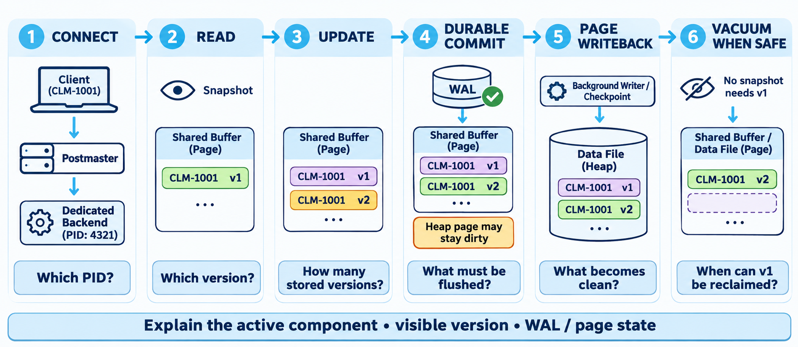

<!--
Speaker notes:
- ให้ผู้เรียนเล่า CLM-1001 ด้วยตัวเอง: เชื่อมต่อ → Backend → Snapshot กับ Buffer → เวอร์ชันใหม่ → WAL → COMMIT → ดูแล Page และเวอร์ชันเก่า
- ถามต่อว่าใช้ Query ใดพิสูจน์แต่ละช่วงได้ เช่น pg_backend_pid(), pg_stat_activity, pg_locks และค่า LSN
- หากผู้เรียนแยกได้ว่าอะไรเกี่ยวกับ Visibility อะไรเกี่ยวกับ Durability และอะไรเป็นงานดูแลภายหลัง แสดงว่าเข้าใจแกนหลักแล้ว
-->

---
layout: default
class: module-five architecture-task thai-deck
---


# สรุป Architecture

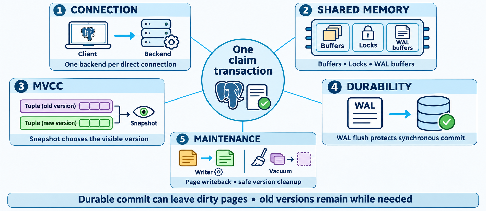

<!--
Speaker notes:
- สรุปห้าเรื่อง: Connection มี Backend, Shared memory ใช้ประสานงาน, MVCC เลือกเวอร์ชัน, WAL ทำให้ COMMIT ทนต่อการล่ม และ Process เบื้องหลังดูแลต่อ
- ให้ผู้เรียนตอบสั้น ๆ ว่า “COMMIT แล้ว Page ต้อง Clean เลยไหม?” และ “UPDATE แล้วเวอร์ชันเก่าหายทันทีไหม?” ทั้งสองข้อไม่จำเป็น
- เชื่อมไป Module 6: ก่อนปรับ Configuration ต้องรู้ว่ากำลังแก้ภาระส่วนไหน และจะใช้หลักฐานอะไรตรวจผล
-->
