<CaseCover :module-id="5" />

# Module 5<br>Architecture

## MVCC และ WAL บนเคลมเดิม

<footer class="cs-footer"><span>ClaimSure ต่อเนื่อง · คู่มือ ภาพรวม</span><span>1 / 29</span></footer>

<!--
Speaker notes:
บทนี้ใช้ฐานข้อมูล claimsure_xx และ schema claimsure จากบท 1–2 ต่อเนื่องกัน เปิดคู่มือบทนี้ไว้เพื่อทำ SQL/native commands ทีละขั้น ภาพปก: ./assets/module-05-architecture-cover-enterprise-blue.png

Source: ../labs/module-05-architecture.md · ภาพรวม
-->

---
layout: default
class: continuous-deck cs-module-five cs-fundamental cs-infographic
---

# 5A · Fundamental: Process / Memory / Files

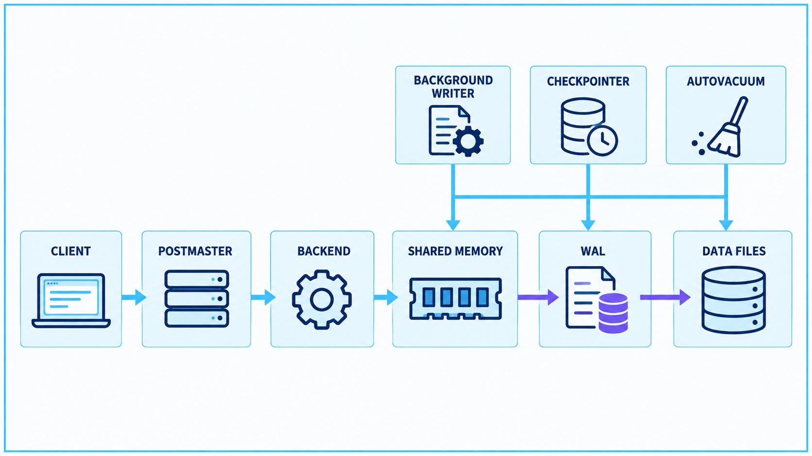

<footer class="cs-footer"><span>ClaimSure ต่อเนื่อง · Fundamental ก่อน Lab 5A</span><span>3 / 29</span></footer>

<!--
Speaker notes:
อ้างอิงคู่มือ labs/module-05-architecture.md หัวข้อ 5A · อธิบายก่อนคำสั่งแล็บที่เกี่ยวข้อง
ภาพเป็นผังภาพรวม ไม่ใช่ทุก SELECT ต้องผ่านขั้น WAL ไป data file แบบลำดับเดียวกัน Postmaster รับและจัดการการเชื่อมต่อ ส่วน backend ประมวลผล SQL ลูกศรด้าน background เป็นการอธิบายบทบาท ไม่ใช่ process ทุกตัวเขียนทุกไฟล์
แยก process ที่ทำงานออกจากพื้นที่ข้อมูล table/index/WAL Backend อ่านและแก้ buffers ส่วนการเขียนไฟล์บางอย่างทำโดย background processes การ commit ไม่เท่ากับเขียน table pages ทุกหน้าทันที

Sources:
- https://www.postgresql.org/docs/18/tutorial-arch.html
- https://www.postgresql.org/docs/18/storage.html
-->

---
layout: default
class: continuous-deck cs-module-five cs-fundamental
---

# 5A–5F · Fundamental: เส้นทางคำสั่งแก้เคลม

<div class="cs-flow"><div><strong>Client</strong><small>ส่ง UPDATE</small></div><span aria-hidden="true">→</span><div><strong>Backend</strong><small>อ่าน/แก้ tuple</small></div><span aria-hidden="true">→</span><div><strong>Buffers + WAL</strong><small>เปลี่ยน page / บันทึก redo</small></div></div>


| จุด | สิ่งที่ต้องแยก |
| --- | --- |
| COMMIT | ความทนทานตาม WAL flush policy |
| Data file write | เกิดภายหลังได้โดย background processes |

<footer class="cs-footer"><span>ClaimSure ต่อเนื่อง · Fundamental ก่อน Lab 5A–5F</span><span>4 / 29</span></footer>

<!--
Speaker notes:
อ้างอิงคู่มือ labs/module-05-architecture.md หัวข้อ 5A–5F · อธิบายก่อนคำสั่งแล็บที่เกี่ยวข้อง
เมื่อ synchronous_commit on ตามปกติ การ commit รอ WAL ที่เกี่ยวข้องให้ durable ไม่ได้บังคับทุก table page ลง data file ทันที จึงต้องแยก visibility กับ durability

Source: ../labs/module-05-architecture.md · 5A / 5F
-->

---
layout: default
class: continuous-deck cs-module-five cs-fundamental cs-infographic
---

# 5A · Fundamental: Background processes

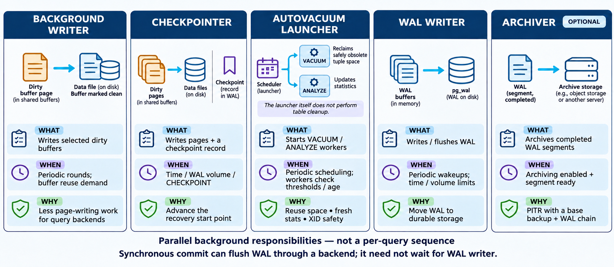

<p class="cs-concept-caption">งานพื้นหลังทำคู่ขนาน · สถิติเป็นระดับ cluster ไม่ใช่ของ query เดียว</p>

<footer class="cs-footer"><span>ClaimSure ต่อเนื่อง · Fundamental ก่อน Lab 5A</span><span>5 / 29</span></footer>

<!--
Speaker notes:
อ้างอิงคู่มือ labs/module-05-architecture.md หัวข้อ 5A · อธิบายก่อนคำสั่งแล็บที่เกี่ยวข้อง
ภาพมี archiver เป็น optional และแยก autovacuum launcher ออกจาก workers ที่ทำ VACUUM/ANALYZE จริง WAL writer ทำงานเป็นรอบ แต่ synchronous commit สามารถให้ backend จัดการ flush ที่ต้องรอได้ ไม่ต้องรอ WAL writer รอบถัดไปทุกครั้ง
สถิติ pg_stat_bgwriter/pg_stat_checkpointer/pg_stat_wal เป็นระดับ cluster อาจรวมผู้เรียนคนอื่น ไม่อ้างว่า counter ทั้งหมดเป็นของ query เดียว

Source: ../labs/module-05-architecture.md · 5A
-->

---
layout: default
class: continuous-deck cs-module-five cs-fundamental
---

# 5A–5B · Fundamental: Row กับ tuple version

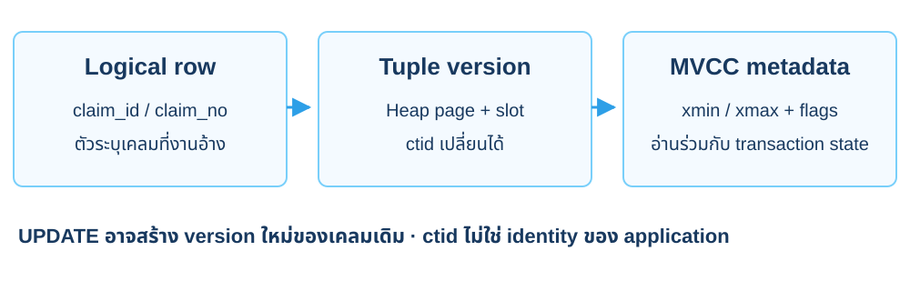

<p class="cs-concept-caption">ใช้ primary/business key อ้างเคลม · ctid ใช้สังเกต version ในแล็บ</p>

<footer class="cs-footer"><span>ClaimSure ต่อเนื่อง · Fundamental ก่อน Lab 5A–5B</span><span>6 / 29</span></footer>

<!--
Speaker notes:
อ้างอิงคู่มือ labs/module-05-architecture.md หัวข้อ 5A–5B · อธิบายก่อนคำสั่งแล็บที่เกี่ยวข้อง
UPDATE สร้าง row version ใหม่ ctid เปลี่ยนได้เมื่อ UPDATE หรือ VACUUM FULL และไม่ควรเก็บเป็น identity ของ application xmax ที่ไม่เป็นศูนย์ยังพบใน row ที่ visible ได้ จึงอ่านร่วมกับ transaction state

Sources:
- https://www.postgresql.org/docs/18/ddl-system-columns.html
-->

---
layout: default
class: continuous-deck cs-module-five cs-fundamental cs-infographic
---

# 5A · Fundamental: Page state กับ visibility

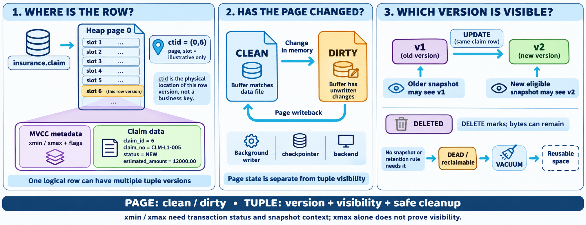

<p class="cs-concept-caption">Page: clean / dirty · Tuple: version / visibility · ctid ในภาพเป็นตัวอย่าง</p>

<footer class="cs-footer"><span>ClaimSure ต่อเนื่อง · Fundamental ก่อน Lab 5A</span><span>7 / 29</span></footer>

<!--
Speaker notes:
อ้างอิงคู่มือ labs/module-05-architecture.md หัวข้อ 5A · อธิบายก่อนคำสั่งแล็บที่เกี่ยวข้อง
ภาพต้นฉบับใช้ insurance.claim และ CLM-L1-005 พร้อม claim_id/ctid ที่ยกตัวอย่าง ในแล็บปัจจุบันใช้ claimsure.claim และวัด ctid/xmin/xmax ของ CLM-L1-001 จริง ไม่คัด id หรือ ctid จากภาพ และไม่ถือว่าตัวเลขท้าย claim_no เท่ากับ claim_id Page clean/dirty หมายถึง buffer เทียบไฟล์ ไม่ใช่ commit/uncommitted ของ tuple; xmax ต้องอ่านร่วม flags และ transaction state

Source: ../labs/module-05-architecture.md · 5A
Visual reference: postgres-admin-labs/docs/slides/module-05-architecture.md
-->

---
layout: default
class: continuous-deck cs-module-five
---

# Lab 5A · A ดู backend และเก็บค่าเดิม

```sql
SELECT pg_backend_pid(),current_database(),current_user;
CREATE TEMP TABLE cs_m5_original AS
SELECT * FROM claimsure.claim
WHERE claim_no IN ('CLM-L1-001','CLM-L1-006');
SELECT ctid,xmin,xmax,claim_no,estimated_amount
FROM claimsure.claim WHERE claim_no='CLM-L1-001';
```


<p class="cs-takeaway">เก็บ Terminal A ไว้ · temporary backup อยู่ใน connection นี้</p>

<footer class="cs-footer"><span>ClaimSure ต่อเนื่อง · คู่มือ Lab 5A</span><span>8 / 29</span></footer>

<!--
Speaker notes:
อ้างอิงคู่มือ labs/module-05-architecture.md หัวข้อ 5A
ctid เป็นตำแหน่ง tuple ไม่ใช่ business key ถาวร ถ้า connection A หลุด ให้กลับ seed 1B และ 1D ตามคู่มือ ไม่เดาว่าค่าเดิมเป็นอะไร

Source: ../labs/module-05-architecture.md · 5A
-->

---
layout: default
class: continuous-deck cs-module-five cs-fundamental cs-infographic
---

# 5B · Fundamental: UPDATE สร้าง version ใหม่

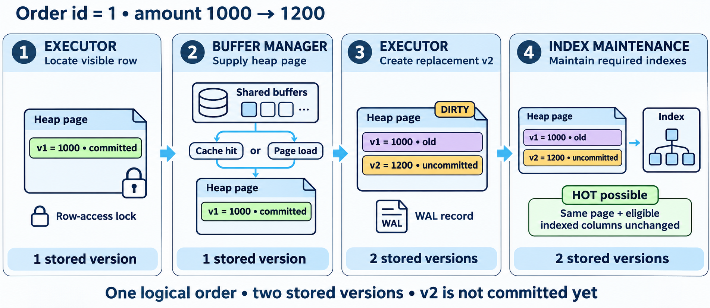

<p class="cs-concept-caption">ภาพ: 1,000 → 1,200 · แล็บ 5B: CLM-L1-001 ยอด 15,000 → 15,100</p>

<footer class="cs-footer"><span>ClaimSure ต่อเนื่อง · Fundamental ก่อน Lab 5B</span><span>9 / 29</span></footer>

<!--
Speaker notes:
อ้างอิงคู่มือ labs/module-05-architecture.md หัวข้อ 5B · อธิบายก่อนคำสั่งแล็บที่เกี่ยวข้อง
ภาพใช้ order id 1 เป็นตัวอย่างการสร้าง v2 ไม่ใช่ข้อมูลที่ต้อง INSERT เพิ่ม แล็บ 5B UPDATE claim เดิมใน A แล้วค้าง transaction ไว้ A เห็นค่าที่ตนเพิ่งแก้ B ยังเห็น version ที่ snapshot ของ B อนุญาต ไม่สรุปว่าทุก UPDATE เป็น HOT: ต้องเข้าเงื่อนไขของหน้าและ index ที่เกี่ยวข้อง ในฐานของบท 3 estimated_amount ถูกเก็บใน INCLUDE จึงไม่รับประกัน HOT เมื่อแก้คอลัมน์นี้

Source: ../labs/module-05-architecture.md · 5B
Visual reference: postgres-admin-labs/docs/slides/module-05-architecture.md
-->

---
layout: default
class: continuous-deck cs-module-five
---

# Lab 5B · A UPDATE แล้วค้าง transaction

```sql
BEGIN;
UPDATE claimsure.claim
SET estimated_amount=estimated_amount+100
WHERE claim_no='CLM-L1-001'
RETURNING ctid,xmin,xmax,claim_no,estimated_amount;
```


<div class="cs-metrics"><div><b>15,000</b><span>ค่าเดิม</span></div><div><b>15,100</b><span>A เห็นใน transaction</span></div></div>

<footer class="cs-footer"><span>ClaimSure ต่อเนื่อง · คู่มือ Lab 5B</span><span>10 / 29</span></footer>

<!--
Speaker notes:
อ้างอิงคู่มือ labs/module-05-architecture.md หัวข้อ 5B
ให้ค้าง transaction A จน B อ่าน snapshot เสร็จ UPDATE ปกติสร้าง tuple version ใหม่ ไม่ใช้ xmax ค่าเดียวตัดสินสถานะ transaction ทุกกรณี

Source: ../labs/module-05-architecture.md · 5B
-->

---
layout: default
class: continuous-deck cs-module-five cs-fundamental
---

# 5C · Fundamental: Snapshot และ isolation

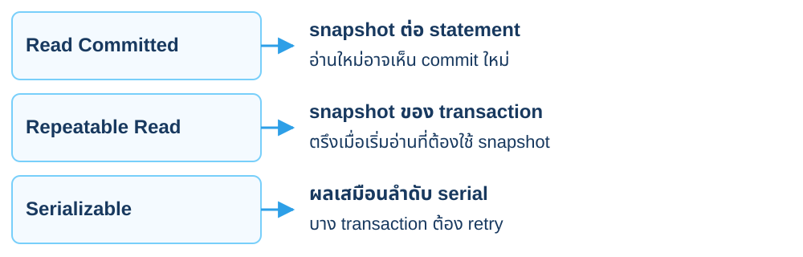

<p class="cs-concept-caption">ทุกระดับยังเห็นการเปลี่ยนที่ทำเอง · B ใช้ REPEATABLE READ ใน 5C</p>

<footer class="cs-footer"><span>ClaimSure ต่อเนื่อง · Fundamental ก่อน Lab 5C</span><span>11 / 29</span></footer>

<!--
Speaker notes:
อ้างอิงคู่มือ labs/module-05-architecture.md หัวข้อ 5C · อธิบายก่อนคำสั่งแล็บที่เกี่ยวข้อง
Read Committed เป็นค่า default ปกติ Repeatable Read เริ่ม snapshot เมื่อคำสั่งที่เกี่ยวข้องเริ่มอ่าน ไม่ใช่ว่าการพิมพ์ BEGIN อย่างเดียวอ่านข้อมูลแล้ว PostgreSQL ให้ Read Uncommitted ทำงานแบบ Read Committed

Sources:
- https://www.postgresql.org/docs/18/transaction-iso.html
-->

---
layout: default
class: continuous-deck cs-module-five cs-fundamental cs-infographic
---

# 5C · Fundamental: Snapshot เลือก version

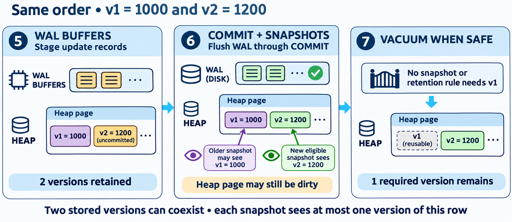

<p class="cs-concept-caption">A COMMIT ไม่เปลี่ยน snapshot เดิมของ B · หลัง B COMMIT อ่านใหม่จึงเห็น 15,100</p>

<footer class="cs-footer"><span>ClaimSure ต่อเนื่อง · Fundamental ก่อน Lab 5C</span><span>12 / 29</span></footer>

<!--
Speaker notes:
อ้างอิงคู่มือ labs/module-05-architecture.md หัวข้อ 5C · อธิบายก่อนคำสั่งแล็บที่เกี่ยวข้อง
ค่าตัวอย่าง 1000/1200 ในภาพ map กับ 15000/15100 ของ CLM-L1-001 ในแล็บ 5C B ต้องเริ่ม REPEATABLE READ และอ่านให้เกิด snapshot ก่อน A commit BEGIN อย่างเดียวไม่ตรึง snapshot เสมอไป A durable commit ไม่ได้ทำให้ heap page ต้อง clean ทันที และไม่ลบ version เก่าที่ยังมี snapshot ต้องเห็น ค้าง A/B ตามลำดับคู่มือ ไม่วางทั้งบทใน connection เดียว

Source: ../labs/module-05-architecture.md · 5C
Visual reference: postgres-admin-labs/docs/slides/module-05-architecture.md
-->

---
layout: default
class: continuous-deck cs-module-five
---

# Lab 5C · B ตรึง snapshot ก่อน A COMMIT

```sql
SELECT claim_no,estimated_amount FROM claimsure.claim
WHERE claim_no='CLM-L1-001';
BEGIN ISOLATION LEVEL REPEATABLE READ;
SELECT claim_no,estimated_amount FROM claimsure.claim
WHERE claim_no='CLM-L1-001';
```


<p class="cs-takeaway">B เห็น 15,000 ทั้งสองครั้ง แล้วค้าง transaction ไว้</p>

<footer class="cs-footer"><span>ClaimSure ต่อเนื่อง · คู่มือ Lab 5C</span><span>13 / 29</span></footer>

<!--
Speaker notes:
อ้างอิงคู่มือ labs/module-05-architecture.md หัวข้อ 5C
A ยังไม่ commit B จึงอ่านค่าก่อนหน้า SELECT ใน REPEATABLE READ ตรึง snapshot แล้ว กลับ A เพื่อ commit ก่อนอ่าน B รอบถัดไป

Source: ../labs/module-05-architecture.md · 5C
-->

---
layout: default
class: continuous-deck cs-module-five
---

# Lab 5C · ตรวจ visibility ของ A และ B

| ลำดับ | A | B |
| --- | --- | --- |
| 1 | UPDATE เป็น 15,100 ยังไม่ commit | อ่านได้ 15,000 |
| 2 | COMMIT | snapshot เดิมยัง 15,000 |
| 3 | commit แล้ว | COMMIT จบ snapshot |
| 4 | ค่าปัจจุบัน 15,100 | SELECT ใหม่ได้ 15,100 |


<p class="cs-takeaway">อ่านใหม่ใน transaction เดิม ≠ อ่านใหม่หลังจบ transaction</p>

<footer class="cs-footer"><span>ClaimSure ต่อเนื่อง · คู่มือ Lab 5C</span><span>14 / 29</span></footer>

<!--
Speaker notes:
อ้างอิงคู่มือ labs/module-05-architecture.md หัวข้อ 5C
ทำลำดับตามคู่มือ ไม่วาง SQL ทั้งบทพร้อมกัน view claim_detail_v สดตาม visibility ของ transaction แต่ materialized summary ไม่ refresh เอง

Source: ../labs/module-05-architecture.md · 5C
-->

---
layout: default
class: continuous-deck cs-module-five
---

# Lab 5C · COMMIT A แล้วอ่านซ้ำใน B

```sql
-- A:
COMMIT;
-- B, in its existing transaction:
SELECT estimated_amount FROM claimsure.claim
WHERE claim_no='CLM-L1-001';
COMMIT;
SELECT estimated_amount FROM claimsure.claim
WHERE claim_no='CLM-L1-001';
```

<footer class="cs-footer"><span>ClaimSure ต่อเนื่อง · คู่มือ Lab 5C</span><span>15 / 29</span></footer>

<!--
Speaker notes:
อ้างอิงคู่มือ labs/module-05-architecture.md หัวข้อ 5C
บรรทัด COMMIT แรกทำใน A ที่เหลือทำใน B ตาม comment ผล B คือ 15000 แล้ว 15100 อย่ารันทั้ง code block ใน connection เดียว

Source: ../labs/module-05-architecture.md · 5C
-->

---
layout: default
class: continuous-deck cs-module-five cs-fundamental cs-infographic
---

# 5D · Fundamental: DELETE กับ visibility

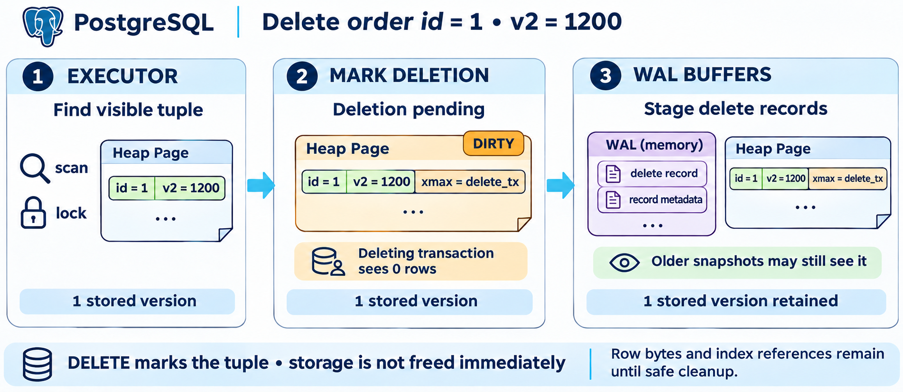

<p class="cs-concept-caption">แล็บ 5D ลบ CLM-L1-006 · A เห็น 0 แต่ B ยังเห็น 1 ก่อน A COMMIT</p>

<footer class="cs-footer"><span>ClaimSure ต่อเนื่อง · Fundamental ก่อน Lab 5D</span><span>16 / 29</span></footer>

<!--
Speaker notes:
อ้างอิงคู่มือ labs/module-05-architecture.md หัวข้อ 5D · อธิบายก่อนคำสั่งแล็บที่เกี่ยวข้อง
ภาพใช้ order id 1/v2=1200 เป็นคำอธิบายกลไก แล็บนี้ลบ CLM-L1-006 ที่ backup ค่าเดิมไว้ใน A แล้ว DELETE ทำเครื่องหมาย visibility และสร้าง WAL ไม่ได้ลบ bytes ออกจากไฟล์ทันที ไม่ใช้ xmax ค่าเดียวตัดสินว่า version visible หรือไม่ และทำเฉพาะแถวเป้าหมายที่คู่มือระบุ

Source: ../labs/module-05-architecture.md · 5D
Visual reference: postgres-admin-labs/docs/slides/module-05-architecture.md
-->

---
layout: default
class: continuous-deck cs-module-five cs-fundamental cs-infographic
---

# 5D · Fundamental: จากลบแถวถึงพื้นที่ใช้ซ้ำ

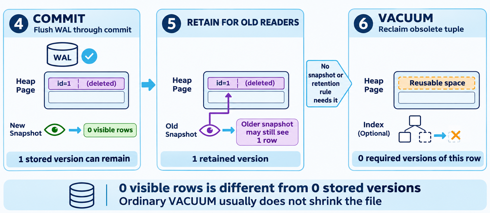

<p class="cs-concept-caption">0 visible rows ไม่ได้แปลว่า 0 stored bytes · VACUUM เก็บกวาดเมื่อไม่ต้องใช้แล้ว</p>

<footer class="cs-footer"><span>ClaimSure ต่อเนื่อง · Fundamental ก่อน Lab 5D</span><span>17 / 29</span></footer>

<!--
Speaker notes:
อ้างอิงคู่มือ labs/module-05-architecture.md หัวข้อ 5D · อธิบายก่อนคำสั่งแล็บที่เกี่ยวข้อง
หลัง A commit B ที่เริ่ม statement ใหม่และไม่มี snapshot เก่าค้างต้องเห็น count=0 ตาม 5D ภาพ old snapshot อาจเห็นแถวเดิมเป็นการขยายแนวคิด หากยังมี snapshot หรือ retention rule ที่ต้องใช้ version นั้น VACUUM จะยังเก็บกวาดไม่ได้ Ordinary VACUUM ช่วยคืนพื้นที่เพื่อ reuse ภายในแต่ไม่จำเป็นต้องย่อขนาดไฟล์ ดูตัวเลขสถิติจริง ไม่คัด stored versions ในภาพเป็นค่าจาก server

Source: ../labs/module-05-architecture.md · 5D
Visual reference: postgres-admin-labs/docs/slides/module-05-architecture.md
-->

---
layout: default
class: continuous-deck cs-module-five
---

# Lab 5D · A DELETE แล้ว B ตรวจ CLM-L1-006

| ช่วง | A เห็นแถว | B เห็นแถว |
| --- | --- | --- |
| ก่อน DELETE | 1 | 1 |
| A DELETE ยังไม่ commit | 0 | 1 |
| หลัง A COMMIT / B statement ใหม่ | 0 | 0 |


<p class="cs-takeaway">DELETE เปลี่ยน visibility · VACUUM เก็บ version ที่ไม่ต้องใช้แล้ว</p>

<footer class="cs-footer"><span>ClaimSure ต่อเนื่อง · คู่มือ Lab 5D</span><span>18 / 29</span></footer>

<!--
Speaker notes:
อ้างอิงคู่มือ labs/module-05-architecture.md หัวข้อ 5D
ทดลองลบจริงหนึ่งแถวหลังเก็บ backup ไว้ใน A แล้ว ใช้ B อ่านนอก snapshot เก่า เพื่อให้ผลตามตาราง

Source: ../labs/module-05-architecture.md · 5D
-->

---
layout: default
class: continuous-deck cs-module-five cs-fundamental
---

# 5D–5G · Fundamental: Rollback / Vacuum

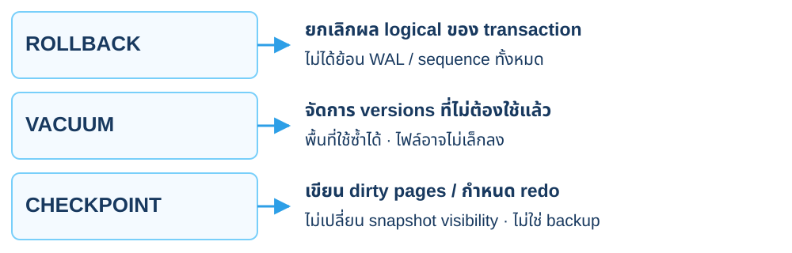

<p class="cs-concept-caption">แยก visibility / space reuse / durability · ไม่สั่ง CHECKPOINT บน shared server</p>

<footer class="cs-footer"><span>ClaimSure ต่อเนื่อง · Fundamental ก่อน Lab 5D–5G</span><span>19 / 29</span></footer>

<!--
Speaker notes:
อ้างอิงคู่มือ labs/module-05-architecture.md หัวข้อ 5D–5G · อธิบายก่อนคำสั่งแล็บที่เกี่ยวข้อง
แยก visibility, space reuse และ durability ออกจากกัน Checkpoint ยังอยู่บนชุดข้อมูลต้นทาง จึงไม่แทน backup Ordinary vacuum ไม่เก็บ version ที่ snapshot อื่นยังต้องเห็นออกก่อนเวลา

Sources:
- https://www.postgresql.org/docs/18/mvcc.html
- https://www.postgresql.org/docs/18/routine-vacuuming.html
- https://www.postgresql.org/docs/18/wal-configuration.html
-->

---
layout: default
class: continuous-deck cs-module-five cs-fundamental cs-infographic
---

# 5D–5G · Fundamental: งาน maintenance

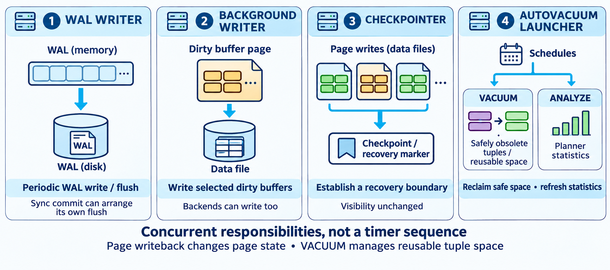

<p class="cs-concept-caption">Writer เปลี่ยน page state · VACUUM จัดการ version ที่ไม่ต้องใช้ · งานเหล่านี้ทำคู่ขนาน</p>

<footer class="cs-footer"><span>ClaimSure ต่อเนื่อง · Fundamental ก่อน Lab 5D–5G</span><span>20 / 29</span></footer>

<!--
Speaker notes:
อ้างอิงคู่มือ labs/module-05-architecture.md หัวข้อ 5D–5G · อธิบายก่อนคำสั่งแล็บที่เกี่ยวข้อง
เลข 1–4 ในภาพจัดหมวดความรับผิดชอบ ไม่ใช่ลำดับ timer ของทุก query background writer และ checkpointer เขียน pages ส่วน autovacuum launcher จัด workers ให้ทำ VACUUM/ANALYZE การเขียน page ลงไฟล์ไม่เปลี่ยน snapshot visibility ของ tuple ใน 5D ใช้ manual VACUUM หลังจบ transaction ที่เกี่ยวข้อง ส่วน 5G ต้องจบ B ก่อน cleanup และไม่สั่ง CHECKPOINT เองบน shared

Source: ../labs/module-05-architecture.md · 5D–5G
Visual reference: postgres-admin-labs/docs/slides/module-05-architecture.md
-->

---
layout: default
class: continuous-deck cs-module-five
---

# Lab 5D · B ทำ manual VACUUM และอ่านสถิติ

```sql
VACUUM (ANALYZE) claimsure.claim;
SELECT n_live_tup,n_dead_tup,last_vacuum,last_autovacuum
FROM pg_stat_user_tables
WHERE relid='claimsure.claim'::regclass;
```


<p class="cs-takeaway">พื้นที่เดิมอาจนำกลับมาใช้ได้ โดยไฟล์ไม่เล็กลง</p>

<footer class="cs-footer"><span>ClaimSure ต่อเนื่อง · คู่มือ Lab 5D</span><span>21 / 29</span></footer>

<!--
Speaker notes:
อ้างอิงคู่มือ labs/module-05-architecture.md หัวข้อ 5D
ทำหลัง A commit DELETE และ B จบ snapshot แล้ว ค่าจำนวน tuples เป็นสถิติประมาณ Manual vacuum ไม่ใช่ autovacuum pass

Source: ../labs/module-05-architecture.md · 5D
-->

---
layout: default
class: continuous-deck cs-module-five cs-fundamental
---

# 5E · Fundamental: คืนค่าและ identity เดิม

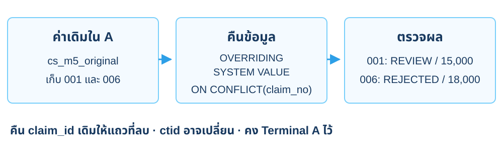

<p class="cs-concept-caption">รันใน A ที่ยังมี cs_m5_original · คืน logical data และ claim_id เดิม</p>

<footer class="cs-footer"><span>ClaimSure ต่อเนื่อง · Fundamental ก่อน Lab 5E</span><span>22 / 29</span></footer>

<!--
Speaker notes:
อ้างอิงคู่มือ labs/module-05-architecture.md หัวข้อ 5E · อธิบายก่อนคำสั่งแล็บที่เกี่ยวข้อง
ก่อน 5F คืนสองเคลมจากค่าจริงที่เก็บไว้ใน 5A OVERRIDING SYSTEM VALUE ยอมให้ INSERT identity เดิมในตาราง GENERATED ALWAYS กรณีแถวหาย เช่น 006 ส่วน ON CONFLICT(claim_no) อัปเดตค่าของ 001 ที่ยังอยู่ ไม่ใช่การย้อน tuple/ctid/WAL เดิม หาก A หลุดให้ทำเส้นทางกู้ seed 1B และ 1D ตามคู่มือ ไม่เดาข้อมูล

Source: ../labs/module-05-architecture.md · 5E
Visual reference: postgres-admin-labs/docs/slides/module-05-architecture.md
-->

---
layout: default
class: continuous-deck cs-module-five
---

# Lab 5E · A คืนสองเคลมด้วย claim_id เดิม

```sql
INSERT INTO claimsure.claim OVERRIDING SYSTEM VALUE
SELECT * FROM cs_m5_original WHERE true
ON CONFLICT(claim_no) DO UPDATE
SET estimated_amount=EXCLUDED.estimated_amount,
 status=EXCLUDED.status,
 approved_amount=EXCLUDED.approved_amount;
```


<p class="cs-takeaway">001 กลับ REVIEW / 15,000 · 006 กลับ REJECTED / 18,000</p>

<footer class="cs-footer"><span>ClaimSure ต่อเนื่อง · คู่มือ Lab 5E</span><span>23 / 29</span></footer>

<!--
Speaker notes:
อ้างอิงคู่มือ labs/module-05-architecture.md หัวข้อ 5E
รันใน A ที่ยังมี cs_m5_original แถวที่เคย DELETE ต้องได้ claim_id เดิม การใช้ OVERRIDING SYSTEM VALUE จำเป็นกับ GENERATED ALWAYS AS IDENTITY

Source: ../labs/module-05-architecture.md · 5E
-->

---
layout: default
class: continuous-deck cs-module-five cs-fundamental cs-infographic
---

# 5F · Fundamental: WAL ก่อน data writeback

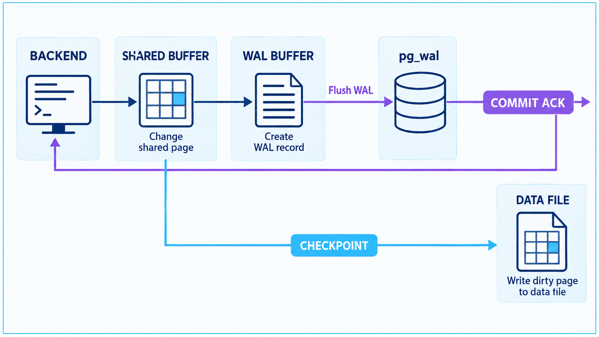

<p class="cs-concept-caption">เมื่อ synchronous_commit=on ปกติ COMMIT รอ WAL flush · data page ยัง dirty ได้</p>

<footer class="cs-footer"><span>ClaimSure ต่อเนื่อง · Fundamental ก่อน Lab 5F</span><span>24 / 29</span></footer>

<!--
Speaker notes:
อ้างอิงคู่มือ labs/module-05-architecture.md หัวข้อ 5F · อธิบายก่อนคำสั่งแล็บที่เกี่ยวข้อง
ภาพแสดงกรณี synchronous durable commit และ write-ahead rule ไม่ได้หมายความว่าเขียน data files ได้เฉพาะตอน checkpoint เท่านั้น background writer และ backend เขียน dirty buffers ได้เมื่อ WAL ที่สัมพันธ์กัน durable แล้ว ค่า pg_current_wal_insert_lsn ในแล็บเป็นตำแหน่ง insert ไม่ใช่หลักฐาน flush โดยตัวมันเอง
WAL เป็นข้อมูลสำหรับ redo ไม่ใช่สำเนา SQL statements ทุกคำสั่ง ความทนทานขึ้นกับ settings ที่ใช้ การ flush WAL กับการเขียน heap/index pages ลงไฟล์เป็นงานที่สัมพันธ์กันแต่ไม่ใช่ขั้นเดียวกัน

Sources:
- https://www.postgresql.org/docs/18/wal-intro.html
- https://www.postgresql.org/docs/18/runtime-config-wal.html
-->

---
layout: default
class: continuous-deck cs-module-five cs-fundamental
---

# 5F · Fundamental: ขอบเขตการวัด WAL

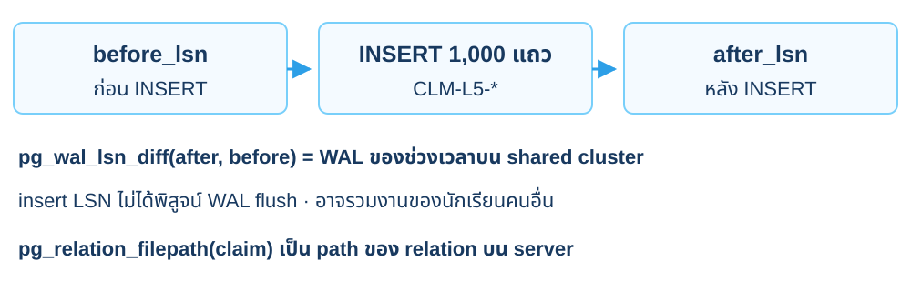

<p class="cs-concept-caption">LSN delta วัดทั้งช่วงบน cluster · relation path เป็นของ PostgreSQL server</p>

<footer class="cs-footer"><span>ClaimSure ต่อเนื่อง · Fundamental ก่อน Lab 5F</span><span>25 / 29</span></footer>

<!--
Speaker notes:
อ้างอิงคู่มือ labs/module-05-architecture.md หัวข้อ 5F · อธิบายก่อนคำสั่งแล็บที่เกี่ยวข้อง
ต้องคั่น before_lsn และ after_lsn ด้วย INSERT 1000 แถวจริงตาม 5F ไม่อ่าน LSN ติดกันแล้วอ้างว่าเป็น workload แม้ช่วงนี้มีคำสั่งของตน shared cluster อาจมี WAL ของงานผู้อื่นด้วย pg_relation_filepath คืน path ฝั่ง server ไม่ใช่ home ของบัญชี SSH ไม่ไปแก้ relation files และไม่สั่ง CHECKPOINT เพื่อทำให้ตัวเลขตรงภาพ

Source: ../labs/module-05-architecture.md · 5F
Visual reference: postgres-admin-labs/docs/slides/module-05-architecture.md
-->

---
layout: default
class: continuous-deck cs-module-five
---

# Lab 5F · A เพิ่มเคลม CLM-L5-* 1,000 แถว

<div class="cs-flow"><div><strong>CLM-L1-001</strong><small>policy และรายละเอียดเดิม</small></div><span aria-hidden="true">→</span><div><strong>CLM-L5-*</strong><small>INSERT 1,000 เคลม</small></div><span aria-hidden="true">→</span><div><strong>WAL delta</strong><small>วัดช่วงก่อน/หลัง</small></div></div>


<p class="cs-takeaway">INSERT บน claim จริง พร้อม PK/FK/indexes เดิม</p>

<footer class="cs-footer"><span>ClaimSure ต่อเนื่อง · คู่มือ Lab 5F</span><span>26 / 29</span></footer>

<!--
Speaker notes:
อ้างอิงคู่มือ labs/module-05-architecture.md หัวข้อ 5F
ทำ INSERT เต็มใน 5F ไม่สร้าง wal_event ใหม่ WAL diff บน shared cluster อาจรวมงานพร้อมกันของผู้อื่น

Source: ../labs/module-05-architecture.md · 5F
-->

---
layout: default
class: continuous-deck cs-module-five
---

# Lab 5F · A อ่าน LSN และ relation path

```sql
SELECT pg_current_wal_insert_lsn() AS before_lsn \gset
-- Run the 1,000-row INSERT in 5F here.
SELECT pg_current_wal_insert_lsn() AS after_lsn \gset
SELECT pg_wal_lsn_diff(:'after_lsn'::pg_lsn,
                      :'before_lsn'::pg_lsn);
SELECT pg_relation_filenode('claimsure.claim'),
       pg_relation_filepath('claimsure.claim');
```

<footer class="cs-footer"><span>ClaimSure ต่อเนื่อง · คู่มือ Lab 5F</span><span>27 / 29</span></footer>

<!--
Speaker notes:
อ้างอิงคู่มือ labs/module-05-architecture.md หัวข้อ 5F
ต้องมี INSERT ในช่วง comment ตามคู่มือ ไม่ใช้ LSN ติดกันวัดแล้วสรุปว่าเป็น workload path เป็นของ server ไม่ใช่ไฟล์ใน SSH home ไม่สั่ง CHECKPOINT บน shared

Source: ../labs/module-05-architecture.md · 5F
-->

---
layout: default
class: continuous-deck cs-module-five cs-fundamental cs-infographic
---

# 5G · Fundamental: ทบทวนก่อนคืนข้อมูล

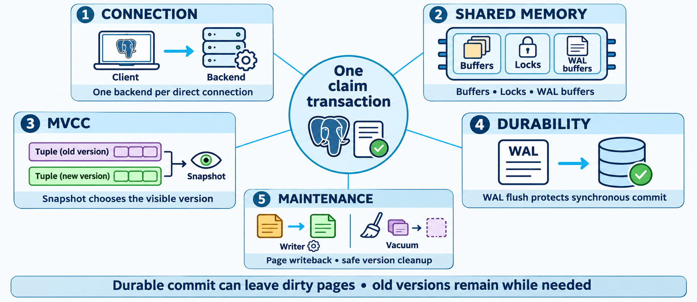

<p class="cs-concept-caption">Backend → memory → MVCC → WAL → maintenance · ตรวจคืนข้อมูลก่อนบท 6</p>

<footer class="cs-footer"><span>ClaimSure ต่อเนื่อง · Fundamental ก่อน Lab 5G</span><span>28 / 29</span></footer>

<!--
Speaker notes:
อ้างอิงคู่มือ labs/module-05-architecture.md หัวข้อ 5G · อธิบายก่อนคำสั่งแล็บที่เกี่ยวข้อง
ทบทวนก่อน 5G ว่า visibility ขึ้นกับ snapshot และ transaction, durability ขึ้นกับ WAL และ settings, page writeback กับ cleanup เป็นคนละงาน ปิด transaction B ก่อน A ลบเฉพาะ CLM-L5-* แล้ว manual VACUUM และ REFRESH materialized summary ตามคู่มือ เก็บหกเคลม CLM-L1 และ CLM-L3 อีกหนึ่งแสนแถวไว้ ไม่ลบ schema หรือ reset sequences

Source: ../labs/module-05-architecture.md · 5G
Visual reference: postgres-admin-labs/docs/slides/module-05-architecture.md
-->

---
layout: default
class: continuous-deck cs-module-five
---

# Lab 5G · จบ B แล้ว A คืนข้อมูลให้บท 6

```sql
DELETE FROM claimsure.claim
WHERE claim_no LIKE 'CLM-L5-%';
VACUUM (ANALYZE) claimsure.claim;
REFRESH MATERIALIZED VIEW
claimsure.cs_monthly_claim_summary;
SELECT count(*) AS expected_100006 FROM claimsure.claim;
```


<p class="cs-takeaway">B ต้องจบ transaction แล้ว · เก็บ CLM-L1-* และ CLM-L3-* ไว้</p>

<footer class="cs-footer"><span>ClaimSure ต่อเนื่อง · คู่มือ Lab 5G</span><span>29 / 29</span></footer>

<!--
Speaker notes:
อ้างอิงคู่มือ labs/module-05-architecture.md หัวข้อ 5G
ลบเฉพาะแถวเพิ่มใน 5F และตรวจหกเคลมเดิมผ่าน view อีกครั้ง ไม่ลบตารางหลักหรือ sequence เพื่อให้เลขต่อเนื่อง

Source: ../labs/module-05-architecture.md · 5G / ส่งต่อ
-->

