<CaseCover :module-id="6" />

# Module 6<br>Configuration

## ตั้งทีละค่า วัด workload เคลมเดิม แล้วคืนค่า

<footer class="cs-footer"><span>ClaimSure · ภาพรวม / เตรียมแล็บ</span><span>1 / 34</span></footer>

<!--
Speaker notes:
อ้างอิงคู่มือบท 6 หัวข้อ ภาพรวม
บทนี้ใช้ฐานข้อมูล claimsure_xx และ schema claimsure จากบท 1–2 ต่อเนื่องกัน เปิดคู่มือบทนี้ไว้เพื่อทำ SQL/native commands ทีละขั้น ภาพปก: ./assets/module-06-configuration-cover-enterprise-blue.png

Source: ../labs/module-06-configuration.md · ภาพรวม
-->

---
layout: default
class: continuous-deck cs-concept-deck cs-module-6
---

# เตรียม 6A–6G · แยก shared กับ private

| แล็บ | ข้อมูล | ที่รัน |
| --- | --- | --- |
| A/B/C | ค่าปัจจุบัน · sort · timeout | shared claimsure_xx |
| D | 120,000 เคลมใหม่ / pass | private copy ของ core tables |
| E | 5,000 updates บน claim | shared claimsure_xx |
| F | sleep · sort · row-lock | private copy ชุดเดิม |


<p class="cs-takeaway">Shared คง settings เดิม · ALTER SYSTEM/CHECKPOINT ทำเฉพาะ private</p>

<footer class="cs-footer"><span>ClaimSure · ภาพรวม / เตรียมแล็บ</span><span>2 / 34</span></footer>

<!--
Speaker notes:
อ้างอิงคู่มือบท 6 หัวข้อ ภาพรวม
รับ 100006 claims หลังบท 5 คืนข้อมูลแล้ว D/F สร้าง private PostgreSQL 18 ใต้ home และคัดลอก customer/policy/claim ไม่สร้าง workload คนละโดเมน

Source: ../labs/module-06-configuration.md · ภาพรวม
-->

---
layout: default
class: continuous-deck cs-concept-deck cs-module-6 cs-fundamental
---

# 6A · Fundamental: ขอบเขตของ setting

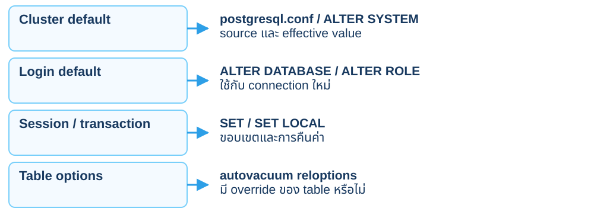

<p class="cs-concept-caption">SHOW อ่านค่าที่ connection นี้ใช้จริง</p>

<footer class="cs-footer"><span>ClaimSure · Fundamental ก่อน Lab 6A</span><span>3 / 34</span></footer>

<!--
Speaker notes:
อ้างอิงคู่มือบท 6 หัวข้อ 6A · อธิบายก่อนคำสั่งที่เกี่ยวข้อง
ช่องทางตั้งค่ามี interaction และ context ต่างกัน ไม่ใช่ทุก parameter ใช้ได้ทุกขอบเขต Table storage options เป็นกลไกเฉพาะและอาจ override autovacuum defaults ของ cluster

Sources:
- https://www.postgresql.org/docs/18/config-setting.html
- https://www.postgresql.org/docs/18/sql-altertable.html
Source: ../labs/module-06-configuration.md · 6A
-->

---
layout: default
class: continuous-deck cs-concept-deck cs-module-6 cs-fundamental
---

# 6A · Fundamental: SET / Reload / Restart

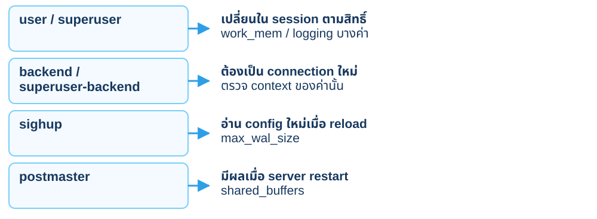

<p class="cs-concept-caption">อ่าน context, source และ pending_restart ก่อนเลือกวิธี activation</p>

<footer class="cs-footer"><span>ClaimSure · Fundamental ก่อน Lab 6A</span><span>4 / 34</span></footer>

<!--
Speaker notes:
อ้างอิงคู่มือบท 6 หัวข้อ 6A · อธิบายก่อนคำสั่งที่เกี่ยวข้อง
บาง parameter สามารถมอบสิทธิ์ SET แก่ role ที่ได้รับอนุญาตได้ ไม่ใช้กฎว่า role นักเรียนเปลี่ยนได้ทุกค่า pending_restart ช่วยระบุการเปลี่ยน config ที่ยังรอ restart

Sources:
- https://www.postgresql.org/docs/18/view-pg-settings.html
Source: ../labs/module-06-configuration.md · 6A
-->

---
layout: default
class: continuous-deck cs-concept-deck cs-module-6 cs-fundamental cs-infographic
---

# 6A · Fundamental: เลือก scope ให้ถูก

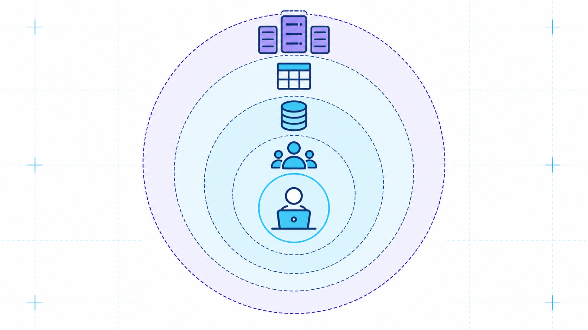

<p class="cs-concept-caption">เลือกขอบเขตที่เล็กพอ · ตรวจ effective value / source / context</p>

<footer class="cs-footer"><span>ClaimSure · Fundamental ก่อน Lab 6A</span><span>5 / 34</span></footer>

<!--
Speaker notes:
อ้างอิงคู่มือบท 6 หัวข้อ 6A · อธิบายก่อนคำสั่งที่เกี่ยวข้อง
ภาพเป็นวงขอบเขตจาก instance/database/role/session/transaction ไม่ใช่คำสั่งที่ต้องเปลี่ยนทุกชั้น 6A ใช้ SET LOCAL และ role/database default ใน transaction; ALTER SYSTEM ของ D ใช้ได้เฉพาะ private cluster ของนักเรียนตามคู่มือ
Source: ../labs/module-06-configuration.md · 6A
-->

---
layout: default
class: continuous-deck cs-concept-deck cs-module-6
---

# Lab 6A · อ่าน effective settings ก่อนเปลี่ยน

```sql
SELECT name,current_setting(name) AS effective,
 setting,unit,boot_val,reset_val,source,context,
 pending_restart
FROM pg_settings
WHERE name IN ('work_mem','max_wal_size',
 'statement_timeout','autovacuum_vacuum_threshold',
 'autovacuum_vacuum_scale_factor');
```


<p class="cs-takeaway">effective รวม override แล้ว · reset_val ไม่จำเป็นต้องเท่า boot_val</p>

<footer class="cs-footer"><span>ClaimSure · คู่มือ Lab 6A</span><span>6 / 34</span></footer>

<!--
Speaker notes:
อ้างอิงคู่มือบท 6 หัวข้อ 6A
เก็บค่าที่ login นี้เห็นจริง ไม่เดาว่า work_mem ต้องเป็น 8MB การ activation ต่างกันตาม context และอาจต้อง restart เฉพาะบาง parameter

Source: ../labs/module-06-configuration.md · 6A
-->

---
layout: default
class: continuous-deck cs-concept-deck cs-module-6
---

# Lab 6A · SET LOCAL กับ role default

| คำสั่ง | ขอบเขต | การทดลองในบทนี้ |
| --- | --- | --- |
| SET LOCAL work_mem | transaction ปัจจุบัน | ROLLBACK คืนค่าเดิม |
| ALTER ROLE … SET | login ใหม่ | ทดลองใน transaction แล้ว ROLLBACK |
| ALTER SYSTEM | server configuration | ใช้เฉพาะ private D |


<p class="cs-takeaway">role default ไม่เปลี่ยน connection ที่เปิดอยู่ทันที</p>

<footer class="cs-footer"><span>ClaimSure · คู่มือ Lab 6A</span><span>7 / 34</span></footer>

<!--
Speaker notes:
อ้างอิงคู่มือบท 6 หัวข้อ 6A
คู่มือ 6A เก็บ original_work_mem แล้วเทียบ restored=true หลัง rollback ROLE default ไม่ใช้กับ SET ROLE หรือ login เดิม

Source: ../labs/module-06-configuration.md · 6A
-->

---
layout: default
class: continuous-deck cs-concept-deck cs-module-6 cs-fundamental
---

# 6B · Fundamental: Memory budget

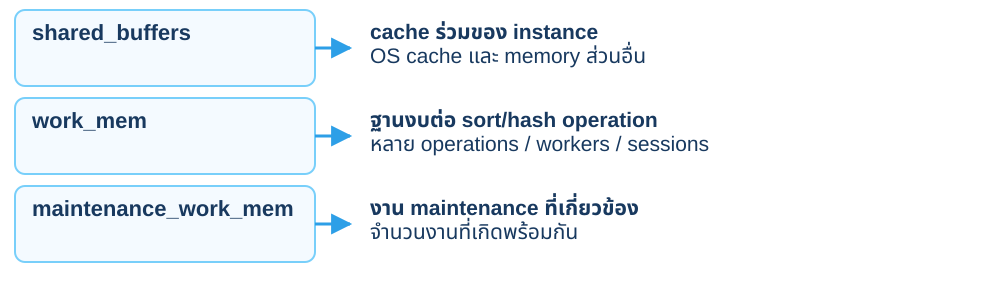

<p class="cs-concept-caption">work_mem ไม่ใช่งบรวมต่อหนึ่ง connection หรือทั้ง server</p>

<footer class="cs-footer"><span>ClaimSure · Fundamental ก่อน Lab 6B</span><span>8 / 34</span></footer>

<!--
Speaker notes:
อ้างอิงคู่มือบท 6 หัวข้อ 6B · อธิบายก่อนคำสั่งที่เกี่ยวข้อง
Hash operations ยังเกี่ยวข้องกับ hash_mem_multiplier การตั้ง work_mem ไม่ได้จองทุกก้อนเต็มไว้ทันที และการใช้ memory จริงต้องดู plan/งานพร้อมกัน เมื่อเกินงบ operation อาจ spill ไป temporary storage

Sources:
- https://www.postgresql.org/docs/18/runtime-config-resource.html
Source: ../labs/module-06-configuration.md · 6B
-->

---
layout: default
class: continuous-deck cs-concept-deck cs-module-6 cs-fundamental cs-infographic
---

# 6B · Fundamental: Memory หลาย operations

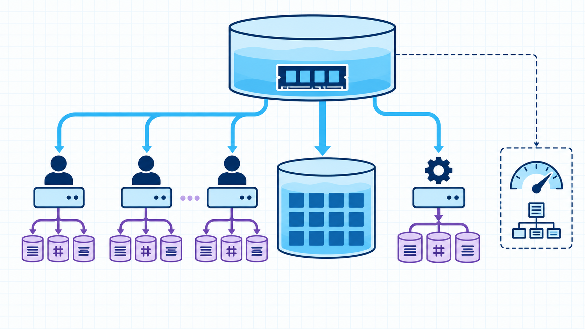

<p class="cs-concept-caption">work_mem ต่อ operation · คิดหลาย workers และหลาย sessions ร่วมด้วย</p>

<footer class="cs-footer"><span>ClaimSure · Fundamental ก่อน Lab 6B</span><span>9 / 34</span></footer>

<!--
Speaker notes:
อ้างอิงคู่มือบท 6 หัวข้อ 6B · อธิบายก่อนคำสั่งที่เกี่ยวข้อง
ภาพแยก shared cache ออกจาก sort/hash memory และงาน maintenance ภาพไม่กำหนดขนาด RAM ที่ทุกคนต้องใช้ 6B วัด workload เดิมที่ original/64kB/4MB/32MB สามครั้งต่อค่า ปิด parallel ตามคู่มือเพื่อเทียบงานเดียวกัน 32MB อาจยัง spill ได้ ไม่ใช้ work_mem × max_connections เป็นงบที่ครอบคลุมทุก operation
Source: ../labs/module-06-configuration.md · 6B
-->

---
layout: default
class: continuous-deck cs-concept-deck cs-module-6
---

# Lab 6B · วัด work_mem ด้วยรายงานเดิม

```sql
BEGIN;
SET LOCAL work_mem='64kB';
SET LOCAL max_parallel_workers_per_gather=0;
EXPLAIN (ANALYZE,BUFFERS,SETTINGS)
SELECT claim_no,description FROM claimsure.claim
ORDER BY description,claim_no;
ROLLBACK;
```


<p class="cs-takeaway">ทดสอบ original → 64kB → 4MB → 32MB อย่างละ 3 รอบ</p>

<footer class="cs-footer"><span>ClaimSure · คู่มือ Lab 6B</span><span>10 / 34</span></footer>

<!--
Speaker notes:
อ้างอิงคู่มือบท 6 หัวข้อ 6B
เปลี่ยนค่าเดียวโดยใช้ query/data เดิม description มาจากบท 3 32MB อาจยัง spill ได้ ไม่ตั้งผลคาดหวังตาม dataset ของเวอร์ชันเดิม

Source: ../labs/module-06-configuration.md · 6B
-->

---
layout: default
class: continuous-deck cs-concept-deck cs-module-6
---

# Lab 6B · เก็บ median / sort / temp blocks

| ค่า | Median time | Sort / space | Temp blocks |
| --- | --- | --- | --- |
| original | วัดจริง | วัดจริง | วัดจริง |
| 64kB | วัดจริง | วัดจริง | วัดจริง |
| 4MB | วัดจริง | วัดจริง | วัดจริง |
| 32MB | วัดจริง | วัดจริง | วัดจริง |


<p class="cs-takeaway">work_mem เป็นงบต่อ operation · ต้องคิด concurrency ด้วย</p>

<footer class="cs-footer"><span>ClaimSure · คู่มือ Lab 6B</span><span>11 / 34</span></footer>

<!--
Speaker notes:
อ้างอิงคู่มือบท 6 หัวข้อ 6B
ไม่คัด timing ของสไลด์เก่ามาใช้ เลือกตาม spill, latency และ memory budget หลาย sort/hash พร้อมกันอาจใช้เกิน work_mem หนึ่งก้อน

Source: ../labs/module-06-configuration.md · 6B
-->

---
layout: default
class: continuous-deck cs-concept-deck cs-module-6 cs-fundamental
---

# 6C · Fundamental: Statement กับ lock timeout

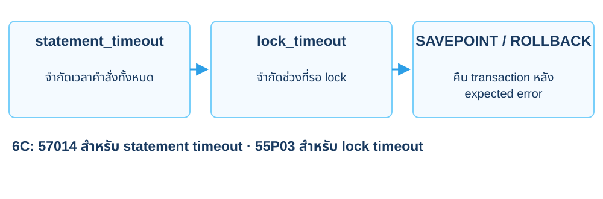

<p class="cs-concept-caption">A ถือ lock · B รอ · บันทึก SQLSTATE แล้วคืน transaction ตาม 6C</p>

<footer class="cs-footer"><span>ClaimSure · Fundamental ก่อน Lab 6C</span><span>12 / 34</span></footer>

<!--
Speaker notes:
อ้างอิงคู่มือบท 6 หัวข้อ 6C · อธิบายก่อนคำสั่งที่เกี่ยวข้อง
ใช้ connection ตรงของนักเรียนเดียวกันทั้ง A/B statement_timeout กับ lock_timeout จำกัดคนละขอบเขต ทำ expected error พร้อม SAVEPOINT และ ON_ERROR_STOP ตามคู่มือ คืน A/B แล้วออก psql ก่อน D ไม่เปลี่ยน config ทั้ง shared cluster
Source: ../labs/module-06-configuration.md · 6C
-->

---
layout: default
class: continuous-deck cs-concept-deck cs-module-6
---

# Lab 6C · A ทดสอบ statement timeout

```sql
BEGIN;
SET LOCAL statement_timeout='200ms';
SAVEPOINT slow_call;
\set ON_ERROR_STOP off
SELECT pg_sleep(0.4),claim_no FROM claimsure.claim
WHERE claim_no='CLM-L1-001';
\echo Expected 57014; actual :SQLSTATE
ROLLBACK TO SAVEPOINT slow_call;
\set ON_ERROR_STOP on
ROLLBACK;
```

<footer class="cs-footer"><span>ClaimSure · คู่มือ Lab 6C</span><span>13 / 34</span></footer>

<!--
Speaker notes:
อ้างอิงคู่มือบท 6 หัวข้อ 6C
คำสั่งเดียวกันอ้างเคลมเดิมและ sleep 0.4s เพื่อให้เห็น cancellation เก็บ SQLSTATE 57014 แล้ว rollback ไม่ใช้ elapsed เป็นเวลาประมวลผลสำเร็จ

Source: ../labs/module-06-configuration.md · 6C
-->

---
layout: default
class: continuous-deck cs-concept-deck cs-module-6
---

# Lab 6C · B รอ lock ที่ A ถืออยู่

| ลำดับ | A | B |
| --- | --- | --- |
| 1 | BEGIN; UPDATE CLM-L1-001 | ยังไม่ขอแถว |
| 2 | ค้าง transaction | SET LOCAL lock_timeout=200ms |
| 3 | ยังถือ row lock | UPDATE แถวเดียวกัน → 55P03 |
| 4 | ROLLBACK | ROLLBACK |


<p class="cs-takeaway">ยอดเคลมยัง 15,000 · statement timeout กับ lock timeout คนละขอบเขต</p>

<footer class="cs-footer"><span>ClaimSure · คู่มือ Lab 6C</span><span>14 / 34</span></footer>

<!--
Speaker notes:
อ้างอิงคู่มือบท 6 หัวข้อ 6C
ใช้สอง terminals ที่เชื่อม DB เดียวกันโดยตรงตาม 6C ตัว waiter ใช้ SAVEPOINT คืน aborted state ไม่ทิ้ง idle in transaction หลังทดสอบ

Source: ../labs/module-06-configuration.md · 6C
-->

---
layout: default
class: continuous-deck cs-concept-deck cs-module-6 cs-fundamental
---

# 6D · Fundamental: WAL กับ checkpoint

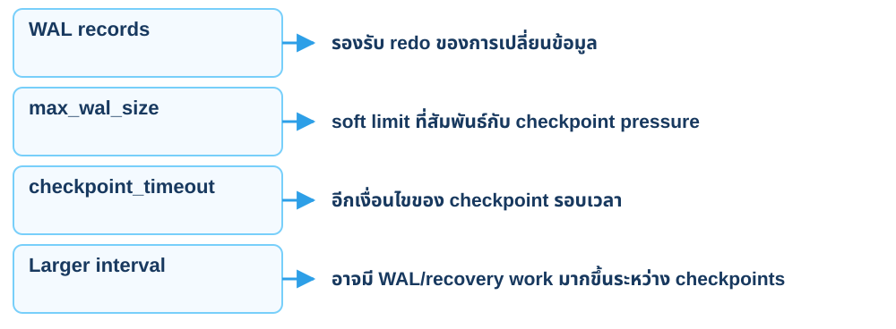

<p class="cs-concept-caption">เพิ่ม max_wal_size ไม่ได้ลด WAL ที่ INSERT ต้องสร้างโดยตรง</p>

<footer class="cs-footer"><span>ClaimSure · Fundamental ก่อน Lab 6D.1–6D.4</span><span>15 / 34</span></footer>

<!--
Speaker notes:
อ้างอิงคู่มือบท 6 หัวข้อ 6D.1–6D.4 · อธิบายก่อนคำสั่งที่เกี่ยวข้อง
เวลาสร้าง checkpoint และ full-page images ทำให้ WAL bytes สอง pass ไม่เท่ากันเป๊ะได้ Soft limit อาจถูกเกินได้ จึงวัด counters และระยะ sample จริง ไม่ตั้ง expected completed=0 จากค่าหนึ่งอย่างเดียว

Sources:
- https://www.postgresql.org/docs/18/wal-configuration.html
- https://www.postgresql.org/docs/18/runtime-config-wal.html
Source: ../labs/module-06-configuration.md · 6D.1–6D.4
-->

---
layout: default
class: continuous-deck cs-concept-deck cs-module-6 cs-fundamental cs-infographic
---

# 6D · Fundamental: เทียบ checkpoint pressure

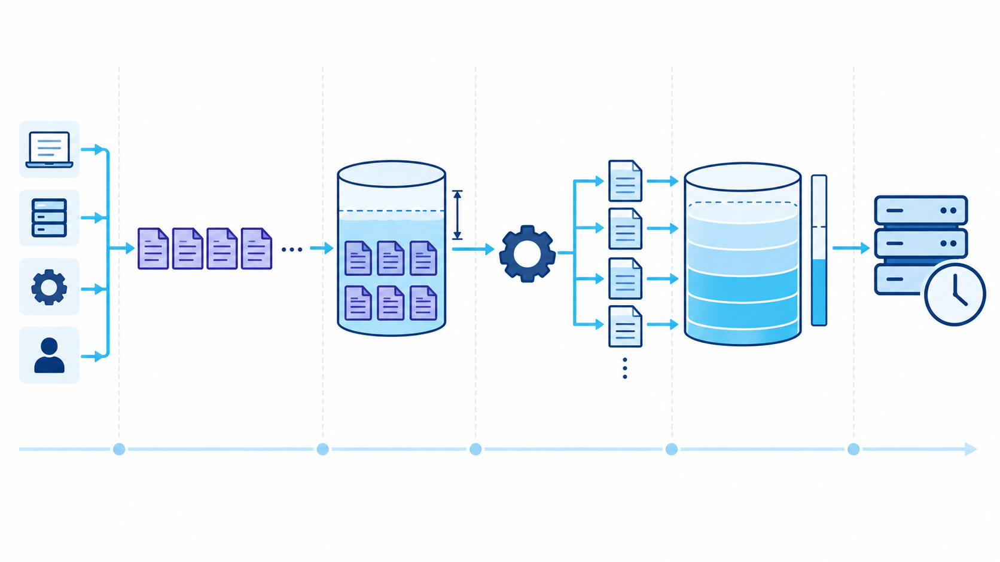

<p class="cs-concept-caption">6D ใช้ private cluster · 64MB เทียบ 256MB ไม่ใช่การลด WAL ของ INSERT</p>

<footer class="cs-footer"><span>ClaimSure · Fundamental ก่อน Lab 6D.1–6D.4</span><span>16 / 34</span></footer>

<!--
Speaker notes:
อ้างอิงคู่มือบท 6 หัวข้อ 6D.1–6D.4 · อธิบายก่อนคำสั่งที่เกี่ยวข้อง
WAL และ checkpoint เป็นกลไกสัมพันธ์กันแต่เพิ่ม max_wal_size ไม่ลด redo records ของ workload โดยตรง อ่าน num_requested/num_done/write_time แบบ delta และตรวจ stats_reset ตาม 6D.3–6D.4 CHECKPOINT, DELETE และ VACUUM preparation อยู่นอกช่วงวัด ทั้งสอง pass ต้องเพิ่ม CLM-WAL 120000 เท่ากัน ไม่คัดตัวเลขจากตาราง wal_probe ของต้นฉบับ
Source: ../labs/module-06-configuration.md · 6D.1–6D.4
-->

---
layout: default
class: continuous-deck cs-concept-deck cs-module-6
---

# Lab 6D.1 · เปิด private copy ของ core เดิม

<div class="cs-flow"><div><strong>Shared</strong><small>customer / policy / claim</small></div><span aria-hidden="true">→</span><div><strong>pg_dump</strong><small>tables + sequences + indexes</small></div><span aria-hidden="true">→</span><div><strong>Private</strong><small>claimsure บน Unix socket</small></div></div>


<p class="cs-takeaway">ไม่เปิด TCP · ใช้ labadmin เฉพาะ instance ใต้ home</p>

<footer class="cs-footer"><span>ClaimSure · คู่มือ Lab 6D.1</span><span>17 / 34</span></footer>

<!--
Speaker notes:
อ้างอิงคู่มือบท 6 หัวข้อ 6D.1
ทำ initdb/config/start/restore เต็มตาม 6D.1 ตัวแปร PRIVATE override host/port/user/db โดย environment shared เดิมยังอยู่ ไม่ใช้ labadmin กับ shared

Source: ../labs/module-06-configuration.md · 6D.1
-->

---
layout: default
class: continuous-deck cs-concept-deck cs-module-6
---

# Lab 6D.1 · เลือก core tables และ sequences

```bash
CORE_TABLES=(
 --table=claimsure.customer --table=claimsure.policy
 --table=claimsure.claim
 --table=claimsure.customer_customer_id_seq
 --table=claimsure.policy_policy_id_seq
 --table=claimsure.claim_claim_id_seq)
pg_dump -Fc --no-owner --no-acl "${CORE_TABLES[@]}" \
 -f "$M6_LAB/core.dump"
```


<p class="cs-takeaway">หลังเตรียม workspace ตาม 6D.1 · ตรวจ archive list ก่อน restore</p>

<footer class="cs-footer"><span>ClaimSure · คู่มือ Lab 6D.1</span><span>18 / 34</span></footer>

<!--
Speaker notes:
อ้างอิงคู่มือบท 6 หัวข้อ 6D.1
สำเนาไม่รวม view/functions/report เพราะ D/F ใช้ core tables เท่านั้น Trigger ทดลองบท 4 ต้อง rollback แล้ว จึงไม่ติด dependency ที่ไม่ได้ dump ไปด้วย

Source: ../labs/module-06-configuration.md · 6D.1
-->

---
layout: default
class: continuous-deck cs-concept-deck cs-module-6
---

# Lab 6D.2 · เตรียม private WAL workload

<div class="cs-metrics"><div><b>120,000</b><span>CLM-WAL-* ต่อ pass</span></div><div><b>5,000</b><span>แถวต่อ commit</span></div><div><b>2</b><span>pass: 64MB และ 256MB</span></div></div>


<p class="cs-takeaway">CALL cs_load_claims() ทำ data load · cs_wal_results เก็บ metrics</p>

<footer class="cs-footer"><span>ClaimSure · คู่มือ Lab 6D.2</span><span>19 / 34</span></footer>

<!--
Speaker notes:
อ้างอิงคู่มือบท 6 หัวข้อ 6D.2
สร้าง procedure ตาม 6D.2 จากแม่แบบ CLM-L1-001 ใช้ description กว้างและ PLAIN storage บน private เท่านั้น Indexes/constraints เดิมยังอยู่ จึงไม่ย้ายผล WAL จาก wal_probe รุ่นเดิมมาใช้

Source: ../labs/module-06-configuration.md · 6D.2
-->

---
layout: default
class: continuous-deck cs-concept-deck cs-module-6
---

# Lab 6D.3 · กำหนดช่วงวัด 64MB

<div class="cs-flow"><div><strong>Preparation</strong><small>DELETE tag / VACUUM / CHECKPOINT</small></div><span aria-hidden="true">→</span><div><strong>Sample</strong><small>LSN + เวลา → CALL → LSN</small></div><span aria-hidden="true">→</span><div><strong>Counters</strong><small>requested / done / write_time</small></div></div>


<p class="cs-takeaway">Preparation อยู่นอก sample · CALL ต้องอยู่นอก BEGIN ของผู้เรียก</p>

<footer class="cs-footer"><span>ClaimSure · คู่มือ Lab 6D.3</span><span>20 / 34</span></footer>

<!--
Speaker notes:
อ้างอิงคู่มือบท 6 หัวข้อ 6D.3
ทำทั้งสอง pass เหมือนกัน DELETE เฉพาะ CLM-WAL-* ตัว procedure commit เป็น batch ถ้าผู้เรียกครอบ BEGIN จะใช้ transaction control แบบนี้ไม่ได้

Source: ../labs/module-06-configuration.md · 6D.3
-->

---
layout: default
class: continuous-deck cs-concept-deck cs-module-6
---

# Lab 6D.3–6D.4 · เทียบหลักฐานสอง pass

| Metric | 64MB | 256MB |
| --- | --- | --- |
| Loaded CLM-WAL-* | 120,000 | 120,000 |
| WAL generated | วัดจริง | วัดจริง |
| Load time | วัดจริง | วัดจริง |
| Requested / completed | delta จริง | delta จริง |
| Checkpoint write time | delta จริง | delta จริง |


<p class="cs-takeaway">max_wal_size เปลี่ยน checkpoint pressure ไม่ลด WAL ที่ INSERT ต้องสร้าง</p>

<footer class="cs-footer"><span>ClaimSure · คู่มือ Lab 6D.3–6D.4</span><span>21 / 34</span></footer>

<!--
Speaker notes:
อ้างอิงคู่มือบท 6 หัวข้อ 6D.3–6D.4
ใช้ pg_stat_checkpointer ของ PG18 และเทียบ stats_reset ก่อนหัก delta completed=0 ได้ถ้า sample จบก่อนงานเสร็จ Larger max_wal_size เป็น soft limit ไม่รับประกันไม่มี checkpoint หรือโหลดเร็วขึ้น

Source: ../labs/module-06-configuration.md · 6D.3–6D.4
-->

---
layout: default
class: continuous-deck cs-concept-deck cs-module-6
---

# Lab 6D.4 · คืน private configuration

```bash
cp "$M6_LAB/auto.before" \
 "$M6_LAB/data/postgresql.auto.conf"
pg_ctl -D "$M6_LAB/data" reload
cmp "$M6_LAB/auto.before" \
 "$M6_LAB/data/postgresql.auto.conf"
psql -X "${PRIVATE[@]}" -c 'SHOW max_wal_size;'
```


<p class="cs-takeaway">ไฟล์ต้องตรงเดิม · ตรวจ effective value หลัง reload</p>

<footer class="cs-footer"><span>ClaimSure · คู่มือ Lab 6D.4</span><span>22 / 34</span></footer>

<!--
Speaker notes:
อ้างอิงคู่มือบท 6 หัวข้อ 6D.4
ทำหลังออก private psql ด้วย q ตาม 6D.4 ไม่เขียนทับ config ของ shared การเก็บ WAL มากระหว่าง checkpoints อาจเพิ่มงาน crash recovery แต่แล็บนี้ไม่ได้วัด recovery

Source: ../labs/module-06-configuration.md · 6D.4
-->

---
layout: default
class: continuous-deck cs-concept-deck cs-module-6 cs-fundamental
---

# 6E · Fundamental: Eligibility กับ scheduler

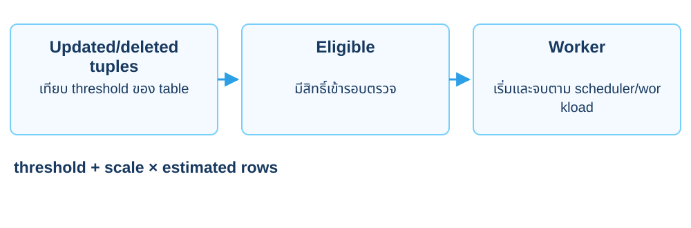

<p class="cs-concept-caption">ถึง threshold ไม่ใช่คำรับประกันว่าจะเสร็จภายในกี่วินาที</p>

<footer class="cs-footer"><span>ClaimSure · Fundamental ก่อน Lab 6E</span><span>23 / 34</span></footer>

<!--
Speaker notes:
อ้างอิงคู่มือบท 6 หัวข้อ 6E · อธิบายก่อนคำสั่งที่เกี่ยวข้อง
สำหรับ update/delete trigger PostgreSQL 18 มี autovacuum_vacuum_max_threshold จำกัดเพดานได้ด้วย ตารางในแล็บยังอยู่ต่ำกว่าเพดานปกติ ใช้ reltuples และ counters ที่อ่านจริง ไม่เอา VACUUM preparation มานับเป็น candidate pass

Sources:
- https://www.postgresql.org/docs/18/runtime-config-vacuum.html
- https://www.postgresql.org/docs/18/routine-vacuuming.html
Source: ../labs/module-06-configuration.md · 6E
-->

---
layout: default
class: continuous-deck cs-concept-deck cs-module-6
---

# Lab 6E · ทำ workload บน shared claim

<div class="cs-metrics"><div><b>100,006</b><span>rows จากบท 3</span></div><div><b>5,000</b><span>CLM-L3-* ที่อัปเดต</span></div><div><b>3,000.15</b><span>candidate threshold</span></div></div>


<p class="cs-takeaway">500 + 0.025 × 100006 · ใช้ reltuples/ค่าจริงของเครื่องด้วย</p>

<footer class="cs-footer"><span>ClaimSure · คู่มือ Lab 6E</span><span>24 / 34</span></footer>

<!--
Speaker notes:
อ้างอิงคู่มือบท 6 หัวข้อ 6E
6E เก็บ status เดิมของ 5000 แถวและ reloptions ใน temporary tables ของ session shared ค่าประมาณ tuples อาจต่าง จึงไม่อ้าง trigger เดิม 5050 ของตาราง 100000 แถว

Source: ../labs/module-06-configuration.md · 6E
-->

---
layout: default
class: continuous-deck cs-concept-deck cs-module-6
---

# Lab 6E · Table override ของ candidate

```sql
ALTER TABLE claimsure.claim SET (
 autovacuum_vacuum_threshold=500,
 autovacuum_vacuum_scale_factor=0.025
);
SELECT n_dead_tup,autovacuum_count,last_autovacuum
FROM pg_stat_user_tables
WHERE relid='claimsure.claim'::regclass;
```


<p class="cs-takeaway">สังเกตอย่างน้อย 75 วินาที · จด not observed หากยังไม่เห็น</p>

<footer class="cs-footer"><span>ClaimSure · คู่มือ Lab 6E</span><span>25 / 34</span></footer>

<!--
Speaker notes:
อ้างอิงคู่มือบท 6 หัวข้อ 6E
ก่อนตั้ง candidate ต้องทำ preparation และเก็บ baseline ตาม 6E ค่าเดิมอ่านจาก pg_settings/reloptions Manual VACUUM ก่อน sample ไม่ใช่ผล candidate ห้ามสั่ง vacuum เพื่อทำให้รายงานดูสำเร็จ

Source: ../labs/module-06-configuration.md · 6E
-->

---
layout: default
class: continuous-deck cs-concept-deck cs-module-6
---

# Lab 6E · ตรวจ completed pass และขนาด

| หลักฐาน | สิ่งที่ใช้สรุป |
| --- | --- |
| n_dead_tup ลดลง | obsolete tuples ถูกจัดการ |
| autovacuum_count เพิ่ม | มี autovacuum pass ของตารางนี้ |
| File size คงเดิม | พื้นที่ภายในนำกลับมาใช้ได้ |
| reltuples / worker timing | ค่าประมาณและเวลาอาจต่าง |


<p class="cs-takeaway">เก็บผลก่อนคืน status · manual VACUUM ท้ายบทคือ reset</p>

<footer class="cs-footer"><span>ClaimSure · คู่มือ Lab 6E</span><span>26 / 34</span></footer>

<!--
Speaker notes:
อ้างอิงคู่มือบท 6 หัวข้อ 6E
ตรวจ dead tuples และ count คู่กัน การเห็น dead=0 อย่างเดียวอาจมาจาก vacuum อื่นหรือ baseline ที่เปลี่ยนแล้ว อย่าอ้างว่าไฟล์หดเมื่อขนาดจริงคงเดิม

Source: ../labs/module-06-configuration.md · 6E
-->

---
layout: default
class: continuous-deck cs-concept-deck cs-module-6
---

# Lab 6E · คืน status และ table options

<div class="cs-flow"><div><strong>Saved options</strong><small>cs_m6_options</small></div><span aria-hidden="true">→</span><div><strong>RESET + reapply</strong><small>คืน overrides เดิม</small></div><span aria-hidden="true">→</span><div><strong>Saved rows</strong><small>คืน status 5,000 แถว</small></div></div>


<p class="cs-takeaway">options_restored ต้อง true · ข้อมูลรวมกลับ 100,006 แถว</p>

<footer class="cs-footer"><span>ClaimSure · คู่มือ Lab 6E</span><span>27 / 34</span></footer>

<!--
Speaker notes:
อ้างอิงคู่มือบท 6 หัวข้อ 6E
ใช้บล็อกเต็ม 6E เพื่อ reset เฉพาะสาม options แล้ว reapply ค่าเดิมจาก pg_options_to_table จากนั้นคืน status และ vacuum เพื่อ reset หลังบันทึกผลแล้ว RESET อย่างเดียวอาจลบ override เดิม

Source: ../labs/module-06-configuration.md · 6E
-->

---
layout: default
class: continuous-deck cs-concept-deck cs-module-6 cs-fundamental
---

# 6F · Fundamental: เหตุการณ์กับ log visibility

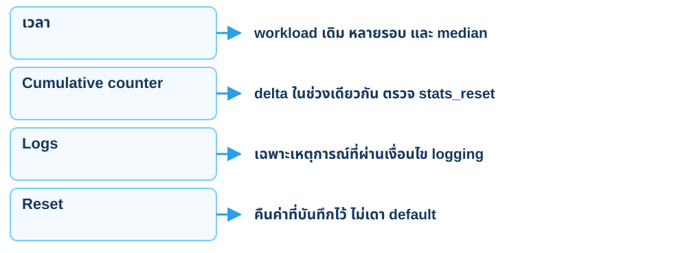

<p class="cs-concept-caption">ไม่มี log line ไม่ได้ยืนยันว่าเหตุการณ์ไม่เกิด</p>

<footer class="cs-footer"><span>ClaimSure · Fundamental ก่อน Lab 6F.1–6F.2</span><span>28 / 34</span></footer>

<!--
Speaker notes:
อ้างอิงคู่มือบท 6 หัวข้อ 6F.1–6F.2 · อธิบายก่อนคำสั่งที่เกี่ยวข้อง
statement_timeout จำกัดอายุคำสั่ง lock_timeout จำกัดการรอ lock ส่วน deadlock_timeout เกี่ยวกับการตรวจ deadlock/ช่วงเริ่ม log wait การตั้ง threshold logging ไม่ได้ทำให้ทุก query ถูกบันทึก

Sources:
- https://www.postgresql.org/docs/18/runtime-config-logging.html
- https://www.postgresql.org/docs/18/runtime-config-client.html
- https://www.postgresql.org/docs/18/monitoring-stats.html
Source: ../labs/module-06-configuration.md · 6F.1–6F.2
-->

---
layout: default
class: continuous-deck cs-concept-deck cs-module-6
---

# Lab 6F.1 · Baseline logging บน private

| เหตุการณ์ | งานที่เกิดทั้งสองรอบ | Candidate |
| --- | --- | --- |
| Slow call | pg_sleep(0.6) | duration ≥ 500ms |
| Disk sort | claim ORDER BY description | log_temp_files=0 |
| Row-lock wait | CLM-L1-001 รอ A/B | log_lock_waits=on |


<p class="cs-takeaway">เปิด logging ทำให้เหตุการณ์ที่มีอยู่มองเห็นได้</p>

<footer class="cs-footer"><span>ClaimSure · คู่มือ Lab 6F.1</span><span>29 / 34</span></footer>

<!--
Speaker notes:
อ้างอิงคู่มือบท 6 หัวข้อ 6F.1
ใช้ private A/B ที่ยังมี core copy เดิม การตั้ง log ไม่ได้สร้าง sleep/sort/lock ขึ้นมาใหม่ เปรียบเทียบก่อน/หลังบนงานเดิม และ log counts ตามจริง

Source: ../labs/module-06-configuration.md · 6F.1
-->

---
layout: default
class: continuous-deck cs-concept-deck cs-module-6
---

# Lab 6F.2 · Candidate และ lock เดิมซ้ำ

```sql
BEGIN;
SET LOCAL log_min_duration_statement='500ms';
SET LOCAL log_temp_files=0;
SET LOCAL log_lock_waits=on;
SET LOCAL deadlock_timeout='100ms';
-- Run the same sleep, sort, and row-lock wait in 6F.
ROLLBACK;
```


<p class="cs-takeaway">private เท่านั้น · ROLLBACK คืน settings ของ transaction</p>

<footer class="cs-footer"><span>ClaimSure · คู่มือ Lab 6F.2</span><span>30 / 34</span></footer>

<!--
Speaker notes:
อ้างอิงคู่มือบท 6 หัวข้อ 6F.2
ทำ work_mem/max_parallel/lock_timeout และลำดับสอง terminals ตาม 6F ไม่รันเฉพาะบล็อกนี้แล้วคาดว่าจะมีเหตุการณ์ใน log deadlock_timeout กำหนดช่วงเริ่มตรวจ/รายงาน wait ไม่ได้ยืนยันว่าเกิด deadlock

Source: ../labs/module-06-configuration.md · 6F.2
-->

---
layout: default
class: continuous-deck cs-concept-deck cs-module-6
---

# Lab 6F.2 · ตรวจ log และคืนค่า

| ค่า | ข้อพิจารณา |
| --- | --- |
| 500ms slow threshold | sort ช้าเกินได้ จึงอาจมี slow line เพิ่ม |
| log_temp_files=0 | ทุก temp file อาจเพิ่ม log volume มาก |
| log_lock_waits=on | row wait ยังจบสำเร็จได้ |
| 100ms deadlock_timeout | 3s wait มักเห็นได้ที่ 1s เช่นกัน |


<p class="cs-takeaway">จดจำนวนจริง · ไม่บังคับผล 2 / 2 / 1</p>

<footer class="cs-footer"><span>ClaimSure · คู่มือ Lab 6F.2</span><span>31 / 34</span></footer>

<!--
Speaker notes:
อ้างอิงคู่มือบท 6 หัวข้อ 6F.2
เก็บ grep โดย application_name ของแต่ละรอบ baseline ไม่มี event lines เมื่อ private เดิมปิด logging เหตุการณ์เหล่านี้ จด not observed ถ้าลำดับ manual ทำให้ lock ถูกปล่อยเร็วเกินไป

Source: ../labs/module-06-configuration.md · 6F.2
-->

---
layout: default
class: continuous-deck cs-concept-deck cs-module-6 cs-fundamental cs-infographic
---

# 6G · Fundamental: Keep หรือ reset

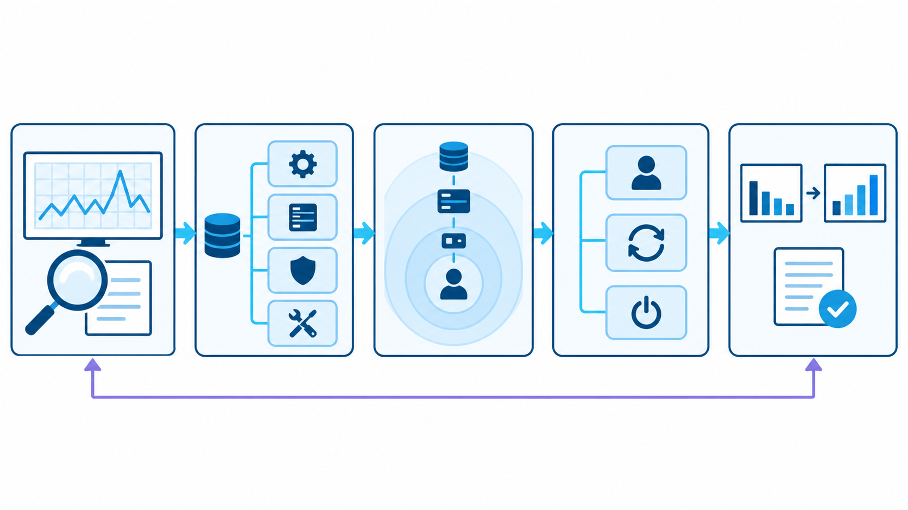

<p class="cs-concept-caption">อาการ → setting ที่เกี่ยวข้อง → activation → วัดผล → keep หรือ reset</p>

<footer class="cs-footer"><span>ClaimSure · Fundamental ก่อน Lab 6G</span><span>32 / 34</span></footer>

<!--
Speaker notes:
อ้างอิงคู่มือบท 6 หัวข้อ 6G · อธิบายก่อนคำสั่งที่เกี่ยวข้อง
อ่านหลักฐานตาม workload เดิมก่อนเลือกค่าที่ใช้ต่อ 6G แยกสิ่งที่วัดแล้วกับสิ่งที่ยังไม่วัด เช่น checkpoint completed เป็น 0 ได้ถ้าช่วงวัดสั้น และไม่มี slow log ไม่พิสูจน์ว่าไม่เกิดการรอ คืนค่าที่บันทึกไว้ ไม่เดา default
Source: ../labs/module-06-configuration.md · 6G
-->

---
layout: default
class: continuous-deck cs-concept-deck cs-module-6
---

# Lab 6G · สรุปหลักฐานก่อนเลือกค่า

| Setting | พิจารณา | ยังต้องระวัง |
| --- | --- | --- |
| work_mem | spill / latency / concurrency | memory พร้อมกัน |
| max_wal_size | checkpoint deltas | disk / crash recovery |
| slow / lock logging | visibility ของเหตุการณ์ | log volume |
| table autovacuum | dead tuples / completed passes | worker และ baseline |

<footer class="cs-footer"><span>ClaimSure · คู่มือ Lab 6G</span><span>33 / 34</span></footer>

<!--
Speaker notes:
อ้างอิงคู่มือบท 6 หัวข้อ 6G
จด workload เดียวกัน ค่าก่อน/หลัง วิธีคืนค่า และสิ่งที่ไม่ได้วัด ไม่สรุปว่าค่ามากขึ้นดีกว่าทุกกรณี

Source: ../labs/module-06-configuration.md · 6G
-->

---
layout: default
class: continuous-deck cs-concept-deck cs-module-6
---

# Lab 6G · ส่งต่อข้อมูลและค่าเดิมให้บท 7

```sql
SELECT count(*) AS expected_100006 FROM claimsure.claim;
SELECT claim_no,status,estimated_amount
FROM claimsure.claim WHERE claim_no LIKE 'CLM-L1-%'
ORDER BY claim_no;
```


<p class="cs-takeaway">หยุด private ด้วย pg_ctl · เก็บ log/metrics · shared settings คงเดิม</p>

<footer class="cs-footer"><span>ClaimSure · คู่มือ Lab 6G</span><span>34 / 34</span></footer>

<!--
Speaker notes:
อ้างอิงคู่มือบท 6 หัวข้อ 6G
ตรวจ status/reloptions คืนค่าแล้ว ปิด transaction ของ A/B ก่อนบท 7 และเก็บข้อมูลลูกค้า/กรมธรรม์/เคลมพร้อม view/routines ไว้

Source: ../labs/module-06-configuration.md · 6G
-->

