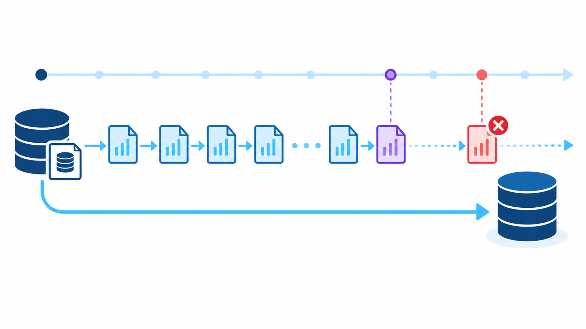

<CaseCover :module-id="7" />

# Module 7 Docker Lab<br>Backup & Recovery

## Conceptual summary และ PostgreSQL standard commands

<footer class="cs-footer"><span>PostgreSQL 18 · Docker Lab</span><span>1 / 10</span></footer>

<!--
Speaker notes:
Deck นี้สรุปแนวคิดและคำสั่ง native ของ PostgreSQL จาก Docker Lab โดยไม่ใช้ Make wrapper เป็นแกนหลัก

Source: ../labs/module07-backup-docker/README.md
-->

---
layout: default
class: continuous-deck cs-concept-deck cs-module-7 cs-fundamental
---

# ขอบเขตของการสำรองข้อมูล

| วิธี | สิ่งที่เก็บ | ใช้กู้เมื่อ |
| --- | --- | --- |
| Logical | schema, data, owner, ACL ของ database | ย้ายหรือกู้ object ที่เลือก |
| Global objects | roles, tablespaces, parameter grants | สร้าง cluster ใหม่ให้ identity ครบ |
| Physical | ทั้ง cluster ในระดับไฟล์ | กู้ server หรือสร้าง recovery copy |
| PITR | physical base และ WAL ต่อเนื่อง | ย้อนถึงจุดก่อนความผิดพลาด |

<p class="cs-takeaway">กำหนด recovery scope ก่อนเลือกคำสั่ง</p>

<footer class="cs-footer"><span>Concept · Backup scope</span><span>2 / 10</span></footer>

<!--
Speaker notes:
Logical dump และ physical backup ตอบโจทย์คนละขอบเขต pg_dump ไม่สร้าง physical base สำหรับ WAL replay ส่วน PITR ต้องมี base backup และ WAL ที่ต่อเนื่องถึง target

Sources:
- ../labs/module07-backup-docker/README.md · ภาพรวม
- https://www.postgresql.org/docs/18/backup.html
-->

---
layout: default
class: continuous-deck cs-concept-deck cs-module-7 cs-fundamental
---

# Artefact และ recovery target

<div class="cs-flow"><div><strong>Source</strong><small>backup_lab</small></div><span aria-hidden="true">→</span><div><strong>Artefact</strong><small>dump · PGDATA · WAL</small></div><span aria-hidden="true">→</span><div><strong>Isolated target</strong><small>restore copy</small></div><span aria-hidden="true">→</span><div><strong>Verify</strong><small>tool + business data</small></div></div>

| Artefact | Target |
| --- | --- |
| `backup_lab.dump` + `globals.sql` | Logical target |
| `weekly-full/` + `daily-*/` | Physical target หลัง combine |
| Base backup + `archive/<WAL>` | PITR target |

<footer class="cs-footer"><span>Concept · Recovery isolation</span><span>3 / 10</span></footer>

<!--
Speaker notes:
กู้ไป target แยกก่อน เพื่อไม่ทับ source และเพื่อให้ตรวจข้อมูลได้ Artefact ต้องอยู่นอก container volume หรือถูก copy ไปยัง storage ที่คงอยู่ได้

Source: ../labs/module07-backup-docker/README.md · ภาพรวม
-->

---
layout: default
class: continuous-deck cs-concept-deck cs-module-7
---

# Logical database และ global objects

```bash
# Database
pg_dump -U postgres -d backup_lab --create -Fc \
  -f backup_lab.dump
pg_restore --list backup_lab.dump
pg_restore -U restore_admin --create --exit-on-error \
  -d postgres backup_lab.dump

# Cluster-wide roles และ tablespaces
pg_dumpall -U postgres --globals-only --no-role-passwords \
  -f globals.sql
psql -X -v ON_ERROR_STOP=1 -U restore_admin \
  -d postgres -f globals.sql
```

<p class="cs-takeaway"><code>pg_dump</code> ไม่เก็บ roles และ tablespaces · ตรวจ <code>globals.sql</code> ก่อน restore</p>

<footer class="cs-footer"><span>Commands · Logical / globals</span><span>4 / 10</span></footer>

<!--
Speaker notes:
Custom format เปิดให้ inspect และเลือก object ด้วย pg_restore ได้ Global dump เป็น SQL และต้อง restore ด้วย cluster superuser ใน clean target Lab ใช้สำเนา globals-for-restore.sql เพราะชื่อ bootstrap admin ต่างจาก source และต้องปรับ GRANTED BY

Sources:
- ../labs/module07-backup-docker/README.md · Logical database / Global objects
- https://www.postgresql.org/docs/18/app-pgdump.html
- https://www.postgresql.org/docs/18/app-pg-dumpall.html
-->

---
layout: default
class: continuous-deck cs-concept-deck cs-module-7
---

# Physical full backup

<div class="cs-flow"><div><strong>Running server</strong><small>consistent online copy</small></div><span aria-hidden="true">→</span><div><strong>pg_basebackup</strong><small>PGDATA + manifest + WAL</small></div><span aria-hidden="true">→</span><div><strong>pg_verifybackup</strong><small>ตรวจ manifest</small></div></div>

```bash
pg_basebackup -U postgres -D weekly-full -Fp -Xs \
  -c fast --manifest-checksums=SHA256 -P
pg_verifybackup weekly-full
```

<p class="cs-takeaway">Physical backup ครอบคลุมทั้ง cluster และผูกกับ PostgreSQL major version</p>

<footer class="cs-footer"><span>Commands · Physical full</span><span>5 / 10</span></footer>

<!--
Speaker notes:
-Fp คือ plain format, -Xs stream WAL และ -c fast ขอ fast checkpoint pg_verifybackup ตรวจไฟล์ตาม backup_manifest แต่ยังต้องเปิด target และตรวจข้อมูล

Sources:
- ../labs/module07-backup-docker/README.md · Physical full
- https://www.postgresql.org/docs/18/app-pgbasebackup.html
- https://www.postgresql.org/docs/18/app-pgverifybackup.html
-->

---
layout: default
class: continuous-deck cs-concept-deck cs-module-7
---

# Physical incremental chain

<div class="cs-flow"><div><strong>Weekly full</strong><small>backup_manifest</small></div><span aria-hidden="true">→</span><div><strong>Daily 01</strong><small>changed blocks</small></div><span aria-hidden="true">→</span><div><strong>Daily 02</strong><small>changed blocks</small></div><span aria-hidden="true">→</span><div><strong>Synthetic full</strong><small>พร้อมเปิด target</small></div></div>

```bash
# postgresql.conf: summarize_wal = on
pg_basebackup -U postgres -D daily-01 -Fp -Xs \
  --incremental=weekly-full/backup_manifest -P

pg_combinebackup -o restore \
  weekly-full daily-01 daily-02
pg_verifybackup restore
```

<p class="cs-takeaway">Incremental เปิดตรง ๆ ไม่ได้ · ต้องเก็บทุก backup ใน chain แล้ว combine</p>

<footer class="cs-footer"><span>Commands · Physical incremental</span><span>6 / 10</span></footer>

<!--
Speaker notes:
Server ใช้ WAL summaries หา block ที่เปลี่ยนจาก reference manifest การตั้ง summarize_wal ต้องเกิดก่อนช่วง WAL ที่ incremental ต้องใช้ ห้ามลบ backup กลาง chain

Sources:
- ../labs/module07-backup-docker/README.md · Physical incremental / Combine
- https://www.postgresql.org/docs/18/continuous-archiving.html#BACKUP-INCREMENTAL-BACKUP
- https://www.postgresql.org/docs/18/app-pgcombinebackup.html
-->

---
layout: default
class: continuous-deck cs-concept-deck cs-module-7 cs-fundamental cs-infographic
---

# PITR · Base backup + WAL + Target



<p class="cs-concept-caption">Base จบก่อน target · WAL ต่อเนื่องถึง target · recovery หยุดก่อนความเสียหาย</p>

<footer class="cs-footer"><span>Concept · Point-in-time recovery</span><span>7 / 10</span></footer>

<!--
Speaker notes:
PITR กู้ทั้ง cluster ไม่ใช่ table เดียว Named restore point ต้องเกิดหลัง base backup จบ และ archive ต้องมี WAL ไปถึง target การเห็นข้อมูลใน base อย่างเดียวไม่พิสูจน์ WAL replay

Sources:
- ../labs/module07-backup-docker/README.md · PITR
- https://www.postgresql.org/docs/18/continuous-archiving.html
-->

---
layout: default
class: continuous-deck cs-concept-deck cs-module-7
---

# PITR standard commands

```sql
SELECT pg_create_restore_point('before_mistake');
SELECT pg_switch_wal();
```

**ไฟล์ที่แก้:** `restore-data/postgresql.auto.conf` ของ recovery copy

```ini
restore_command = 'cp /archive/%f %p'
recovery_target_name = 'before_mistake'
recovery_target_action = 'promote'
recovery_target_timeline = 'current'
```

```bash
touch restore-data/recovery.signal
pg_ctl -D restore-data -w start
```

<p class="cs-takeaway">ใช้ recovery copy ใหม่ · ตรวจว่า WAL segment ของ target อยู่ใน archive ก่อน start</p>

<footer class="cs-footer"><span>Commands · PITR</span><span>8 / 10</span></footer>

<!--
Speaker notes:
archive_mode, archive_command และ wal_level ต้องเตรียมบน source ล่วงหน้า recovery.signal ทำให้ server เข้า archive recovery ค่ากู้ถูกอ่านตอน start และกำหนด recovery target ได้ครั้งละแบบเดียว

Sources:
- ../labs/module07-backup-docker/README.md · PITR
- https://www.postgresql.org/docs/18/continuous-archiving.html
- https://www.postgresql.org/docs/18/recovery-target-settings.html
-->

---
layout: default
class: continuous-deck cs-concept-deck cs-module-7
---

# Backup policy ตัวอย่าง

| รอบ | งานที่รัน | สิ่งที่ต้องเก็บ |
| --- | --- | --- |
| จันทร์ถึงเสาร์ | Physical incremental + globals | Incremental chain + `globals.sql` |
| ทุกวันอาทิตย์ | Physical full + logical full + globals | Full ชุดใหม่และ checksum |
| ต่อเนื่อง | Archive completed WAL | WAL ทุก segment ใน recovery window |
| ทุกรอบ | Verify และ copy ออกนอกเครื่อง | Manifest, checksum, logs |

```bash
0 2 * * * cd /path/module07-backup-docker && \
  bash scripts/scheduled-backup.sh >> artifacts/schedule.log 2>&1
```

<p class="cs-takeaway">Retention ต้องเก็บ full, incremental และ WAL ที่พึ่งกันครบชุด</p>

<footer class="cs-footer"><span>Operations · Daily / weekly policy</span><span>9 / 10</span></footer>

<!--
Speaker notes:
ตัวอย่างนี้ให้วันอาทิตย์เริ่ม chain ใหม่ ส่วนวันอื่นอ้าง chain ล่าสุด Global objects สำรองทุกวันเพราะ roles เปลี่ยนแยกจาก database dump ระบบจริงต้องส่งสำเนาไปคนละ failure domain

Source: ../labs/module07-backup-docker/README.md · ตัวอย่างนโยบายสำรองข้อมูล
-->

---
layout: default
class: continuous-deck cs-concept-deck cs-module-7
---

# หลักฐานว่า restore ใช้งานได้

| ชั้นตรวจ | คำสั่งหรือหลักฐาน |
| --- | --- |
| Archive | `pg_restore --list backup_lab.dump` |
| Physical files | `pg_verifybackup weekly-full` |
| Integrity | `sha256sum -c CHECKSUMS.sha256` |
| Recovery state | `SELECT pg_is_in_recovery();` |
| Business data | แถวก่อน target ต้องมี · แถวหลัง target ต้องไม่มี |

```sql
SELECT count(*), min(created_at), max(created_at)
FROM claims.claim_event;
```

<p class="cs-takeaway">Backup สำเร็จเมื่อกู้บน target แยก ตรวจข้อมูล และบันทึก RPO/RTO ได้</p>

<footer class="cs-footer"><span>Summary · Restore verification</span><span>10 / 10</span></footer>

<!--
Speaker notes:
Exit code และ checksum อย่างเดียวไม่พิสูจน์ว่า application ใช้งานได้ Restore drill ต้องตรวจ owner, ACL, roles, row counts, business keys และข้อมูลที่ควรมีหรือไม่ควรมีตาม recovery target

Source: ../labs/module07-backup-docker/README.md · ดูไฟล์และสถานะ / PITR result
-->

