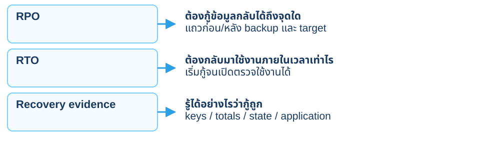
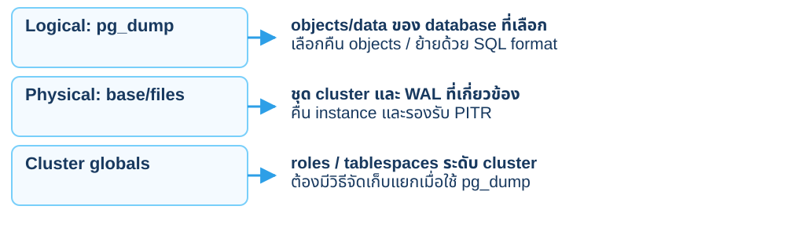
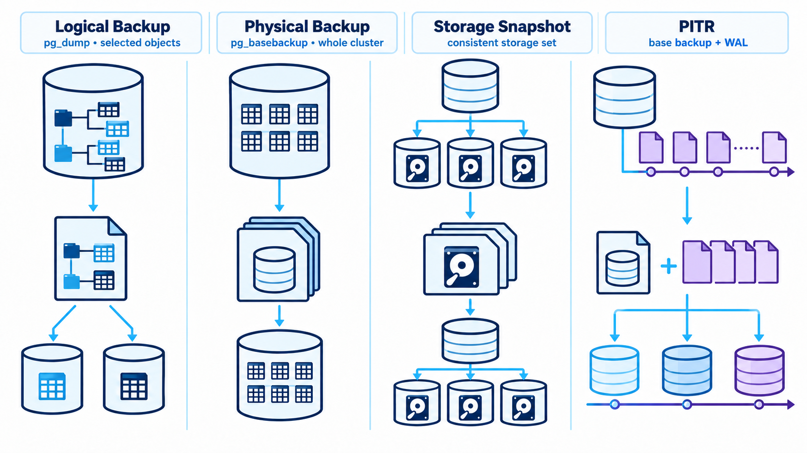
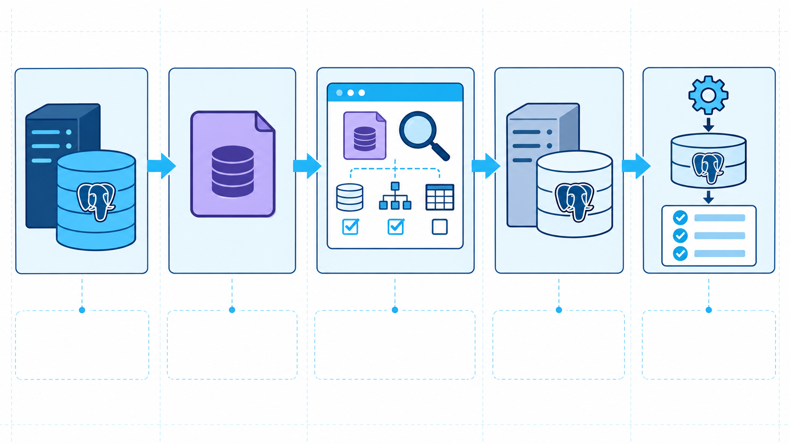
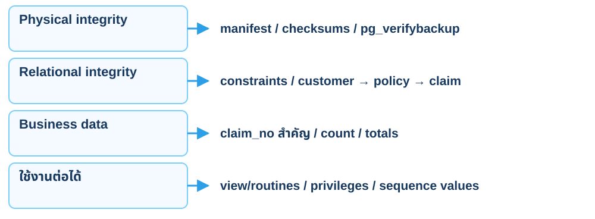
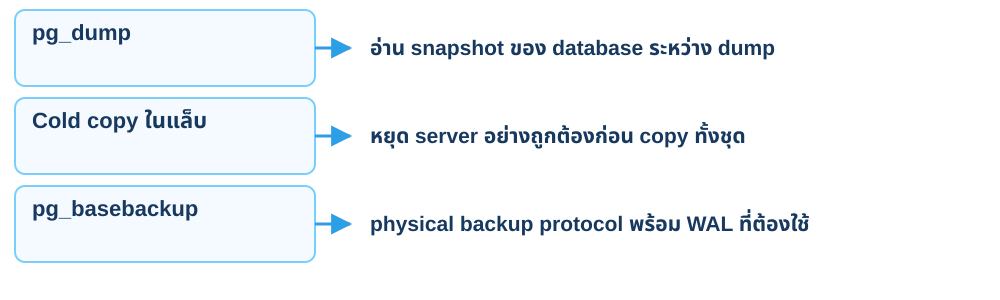
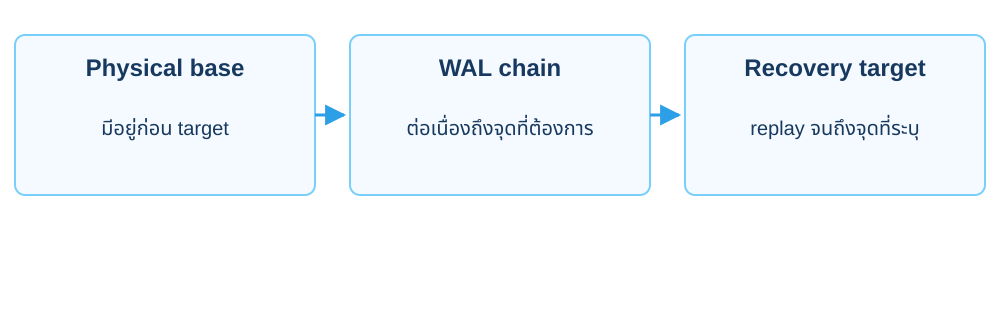
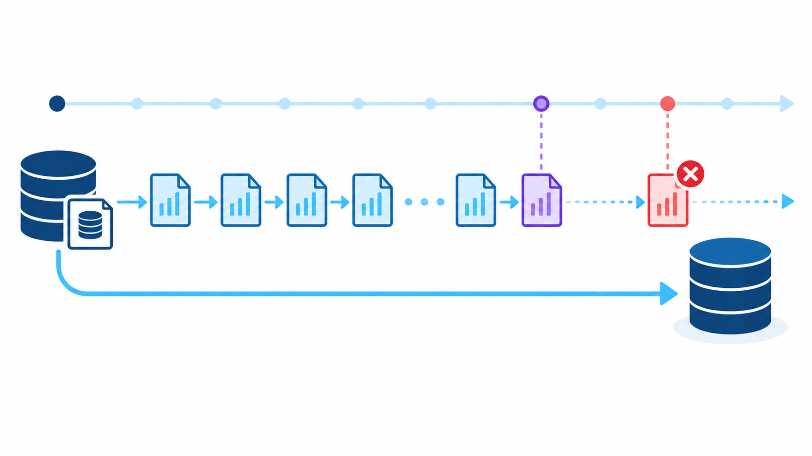
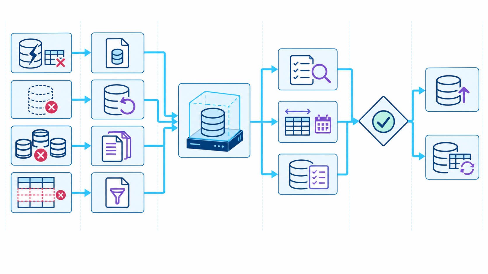
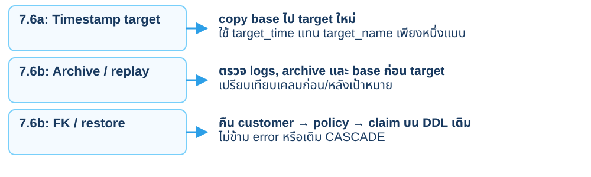

<CaseCover :module-id="7" />

# Module 7<br>Backup & Recovery

## กู้ลูกค้า กรมธรรม์ และเคลมชุดเดิม

<footer class="cs-footer"><span>ClaimSure · ภาพรวม / เตรียมแล็บ</span><span>1 / 32</span></footer>

<!--
Speaker notes:
อ้างอิงคู่มือบท 7 หัวข้อ ภาพรวม
บทนี้ใช้ฐานข้อมูล claimsure_xx และ schema claimsure จากบท 1–2 ต่อเนื่องกัน เปิดคู่มือบทนี้ไว้เพื่อทำ SQL/native commands ทีละขั้น ภาพปก: ./assets/module-07-backup-recovery-cover-enterprise-blue.png

Source: ../labs/module-07-backup-recovery.md · ภาพรวม
-->

---
layout: default
class: continuous-deck cs-concept-deck cs-module-7
---

# เตรียม 7.1–7.5 · ข้อมูลเดิมและขอบเขตกู้

<div class="cs-metrics"><div><b>3</b><span>customers</span></div><div><b>3</b><span>policies</span></div><div><b>100,006</b><span>claims</span></div></div>


<p class="cs-takeaway">เก็บ claim_detail_v · claim_tax · routines · รายงานบท 3</p>

<footer class="cs-footer"><span>ClaimSure · ภาพรวม / เตรียมแล็บ</span><span>2 / 32</span></footer>

<!--
Speaker notes:
อ้างอิงคู่มือบท 7 หัวข้อ ภาพรวม
บท 6 ต้องคืน shared data/options แล้ว ปิดทุก transaction/workload ก่อนทำ backup การกู้ shared ในบทนี้คืน data ของ core สามตารางบน DDL เดิม

Source: ../labs/module-07-backup-recovery.md · ภาพรวม
-->

---
layout: default
class: continuous-deck cs-concept-deck cs-module-7 cs-fundamental
---

# 7.1 · Fundamental: RPO และ RTO



<p class="cs-concept-caption">เป้าหมายธุรกิจ กับผลจากการทดลองหนึ่งรอบ เป็นคนละค่า</p>

<footer class="cs-footer"><span>ClaimSure · Fundamental ก่อน Lab 7.1</span><span>3 / 32</span></footer>

<!--
Speaker notes:
อ้างอิงคู่มือบท 7 หัวข้อ 7.1 · อธิบายก่อนคำสั่งที่เกี่ยวข้อง
RPO/RTO ต้องมาจากความต้องการที่ตกลงกัน การจับเวลา restore บนข้อมูลฝึกไม่ใช่ SLA ของระบบจริง CLM-L1-002 และแถวหลัง base ใช้ตรวจจุดข้อมูลที่กู้ได้ ไม่ใช่ดูเพียง process exit code

Sources:
- https://csrc.nist.gov/glossary/term/recovery_point_objective
- https://csrc.nist.gov/glossary/term/recovery_time_objective
Source: ../labs/module-07-backup-recovery.md · 7.1
-->

---
layout: default
class: continuous-deck cs-concept-deck cs-module-7 cs-fundamental
---

# 7.1 · Fundamental: Logical กับ physical



<p class="cs-concept-caption">Logical dump ไม่ใช่ physical base สำหรับ WAL replay</p>

<footer class="cs-footer"><span>ClaimSure · Fundamental ก่อน Lab 7.1–7.4</span><span>4 / 32</span></footer>

<!--
Speaker notes:
อ้างอิงคู่มือบท 7 หัวข้อ 7.1–7.4 · อธิบายก่อนคำสั่งที่เกี่ยวข้อง
Physical backup ผูกกับ server major version และสภาพแวดล้อมมากกว่า logical dump pg_dump เลือก table ไม่ได้รวม dependencies ทุกอย่างให้โดยอัตโนมัติ จึงต้องรู้ scope ที่ตนสำรองไว้

Sources:
- https://www.postgresql.org/docs/18/backup-dump.html
- https://www.postgresql.org/docs/18/app-pgdump.html
- https://www.postgresql.org/docs/18/backup-file.html
Source: ../labs/module-07-backup-recovery.md · 7.1–7.4
-->

---
layout: default
class: continuous-deck cs-concept-deck cs-module-7 cs-fundamental cs-infographic
---

# 7.1 · Fundamental: เลือกขอบเขต backup



<p class="cs-concept-caption">Logical archive ≠ physical base · เลือกขอบเขตและ WAL chain ให้ตรงวิธีกู้</p>

<footer class="cs-footer"><span>ClaimSure · Fundamental ก่อน Lab 7.1–7.4</span><span>5 / 32</span></footer>

<!--
Speaker notes:
อ้างอิงคู่มือบท 7 หัวข้อ 7.1–7.4 · อธิบายก่อนคำสั่งที่เกี่ยวข้อง
ภาพแบ่ง logical/physical/storage snapshot/PITR เป็นแนวทางเลือกวิธี ในแล็บ 7.2 archive เลือกสามตารางและ identity sequences ไม่รวม roles หรือ routines ที่ไม่ได้เลือก; 7.3 เป็น cold copy ของ private source ที่หยุดแล้ว ไม่ใช่ cp ไฟล์ shared ที่กำลังเขียน; 7.4 ใช้ physical base และ WAL ต่อเนื่องถึง target
Source: ../labs/module-07-backup-recovery.md · 7.1–7.4
-->

---
layout: default
class: continuous-deck cs-concept-deck cs-module-7 cs-fundamental
---

# 7.1 · Fundamental: เลือกวิธีกู้ให้ตรงโจทย์

| วิธี | สิ่งที่เก็บ | สิ่งที่พิสูจน์ |
| --- | --- | --- |
| 7.2: pg_dump | core tables / sequences / indexes | คืนข้อมูลที่ถูก COMMIT ลบ |
| 7.3: cold copy | private cluster ขณะหยุด | snapshot ที่ consistent |
| 7.4: physical base + WAL | private cluster + archive chain | กู้แถวหลัง base ก่อนความเสียหาย |


<p class="cs-takeaway">Physical recovery ทำบน private แล้ว logical import กลับ own DB</p>

<footer class="cs-footer"><span>ClaimSure · Fundamental ก่อน Lab 7.1–7.4</span><span>6 / 32</span></footer>

<!--
Speaker notes:
อ้างอิงคู่มือบท 7 หัวข้อ 7.1–7.4 · อธิบายก่อนคำสั่งที่เกี่ยวข้อง
ไม่ restore shared cluster ทั้งก้อน RPO คือจุดข้อมูลที่คืนได้ RTO คือเวลาที่วัดจนใช้งานและตรวจข้อมูลได้ ไม่เท่ากับเวลา copy อย่างเดียว

Source: ../labs/module-07-backup-recovery.md · 7.1–7.4
-->

---
layout: default
class: continuous-deck cs-concept-deck cs-module-7
---

# Lab 7.1a–7.1d · Workspace และ connection

<div class="cs-flow"><div><strong>Shared</strong><small>student_xx / claimsure_xx</small></div><span aria-hidden="true">→</span><div><strong>Private source</strong><small>labadmin / m7_stage_xx</small></div><span aria-hidden="true">→</span><div><strong>Recovery target</strong><small>socket/port แยกจาก source</small></div></div>


<p class="cs-takeaway">initdb และ pg_ctl อยู่ใต้ home · จด LAB path ของตน</p>

<footer class="cs-footer"><span>ClaimSure · คู่มือ Lab 7.1a–7.1d</span><span>7 / 32</span></footer>

<!--
Speaker notes:
อ้างอิงคู่มือบท 7 หัวข้อ 7.1a–7.1d
ทำ 7.1a–7.1d ด้วย Bash เดิม SHARED/PRIVATE/RECOVERED เป็น arrays เก็บ flags ของ native commands ไม่ใช่ shell runner ตรวจ system identifier/config path ว่าคนละ server

Source: ../labs/module-07-backup-recovery.md · 7.1a–7.1d
-->

---
layout: default
class: continuous-deck cs-concept-deck cs-module-7
---

# Lab 7.1e · บันทึก baseline ของเคลม

```sql
SELECT count(*),sum(estimated_amount)
FROM claimsure.claim;
SELECT claim_no,status,estimated_amount
FROM claimsure.claim
WHERE claim_no LIKE 'CLM-L1-%' ORDER BY claim_no;
```


<p class="cs-takeaway">CLM-L1-002 ยังอยู่ / 22,000 · ยังไม่มี CLM-L7-*</p>

<footer class="cs-footer"><span>ClaimSure · คู่มือ Lab 7.1e</span><span>8 / 32</span></footer>

<!--
Speaker notes:
อ้างอิงคู่มือบท 7 หัวข้อ 7.1e
7.1e บันทึก count และ sum ลง before-count-total.txt เพื่อ cmp ท้ายบท ไม่ใช้ count อย่างเดียว เพราะการลบหนึ่งแถวและเพิ่มอีกแถวอาจทำให้ count เท่าเดิม

Source: ../labs/module-07-backup-recovery.md · 7.1e
-->

---
layout: default
class: continuous-deck cs-concept-deck cs-module-7 cs-fundamental cs-infographic
---

# 7.2 · Fundamental: Logical restore flow



<p class="cs-concept-caption">Dump → ตรวจ archive → เลือก data → คืน customer → policy → claim</p>

<footer class="cs-footer"><span>ClaimSure · Fundamental ก่อน Lab 7.2a–7.2i</span><span>9 / 32</span></footer>

<!--
Speaker notes:
อ้างอิงคู่มือบท 7 หัวข้อ 7.2a–7.2i · อธิบายก่อนคำสั่งที่เกี่ยวข้อง
ใช้ไฟล์ dump ที่เพิ่งสร้างจาก own DB ตาม 7.2a และ DDL shared เดิม คืนข้อมูลแบบ data-only ใน transaction เดียวพร้อม TRUNCATE ทั้งสามตารางตาม 7.2f เพื่อรักษา view/functions/report เดิม ไม่ใช้ --clean, CASCADE หรือปิด constraints เพื่อข้าม FK ที่ไม่อยู่ในขอบเขต
Source: ../labs/module-07-backup-recovery.md · 7.2a–7.2i
-->

---
layout: default
class: continuous-deck cs-concept-deck cs-module-7
---

# Lab 7.2a · Archive ของ core และ sequences

```bash
pg_dump "${SHARED[@]}" -d "$MAIN" -Fc \
 --no-owner --no-acl "${CORE_TABLES[@]}" \
 -f "$BACKUPS/a-logical.dump"
pg_restore --list "$BACKUPS/a-logical.dump"
```


<p class="cs-takeaway">CORE_TABLES จาก 7.1b: customer / policy / claim และ identity sequences</p>

<p class="cs-takeaway">ก่อนลบ ทำ 7.2b ตรวจ count / totals / เคลม 002 และบันทึกเวลา</p>

<footer class="cs-footer"><span>ClaimSure · คู่มือ Lab 7.2a</span><span>10 / 32</span></footer>

<!--
Speaker notes:
อ้างอิงคู่มือบท 7 หัวข้อ 7.2a
ตัวแปรทุกตัวเตรียมใน 7.1b Archive เลือกด้วย table filters จึงไม่ได้สร้าง schema/routines/report ให้เอง ตรวจ TABLE DATA และ SEQUENCE SET ก่อนใช้

Source: ../labs/module-07-backup-recovery.md · 7.2a
-->

---
layout: default
class: continuous-deck cs-concept-deck cs-module-7
---

# Lab 7.2c–7.2d · ลบ COMMIT แล้วตรวจผล

```sql
DELETE FROM claimsure.claim
WHERE claim_no='CLM-L1-002';
SELECT count(*) FROM claimsure.claim
WHERE claim_no='CLM-L1-002';
```


<div class="cs-metrics"><div><b>100,005</b><span>จำนวนรวมหลังลบ</span></div><div><b>0</b><span>CLM-L1-002 ที่พบ</span></div></div>

<footer class="cs-footer"><span>ClaimSure · คู่มือ Lab 7.2c–7.2d</span><span>11 / 32</span></footer>

<!--
Speaker notes:
อ้างอิงคู่มือบท 7 หัวข้อ 7.2c–7.2d
คำสั่งอยู่นอก BEGIN จึง auto-commit การลบ ต้องใช้ archive เพื่อกู้ ไม่ใช่ ROLLBACK ภายหลัง และควรยืนยัน own database ก่อนรัน

Source: ../labs/module-07-backup-recovery.md · 7.2c–7.2d
-->

---
layout: default
class: continuous-deck cs-concept-deck cs-module-7 cs-fundamental
---

# 7.2 · Fundamental: ลำดับคืนข้อมูลตาม FK

<div class="cs-flow"><div><strong>customer</strong><small>คืนแถวลูกค้าก่อน</small></div><span aria-hidden="true">→</span><div><strong>policy</strong><small>อ้าง customer ที่มีแล้ว</small></div><span aria-hidden="true">→</span><div><strong>claim</strong><small>อ้าง policy ที่มีแล้ว</small></div></div>


<p class="cs-takeaway">คืน data-only บน DDL เดิม · ไม่ DROP ตารางที่ view พึ่งอยู่</p>

<footer class="cs-footer"><span>ClaimSure · Fundamental ก่อน Lab 7.2e–7.2f</span><span>12 / 32</span></footer>

<!--
Speaker notes:
อ้างอิงคู่มือบท 7 หัวข้อ 7.2e–7.2f · อธิบายก่อนคำสั่งที่เกี่ยวข้อง
การเลือก full archive แล้ว restore เฉพาะ data ไม่รับประกันลำดับที่ FK ต้องการ ในคู่มือจึงแยกสามไฟล์ชัดเจน ห้ามเติม CASCADE หรือปิด FK เพื่อข้าม error

Source: ../labs/module-07-backup-recovery.md · 7.2e–7.2f
-->

---
layout: default
class: continuous-deck cs-concept-deck cs-module-7
---

# Lab 7.2e · แยก data ของแต่ละตาราง

```bash
pg_restore --data-only --no-owner --no-acl \
 --schema=claimsure \
 --table=customer --table=customer_customer_id_seq \
 --file="$LAB/a-logical-customer.sql" \
 "$BACKUPS/a-logical.dump"
```


| ไฟล์ | เลือกคู่กัน |
| --- | --- |
| …-customer.sql | customer + customer_customer_id_seq |
| …-policy.sql | policy + policy_policy_id_seq |
| …-claim.sql | claim + claim_claim_id_seq |

<footer class="cs-footer"><span>ClaimSure · คู่มือ Lab 7.2e</span><span>13 / 32</span></footer>

<!--
Speaker notes:
อ้างอิงคู่มือบท 7 หัวข้อ 7.2e
ทำซ้ำตามคำสั่งเต็ม 7.2b–7.2h สำหรับ policy/claim pg_restore -t ใช้ชื่อตารางไม่ใส่ schema จึงระบุ -n/--schema ร่วม และเลือก sequence ของแต่ละตาราง

Source: ../labs/module-07-backup-recovery.md · 7.2e
-->

---
layout: default
class: continuous-deck cs-concept-deck cs-module-7 cs-fundamental
---

# 7.2 · Fundamental: Verify หลายชั้น



<p class="cs-concept-caption">เครื่องมือ verify ผ่าน ยังต้องเปิดตรวจข้อมูลและ access path</p>

<footer class="cs-footer"><span>ClaimSure · Fundamental ก่อน Lab 7.2f–7.5a</span><span>14 / 32</span></footer>

<!--
Speaker notes:
อ้างอิงคู่มือบท 7 หัวข้อ 7.2f–7.5a · อธิบายก่อนคำสั่งที่เกี่ยวข้อง
ตรวจทั้งสถานะ in recovery/paused ตาม target และแถวที่ควรมีหรือไม่ควรมี เมื่อ restore data-only ต้องรู้ DDL ที่มีอยู่และลำดับ FK การคืนเลข sequence มีพฤติกรรม transaction ต่างจาก rows จึงตรวจแยก

Sources:
- https://www.postgresql.org/docs/18/app-pgverifybackup.html
- https://www.postgresql.org/docs/18/app-pgrestore.html
- https://www.postgresql.org/docs/18/functions-sequence.html
Source: ../labs/module-07-backup-recovery.md · 7.2f–7.5a
-->

---
layout: default
class: continuous-deck cs-concept-deck cs-module-7
---

# Lab 7.2f · คืนสามตารางใน transaction เดียว

```bash
psql -X -1 -v ON_ERROR_STOP=1 \
 "${SHARED[@]}" -d "$MAIN" \
 -c 'TRUNCATE claimsure.claim, claimsure.policy,
              claimsure.customer;' \
 -f "$LAB/a-logical-customer.sql" \
 -f "$LAB/a-logical-policy.sql" \
 -f "$LAB/a-logical-claim.sql"
```


<p class="cs-takeaway">ใช้เฉพาะ own training DB · archive ใหม่จากฐานนี้ · หยุด workload ก่อน</p>

<footer class="cs-footer"><span>ClaimSure · คู่มือ Lab 7.2f</span><span>15 / 32</span></footer>

<!--
Speaker notes:
อ้างอิงคู่มือบท 7 หัวข้อ 7.2f
psql -1 ครอบ TRUNCATE และไฟล์ทั้งสาม หาก FK/SQL error จะ rollback ข้อมูล การทดลองครอบคลุมทั้งสามตาราง ไม่ใช่คืนเคลมเดียว ถ้ามี FK จากงานอื่นเข้ามาให้หยุดตรวจ scope ไม่เพิ่ม CASCADE

Source: ../labs/module-07-backup-recovery.md · 7.2f
-->

---
layout: default
class: continuous-deck cs-concept-deck cs-module-7
---

# Lab 7.2g–7.2i · ตรวจข้อมูลและหลักฐาน RPO/RTO

```sql
SELECT count(*) AS expected_100006,sum(estimated_amount)
FROM claimsure.claim;
SELECT claim_no,status,estimated_amount FROM claimsure.claim
WHERE claim_no='CLM-L1-002';
SELECT count(*) FROM claimsure.claim_detail_v;
```

| ขั้นคู่มือ | หลักฐานที่ต้องตรวจ |
| --- | --- |
| 7.2g | เคลม 002 กลับมา, view/routines และ identity sequence ตามคู่มือ |
| 7.2h | count / sum ตรงไฟล์ baseline; ใช้ cmp ตามคำสั่งเต็ม |
| 7.2i | จด snapshot time, data gap และเวลาจนเปิดใช้งานได้ |

<footer class="cs-footer"><span>ClaimSure · คู่มือ Lab 7.2g–7.2i</span><span>16 / 32</span></footer>

<!--
Speaker notes:
อ้างอิงคู่มือบท 7 หัวข้อ 7.2g–7.2i หลัง atomic restore ให้ตรวจทั้งข้อมูลและการใช้งาน ไม่สรุปว่า restore สำเร็จเพียงเพราะ command exit 0 เปิด SQL ทดสอบ function/procedure และ identity ตามคู่มือโดยทำ transaction/rollback ให้ครบ count/sum ต้องเทียบกับ baseline ของนักเรียนเอง และ RPO/RTO เป็นค่าที่วัดจากรอบนี้
Source: ../labs/module-07-backup-recovery.md · 7.2g–7.2i
-->

---
layout: default
class: continuous-deck cs-concept-deck cs-module-7 cs-fundamental
---

# 7.3 · Fundamental: Consistent backup



<p class="cs-concept-caption">Copy ไฟล์ที่กำลังเขียน ไม่ได้กลายเป็น consistent backup เอง</p>

<footer class="cs-footer"><span>ClaimSure · Fundamental ก่อน Lab 7.3a–7.3b</span><span>17 / 32</span></footer>

<!--
Speaker notes:
อ้างอิงคู่มือบท 7 หัวข้อ 7.3a–7.3b · อธิบายก่อนคำสั่งที่เกี่ยวข้อง
เลือกวิธีที่มีเงื่อนไขความสอดคล้องชัดเจน หากมี tablespaces หรือ storage แยกต้องรวมขอบเขตนั้นด้วย แล็บใช้ private cluster ที่สร้างเองและหยุด source ก่อน cold copy

Sources:
- https://www.postgresql.org/docs/18/backup-file.html
- https://www.postgresql.org/docs/18/app-pgbasebackup.html
Source: ../labs/module-07-backup-recovery.md · 7.3a–7.3b
-->

---
layout: default
class: continuous-deck cs-concept-deck cs-module-7
---

# Lab 7.3a–7.3b · Cold copy ของ private

<div class="cs-flow"><div><strong>Stop source</strong><small>pg_ctl -m fast -w stop</small></div><span aria-hidden="true">→</span><div><strong>Copy cluster</strong><small>cp -a ขณะหยุด</small></div><span aria-hidden="true">→</span><div><strong>Checksums</strong><small>ตรวจ SHA256SUMS</small></div></div>


<p class="cs-takeaway">Start source หลัง copy · recovery copy ใช้ directory ใหม่</p>

<footer class="cs-footer"><span>ClaimSure · คู่มือ Lab 7.3a–7.3b</span><span>18 / 32</span></footer>

<!--
Speaker notes:
อ้างอิงคู่มือบท 7 หัวข้อ 7.3a–7.3b
7.3a นำ core เข้า private ก่อน 7.3b หยุด source แล้ว copy ทั้ง cluster ห้ามใช้ cp ตอน server ยังเขียนและเรียกว่า consistent snapshot ตรวจ checksum อีกครั้งก่อนสร้าง recovery copy

Source: ../labs/module-07-backup-recovery.md · 7.3a–7.3b
-->

---
layout: default
class: continuous-deck cs-concept-deck cs-module-7
---

# Lab 7.3c · จำลองข้อมูลเสียหลัง snapshot

| สถานะ | CLM-L1-002 | CLM-L7-LOSS |
| --- | --- | --- |
| ตอน snapshot | มี | ไม่มี |
| หลังเสียบน shared | ไม่มี | มี / 999 |
| หลัง cold recovery + import | กลับมา | ไม่มี |


<p class="cs-takeaway">Count เท่ากันได้ แม้แถวธุรกิจคนละแถว</p>

<footer class="cs-footer"><span>ClaimSure · คู่มือ Lab 7.3c</span><span>19 / 32</span></footer>

<!--
Speaker notes:
อ้างอิงคู่มือบท 7 หัวข้อ 7.3c
C3 ลบเคลมเดิมแล้วเพิ่ม LOSS ทำให้ count ยังเท่าเดิม ใช้ business keys และ sum ตรวจ Snapshot ไม่รวมงานที่เกิดหลังเวลาสำรอง

Source: ../labs/module-07-backup-recovery.md · 7.3c
-->

---
layout: default
class: continuous-deck cs-concept-deck cs-module-7
---

# Lab 7.3d–7.3e · แยก recovery จาก source

| ค่าที่ override | เหตุผล |
| --- | --- |
| unix_socket_directories / port | ไม่ชน source ที่ยังทำงาน |
| archive_mode=off | target ไม่เขียน archive ทับ source |
| directory ใหม่ | ไม่ทับ primary data |
| cold copy ไม่มี recovery.signal | เปิดจาก cleanly stopped snapshot |


<p class="cs-takeaway">ตรวจแถวบน recovery ก่อน dump กลับ shared</p>

<footer class="cs-footer"><span>ClaimSure · คู่มือ Lab 7.3d–7.3e</span><span>20 / 32</span></footer>

<!--
Speaker notes:
อ้างอิงคู่มือบท 7 หัวข้อ 7.3d–7.3e
C4 เขียน postgresql.auto.conf ของ target ก่อน start แล้ว C5 dump core จาก recovered instance และ ordered data-only import กลับ shared

Source: ../labs/module-07-backup-recovery.md · 7.3d–7.3e
-->

---
layout: default
class: continuous-deck cs-concept-deck cs-module-7 cs-fundamental
---

# 7.4 · Fundamental: Base + WAL + Target



<p class="cs-concept-caption">Base + WAL ที่ครบ + timeline/target ที่ถูกต้อง</p>

<footer class="cs-footer"><span>ClaimSure · Fundamental ก่อน Lab 7.4a–7.4h</span><span>21 / 32</span></footer>

<!--
Speaker notes:
อ้างอิงคู่มือบท 7 หัวข้อ 7.4a–7.4h · อธิบายก่อนคำสั่งที่เกี่ยวข้อง
Named restore point ต้องอยู่ใน WAL ที่กู้เข้าถึงได้ การกู้แถวที่เพิ่มหลัง base จึงพิสูจน์ replay มากกว่าการ copy base กลับอย่างเดียว เก็บ base และ archived WAL ให้ครบคู่กัน

Sources:
- https://www.postgresql.org/docs/18/continuous-archiving.html
- https://www.postgresql.org/docs/18/recovery-target-settings.html
Source: ../labs/module-07-backup-recovery.md · 7.4a–7.4h
-->

---
layout: default
class: continuous-deck cs-concept-deck cs-module-7 cs-fundamental cs-infographic
---

# 7.4 · Fundamental: Replay ถึงเป้าหมาย



<p class="cs-concept-caption">Base ก่อน target + WAL ต่อเนื่อง → หยุดที่ named restore point ก่อนความเสียหาย</p>

<footer class="cs-footer"><span>ClaimSure · Fundamental ก่อน Lab 7.4a–7.4h</span><span>22 / 32</span></footer>

<!--
Speaker notes:
อ้างอิงคู่มือบท 7 หัวข้อ 7.4a–7.4h · อธิบายก่อนคำสั่งที่เกี่ยวข้อง
7.4 ต้องพิสูจน์ replay ด้วย CLM-L7-AFTER-BASE ที่เกิดหลัง base แต่ก่อน target และต้องไม่มี CLM-L7-LOSS ที่เกิดหลัง target การเห็นเคลมเก่าจาก base อย่างเดียวไม่พิสูจน์ PITR ตรวจ archive ไปไกลกว่า target, recovery.signal, target name และ paused state ตาม 7.4a–7.4h ห้ามนำ target ของรูปไปใช้เป็น timestamp จริง
Source: ../labs/module-07-backup-recovery.md · 7.4a–7.4h
-->

---
layout: default
class: continuous-deck cs-concept-deck cs-module-7 cs-fundamental
---

# 7.4 · Fundamental: พิสูจน์แถวหลัง base

| ลำดับ | ข้อมูลสำคัญ |
| --- | --- |
| 1 · basebackup จบ | มี CLM-L1-002 |
| 2 · INSERT หลัง base | CLM-L7-AFTER-BASE / 400 |
| 3 · restore point | สองเคลมข้างต้นมีอยู่ |
| 4 · damage หลัง point | ลบ 002 + เพิ่ม CLM-L7-LOSS |
| 5 · recovery ไป point | 002 และ AFTER-BASE มี · LOSS ไม่มี |

<footer class="cs-footer"><span>ClaimSure · Fundamental ก่อน Lab 7.4a–7.4b</span><span>23 / 32</span></footer>

<!--
Speaker notes:
อ้างอิงคู่มือบท 7 หัวข้อ 7.4a–7.4b · อธิบายก่อนคำสั่งที่เกี่ยวข้อง
ลำดับ base จบก่อนแถวใหม่ทำให้พิสูจน์ WAL replay ถ้า base มีทุกแถวอยู่แล้ว การ copy base กลับไม่พิสูจน์ว่า replay จนถึง target ได้

Source: ../labs/module-07-backup-recovery.md · 7.4a–7.4b
-->

---
layout: default
class: continuous-deck cs-concept-deck cs-module-7
---

# Lab 7.4a · Physical base และ manifest

```bash
pg_basebackup "${PRIVATE[@]}" \
 -D "$D_BASE/data" -Fp -Xs -c fast -P
pg_verifybackup "$D_BASE/data"
```


<p class="cs-takeaway">ทำหลัง sync staging ใน 7.4a · ยังไม่สร้าง restore point</p>

<footer class="cs-footer"><span>ClaimSure · คู่มือ Lab 7.4a</span><span>24 / 32</span></footer>

<!--
Speaker notes:
อ้างอิงคู่มือบท 7 หัวข้อ 7.4a
pg_verifybackup ตรวจความครบ/สอดคล้องของ backup ตาม manifest ไม่แทนการเปิด recovery ตรวจเคลมและ business totals จดเวลาเริ่ม/จบและเก็บ WAL chain คู่กับ base

Source: ../labs/module-07-backup-recovery.md · 7.4a
-->

---
layout: default
class: continuous-deck cs-concept-deck cs-module-7
---

# Lab 7.4b · เพิ่มเคลมหลัง base ก่อน target

```sql
INSERT INTO claimsure.claim
 (claim_no,policy_id,status,incident_at,estimated_amount)
SELECT 'CLM-L7-AFTER-BASE',policy_id,'NEW',incident_at,400
FROM claimsure.claim WHERE claim_no='CLM-L1-001';
```


<p class="cs-takeaway">Sync ไป staging ก่อนสร้าง named restore point</p>

<footer class="cs-footer"><span>ClaimSure · คู่มือ Lab 7.4b</span><span>25 / 32</span></footer>

<!--
Speaker notes:
อ้างอิงคู่มือบท 7 หัวข้อ 7.4b
รันบน shared ตาม 7.4b จากนั้น dump/ordered import ไป private staging ให้แถวหลัง base อยู่ใน WAL ของ source ก่อนเรียก pg_create_restore_point

Source: ../labs/module-07-backup-recovery.md · 7.4b
-->

---
layout: default
class: continuous-deck cs-concept-deck cs-module-7
---

# Lab 7.4b–7.4e · Restore point และ archive

```bash
SEGMENT=$(psql -X -v ON_ERROR_STOP=1 \
 "${PRIVATE[@]}" -d "$STAGE" -Atc \
 "SELECT pg_walfile_name(pg_create_restore_point('$POINT'));")
psql -X "${PRIVATE[@]}" -d "$STAGE" \
 -c 'SELECT pg_switch_wal();'
test -s "$WAL/$SEGMENT"
```


<p class="cs-takeaway">POINT ตาม 7.4b · ตรวจ archive ใน 7.4c และ 7.4e ก่อนเปิด recovery</p>

<p>7.4c ตรวจ archive → 7.4d สร้าง damage และ sync staging → 7.4e ยืนยัน WAL หลัง target ตามคู่มือ</p>

<footer class="cs-footer"><span>ClaimSure · คู่มือ Lab 7.4b–7.4e</span><span>26 / 32</span></footer>

<!--
Speaker notes:
อ้างอิงคู่มือบท 7 หัวข้อ 7.4b–7.4e
SQL pg_switch_wal สำเร็จยังไม่พอ ต้องมีไฟล์ segment จริงและ archive ไปไกลกว่า target หลังสร้าง damage ด้วย ตรวจ pg_stat_archiver และอย่าลบ WAL ที่ base ยังต้องใช้

Source: ../labs/module-07-backup-recovery.md · 7.4b–7.4e
-->

---
layout: default
class: continuous-deck cs-concept-deck cs-module-7
---

# Lab 7.4f · ตั้ง named recovery target

```ini
restore_command = 'cp WAL_DIRECTORY/%f %p'
recovery_target_name = 'POINT_FROM_7_4b'
recovery_target_timeline = 'current'
recovery_target_action = 'pause'
hot_standby = on
```


<p class="cs-takeaway">ตัวอย่างรูปแบบ · ใช้ heredoc 7.4f แทนค่า path/POINT จริง</p>

<footer class="cs-footer"><span>ClaimSure · คู่มือ Lab 7.4f</span><span>27 / 32</span></footer>

<!--
Speaker notes:
อ้างอิงคู่มือบท 7 หัวข้อ 7.4f
เขียนเฉพาะ D_RECOVERY/postgresql.auto.conf หลัง copy base ไป target ใหม่ ใช้ค่าจริงจาก 7.4f พร้อม port/socket/archive overrides แล้ว touch recovery.signal ก่อน start ห้ามใช้ placeholders บนหน้านี้เป็นค่าจริง

Source: ../labs/module-07-backup-recovery.md · 7.4f
-->

---
layout: default
class: continuous-deck cs-concept-deck cs-module-7
---

# Lab 7.4g · ตรวจ paused state และแถว

```sql
SELECT pg_is_in_recovery(),
       pg_get_wal_replay_pause_state();
SELECT claim_no,estimated_amount FROM claimsure.claim
WHERE claim_no IN ('CLM-L1-002','CLM-L7-AFTER-BASE',
                   'CLM-L7-LOSS') ORDER BY claim_no;
```


<p class="cs-takeaway">true + paused · ได้ 002 และ AFTER-BASE · ไม่มี LOSS</p>

<footer class="cs-footer"><span>ClaimSure · คู่มือ Lab 7.4g</span><span>28 / 32</span></footer>

<!--
Speaker notes:
อ้างอิงคู่มือบท 7 หัวข้อ 7.4g
รันผ่าน RECOVERED ไม่ใช่ SHARED/PRIVATE แค่ connect ได้หรือ pg_verifybackup ผ่านยังไม่พอ รอ replay state paused ตาม loop 7.4g ก่อน export

Source: ../labs/module-07-backup-recovery.md · 7.4g
-->

---
layout: default
class: continuous-deck cs-concept-deck cs-module-7
---

# Lab 7.4h · Import แล้วตรวจ business totals

<div class="cs-metrics"><div><b>100,007</b><span>claims หลัง PITR import</span></div><div><b>+400</b><span>ยอดจาก baseline</span></div><div><b>6</b><span>seed claims กลับครบ</span></div></div>


<p class="cs-takeaway">ใช้ ordered data-only import เดิม · view/routines ยังอยู่</p>

<footer class="cs-footer"><span>ClaimSure · คู่มือ Lab 7.4h</span><span>29 / 32</span></footer>

<!--
Speaker notes:
อ้างอิงคู่มือบท 7 หัวข้อ 7.4h
7.4h dump จาก recovery ที่ paused แล้วนำกลับตาราง shared เดิม หากไม่มี AFTER-BASE แปลว่ายังพิสูจน์ replay หลัง base ไม่ได้ ไม่สรุปจาก count อย่างเดียว

Source: ../labs/module-07-backup-recovery.md · 7.4h
-->

---
layout: default
class: continuous-deck cs-concept-deck cs-module-7 cs-fundamental cs-infographic
---

# 7.5 · Fundamental: ตรวจว่าพร้อมใช้ต่อ



<p class="cs-concept-caption">Files ผ่าน verify → ตรวจ keys / totals / state → ตรวจ view และสิทธิ์ก่อนใช้ต่อ</p>

<footer class="cs-footer"><span>ClaimSure · Fundamental ก่อน Lab 7.5a</span><span>30 / 32</span></footer>

<!--
Speaker notes:
อ้างอิงคู่มือบท 7 หัวข้อ 7.5a · อธิบายก่อนคำสั่งที่เกี่ยวข้อง
checksum และ pg_verifybackup ตรวจความครบของสิ่งที่ครอบคลุม แต่ไม่ยืนยัน business correctness ทุกแถว 7.5a เก็บหลักฐานแล้วคืน baseline และหยุด private servers ของตน ตารางและ objects บน shared คงไว้สำหรับบท 9 ต้องตรวจหกเคลมและยอดรวม ไม่ใช่อาศัย exit code อย่างเดียว
Source: ../labs/module-07-backup-recovery.md · 7.5a
-->

---
layout: default
class: continuous-deck cs-concept-deck cs-module-7
---

# Lab 7.5a · คืน baseline และปิด private

```sql
DELETE FROM claimsure.claim
WHERE claim_no='CLM-L7-AFTER-BASE';
REFRESH MATERIALIZED VIEW
claimsure.cs_monthly_claim_summary;
SELECT count(*) AS expected_100006 FROM claimsure.claim;
```


<p class="cs-takeaway">cmp count/total กับก่อนเริ่ม · หยุด private source/recovery</p>

<footer class="cs-footer"><span>ClaimSure · คู่มือ Lab 7.5a</span><span>31 / 32</span></footer>

<!--
Speaker notes:
อ้างอิงคู่มือบท 7 หัวข้อ 7.5a
เก็บหลักฐานผลกู้ก่อนลบแถวสาธิต ตรวจ CLM-L1-* หกแถวและ claim_tax ยังใช้ได้ ไม่ลบ core tables/archives ที่ยังต้องพึ่งกัน Sequence มีช่องว่างได้

Source: ../labs/module-07-backup-recovery.md · 7.5a
-->

---
layout: default
class: continuous-deck cs-concept-deck cs-module-7
---

# เสริม 7.6a–7.6b · Target และการตรวจปัญหา



<p class="cs-concept-caption">ส่วนเสริม 7.6 · เก็บ base และหลักฐานเดิมไว้ก่อนลอง target ใหม่</p>

<footer class="cs-footer"><span>ClaimSure · คู่มือ Lab 7.6a–7.6b</span><span>32 / 32</span></footer>

<!--
Speaker notes:
อ้างอิงคู่มือบท 7 หัวข้อ 7.6a–7.6b
timestamp เป็นทางเลือกจาก named restore point ในคู่มือ ให้ใช้ target directory ใหม่และเลือก recovery target เพียงแบบเดียว ตรวจ archive/replay/FK ตามสาเหตุ ไม่ย้อนทำ initdb บน source หรือข้าม error เพื่อให้เครื่องมือจบ
Source: ../labs/module-07-backup-recovery.md · 7.6a–7.6b
-->

