<div class="cover-art">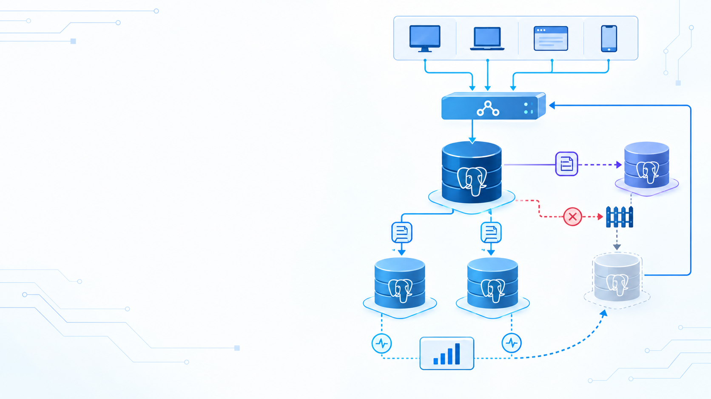</div>

# Module 8<br>Replication & HA

## สตรีม WAL · วัด lag · ฝึก failover อย่างเป็นลำดับ

<footer class="cs-footer"><span>ClaimSure · ภาพรวม / เตรียมแล็บ</span><span>1 / 32</span></footer>

<!--
Speaker notes:
บทนี้เรียนการส่ง WAL และฝึก failover บน cluster แล็บแยก อธิบายให้ชัดว่า replication ยังไม่ใช่ HA จนกว่าจะมี fencing, routing และการตรวจหลังเปลี่ยน primary
Technical notes: Follow the numbered native lab guide. Use dedicated lab instances, record actual results, and confirm the target node before each command.
Source: ../labs/module-08-replication.md · Overview
-->

---
layout: default
class: continuous-deck cs-concept-deck cs-module-8
---

# เตรียม Step 1–15 · Native instances

| สิ่งที่เตรียม | ขอบเขตของบทนี้ |
| --- | --- |
| PostgreSQL 16+; path ตัวอย่าง 18 | cluster แล็บแยกจาก shared claimsure_xx |
| Single host | primary  port 5432 / replica  port 5433 / optional replica2  port 5434 |
| Two hosts | PRIMARY_HOST / REPLICA_HOST และ HBA ที่ตรงกัน |
| สิทธิ์ | postgres/admin สำหรับ config; OS postgres สำหรับ clone |

ใช้ Step 1–15 ในคู่มือ native; Compose 3 nodes มีคู่มือและพอร์ตแยก

<footer class="cs-footer"><span>ClaimSure · Step 1–15</span><span>2 / 32</span></footer>

<!--
Speaker notes:
ให้นักเรียนจด host, port และ data directory ก่อนเริ่ม เลือก native หรือ Compose อย่างใดอย่างหนึ่ง ชุด native ใช้ primary 5432 และ replica 5433 บนเครื่องเดียวกัน ไม่ใช้ฐาน shared claimsure_xx เป็นเป้าหมาย clone
Technical notes: Choose either native or Compose before starting. This deck follows labs/module-08-replication.md. Do not combine Compose ports or container commands with native data directories. The native guide uses a standalone lab_repl.canary so it does not require legacy insurance tables. Fill in all host/path variables from the actual lab allocation.
Source: ../labs/module-08-replication.md · 1–15
-->

---
layout: default
class: continuous-deck cs-concept-deck cs-module-8 cs-fundamental cs-infographic
---

# Step 1–8 · Fundamental: Primary และ Replica

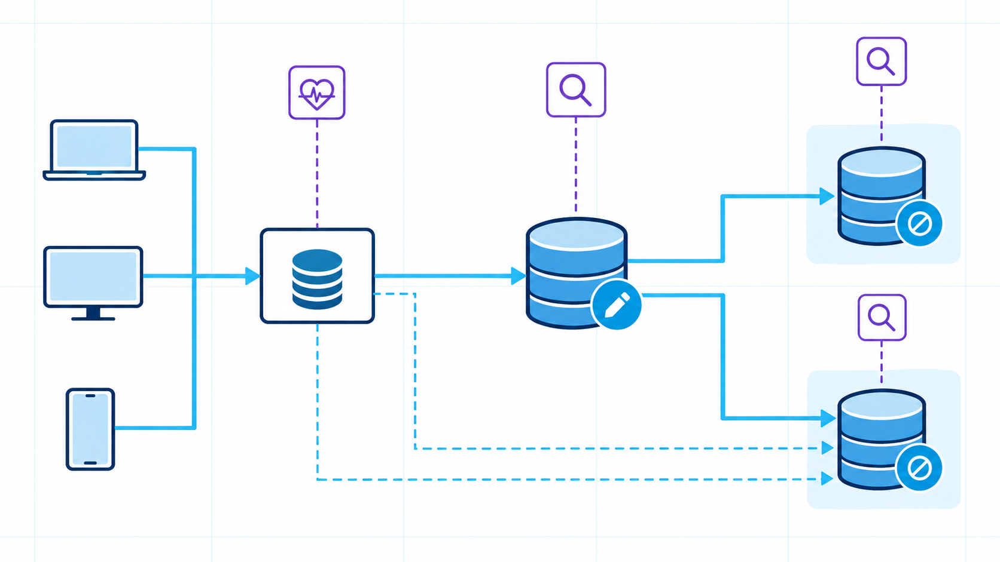

<p class="cs-concept-caption">Primary รับ write · Replica replay WAL · Routing เลือกปลายทางที่ถูกต้อง</p>

<footer class="cs-footer"><span>ClaimSure · Fundamental ก่อน Step 1–8</span><span>3 / 32</span></footer>

<!--
Speaker notes:
ชี้เส้นทางจาก client ผ่าน routing ไปยัง primary และตาม WAL ไป replica ภาพเป็น topology อ้างอิง ต้องเทียบพอร์ตกับ environment จริง การต่อ replication สำเร็จไม่ได้เลือกผู้นำหรือเปลี่ยนเส้นทาง client ให้เอง
Technical notes: The source image shows a conceptual topology. Native single-host lab ports are 5432 and 5433, with optional 5434. A connected replica alone does not provide fencing, leader election or client routing. Keep the original image unchanged.
Source: ../labs/module-08-replication.md · 1–8
-->

---
layout: default
class: continuous-deck cs-concept-deck cs-module-8
---

# Lab Step 1 · ตรวจ primary

```sql
SELECT version();
SELECT pg_is_in_recovery();  -- false on primary
SHOW data_directory;
SHOW port;
```

| Check | Expected |
| --- | --- |
| pg_is_in_recovery() | false |
| directory / port | Match the assigned primary |
| Database / role | Dedicated replication lab, admin connection |

<footer class="cs-footer"><span>ClaimSure · Step 1</span><span>4 / 32</span></footer>

<!--
Speaker notes:
รันบน primary ที่จัดไว้ ต้องเห็น recovery เป็น false ให้เทียบ data directory และ port กับใบงาน หากเป็น true แสดงว่าต่อ standby อยู่ ให้แก้ connection ก่อนสร้าง canary
Technical notes: Run on the intended primary. If recovery is true, this is a standby: select the writable lab node before creating objects. Check the actual cluster path and port rather than assuming the system service refers to the right instance.
Source: ../labs/module-08-replication.md · 1
-->

---
layout: default
class: continuous-deck cs-concept-deck cs-module-8
---

# Lab Step 1 · สร้าง canary

```sql
CREATE SCHEMA IF NOT EXISTS lab_repl;
CREATE TABLE IF NOT EXISTS lab_repl.canary (
  id bigint PRIMARY KEY,
  note text NOT NULL,
  updated_at timestamptz NOT NULL DEFAULT clock_timestamp()
);
INSERT INTO lab_repl.canary (id,note) VALUES (1,'before replica')
ON CONFLICT (id) DO UPDATE
SET note=EXCLUDED.note,updated_at=clock_timestamp();
```

<footer class="cs-footer"><span>ClaimSure · Step 1</span><span>5 / 32</span></footer>

<!--
Speaker notes:
สร้าง schema และ canary ก่อน clone เพื่อให้ตารางและแถวเริ่มต้นอยู่ใน base backup ใช้ canary นี้ตรวจความถูกต้องโดยไม่พึ่ง insurance schema จากตัวอย่างเก่า
Technical notes: Create the canary before cloning so both the schema and initial row are included in the physical base backup. This replaces the legacy insurance sample for a standalone native lab.
Source: ../labs/module-08-replication.md · 1
-->

---
layout: default
class: continuous-deck cs-concept-deck cs-module-8 cs-fundamental
---

# Step 2–4 · Fundamental: เชื่อมต่อ replication

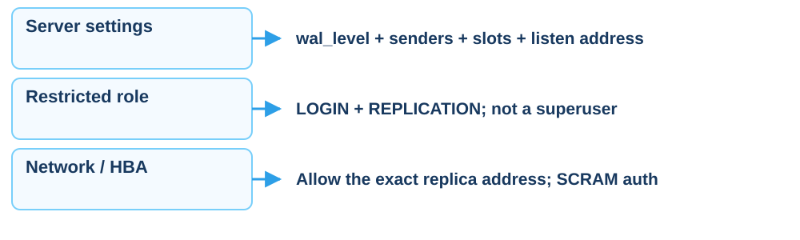

<p class="cs-concept-caption">ตรวจ settings context ก่อนเลือก reload หรือ restart</p>

<footer class="cs-footer"><span>ClaimSure · Fundamental ก่อน Step 2–4</span><span>6 / 32</span></footer>

<!--
Speaker notes:
อธิบายสามด่าน ได้แก่ settings ของ server, replication role และ network/HBA ดู context ของแต่ละ setting ก่อนเลือกระหว่าง reload กับ restart และทำเฉพาะ cluster แล็บแยก
Technical notes: Not every setting in Step 2 requires a restart. Inspect pg_settings.context and pending_restart. Only restart the dedicated lab cluster when required; never restart a shared classroom server as part of this deck.
Source: ../labs/module-08-replication.md · 2–4
-->

---
layout: default
class: continuous-deck cs-concept-deck cs-module-8
---

# Lab Step 2 · ตั้งค่า primary

ตั้งค่าตามบล็อกเต็มในคู่มือบน **cluster แล็บแยก** แล้วตรวจ:

```sql
SELECT name,setting,context,pending_restart
FROM pg_settings
WHERE name IN ('wal_level','max_wal_senders','max_replication_slots',
               'wal_keep_size','hot_standby','listen_addresses')
ORDER BY name;
```

ต้องมี wal_level = replica หรือ logical และ network ที่ replica เข้าถึงได้

postmaster context ต้อง restart cluster เป้าหมาย; SIGHUP ใช้ reload

<footer class="cs-footer"><span>ClaimSure · Step 2</span><span>7 / 32</span></footer>

<!--
Speaker notes:
เปิดบล็อก configuration เต็มใน Step 2 แล้วอ่าน pg_settings ค่าในคู่มือเป็น teaching values ไม่ใช่ขนาด production context แบบ postmaster ต้อง restart instance เป้าหมาย ส่วน SIGHUP ใช้ reload
Technical notes: The guide lists max_wal_senders=10, max_replication_slots=10 and wal_keep_size=1GB as teaching values, not production sizing. wal_level, sender/slot limits and listen_addresses have start-time contexts; inspect settings rather than declaring the entire block reloadable. Source: https://www.postgresql.org/docs/18/runtime-config-replication.html
Source: ../labs/module-08-replication.md · 2
-->

---
layout: default
class: continuous-deck cs-concept-deck cs-module-8
---

# Lab Step 3–4 · Role และ HBA

```sql
-- If the lab role does not already exist:
CREATE ROLE replicator WITH REPLICATION LOGIN;
\password replicator
```

```text
host replication replicator 10.0.0.12/32 scram-sha-256
```

Single-host ใช้ `127.0.0.1/32` แทน host ตัวอย่าง แล้ว reload HBA

```sql
SELECT pg_reload_conf();
```

<footer class="cs-footer"><span>ClaimSure · Step 3–4</span><span>8 / 32</span></footer>

<!--
Speaker notes:
ตรวจ role ก่อนสร้าง และใช้ backslash password ตั้งรหัสแบบ interactive แทนรหัสตัวอย่าง อนุญาตเฉพาะ IP ของ replica ใน HBA แล้วทดสอบ authentication จากเครื่อง replica ก่อน clone
Technical notes: The deck uses interactive psql password entry instead of the guide placeholder password. Check role existence before CREATE ROLE. Use the actual allocated replica host, not a broad CIDR. Verify authentication from the replica host using the Step 4 connection test before cloning. REPLICATION privilege must not imply application ownership or superuser.
Source: ../labs/module-08-replication.md · 3–4
-->

---
layout: default
class: continuous-deck cs-concept-deck cs-module-8 cs-fundamental
---

# Step 5 / 10–11 · Fundamental: Slot และ WAL

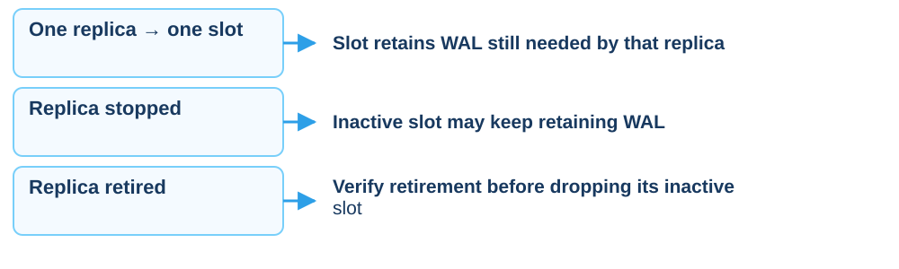

<p class="cs-concept-caption">Slot ช่วยเก็บ WAL แต่ต้องติดตามพื้นที่และอายุของ replica</p>

<footer class="cs-footer"><span>ClaimSure · Fundamental ก่อน Step 5 / 10–11</span><span>9 / 32</span></footer>

<!--
Speaker notes:
Slot เก็บ WAL ที่ replica ยังต้องใช้ แม้ replica หยุดไปแล้ว primary ก็อาจเก็บ WAL ต่อ จึงต้องติดตาม disk และ lifecycle ของ slot ไม่ลบ slot ที่ consumer ยังต้องใช้งาน
Technical notes: Follow the numbered native lab guide. Use dedicated lab instances, record actual results, and confirm the target node before each command.
Source: ../labs/module-08-replication.md · 5 / 10–11
-->

---
layout: default
class: continuous-deck cs-concept-deck cs-module-8
---

# Lab Step 5 · สร้าง physical slot

```sql
SELECT * FROM pg_create_physical_replication_slot('replica_slot',true);
SELECT slot_name,slot_type,active,restart_lsn
FROM pg_replication_slots;
```

| Phase | Expected |
| --- | --- |
| Before replica connection | physical / active = false |
| After streaming starts | active = true |

<footer class="cs-footer"><span>ClaimSure · Step 5</span><span>10 / 32</span></footer>

<!--
Speaker notes:
สร้าง slot ครั้งเดียวบน primary ชนิด physical ก่อนเชื่อมต่อจะ inactive และเมื่อ streaming ต้อง active หากชื่อมีอยู่แล้วให้ตรวจของเดิมแทนการสั่งสร้างซ้ำ
Technical notes: Run once on the primary after checking the slot does not already exist. One slot belongs to one replica. Reserve WAL immediately with true; keep the replica running or manage the slot lifecycle deliberately.
Source: ../labs/module-08-replication.md · 5
-->

---
layout: default
class: continuous-deck cs-concept-deck cs-module-8 cs-fundamental
---

# Step 6–8 · Fundamental: Base backup และ WAL

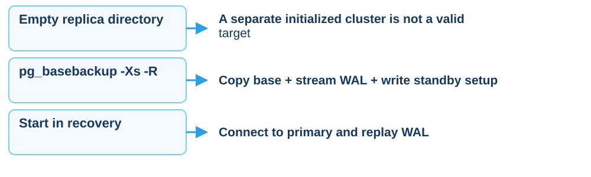

<p class="cs-concept-caption">clone สร้าง standby จาก cluster เดียวกัน แล้วค่อยเปิด streaming</p>

<footer class="cs-footer"><span>ClaimSure · Fundamental ก่อน Step 6–8</span><span>11 / 32</span></footer>

<!--
Speaker notes:
Base backup ต้องมาจาก cluster เดียวกับ WAL ที่จะ replay ปลายทางต้องว่าง ไม่ใช้ initialized cluster อื่นเป็นจุดรับ flag Xs ช่วยส่ง WAL ระหว่าง backup และ R เตรียม standby
Technical notes: Follow the numbered native lab guide. Use dedicated lab instances, record actual results, and confirm the target node before each command.
Source: ../labs/module-08-replication.md · 6–8
-->

---
layout: default
class: continuous-deck cs-concept-deck cs-module-8
---

# Lab Step 6 · เตรียม data directory

- ระบุ `PGDATA_PRIMARY` / `PGDATA_REPLICA` ให้ชัด และเป็นคนละ directory
- หยุด **เฉพาะ replica instance**; ถ้าเครื่องเดียวกัน primary ต้องยังทำงาน
- ทำ Step 6 เต็มจากคู่มือด้วย admin บน replica ที่จัดไว้
- directory ปลายทางต้องว่าง/ไม่มีอยู่ และ OS postgres เขียนได้

```bash
printf 'Replica target: %s\n' "$PGDATA_REPLICA"
pg_ctl -D "$PGDATA_REPLICA" status
```

<p class="cs-takeaway">ตรวจ target ก่อนจัดเตรียม directory ทุกครั้ง</p>

<footer class="cs-footer"><span>ClaimSure · Step 6</span><span>12 / 32</span></footer>

<!--
Speaker notes:
ตรวจ target directory ให้แน่ชัดก่อนทำ Step 6 เต็ม หยุดเฉพาะ replica ไม่หยุด primary ที่อยู่เครื่องเดียวกัน directory ต้องว่างและ postgres เขียนได้ status อาจรายงานว่าไม่มี directory ก่อน clone ซึ่งเป็นผลที่ยอมรับได้
Technical notes: pg_ctl status returning not running is expected for the stopped replica, and may report a missing directory before clone. The native guide contains directory removal commands: perform them only on the dedicated allocated replica target after verifying paths and backups. This slide deliberately delegates that full sequence to the lab guide rather than providing a shortened destructive command.
Source: ../labs/module-08-replication.md · 6
-->

---
layout: default
class: continuous-deck cs-concept-deck cs-module-8
---

# Lab Step 7 · Clone บนเครื่อง replica

```bash
pg_basebackup -h "$PRIMARY_HOST" -p 5432 -U replicator \
  -D "$PGDATA_REPLICA" -Fp -Xs -P -R -S replica_slot
```

| Flag | หน้าที่ |
| --- | --- |
| -Fp / -Xs | plain-format base / stream WAL ระหว่างสำรอง |
| -R | เขียน standby.signal และ primary_conninfo |
| -S | ใช้ physical slot ที่สร้างไว้ |

ตรวจไฟล์ standby และกำหนด replica port = **5433** สำหรับ single host

<footer class="cs-footer"><span>ClaimSure · Step 7</span><span>13 / 32</span></footer>

<!--
Speaker notes:
รัน pg_basebackup ใน shell ของ OS postgres บนเครื่อง replica ตัวแปร host และ path ต้องมาจากใบงาน ตรวจ standby.signal และตั้งพอร์ต replica ไม่ให้ชน primary ก่อน start
Technical notes: Run as OS postgres on the replica host, not inside psql. PRIMARY_HOST and PGDATA_REPLICA must be set from the environment worksheet. -R writes connection information, so do not project credentials from configuration files. Configure the replica instance listener to its own port before start.
Source: ../labs/module-08-replication.md · 7
-->

---
layout: default
class: continuous-deck cs-concept-deck cs-module-8
---

# Lab Step 8 · Start และพิสูจน์ streaming

เริ่มเฉพาะ replica ด้วยวิธีของ instance แล้วตรวจ **primary**:

```sql
SELECT application_name,state,sync_state,sent_lsn,replay_lsn
FROM pg_stat_replication;
SELECT slot_name,active FROM pg_replication_slots;
```

**Replica**:

```sql
SELECT pg_is_in_recovery();
SELECT status,sender_host,slot_name FROM pg_stat_wal_receiver;
```

ต้องเห็น streaming / slot active และ replica recovery = true

<footer class="cs-footer"><span>ClaimSure · Step 8</span><span>14 / 32</span></footer>

<!--
Speaker notes:
เริ่ม replica ด้วย instance-specific command แล้วตรวจทั้งสองฝั่ง primary ต้องเห็น streaming และ slot active ส่วน replica ต้อง recovery true และมี wal receiver เชื่อมอยู่ บันทึก host/port พร้อมผล
Technical notes: On a single host avoid an ambiguous systemctl start postgresql that could target multiple clusters. Use the actual replica instance manager or pg_ctl -D assigned replica path start. Query each role on its own port and label evidence with host and port.
Source: ../labs/module-08-replication.md · 8
-->

---
layout: default
class: continuous-deck cs-concept-deck cs-module-8
---

# Lab Step 9 · Write แล้วอ่านหลัง replay

**Primary**

```sql
UPDATE lab_repl.canary
SET note='streamed to replica',updated_at=clock_timestamp()
WHERE id=1 RETURNING *;
```

**Replica**

```sql
SELECT * FROM lab_repl.canary WHERE id=1;
INSERT INTO lab_repl.canary(id,note) VALUES (2,'should fail');
```

อ่าน note ใหม่หลัง replay; INSERT บน standby ต้องได้ read-only error

<footer class="cs-footer"><span>ClaimSure · Step 9</span><span>15 / 32</span></footer>

<!--
Speaker notes:
เขียน canary บน primary แล้วอ่านบน replica หลัง replay คำสั่ง INSERT บน standby เป็น expected error เพื่อพิสูจน์ read-only อย่าย้ายคำสั่งไป primary เพียงเพื่อให้ผ่าน
Technical notes: The INSERT is an intentional error on the replica. Do not reroute it to the primary merely to make it succeed. A connected receiver is insufficient: prove row visibility after replay.
Source: ../labs/module-08-replication.md · 9
-->

---
layout: default
class: continuous-deck cs-concept-deck cs-module-8 cs-fundamental cs-infographic
---

# Step 10 · Fundamental: Write / Flush / Replay

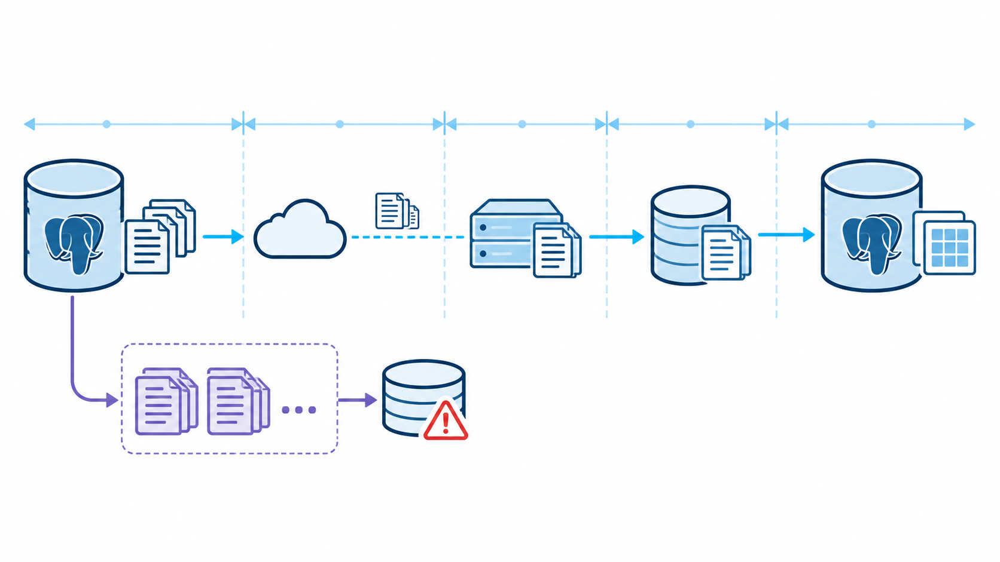

<p class="cs-concept-caption">Receive, write, durable flush และ replay เป็นคนละจุดของ WAL</p>

<footer class="cs-footer"><span>ClaimSure · Fundamental ก่อน Step 10</span><span>16 / 32</span></footer>

<!--
Speaker notes:
แยก receive, OS write, durable flush และ replay ค่า lag เวลาเป็น feedback ที่วัดได้ ไม่ใช่เวลาคาดการณ์จน catch-up และช่วง idle อาจเป็น NULL ให้อ่าน LSN gap และ canary ร่วมกัน
Technical notes: Source image illustrates stages. PostgreSQL write_lag/flush_lag/replay_lag report measured feedback delays for recent WAL, not predicted catch-up time. On an idle caught-up system these timing fields can be NULL; replay timestamp age can grow just because there are no new transactions. Cross-check LSN gaps and a canary. Source: https://www.postgresql.org/docs/18/monitoring-stats.html
Source: ../labs/module-08-replication.md · 10
-->

---
layout: default
class: continuous-deck cs-concept-deck cs-module-8
---

# Lab Step 10 · วัด lag หลายหลักฐาน

```sql
SELECT application_name,write_lag,flush_lag,replay_lag,
       pg_size_pretty(pg_wal_lsn_diff(pg_current_wal_lsn(),replay_lsn))
         AS replay_byte_lag
FROM pg_stat_replication;
```

- อ่านบน primary แล้วเทียบกับ canary บน replica
- timing lag เป็น feedback delay ไม่ใช่เวลารอ catch-up ที่คำนวณล่วงหน้า
- ช่วง idle ค่าเป็น NULL ได้; timestamp เก่าอย่างเดียวไม่พิสูจน์ backlog
- เทียบผลที่วัดกับ RPO ของงาน ก่อนเลือก standby สำหรับ promote

<footer class="cs-footer"><span>ClaimSure · Step 10</span><span>17 / 32</span></footer>

<!--
Speaker notes:
อ่านจาก primary และเทียบผล canary บน replica Byte gap กับ timing lag ตอบคนละคำถาม timestamp replay ที่เก่าเพียงอย่างเดียวไม่พิสูจน์ว่ามี backlog เทียบหลักฐานกับ RPO ก่อนเลือก node สำหรับ promote
Technical notes: pg_wal_lsn_diff compares WAL positions in bytes. Write/flush/replay timing columns and byte gaps answer different questions. Do not call async streaming near-zero RPO without a measured failure scenario. Source: https://www.postgresql.org/docs/18/monitoring-stats.html
Source: ../labs/module-08-replication.md · 10
-->

---
layout: default
class: continuous-deck cs-concept-deck cs-module-8
---

# Lab Step 10 · ตรวจ WAL ที่ slot เก็บ

```sql
SELECT slot_name,active,
       pg_size_pretty(pg_wal_lsn_diff(pg_current_wal_lsn(),restart_lsn))
         AS retained_wal
FROM pg_replication_slots ORDER BY slot_name;
```

Replica หยุดแล้วอาจหายจาก pg_stat_replication แต่ slot ยังเก็บ WAL

ติดตาม disk และ slot lifecycle; ลบ slot เฉพาะ replica ที่เลิกใช้แล้ว
และยืนยันว่าไม่มี consumer ต้องการ WAL นั้น

<footer class="cs-footer"><span>ClaimSure · Step 10</span><span>18 / 32</span></footer>

<!--
Speaker notes:
เมื่อ replica หยุด แถวใน pg_stat_replication หายได้แต่ slot ยังเก็บ WAL ดู retained bytes และ disk ก่อน/หลังทดลอง ไม่ลบ replica_slot ที่ยังเป็นส่วนหนึ่งของแล็บ
Technical notes: Do not drop replica_slot during the active exercise. A slot retention limit can eventually invalidate a lagging consumer, so slots do not promise unlimited recovery time. Record active state and retained bytes before and after the node-down drill.
Source: ../labs/module-08-replication.md · 10
-->

---
layout: default
class: continuous-deck cs-concept-deck cs-module-8
---

# Lab Step 11 · Optional: Replica ตัวที่สอง

1. ทำ Step 5–8 ซ้ำด้วย `replica2_slot`, directory ใหม่ และ port **5434**
2. ตรวจ primary เห็นสอง streaming rows และสอง physical slots
3. เก็บ baseline แล้วหยุดเฉพาะ replica2
4. สร้าง WAL; ตรวจ slot inactive และ retained WAL เพิ่มตามงาน
5. เปิด replica2 กลับ แล้วพิสูจน์ว่า replay ตามทัน

<p class="cs-takeaway">เป็น node-down / catch-up drill · ไม่ promote ในขั้นนี้</p>

<footer class="cs-footer"><span>ClaimSure · Step 11</span><span>19 / 32</span></footer>

<!--
Speaker notes:
ขั้น optional ใช้ replica2_slot, directory ใหม่และพอร์ต 5434 หยุดเฉพาะ replica2 แล้วดู retained WAL จากนั้นเปิดกลับและรอ replay ตามทัน ขั้นนี้ไม่ promote และไม่ใช่ failover
Technical notes: Use an independent data directory, port and slot. This optional drill tests retention and catch-up, not fencing or failover. Keep primary writable and replica1 connected throughout the test.
Source: ../labs/module-08-replication.md · 11
-->

---
layout: default
class: continuous-deck cs-concept-deck cs-module-8 cs-fundamental
---

# Step 12 · Fundamental: Commit acknowledgment

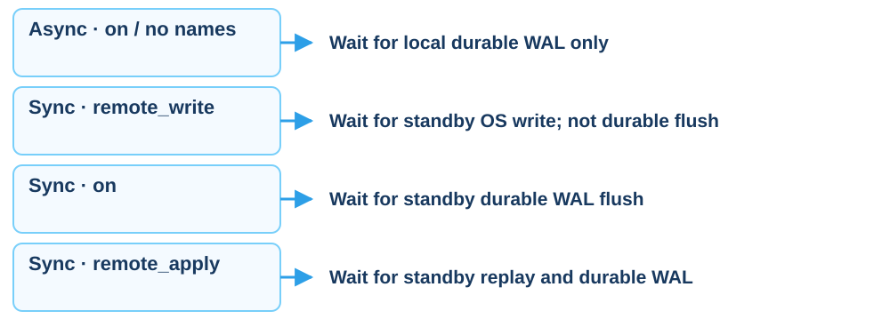

<p class="cs-concept-caption">Sync ต้องกำหนด synchronous_standby_names ให้ตรง application_name</p>

<footer class="cs-footer"><span>ClaimSure · Fundamental ก่อน Step 12</span><span>20 / 32</span></footer>

<!--
Speaker notes:
อ่านเงื่อนไข sync ให้ครบ remote_write รอ OS write แต่ยังไม่รับประกัน durable flush ค่า on เมื่อมี synchronous standby รอ flush และ remote_apply รอ replay ถ้า standby names ว่างจะรอ durable WAL เฉพาะ local
Technical notes: The three sync rows assume a selected synchronous standby. With empty synchronous_standby_names, non-off modes provide local flush only. remote_write does not guarantee survival of a standby OS crash; on waits for durable flush. This clarifies imprecise wording in the course guide. Source: https://www.postgresql.org/docs/18/runtime-config-wal.html
Source: ../labs/module-08-replication.md · 12
-->

---
layout: default
class: continuous-deck cs-concept-deck cs-module-8
---

# Lab Step 12 · เลือก synchronous standby

```sql
ALTER SYSTEM SET synchronous_standby_names='FIRST 1 (replica)';
ALTER SYSTEM SET synchronous_commit='on';
SELECT pg_reload_conf();
SHOW synchronous_commit;
SHOW synchronous_standby_names;
SELECT application_name,sync_state FROM pg_stat_replication;
```

```text
primary_conninfo = 'host=10.0.0.11 port=5432 user=replicator application_name=replica'
```

<footer class="cs-footer"><span>ClaimSure · Step 12</span><span>21 / 32</span></footer>

<!--
Speaker notes:
ทำบน cluster แล็บแยก ตรวจ application_name ให้ตรง replica และเห็น sync_state เป็น sync ก่อนสรุปผล หาก required standby หาย commit อาจรอได้ บันทึก baseline และคืนโหมดตามแผนเมื่อจบ
Technical notes: Dedicated lab cluster only. Replace example host with the actual primary. The replica connection application_name must be replica and sync_state must become sync. Verify a healthy standby before enabling the requirement; commits can wait when the required synchronous standby is unavailable. Restore the allocated lab baseline when ending this optional mode experiment.
Source: ../labs/module-08-replication.md · 12
-->

---
layout: default
class: continuous-deck cs-concept-deck cs-module-8 cs-fundamental cs-infographic
---

# Step 13 · Fundamental: Failover และ HA

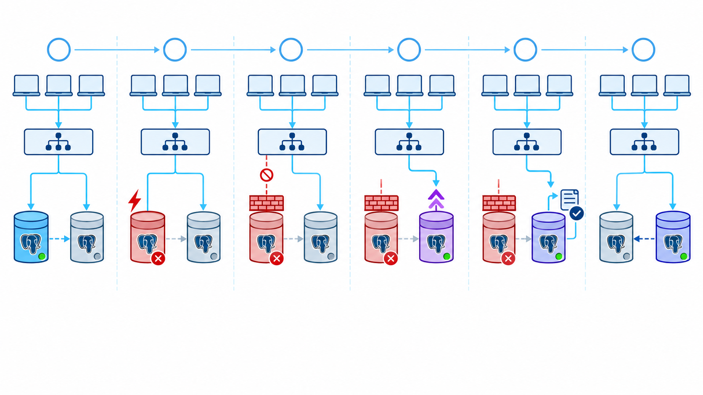

<p class="cs-concept-caption">Fence ก่อน promote · เปลี่ยน routing · ตรวจ write · rejoin เป็น standby</p>

<footer class="cs-footer"><span>ClaimSure · Fundamental ก่อน Step 13a–f</span><span>22 / 32</span></footer>

<!--
Speaker notes:
ภาพ failover แสดงขั้นตอนที่ต้องทำเพิ่มจาก streaming ทำเป็น planned drill บน node ที่จัดไว้เท่านั้น fencing ต้องรับประกันว่า primary เดิม commit ต่อไม่ได้
Technical notes: This is a planned drill on dedicated nodes. Replication does not elect a leader or change client routing automatically. Fence means guaranteeing the old node cannot accept commits, not merely observing a failed health check.
Source: ../labs/module-08-replication.md · 13a–f
-->

---
layout: default
class: continuous-deck cs-concept-deck cs-module-8 cs-fundamental
---

# Step 13 · Fundamental: ลำดับ failover

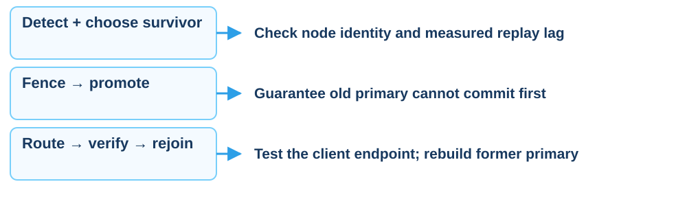

<p class="cs-concept-caption">Connected replica ≠ HA · สอง writable nodes คือ split-brain</p>

<footer class="cs-footer"><span>ClaimSure · Fundamental ก่อน Step 13a–f</span><span>23 / 32</span></footer>

<!--
Speaker notes:
อ่านลำดับ detect, fence, promote, route, verify และ rejoin เน้นว่าการเชื่อม standby อยู่ไม่ใช่ HA และการเปิด writable สองตัวพร้อมกันทำให้เกิด split-brain
Technical notes: Follow the numbered native lab guide. Use dedicated lab instances, record actual results, and confirm the target node before each command.
Source: ../labs/module-08-replication.md · 13a–f
-->

---
layout: default
class: continuous-deck cs-concept-deck cs-module-8
---

# Lab Step 13a–b · Detect และ Fence

- บันทึก primary เดิม, survivor และ replay evidence เทียบ RPO
- จัดการให้ primary เดิม **ไม่สามารถ commit** ก่อน promote
- ใช้วิธีหยุด instance / กั้น write ที่กำหนดไว้สำหรับแล็บ
- ถ้าเครื่องเดียวกัน ให้หยุดเฉพาะ primary เดิม ไม่หยุด survivor
- เก็บหลักฐานว่า endpoint เก่ารับ write ไม่ได้

<p class="cs-takeaway">ทำบน node แล็บที่ระบุชัดและมีแผน rejoin แล้ว</p>

<footer class="cs-footer"><span>ClaimSure · Step 13a–b</span><span>24 / 32</span></footer>

<!--
Speaker notes:
บันทึกตัวตนของ primary เดิมและ survivor พร้อม replay evidence ก่อน fence การ ping ไม่ถึงไม่ยืนยันว่าหยุด commit ใช้วิธี fencing ของ topology แล็บและตรวจผลก่อน promote
Technical notes: An unreachable node is not proof it has stopped committing. Fence with a method appropriate to the dedicated topology. The deck avoids an ambiguous systemctl command because it may stop both instances on a single host. Do not proceed to promotion until fencing is verified.
Source: ../labs/module-08-replication.md · 13a–b
-->

---
layout: default
class: continuous-deck cs-concept-deck cs-module-8
---

# Lab Step 13c · Promote survivor

```sql
SELECT pg_promote();
SELECT pg_is_in_recovery();  -- false after promotion
SHOW transaction_read_only; -- off
```

รันบน replica ที่เลือกหลัง fence สำเร็จเท่านั้น

บันทึก host/port และเวลา promote; พอร์ต native ไม่เปลี่ยนเอง

ถ้าเริ่มที่  port 5433 ยังเป็น  port 5433 จนกว่าจะตั้ง listener/routing ใหม่

<footer class="cs-footer"><span>ClaimSure · Step 13c</span><span>25 / 32</span></footer>

<!--
Speaker notes:
สั่ง promote หลัง fence สำเร็จเท่านั้น ตรวจ recovery false และ read_only off การ promote ไม่เปลี่ยนพอร์ต replica เอง หากเดิมอยู่ 5433 ก็ยังอยู่ 5433 จนกว่าจะปรับ listener หรือ routing
Technical notes: Do not hard-code new primary port 5432 merely because the role changed. The native single-host survivor normally still listens on 5433. Update the pooler backend to the actual survivor address and port.
Source: ../labs/module-08-replication.md · 13c
-->

---
layout: default
class: continuous-deck cs-concept-deck cs-module-8
---

# Lab Step 13d–e · Route และตรวจ write

เปลี่ยน pooler/VIP ไป **host:port ของ primary ใหม่** แล้วรันผ่าน client endpoint:

```sql
INSERT INTO lab_repl.canary(id,note) VALUES (3,'after promote')
ON CONFLICT(id) DO UPDATE
SET note=EXCLUDED.note,updated_at=clock_timestamp()
RETURNING *;
SELECT inet_server_addr(),inet_server_port(),pg_is_in_recovery(),
       current_setting('transaction_read_only');
```

ยืนยัน write สำเร็จ, recovery=false, read_only=off และ endpoint เก่าถูก fence

<footer class="cs-footer"><span>ClaimSure · Step 13d–e</span><span>26 / 32</span></footer>

<!--
Speaker notes:
เปลี่ยน pooler หรือ VIP ไป host และ port จริงของ primary ใหม่ จากนั้นตรวจ canary ผ่าน client endpoint ไม่ใช่ต่อ localhost บน node ใหม่อย่างเดียว ต้องยืนยันว่าเส้นทางแอปเปลี่ยนจริง
Technical notes: Checking localhost on the promoted node does not prove the application route changed. Run verification through the client write endpoint. If application RLS is configured, separately verify the security context through the pooler as in Step 15.
Source: ../labs/module-08-replication.md · 13d–e
-->

---
layout: default
class: continuous-deck cs-concept-deck cs-module-8
---

# Lab Step 13f · Rejoin primary เดิม

1. คง fencing ไว้; data directory เดิมอาจอยู่คนละ timeline
2. ทางเลือกหลักของแล็บ: **fresh base backup** จาก primary ใหม่
3. ใช้ slot ใหม่, standby.signal และ primary_conninfo ที่ชี้ node ใหม่
4. เปิดกลับใน recovery แล้วตรวจ streaming ทั้งสองฝั่ง

```sql
SELECT application_name,state,replay_lsn
FROM pg_stat_replication;
```

pg_rewind เป็นทางเลือกเมื่อ prerequisites ครบ; ไม่เปิด directory เดิมเป็น primary

<footer class="cs-footer"><span>ClaimSure · Step 13f</span><span>27 / 32</span></footer>

<!--
Speaker notes:
คง fencing ไว้ระหว่าง rebuild เลือก fresh base backup จาก primary ใหม่เป็นทางหลักของแล็บ แล้วเปิด primary เดิมกลับเป็น standby เท่านั้น pg_rewind ต้องมี prerequisites ครบ ไม่ใช้แทน rebuild โดยอัตโนมัติ
Technical notes: The native guide recommends a fresh base backup for the lab. pg_rewind has additional prerequisites including checksums or wal_log_hints enabled before divergence and full_page_writes on; do not treat it as an unconditional replacement for a rebuild. Keep the old node isolated until it is configured as a standby and rejoin is verified.
Source: ../labs/module-08-replication.md · 13f
-->

---
layout: default
class: continuous-deck cs-concept-deck cs-module-8 cs-fundamental cs-infographic
---

# Step 14 · Fundamental: Physical / Logical

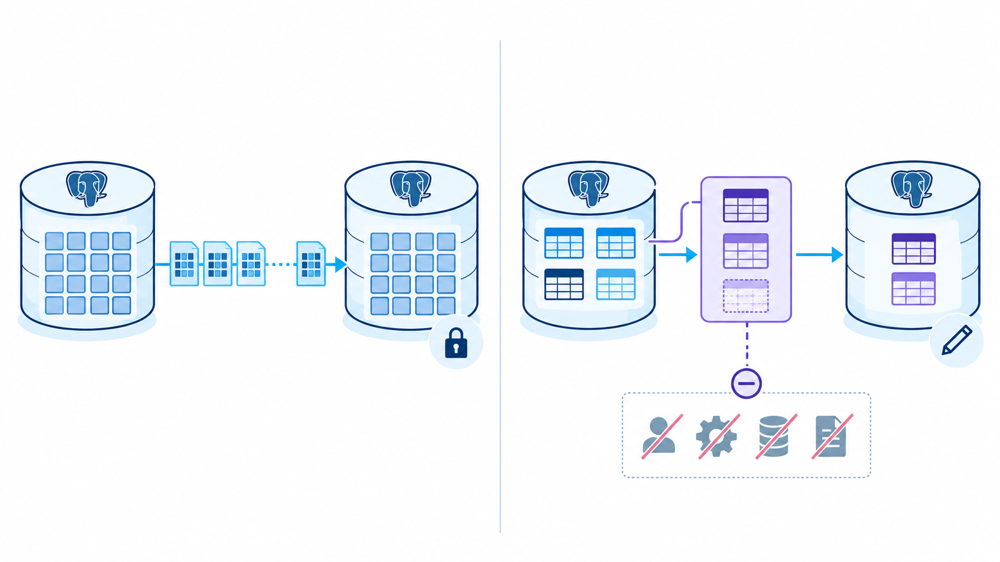

<p class="cs-concept-caption">Physical เป็น standby ทั้ง cluster · Logical เลือกตารางและเตรียม subscriber แยก</p>

<footer class="cs-footer"><span>ClaimSure · Fundamental ก่อน Step 14</span><span>28 / 32</span></footer>

<!--
Speaker notes:
Physical เป็น standby ทั้ง cluster ส่วน logical เลือกตารางส่งไป subscriber แยก ไม่ส่ง roles, sequences หรือ DDL ให้อัตโนมัติ จึงไม่ใช้ publication แทน physical DR
Technical notes: Logical replication does not automatically copy roles, sequences or schema DDL. A publication is not a promotable physical disaster-recovery cluster. The legacy guide example insurance.claim is replaced by the native canary in this deck so it can run without legacy schemas.
Source: ../labs/module-08-replication.md · 14
-->

---
layout: default
class: continuous-deck cs-concept-deck cs-module-8
---

# Lab Step 14 · Optional: Publication

เมื่อ `wal_level = logical` และมีสิทธิ์บนตาราง:

```sql
CREATE PUBLICATION claims_reporting
FOR TABLE lab_repl.canary;
```

- ใช้ canary ที่มีจริง แทน insurance.claim ในตัวอย่างเก่า
- เตรียมตาราง DDL ที่ตรงกันบน subscriber ก่อนสร้าง subscription
- publication อย่างเดียวไม่ได้สร้าง subscriber หรือเริ่มส่งข้อมูล
- เก็บ physical standby เป็น failover target; DDL/roles/sequences ไม่ตามอัตโนมัติ

<footer class="cs-footer"><span>ClaimSure · Step 14</span><span>29 / 32</span></footer>

<!--
Speaker notes:
ตัวอย่างนี้ปรับจาก insurance เป็น canary ที่มีจริง ต้องมี wal_level logical และสิทธิ์ที่เกี่ยวข้อง publication อย่างเดียวยังไม่สร้าง subscriber หรือพิสูจน์การส่งข้อมูล หากโหมดไม่พร้อมให้ข้าม optional ตามแผน
Technical notes: Optional concept exercise adapted to the native canary. If the cluster remains wal_level=replica, skip publication rather than restart shared infrastructure. Subscriber creation is outside this short Step 14 example; report publication creation separately from end-to-end logical replication.
Source: ../labs/module-08-replication.md · 14
-->

---
layout: default
class: continuous-deck cs-concept-deck cs-module-8 cs-fundamental
---

# Step 15 · Fundamental: Transaction pooling

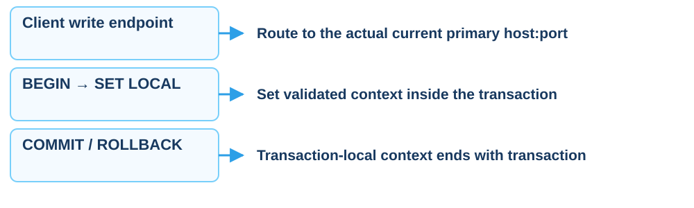

<p class="cs-concept-caption">Routing และ security context ต้องทดสอบผ่าน pooler หลัง failover</p>

<footer class="cs-footer"><span>ClaimSure · Fundamental ก่อน Step 15</span><span>30 / 32</span></footer>

<!--
Speaker notes:
Transaction pool ต้องตั้ง context ภายใน transaction ด้วย SET LOCAL และรับตัวตนจาก trusted boundary การตั้ง GUC เองไม่ใช่การ verify token และ canary นี้ยังไม่มี tenant RLS
Technical notes: Context must come from a trusted identity boundary. A custom GUC is a context value, not token verification. Tenant/RLS examples require the corresponding application roles and policies; the native canary alone does not prove tenant isolation.
Source: ../labs/module-08-replication.md · 15
-->

---
layout: default
class: continuous-deck cs-concept-deck cs-module-8
---

# Lab Step 15 · Pool mode และ context

```sql
BEGIN;
SET LOCAL app.tenant_id='1';
SELECT current_setting('app.tenant_id',true);
-- Run an application query only if its RLS is configured.
COMMIT;
```

- ตัวอย่างจำลอง context; canary ไม่มี tenant RLS ที่สร้างไว้
- transaction pool ใช้ SET LOCAL ภายใน transaction
- หลัง failover ปรับ pooler backend แล้วทดสอบ write/context ซ้ำ
- session state, temp tables และ prepared statements ต้องตรวจตาม pooler/version

<footer class="cs-footer"><span>ClaimSure · Step 15</span><span>31 / 32</span></footer>

<!--
Speaker notes:
บล็อกนี้จำลองอายุ context เท่านั้น ไม่พิสูจน์ tenant isolation หลัง failover ต้องทดสอบ write และ RLS ของแอปจริงผ่าน pooler เมื่อ roles/policies ถูกเตรียมไว้แล้ว ตรวจพฤติกรรม session state ตาม pooler และ version ที่ใช้
Technical notes: Do not claim this arbitrary tenant ID was authenticated or that selecting current_setting proves row isolation. It demonstrates transaction-local scope. Real application RLS tests need roles, policies and validated identity injection. Prepared-statement support depends on pooler configuration and version; avoid categorical claims.
Source: ../labs/module-08-replication.md · 15
-->

---
layout: default
class: continuous-deck cs-concept-deck cs-module-8
---

# Step 1–15 · หลักฐานจบบท

| คู่มือ | สิ่งที่พิสูจน์ |
| --- | --- |
| 1–8 | primary ถูกตัว, slot active, replica recovery=true และ streaming |
| 9–11 | canary replay แล้ว, write ถูกปฏิเสธบน standby, lag/retained WAL |
| 12 | commit mode และ sync_state ตรงเงื่อนไข RPO |
| 13a–f | fence → promote → route → verify → rejoin พร้อมเวลา/host/port |
| 14–15 | แยก physical/logical และทดสอบ pooler/context ตาม scope |

บันทึก optional ที่ข้ามและเหตุผล; เก็บ cluster ตามแผนของอาจารย์

<footer class="cs-footer"><span>ClaimSure · Step 1–15</span><span>32 / 32</span></footer>

<!--
Speaker notes:
ให้นักเรียนส่งหลักฐานตาม Step 1–15 พร้อม host/port เวลาและเหตุผลที่ข้าม optional ขั้น failover ต้องเห็นครบถึง rejoin เมื่อไปบท 9 ให้กลับ environment claimsure_xx เดิม ไม่ใช้ replica cluster นี้แทน
Technical notes: Keep native Step numbering visible throughout the deck; do not label these steps 8A–8E, which refer to a different runner. The course can continue to module 9 in the original claimsure_xx environment; replication lab clusters are separate.
Source: ../labs/module-08-replication.md · 1–15
-->

