<div class="cover-art">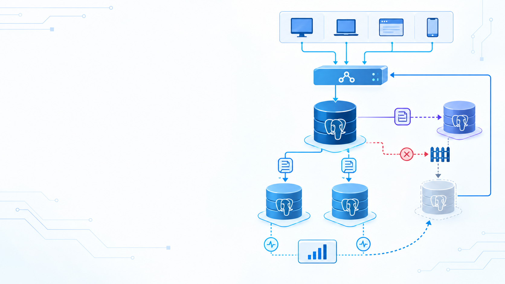</div>

# Module 8<br>Replication & HA

## Stream WAL · measure lag · rehearse failover

<footer class="cs-footer"><span>ClaimSure · Overview / preparation</span><span>1 / 32</span></footer>

<!--
Speaker notes:
Follow the numbered native lab guide. Use dedicated lab instances, record actual results, and confirm the target node before each command.
Source: ../labs/module-08-replication.md · Overview
-->

---
layout: default
class: continuous-deck cs-concept-deck cs-module-8
---

# Preparation · Native instances

| Prerequisite | Scope |
| --- | --- |
| PostgreSQL 16+; example paths use 18 | Dedicated lab clusters, separate from shared claimsure_xx |
| Single host | Primary  port 5432 / replica  port 5433 / optional replica2  port 5434 |
| Two hosts | Consistent PRIMARY_HOST / REPLICA_HOST and HBA |
| Access | PostgreSQL admin for config; OS postgres for cloning |

Follow native Steps 1–15; Compose 3 nodes has a separate guide and port map

<footer class="cs-footer"><span>ClaimSure · Step 1–15</span><span>2 / 32</span></footer>

<!--
Speaker notes:
Choose either native or Compose before starting. This deck follows labs/module-08-replication.md. Do not combine Compose ports or container commands with native data directories. The native guide uses a standalone lab_repl.canary so it does not require legacy insurance tables. Fill in all host/path variables from the actual lab allocation.
Source: ../labs/module-08-replication.md · 1–15
-->

---
layout: default
class: continuous-deck cs-concept-deck cs-module-8 cs-fundamental cs-infographic
---

# Steps 1–8 · Fundamental: Primary and replica

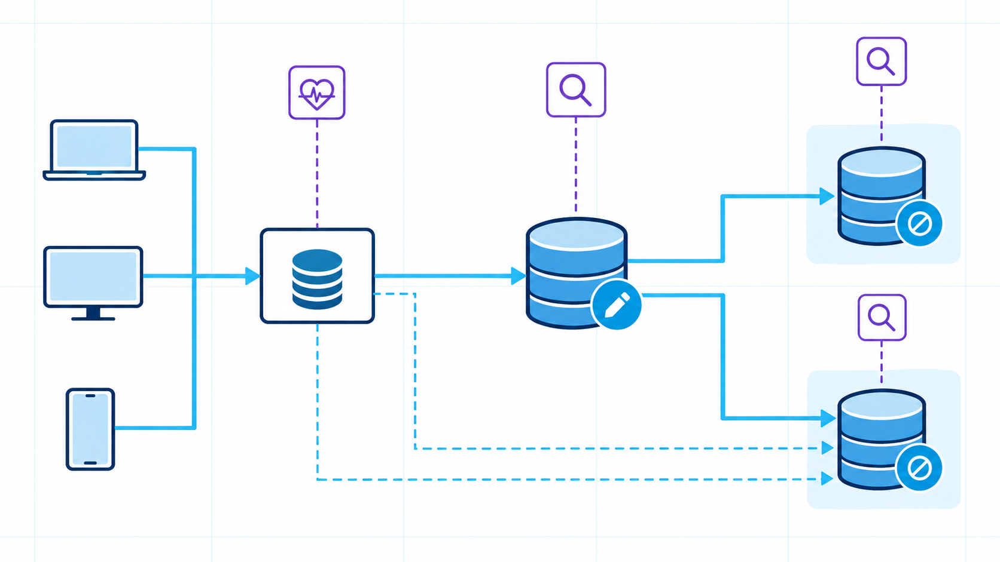

<p class="cs-concept-caption">Primary accepts writes · replica replays WAL · routing selects the endpoint</p>

<footer class="cs-footer"><span>ClaimSure · Fundamental before Step 1–8</span><span>3 / 32</span></footer>

<!--
Speaker notes:
The source image shows a conceptual topology. Native single-host lab ports are 5432 and 5433, with optional 5434. A connected replica alone does not provide fencing, leader election or client routing. Keep the original image unchanged.
Source: ../labs/module-08-replication.md · 1–8
-->

---
layout: default
class: continuous-deck cs-concept-deck cs-module-8
---

# Lab Step 1 · Confirm the primary

```sql
SELECT version();
SELECT pg_is_in_recovery();  -- false on primary
SHOW data_directory;
SHOW port;
```

| Check | Expected |
| --- | --- |
| pg_is_in_recovery() | false |
| directory / port | Match the assigned primary |
| Database / role | Dedicated replication lab, admin connection |

<footer class="cs-footer"><span>ClaimSure · Step 1</span><span>4 / 32</span></footer>

<!--
Speaker notes:
Run on the intended primary. If recovery is true, this is a standby: select the writable lab node before creating objects. Check the actual cluster path and port rather than assuming the system service refers to the right instance.
Source: ../labs/module-08-replication.md · 1
-->

---
layout: default
class: continuous-deck cs-concept-deck cs-module-8
---

# Lab Step 1 · Create a canary

```sql
CREATE SCHEMA IF NOT EXISTS lab_repl;
CREATE TABLE IF NOT EXISTS lab_repl.canary (
  id bigint PRIMARY KEY,
  note text NOT NULL,
  updated_at timestamptz NOT NULL DEFAULT clock_timestamp()
);
INSERT INTO lab_repl.canary (id,note) VALUES (1,'before replica')
ON CONFLICT (id) DO UPDATE
SET note=EXCLUDED.note,updated_at=clock_timestamp();
```

<footer class="cs-footer"><span>ClaimSure · Step 1</span><span>5 / 32</span></footer>

<!--
Speaker notes:
Create the canary before cloning so both the schema and initial row are included in the physical base backup. This replaces the legacy insurance sample for a standalone native lab.
Source: ../labs/module-08-replication.md · 1
-->

---
layout: default
class: continuous-deck cs-concept-deck cs-module-8 cs-fundamental
---

# Steps 2–4 · Fundamental: Replication access

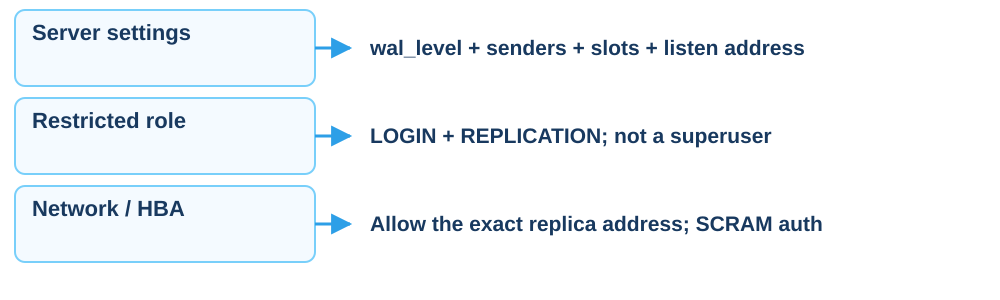

<p class="cs-concept-caption">Inspect setting context before reload or restart</p>

<footer class="cs-footer"><span>ClaimSure · Fundamental before Step 2–4</span><span>6 / 32</span></footer>

<!--
Speaker notes:
Not every setting in Step 2 requires a restart. Inspect pg_settings.context and pending_restart. Only restart the dedicated lab cluster when required; never restart a shared classroom server as part of this deck.
Source: ../labs/module-08-replication.md · 2–4
-->

---
layout: default
class: continuous-deck cs-concept-deck cs-module-8
---

# Lab Step 2 · Configure the primary

Apply the full configuration block in the guide on the **dedicated lab cluster**, then inspect:

```sql
SELECT name,setting,context,pending_restart
FROM pg_settings
WHERE name IN ('wal_level','max_wal_senders','max_replication_slots',
               'wal_keep_size','hot_standby','listen_addresses')
ORDER BY name;
```

wal_level must be replica or logical; the replica must reach the listener

postmaster context needs a target-cluster restart; SIGHUP uses reload

<footer class="cs-footer"><span>ClaimSure · Step 2</span><span>7 / 32</span></footer>

<!--
Speaker notes:
The guide lists max_wal_senders=10, max_replication_slots=10 and wal_keep_size=1GB as teaching values, not production sizing. wal_level, sender/slot limits and listen_addresses have start-time contexts; inspect settings rather than declaring the entire block reloadable. Source: https://www.postgresql.org/docs/18/runtime-config-replication.html
Source: ../labs/module-08-replication.md · 2
-->

---
layout: default
class: continuous-deck cs-concept-deck cs-module-8
---

# Lab Steps 3–4 · Role and HBA

```sql
-- If the lab role does not already exist:
CREATE ROLE replicator WITH REPLICATION LOGIN;
\password replicator
```

```text
host replication replicator 10.0.0.12/32 scram-sha-256
```

For single host use `127.0.0.1/32`, then reload HBA

```sql
SELECT pg_reload_conf();
```

<footer class="cs-footer"><span>ClaimSure · Step 3–4</span><span>8 / 32</span></footer>

<!--
Speaker notes:
The deck uses interactive psql password entry instead of the guide placeholder password. Check role existence before CREATE ROLE. Use the actual allocated replica host, not a broad CIDR. Verify authentication from the replica host using the Step 4 connection test before cloning. REPLICATION privilege must not imply application ownership or superuser.
Source: ../labs/module-08-replication.md · 3–4
-->

---
layout: default
class: continuous-deck cs-concept-deck cs-module-8 cs-fundamental
---

# Steps 5 / 10–11 · Fundamental: Slots and WAL

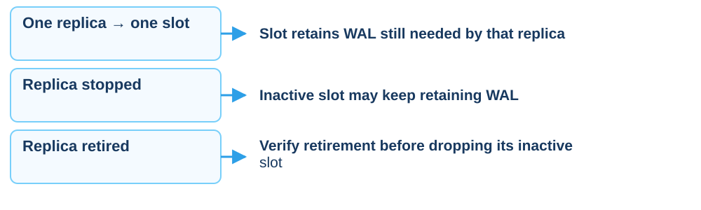

<p class="cs-concept-caption">Slots retain WAL and require disk-space monitoring</p>

<footer class="cs-footer"><span>ClaimSure · Fundamental before Step 5 / 10–11</span><span>9 / 32</span></footer>

<!--
Speaker notes:
Follow the numbered native lab guide. Use dedicated lab instances, record actual results, and confirm the target node before each command.
Source: ../labs/module-08-replication.md · 5 / 10–11
-->

---
layout: default
class: continuous-deck cs-concept-deck cs-module-8
---

# Lab Step 5 · Create a physical slot

```sql
SELECT * FROM pg_create_physical_replication_slot('replica_slot',true);
SELECT slot_name,slot_type,active,restart_lsn
FROM pg_replication_slots;
```

| Phase | Expected |
| --- | --- |
| Before replica connection | physical / active = false |
| After streaming starts | active = true |

<footer class="cs-footer"><span>ClaimSure · Step 5</span><span>10 / 32</span></footer>

<!--
Speaker notes:
Run once on the primary after checking the slot does not already exist. One slot belongs to one replica. Reserve WAL immediately with true; keep the replica running or manage the slot lifecycle deliberately.
Source: ../labs/module-08-replication.md · 5
-->

---
layout: default
class: continuous-deck cs-concept-deck cs-module-8 cs-fundamental
---

# Steps 6–8 · Fundamental: Base backup and WAL

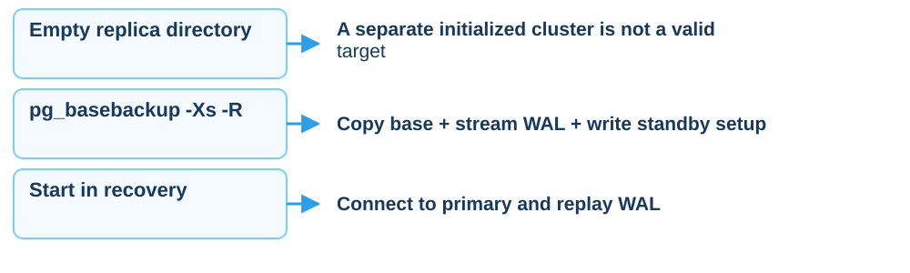

<p class="cs-concept-caption">Clone the same cluster, then start streaming</p>

<footer class="cs-footer"><span>ClaimSure · Fundamental before Step 6–8</span><span>11 / 32</span></footer>

<!--
Speaker notes:
Follow the numbered native lab guide. Use dedicated lab instances, record actual results, and confirm the target node before each command.
Source: ../labs/module-08-replication.md · 6–8
-->

---
layout: default
class: continuous-deck cs-concept-deck cs-module-8
---

# Lab Step 6 · Prepare the data directory

- Identify separate `PGDATA_PRIMARY` and `PGDATA_REPLICA` directories
- Stop **only the replica instance**; keep the primary running on a shared host
- Follow the full Step 6 preparation on the assigned replica with admin access
- The destination must be empty or absent and writable by OS postgres

```bash
printf 'Replica target: %s\n' "$PGDATA_REPLICA"
pg_ctl -D "$PGDATA_REPLICA" status
```

<p class="cs-takeaway">Verify the target before preparing its directory</p>

<footer class="cs-footer"><span>ClaimSure · Step 6</span><span>12 / 32</span></footer>

<!--
Speaker notes:
pg_ctl status returning not running is expected for the stopped replica, and may report a missing directory before clone. The native guide contains directory removal commands: perform them only on the dedicated allocated replica target after verifying paths and backups. This slide deliberately delegates that full sequence to the lab guide rather than providing a shortened destructive command.
Source: ../labs/module-08-replication.md · 6
-->

---
layout: default
class: continuous-deck cs-concept-deck cs-module-8
---

# Lab Step 7 · Clone on the replica host

```bash
pg_basebackup -h "$PRIMARY_HOST" -p 5432 -U replicator \
  -D "$PGDATA_REPLICA" -Fp -Xs -P -R -S replica_slot
```

| Flag | Purpose |
| --- | --- |
| -Fp / -Xs | Plain-format base / stream WAL during backup |
| -R | Write standby.signal and primary_conninfo |
| -S | Use the existing physical slot |

Check standby files and set replica port = **5433** for a single host

<footer class="cs-footer"><span>ClaimSure · Step 7</span><span>13 / 32</span></footer>

<!--
Speaker notes:
Run as OS postgres on the replica host, not inside psql. PRIMARY_HOST and PGDATA_REPLICA must be set from the environment worksheet. -R writes connection information, so do not project credentials from configuration files. Configure the replica instance listener to its own port before start.
Source: ../labs/module-08-replication.md · 7
-->

---
layout: default
class: continuous-deck cs-concept-deck cs-module-8
---

# Lab Step 8 · Start and prove streaming

Start the replica with its instance-specific command; inspect the **primary**:

```sql
SELECT application_name,state,sync_state,sent_lsn,replay_lsn
FROM pg_stat_replication;
SELECT slot_name,active FROM pg_replication_slots;
```

**Replica**:

```sql
SELECT pg_is_in_recovery();
SELECT status,sender_host,slot_name FROM pg_stat_wal_receiver;
```

Expect streaming / active slot and replica recovery = true

<footer class="cs-footer"><span>ClaimSure · Step 8</span><span>14 / 32</span></footer>

<!--
Speaker notes:
On a single host avoid an ambiguous systemctl start postgresql that could target multiple clusters. Use the actual replica instance manager or pg_ctl -D assigned replica path start. Query each role on its own port and label evidence with host and port.
Source: ../labs/module-08-replication.md · 8
-->

---
layout: default
class: continuous-deck cs-concept-deck cs-module-8
---

# Lab Step 9 · Write and read after replay

**Primary**

```sql
UPDATE lab_repl.canary
SET note='streamed to replica',updated_at=clock_timestamp()
WHERE id=1 RETURNING *;
```

**Replica**

```sql
SELECT * FROM lab_repl.canary WHERE id=1;
INSERT INTO lab_repl.canary(id,note) VALUES (2,'should fail');
```

Read the new note after replay; standby INSERT must fail as read-only

<footer class="cs-footer"><span>ClaimSure · Step 9</span><span>15 / 32</span></footer>

<!--
Speaker notes:
The INSERT is an intentional error on the replica. Do not reroute it to the primary merely to make it succeed. A connected receiver is insufficient: prove row visibility after replay.
Source: ../labs/module-08-replication.md · 9
-->

---
layout: default
class: continuous-deck cs-concept-deck cs-module-8 cs-fundamental cs-infographic
---

# Step 10 · Fundamental: Write / flush / replay

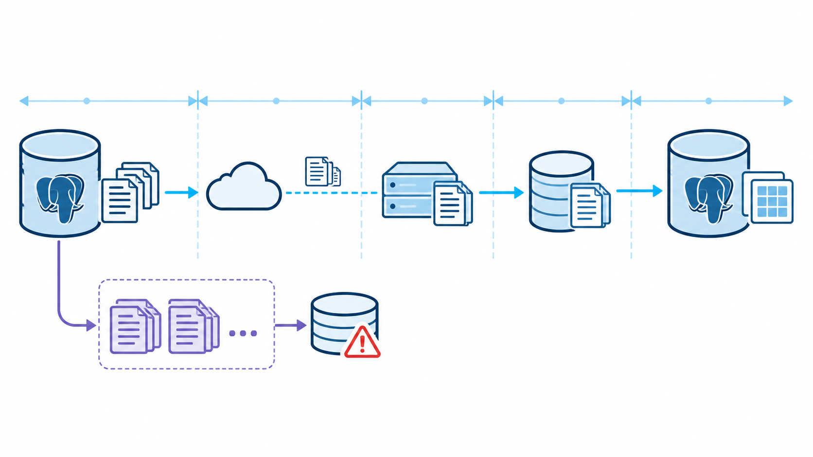

<p class="cs-concept-caption">Receive, write, durable flush and replay are different WAL positions</p>

<footer class="cs-footer"><span>ClaimSure · Fundamental before Step 10</span><span>16 / 32</span></footer>

<!--
Speaker notes:
Source image illustrates stages. PostgreSQL write_lag/flush_lag/replay_lag report measured feedback delays for recent WAL, not predicted catch-up time. On an idle caught-up system these timing fields can be NULL; replay timestamp age can grow just because there are no new transactions. Cross-check LSN gaps and a canary. Source: https://www.postgresql.org/docs/18/monitoring-stats.html
Source: ../labs/module-08-replication.md · 10
-->

---
layout: default
class: continuous-deck cs-concept-deck cs-module-8
---

# Lab Step 10 · Measure lag with several signals

```sql
SELECT application_name,write_lag,flush_lag,replay_lag,
       pg_size_pretty(pg_wal_lsn_diff(pg_current_wal_lsn(),replay_lsn))
         AS replay_byte_lag
FROM pg_stat_replication;
```

- Inspect on primary and compare with the replica canary
- Timing lag is measured feedback delay, not predicted catch-up time
- Idle timing fields may be NULL; an old timestamp alone is not backlog
- Compare measured evidence with RPO before selecting a promotion target

<footer class="cs-footer"><span>ClaimSure · Step 10</span><span>17 / 32</span></footer>

<!--
Speaker notes:
pg_wal_lsn_diff compares WAL positions in bytes. Write/flush/replay timing columns and byte gaps answer different questions. Do not call async streaming near-zero RPO without a measured failure scenario. Source: https://www.postgresql.org/docs/18/monitoring-stats.html
Source: ../labs/module-08-replication.md · 10
-->

---
layout: default
class: continuous-deck cs-concept-deck cs-module-8
---

# Lab Step 10 · Inspect retained WAL

```sql
SELECT slot_name,active,
       pg_size_pretty(pg_wal_lsn_diff(pg_current_wal_lsn(),restart_lsn))
         AS retained_wal
FROM pg_replication_slots ORDER BY slot_name;
```

A stopped replica disappears from pg_stat_replication while its slot retains WAL

Monitor disk and slot lifecycle; drop only a retired replica's slot after
confirming that no consumer still needs that retained WAL

<footer class="cs-footer"><span>ClaimSure · Step 10</span><span>18 / 32</span></footer>

<!--
Speaker notes:
Do not drop replica_slot during the active exercise. A slot retention limit can eventually invalidate a lagging consumer, so slots do not promise unlimited recovery time. Record active state and retained bytes before and after the node-down drill.
Source: ../labs/module-08-replication.md · 10
-->

---
layout: default
class: continuous-deck cs-concept-deck cs-module-8
---

# Lab Step 11 · Optional: Second replica

1. Repeat Steps 5–8 with `replica2_slot`, a new directory and port **5434**
2. Confirm two streaming rows and two physical slots on primary
3. Record baseline, then stop only replica2
4. Generate WAL; inspect its inactive slot and retained WAL
5. Restart replica2 and prove replay catches up

<p class="cs-takeaway">This is a node-down / catch-up drill; do not promote here</p>

<footer class="cs-footer"><span>ClaimSure · Step 11</span><span>19 / 32</span></footer>

<!--
Speaker notes:
Use an independent data directory, port and slot. This optional drill tests retention and catch-up, not fencing or failover. Keep primary writable and replica1 connected throughout the test.
Source: ../labs/module-08-replication.md · 11
-->

---
layout: default
class: continuous-deck cs-concept-deck cs-module-8 cs-fundamental
---

# Step 12 · Fundamental: Commit acknowledgment

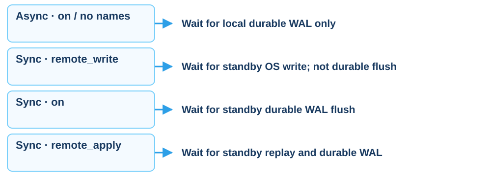

<p class="cs-concept-caption">Sync requires matching synchronous_standby_names and application_name</p>

<footer class="cs-footer"><span>ClaimSure · Fundamental before Step 12</span><span>20 / 32</span></footer>

<!--
Speaker notes:
The three sync rows assume a selected synchronous standby. With empty synchronous_standby_names, non-off modes provide local flush only. remote_write does not guarantee survival of a standby OS crash; on waits for durable flush. This clarifies imprecise wording in the course guide. Source: https://www.postgresql.org/docs/18/runtime-config-wal.html
Source: ../labs/module-08-replication.md · 12
-->

---
layout: default
class: continuous-deck cs-concept-deck cs-module-8
---

# Lab Step 12 · Select a synchronous standby

```sql
ALTER SYSTEM SET synchronous_standby_names='FIRST 1 (replica)';
ALTER SYSTEM SET synchronous_commit='on';
SELECT pg_reload_conf();
SHOW synchronous_commit;
SHOW synchronous_standby_names;
SELECT application_name,sync_state FROM pg_stat_replication;
```

```text
primary_conninfo = 'host=10.0.0.11 port=5432 user=replicator application_name=replica'
```

<footer class="cs-footer"><span>ClaimSure · Step 12</span><span>21 / 32</span></footer>

<!--
Speaker notes:
Dedicated lab cluster only. Replace example host with the actual primary. The replica connection application_name must be replica and sync_state must become sync. Verify a healthy standby before enabling the requirement; commits can wait when the required synchronous standby is unavailable. Restore the allocated lab baseline when ending this optional mode experiment.
Source: ../labs/module-08-replication.md · 12
-->

---
layout: default
class: continuous-deck cs-concept-deck cs-module-8 cs-fundamental cs-infographic
---

# Step 13 · Fundamental: Failover and HA

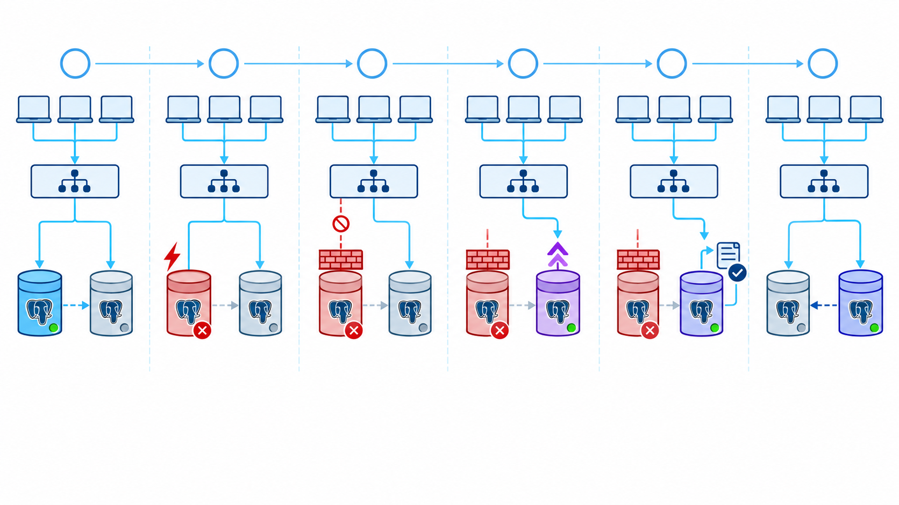

<p class="cs-concept-caption">Fence before promotion · reroute · verify writes · rejoin as standby</p>

<footer class="cs-footer"><span>ClaimSure · Fundamental before Step 13a–f</span><span>22 / 32</span></footer>

<!--
Speaker notes:
This is a planned drill on dedicated nodes. Replication does not elect a leader or change client routing automatically. Fence means guaranteeing the old node cannot accept commits, not merely observing a failed health check.
Source: ../labs/module-08-replication.md · 13a–f
-->

---
layout: default
class: continuous-deck cs-concept-deck cs-module-8 cs-fundamental
---

# Step 13 · Fundamental: Failover sequence

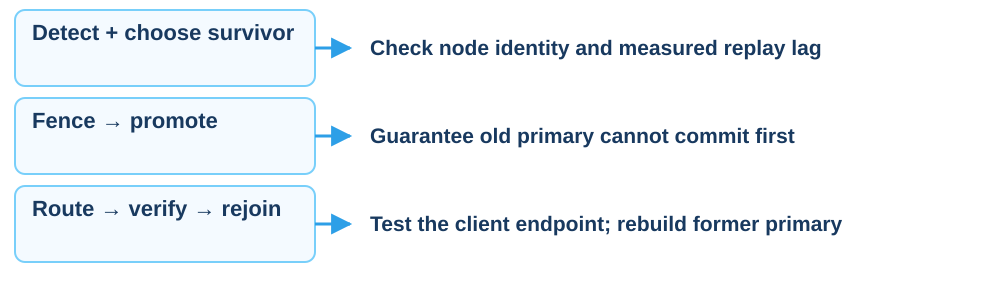

<p class="cs-concept-caption">Connected replica ≠ HA · two writable nodes cause split-brain</p>

<footer class="cs-footer"><span>ClaimSure · Fundamental before Step 13a–f</span><span>23 / 32</span></footer>

<!--
Speaker notes:
Follow the numbered native lab guide. Use dedicated lab instances, record actual results, and confirm the target node before each command.
Source: ../labs/module-08-replication.md · 13a–f
-->

---
layout: default
class: continuous-deck cs-concept-deck cs-module-8
---

# Lab Steps 13a–b · Detect and fence

- Record the old primary, intended survivor and replay evidence against RPO
- Guarantee the old primary **cannot commit** before promotion
- Use the lab's instance-stop or write-fencing procedure
- On a single host, stop only the old primary, keeping the survivor running
- Record evidence that the old write endpoint cannot accept writes

<p class="cs-takeaway">Use identified lab nodes with a prepared rejoin plan</p>

<footer class="cs-footer"><span>ClaimSure · Step 13a–b</span><span>24 / 32</span></footer>

<!--
Speaker notes:
An unreachable node is not proof it has stopped committing. Fence with a method appropriate to the dedicated topology. The deck avoids an ambiguous systemctl command because it may stop both instances on a single host. Do not proceed to promotion until fencing is verified.
Source: ../labs/module-08-replication.md · 13a–b
-->

---
layout: default
class: continuous-deck cs-concept-deck cs-module-8
---

# Lab Step 13c · Promote the survivor

```sql
SELECT pg_promote();
SELECT pg_is_in_recovery();  -- false after promotion
SHOW transaction_read_only; -- off
```

Run on the chosen survivor only after verified fencing

Record host/port and promotion time; promotion does not change its port

A replica on  port 5433 stays on  port 5433 until listener/routing is reconfigured

<footer class="cs-footer"><span>ClaimSure · Step 13c</span><span>25 / 32</span></footer>

<!--
Speaker notes:
Do not hard-code new primary port 5432 merely because the role changed. The native single-host survivor normally still listens on 5433. Update the pooler backend to the actual survivor address and port.
Source: ../labs/module-08-replication.md · 13c
-->

---
layout: default
class: continuous-deck cs-concept-deck cs-module-8
---

# Lab Steps 13d–e · Route and verify writes

Point the pooler/VIP to the **actual new primary host:port**, then use the client endpoint:

```sql
INSERT INTO lab_repl.canary(id,note) VALUES (3,'after promote')
ON CONFLICT(id) DO UPDATE
SET note=EXCLUDED.note,updated_at=clock_timestamp()
RETURNING *;
SELECT inet_server_addr(),inet_server_port(),pg_is_in_recovery(),
       current_setting('transaction_read_only');
```

Confirm write success, recovery=false, read_only=off and the fenced old endpoint

<footer class="cs-footer"><span>ClaimSure · Step 13d–e</span><span>26 / 32</span></footer>

<!--
Speaker notes:
Checking localhost on the promoted node does not prove the application route changed. Run verification through the client write endpoint. If application RLS is configured, separately verify the security context through the pooler as in Step 15.
Source: ../labs/module-08-replication.md · 13d–e
-->

---
layout: default
class: continuous-deck cs-concept-deck cs-module-8
---

# Lab Step 13f · Rejoin the former primary

1. Keep fencing in place; the old data directory may have diverged
2. Preferred lab path: **fresh base backup** from the new primary
3. Use a new slot, standby.signal and primary_conninfo for the new primary
4. Start in recovery and verify streaming from both nodes

```sql
SELECT application_name,state,replay_lsn
FROM pg_stat_replication;
```

pg_rewind is an alternative with prerequisites; never reopen the old node as primary

<footer class="cs-footer"><span>ClaimSure · Step 13f</span><span>27 / 32</span></footer>

<!--
Speaker notes:
The native guide recommends a fresh base backup for the lab. pg_rewind has additional prerequisites including checksums or wal_log_hints enabled before divergence and full_page_writes on; do not treat it as an unconditional replacement for a rebuild. Keep the old node isolated until it is configured as a standby and rejoin is verified.
Source: ../labs/module-08-replication.md · 13f
-->

---
layout: default
class: continuous-deck cs-concept-deck cs-module-8 cs-fundamental cs-infographic
---

# Step 14 · Fundamental: Physical / logical

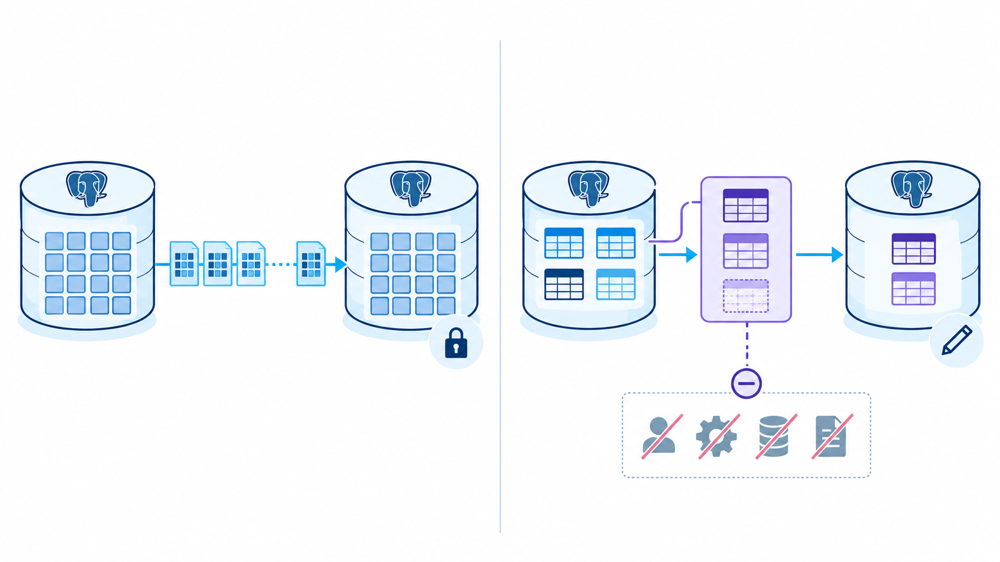

<p class="cs-concept-caption">Physical is a cluster standby · logical selects tables for a separate subscriber</p>

<footer class="cs-footer"><span>ClaimSure · Fundamental before Step 14</span><span>28 / 32</span></footer>

<!--
Speaker notes:
Logical replication does not automatically copy roles, sequences or schema DDL. A publication is not a promotable physical disaster-recovery cluster. The legacy guide example insurance.claim is replaced by the native canary in this deck so it can run without legacy schemas.
Source: ../labs/module-08-replication.md · 14
-->

---
layout: default
class: continuous-deck cs-concept-deck cs-module-8
---

# Lab Step 14 · Optional: Publication

With `wal_level = logical` and the required table privileges:

```sql
CREATE PUBLICATION claims_reporting
FOR TABLE lab_repl.canary;
```

- Use the existing canary instead of legacy insurance.claim
- Prepare matching table DDL on the subscriber before subscription
- A publication alone does not create a subscriber or start delivery
- Keep physical standby for failover; DDL/roles/sequences do not copy automatically

<footer class="cs-footer"><span>ClaimSure · Step 14</span><span>29 / 32</span></footer>

<!--
Speaker notes:
Optional concept exercise adapted to the native canary. If the cluster remains wal_level=replica, skip publication rather than restart shared infrastructure. Subscriber creation is outside this short Step 14 example; report publication creation separately from end-to-end logical replication.
Source: ../labs/module-08-replication.md · 14
-->

---
layout: default
class: continuous-deck cs-concept-deck cs-module-8 cs-fundamental
---

# Step 15 · Fundamental: Transaction pooling

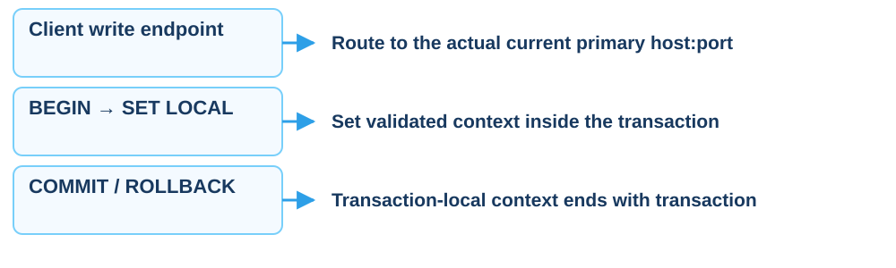

<p class="cs-concept-caption">Test routing and security context through the pooler after failover</p>

<footer class="cs-footer"><span>ClaimSure · Fundamental before Step 15</span><span>30 / 32</span></footer>

<!--
Speaker notes:
Context must come from a trusted identity boundary. A custom GUC is a context value, not token verification. Tenant/RLS examples require the corresponding application roles and policies; the native canary alone does not prove tenant isolation.
Source: ../labs/module-08-replication.md · 15
-->

---
layout: default
class: continuous-deck cs-concept-deck cs-module-8
---

# Lab Step 15 · Pool mode and context

```sql
BEGIN;
SET LOCAL app.tenant_id='1';
SELECT current_setting('app.tenant_id',true);
-- Run an application query only if its RLS is configured.
COMMIT;
```

- Context simulation; the canary has no preconfigured tenant RLS
- In transaction pooling, use SET LOCAL inside the transaction
- After failover, update the backend and retest writes/context
- Test session state, temp tables and prepared statements for your pooler/version

<footer class="cs-footer"><span>ClaimSure · Step 15</span><span>31 / 32</span></footer>

<!--
Speaker notes:
Do not claim this arbitrary tenant ID was authenticated or that selecting current_setting proves row isolation. It demonstrates transaction-local scope. Real application RLS tests need roles, policies and validated identity injection. Prepared-statement support depends on pooler configuration and version; avoid categorical claims.
Source: ../labs/module-08-replication.md · 15
-->

---
layout: default
class: continuous-deck cs-concept-deck cs-module-8
---

# Steps 1–15 · Completion evidence

| Guide | Required evidence |
| --- | --- |
| 1–8 | Correct primary, active slot, replica recovery=true and streaming |
| 9–11 | Replayed canary, rejected standby write, lag and retained WAL |
| 12 | Commit mode and sync_state match the RPO requirement |
| 13a–f | Fence → promote → route → verify → rejoin, with time/host/port |
| 14–15 | Physical/logical scope and pooler/context verification |

Record skipped optional work and reasons; retain clusters per the instructor's plan

<footer class="cs-footer"><span>ClaimSure · Step 1–15</span><span>32 / 32</span></footer>

<!--
Speaker notes:
Keep native Step numbering visible throughout the deck; do not label these steps 8A–8E, which refer to a different runner. The course can continue to module 9 in the original claimsure_xx environment; replication lab clusters are separate.
Source: ../labs/module-08-replication.md · 1–15
-->

