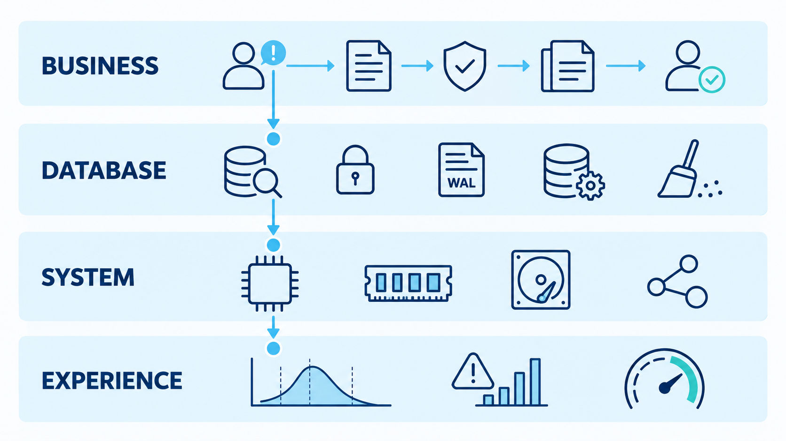
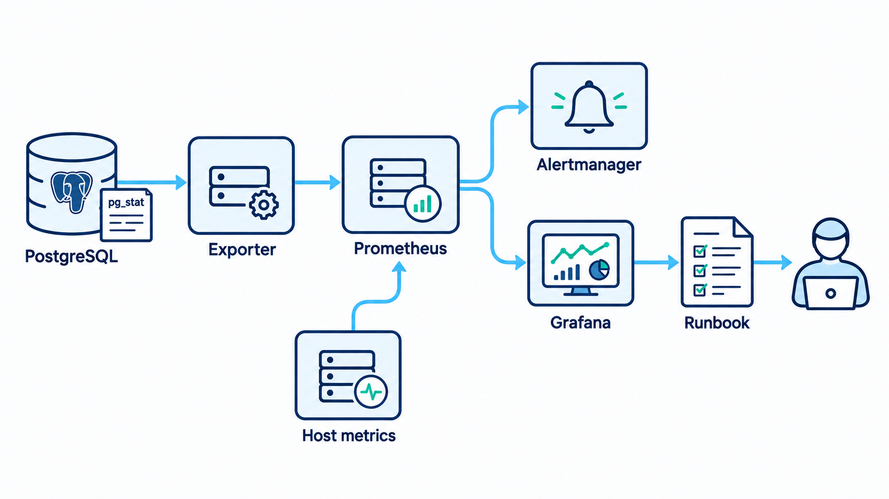
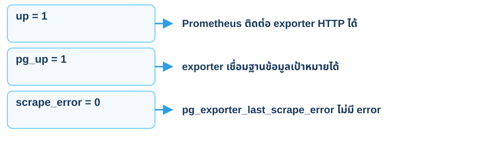
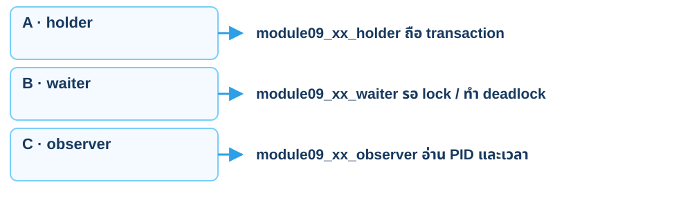
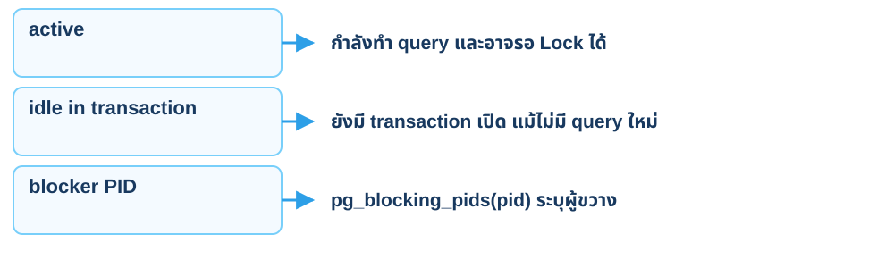
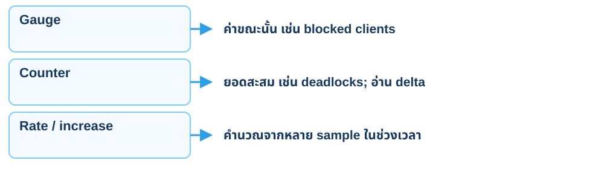
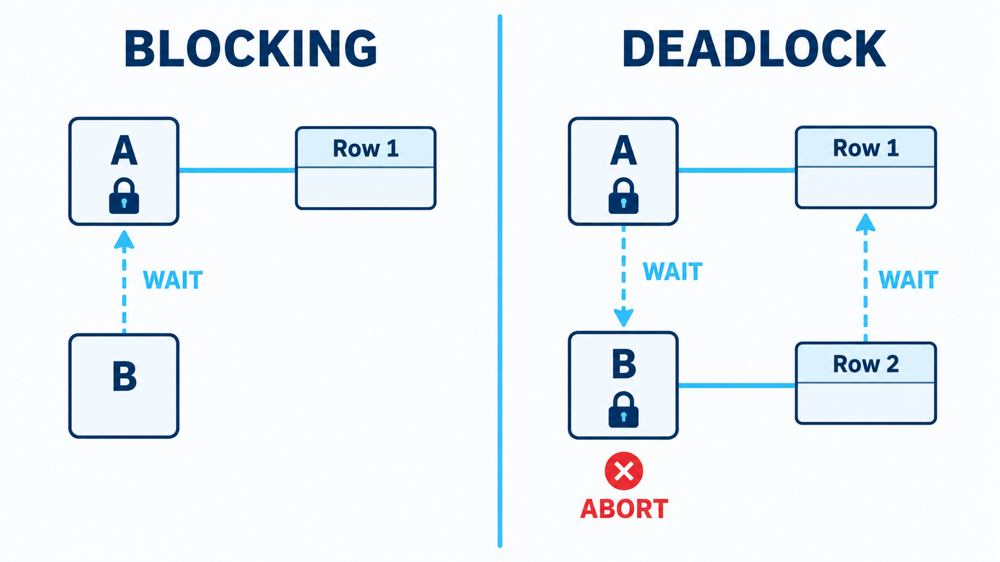
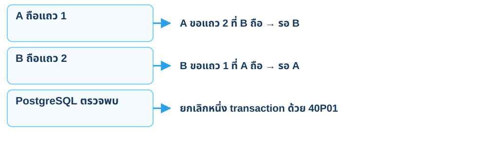
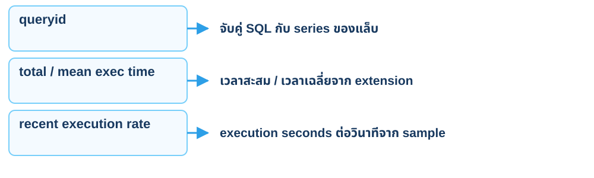
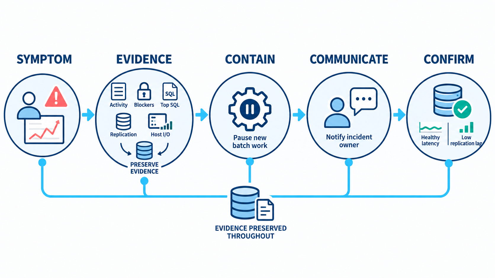

<CaseCover :module-id="9" />

# Module 9<br>Monitoring

## อ่านหลักฐาน SQL และ Grafana บนแล็บของตนเอง

<footer class="cs-footer"><span>ClaimSure · ภาพรวม / เตรียมแล็บ</span><span>1 / 31</span></footer>

<!--
Speaker notes:
เปิดคู่มือหัวข้อนี้และทำทีละขั้นในฐาน claimsure_xx ของตนเอง บันทึกเวลาและผลจริงของรอบทดลอง
Source: ../labs/module-09-monitoring.md · Overview
-->

---
layout: default
class: continuous-deck cs-concept-deck cs-module-9
---

# เตรียม 9A–9G · สภาพแวดล้อมและข้อมูล

| สิ่งที่ใช้ | ขอบเขต |
| --- | --- |
| SSH / direct PostgreSQL 5432 | studentxx / student_xx / claimsure_xx ของตน |
| Session A / B / C | holder / waiter / observer ของนักเรียนคนเดียวกัน |
| lab_m9_shell | workload 20,000 แถว · queue 1,000 · lock_demo 2 |
| claimsure.claim | คง 100,006 แถว และยอดเคลม 001/002 = 15,000 / 22,000 |

อาจารย์เตรียม exporter / Grafana / pg_stat_statements ก่อนเริ่มตามคู่มือ

<footer class="cs-footer"><span>ClaimSure · Lab 9A–9G</span><span>2 / 31</span></footer>

<!--
Speaker notes:
บท 9 รุ่นปัจจุบันสร้าง fixture แยกจาก business tables ให้ใช้คู่มือ module-09-monitoring.md ไม่ใช้ workload เก่าที่แก้ claimsure.claim หรือรัน shell workload ซ้อน native pgbench อาจารย์ใช้ module09-stack.sh init-all --dry-run ตามด้วย init-all และ check บนเครื่องแล็บ นักเรียนไม่ restart shared server
Source: ../labs/module-09-monitoring.md · 9A–9G
-->

---
layout: default
class: continuous-deck cs-concept-deck cs-module-9 cs-fundamental cs-infographic
---

# 9A · Fundamental: ชั้นของหลักฐาน



<p class="cs-concept-caption">SQL เห็นสถานะขณะนั้น · counters สะสม · กราฟช่วยเทียบตามเวลา</p>

<footer class="cs-footer"><span>ClaimSure · Fundamental ก่อน Lab 9A</span><span>3 / 31</span></footer>

<!--
Speaker notes:
ภาพอ้างอิงอธิบายชั้นทั่วไป ในห้องเรียนใช้ activity/statistics, exporter, Prometheus และ Grafana ส่วน host metrics และ application p99 ต้องมี instrumentation เพิ่ม ไม่อนุมานว่ามีจากภาพนี้
Source: ../labs/module-09-monitoring.md · 9A
-->

---
layout: default
class: continuous-deck cs-concept-deck cs-module-9 cs-fundamental cs-infographic
---

# 9A · Fundamental: เส้นทางเมตริก



<p class="cs-concept-caption">ห้องเรียน: PostgreSQL → exporter → Prometheus → Grafana</p>

<footer class="cs-footer"><span>ClaimSure · Fundamental ก่อน Lab 9A</span><span>4 / 31</span></footer>

<!--
Speaker notes:
ภาพเป็นสถาปัตยกรรมอ้างอิง ไม่ได้แปลว่าห้องเรียนติดตั้ง Alertmanager, node_exporter, replica collector หรือ app p99 แล้ว ชุดที่ provision จริงเป็นไปตามคู่มือและ custom claimsure_m9 collector เท่านั้น
Source: ../labs/module-09-monitoring.md · 9A
-->

---
layout: default
class: continuous-deck cs-concept-deck cs-module-9 cs-fundamental
---

# 9A · Fundamental: สุขภาพแต่ละชั้น



<p class="cs-concept-caption">ตรวจให้ครบ 1 / 1 / 0 ก่อนตีความ workload</p>

<footer class="cs-footer"><span>ClaimSure · Fundamental ก่อน Lab 9A</span><span>5 / 31</span></footer>

<!--
Speaker notes:
เปิดคู่มือหัวข้อนี้และทำทีละขั้นในฐาน claimsure_xx ของตนเอง บันทึกเวลาและผลจริงของรอบทดลอง
Source: ../labs/module-09-monitoring.md · 9A
-->

---
layout: default
class: continuous-deck cs-concept-deck cs-module-9
---

# Lab 9A · เปิด Grafana และเลือกฐาน

- เปิด `http://SERVER_IP:3000/d/claimsure-module09` ด้วยบัญชีที่อาจารย์ให้
- เลือก datasource **Prometheus** และฐาน `claimsure_xx` ของตน
- ใช้ Last 15 minutes / refresh 10s; Prometheus scrape ทุก **30s**
- ตรวจสุขภาพ 1 / 1 / 0 แล้วเปิดแดชบอร์ดค้างไว้

<p class="cs-takeaway">Refresh 10s ไม่ได้ทำให้มี sample ใหม่ทุก 10s · rate() ต้องมีอย่างน้อยสอง sample</p>

<footer class="cs-footer"><span>ClaimSure · Lab 9A</span><span>6 / 31</span></footer>

<!--
Speaker notes:
แทน SERVER_IP ด้วยปลายทางจริง อย่านำรหัสผ่านตัวอย่างมาใช้ ข้อมูล Grafana มาช้ากว่า SQL ได้ รอ 60–90 วินาทีเมื่อยังไม่มี sample ของ workload นักเรียนไม่ต้องเปิด exporter ต่อสาธารณะ
Source: ../labs/module-09-monitoring.md · 9A
-->

---
layout: default
class: continuous-deck cs-concept-deck cs-module-9 cs-fundamental
---

# 9A · Fundamental: ติดแท็กเซสชัน



<p class="cs-concept-caption">ทุกเซสชันใช้ฐานและ role ของนักเรียนคนเดียวกัน</p>

<footer class="cs-footer"><span>ClaimSure · Fundamental ก่อน Lab 9A</span><span>7 / 31</span></footer>

<!--
Speaker notes:
เปิดคู่มือหัวข้อนี้และทำทีละขั้นในฐาน claimsure_xx ของตนเอง บันทึกเวลาและผลจริงของรอบทดลอง
Source: ../labs/module-09-monitoring.md · 9A
-->

---
layout: default
class: continuous-deck cs-concept-deck cs-module-9
---

# Lab 9A · เปิด Session A

```bash
STUDENT_NO="${PGDATABASE##*_}"
case "$STUDENT_NO" in
  0[1-9]|1[0-9]|20) ;;
  *) printf 'Replace xx with your assigned number (01-20); expected claimsure_xx\n' >&2; exit 1 ;;
esac
export PGAPPNAME="module09_${STUDENT_NO}_holder"
psql -X -v ON_ERROR_STOP=1
```

ใน Bash B/C ใช้ validation เดียวกัน แล้วเปลี่ยน suffix เป็น `waiter` / `observer`

<footer class="cs-footer"><span>ClaimSure · Lab 9A</span><span>8 / 31</span></footer>

<!--
Speaker notes:
ใช้ environment connection ที่ตั้งใน overview และตรวจ claimsure_xx ก่อนรัน นี่เป็น Bash ไม่ใช่ SQL เซสชัน C ใช้คำสั่งเปิดตามคู่มือ 9B; B ตาม 9D
Source: ../labs/module-09-monitoring.md · 9A
-->

---
layout: default
class: continuous-deck cs-concept-deck cs-module-9
---

# Lab 9A · สร้าง fixture ตามคู่มือ

1. ตรวจ claim count และยอดเคลมเดิม
2. รัน **บล็อก 9A เต็มจากคู่มือ** รวม owner/marker guard และ transaction
3. ถ้า schema มีอยู่แต่ marker ไม่ตรง ให้หยุดตาม guard
4. ตรวจผลหลังสร้าง:

```sql
SELECT (SELECT count(*) FROM lab_m9_shell.workload) AS workload_rows,
       (SELECT identity FROM lab_m9_shell.module_identity WHERE id=1) AS marker;
SELECT id,note FROM lab_m9_shell.lock_demo ORDER BY id;
```

ต้องได้ `20000`, `module09-shell-v1` และสองแถว `ready`

<footer class="cs-footer"><span>ClaimSure · Lab 9A</span><span>9 / 31</span></footer>

<!--
Speaker notes:
สไลด์นี้เป็น checkpoint หลังรัน SQL 9A เต็ม ไม่ใช่สคริปต์สร้าง schema แบบตัด guard ออก Guard ตรวจ ownership และป้องกัน schema ชื่อชน บทนี้ commit การเปลี่ยน fixture ได้ แต่ไม่แก้ยอดเคลมจริง
Source: ../labs/module-09-monitoring.md · 9A
-->

---
layout: default
class: continuous-deck cs-concept-deck cs-module-9 cs-fundamental
---

# 9B · Fundamental: State และ Wait



<p class="cs-concept-caption">ดู state, wait_event, PID และอายุ transaction ร่วมกัน</p>

<footer class="cs-footer"><span>ClaimSure · Fundamental ก่อน Lab 9B</span><span>10 / 31</span></footer>

<!--
Speaker notes:
เปิดคู่มือหัวข้อนี้และทำทีละขั้นในฐาน claimsure_xx ของตนเอง บันทึกเวลาและผลจริงของรอบทดลอง
Source: ../labs/module-09-monitoring.md · 9B
-->

---
layout: default
class: continuous-deck cs-concept-deck cs-module-9
---

# Lab 9B · Session C อ่านเซสชัน

```sql
SELECT pid,application_name,state,wait_event_type,wait_event,
       round(extract(epoch FROM clock_timestamp()-xact_start)::numeric,2)
         AS transaction_seconds,
       pg_blocking_pids(pid) AS blockers,left(query,100) AS query
FROM pg_stat_activity
WHERE datname=current_database() AND usename=current_user
  AND starts_with(application_name,
      'module09_'||right(current_database(),2)||'_')
  AND pid<>pg_backend_pid()
ORDER BY pid;
```

รันซ้ำระหว่างทดลอง หรือ `\watch 1` แล้ว Ctrl+C เพื่อหยุด

<footer class="cs-footer"><span>ClaimSure · Lab 9B</span><span>11 / 31</span></footer>

<!--
Speaker notes:
Observer ถูกนับใน Grafana tagged sessions แต่ query นี้ตัด PID ของตัวเองออก อย่าตีความ state active ว่าใช้ CPU ตลอดเวลา รันใน autocommit เพื่อไม่อ่าน snapshot เก่าค้างใน transaction
Source: ../labs/module-09-monitoring.md · 9B
-->

---
layout: default
class: continuous-deck cs-concept-deck cs-module-9 cs-fundamental
---

# 9C · Fundamental: Gauge, Counter, Rate



<p class="cs-concept-caption">rate() ว่างช่วงแรกได้ · increase() อาจเป็นเศษส่วน</p>

<footer class="cs-footer"><span>ClaimSure · Fundamental ก่อน Lab 9C</span><span>12 / 31</span></footer>

<!--
Speaker notes:
ไม่ล้าง statistics เพื่อให้ counter เริ่มศูนย์ ค่าจาก Prometheus มีการประมาณตามช่วงเวลา ตีความชนิดเมตริกก่อนเทียบกับ SQL
Source: ../labs/module-09-monitoring.md · 9C
-->

---
layout: default
class: continuous-deck cs-concept-deck cs-module-9
---

# Lab 9C · เขียนไฟล์ workload

```bash
mkdir -p "$HOME/case-labs"
cat > "$HOME/case-labs/m9-workload.sql" <<'SQL'
\set bucket random(0,99)
\set q random(1,900)
BEGIN;
SELECT sum(amount) FROM lab_m9_shell.workload WHERE bucket=:bucket;
UPDATE lab_m9_shell.queue SET touches=touches+1
WHERE id BETWEEN :q AND (:q+9);
COMMIT;
SQL
```

ออก psql A ด้วย `\q` ก่อนเขียนไฟล์ใน Bash

<footer class="cs-footer"><span>ClaimSure · Lab 9C</span><span>13 / 31</span></footer>

<!--
Speaker notes:
ไฟล์นี้เป็น pgbench script ข้อมูลที่เปลี่ยนอยู่ใน lab_m9_shell.queue เท่านั้น ไม่รัน module09-workload.sh ซ้อนกับ native pgbench นี้
Source: ../labs/module-09-monitoring.md · 9C
-->

---
layout: default
class: continuous-deck cs-concept-deck cs-module-9
---

# Lab 9C · รัน 120 วินาที

```bash
PGAPPNAME="module09_${STUDENT_NO}_workload" \
  pgbench -n -c 2 -j 1 -T 120 -P 10 \
  -f "$HOME/case-labs/m9-workload.sql"
```

| หลักฐาน | สิ่งที่ตรวจ |
| --- | --- |
| pgbench | transaction count / latency / TPS ของรอบนี้ |
| Session C | สอง client ที่ติดแท็ก; อาจชน lock สั้น ๆ |
| Grafana | SQL calls/s, transactions/s, Top lab SQL |
| ระยะเวลา | ครอบคลุม scrape 30s มากกว่าหนึ่งรอบ |

<footer class="cs-footer"><span>ClaimSure · Lab 9C</span><span>14 / 31</span></footer>

<!--
Speaker notes:
ใช้ STUDENT_NO ที่ผ่าน validation แล้วใน Bash A ถ้าเปิด shell ใหม่ให้รัน validation จาก 9A/9C ใหม่ TPS เครื่องแล็บไม่ใช่ production SLA แผงเวลาของ query ID เป็น execution seconds per second ไม่ใช่ mean latency หรือ p99
Source: ../labs/module-09-monitoring.md · 9C
-->

---
layout: default
class: continuous-deck cs-concept-deck cs-module-9
---

# Lab 9C · ตรวจผลและข้อมูลเดิม

```sql
SELECT sum(touches) AS committed_queue_touches FROM lab_m9_shell.queue;
SELECT count(*) AS expected_100006 FROM claimsure.claim;
SELECT claim_no,estimated_amount FROM claimsure.claim
WHERE claim_no IN ('CLM-L1-001','CLM-L1-002') ORDER BY claim_no;
SELECT datname,xact_commit,xact_rollback,deadlocks,temp_bytes
FROM pg_stat_database WHERE datname=current_database();
```

Touches > 0; เคลม 001/002 คง 15000 / 22000; temp bytes เป็น 0 ได้

<footer class="cs-footer"><span>ClaimSure · Lab 9C</span><span>15 / 31</span></footer>

<!--
Speaker notes:
Counter ใน pg_stat_database เป็นระดับฐานรวมงานอื่น จดค่าก่อนและหลังเพื่อคำนวณ delta Dead tuples เป็นค่าประมาณและอาจลดลงเพราะ autovacuum ไม่ reset pg_stat_statements หรือ monitoring history
Source: ../labs/module-09-monitoring.md · 9C
-->

---
layout: default
class: continuous-deck cs-concept-deck cs-module-9 cs-fundamental cs-infographic
---

# 9D–9E · Fundamental: Blocking และ Deadlock



<p class="cs-concept-caption">Blocking: ผู้หนึ่งรอ · Deadlock: มีวงจรการรอระหว่าง transaction</p>

<footer class="cs-footer"><span>ClaimSure · Fundamental ก่อน Lab 9D–9E</span><span>16 / 31</span></footer>

<!--
Speaker notes:
ภาพใช้ตัวอย่างทั่วไป ส่วนแล็บปัจจุบันล็อกแถว id 1/2 ใน lab_m9_shell.lock_demo ไม่ล็อก customer หรือ claim จริง
Source: ../labs/module-09-monitoring.md · 9D–9E
-->

---
layout: default
class: continuous-deck cs-concept-deck cs-module-9
---

# Lab 9D · A ถือ lock แล้ว B รอ

**Session A**

```sql
BEGIN;
UPDATE lab_m9_shell.lock_demo SET note='held by module 9' WHERE id=1;
```

**Session B**

```sql
BEGIN;
SET LOCAL lock_timeout='180s';
UPDATE lab_m9_shell.lock_demo SET note='waiter completed' WHERE id=1;
```

ปล่อย B รอ **60–90s** เพื่อให้ Grafana มี sample

<footer class="cs-footer"><span>ClaimSure · Lab 9D</span><span>17 / 31</span></footer>

<!--
Speaker notes:
A/B กลับเข้า psql ด้วย PGAPPNAME holder/waiter หลัง pgbench จบ ใช้ role และฐานของตัวเอง ไม่เปิด transaction ค้างนอกช่วงทดลอง ถ้า B timeout ให้ ROLLBACK แล้วเริ่มใหม่
Source: ../labs/module-09-monitoring.md · 9D
-->

---
layout: default
class: continuous-deck cs-concept-deck cs-module-9
---

# Lab 9D · C จับคู่ blocked / blocker

```sql
SELECT b.pid AS blocked_pid,h.pid AS blocker_pid,
       b.application_name AS blocked_application,
       h.application_name AS blocker_application,
       b.wait_event_type,b.wait_event
FROM pg_stat_activity b
CROSS JOIN LATERAL unnest(pg_blocking_pids(b.pid)) x(pid)
JOIN pg_stat_activity h ON h.pid=x.pid
WHERE b.datname=current_database() AND b.usename=current_user
  AND starts_with(b.application_name,
      'module09_'||right(current_database(),2)||'_');
```

บันทึก PID/เวลาคู่กับแผง Blocked Module 9 clients ≥ 1

<footer class="cs-footer"><span>ClaimSure · Lab 9D</span><span>18 / 31</span></footer>

<!--
Speaker notes:
ตรวจชื่อ holder/waiter ไม่อนุมานจาก PID อย่างเดียว Oldest blocked query และ oldest transaction โตได้ระหว่างรอ เมื่อไม่มี query ใหม่ A มีสถานะ idle in transaction
Source: ../labs/module-09-monitoring.md · 9D
-->

---
layout: default
class: continuous-deck cs-concept-deck cs-module-9
---

# Lab 9D · ปล่อย lock และตรวจคืนค่า

1. **A:** `ROLLBACK;` เพื่อปล่อย lock
2. รอให้ UPDATE ของ **B** จบ แล้ว **B:** `ROLLBACK;`
3. **C** ตรวจสองแถวกลับเป็น `ready` และไม่เหลือ blocked client

```sql
SELECT id,note FROM lab_m9_shell.lock_demo ORDER BY id;
```

<p class="cs-takeaway">Grafana blocked ลดเป็น 0 หลัง scrape ถัดไป · จุดเก่าบนกราฟยังอยู่</p>

<footer class="cs-footer"><span>ClaimSure · Lab 9D</span><span>19 / 31</span></footer>

<!--
Speaker notes:
คืนค่าทั้งสอง session ไม่ใช่ rollback holder เพียงฝั่งเดียว เก็บหลักฐานก่อนปล่อย lock ใช้กับเซสชันแล็บที่ระบุได้เท่านั้น ไม่ยกเลิกเซสชันคนอื่น
Source: ../labs/module-09-monitoring.md · 9D
-->

---
layout: default
class: continuous-deck cs-concept-deck cs-module-9 cs-fundamental
---

# 9E · Fundamental: วงจรการรอ



<p class="cs-concept-caption">ไม่รับประกันว่า B เป็น victim · แอปต้อง retry ทั้ง transaction</p>

<footer class="cs-footer"><span>ClaimSure · Fundamental ก่อน Lab 9E</span><span>20 / 31</span></footer>

<!--
Speaker notes:
เปิดคู่มือหัวข้อนี้และทำทีละขั้นในฐาน claimsure_xx ของตนเอง บันทึกเวลาและผลจริงของรอบทดลอง
Source: ../labs/module-09-monitoring.md · 9E
-->

---
layout: default
class: continuous-deck cs-concept-deck cs-module-9
---

# Lab 9E · A/B ถือคนละแถว

รันใน **ทั้งสอง session** ก่อน แล้วทำ UPDATE ของแต่ละฝั่ง

```sql
\set VERBOSITY verbose
\set ON_ERROR_STOP off
BEGIN;
```

**A**

```sql
UPDATE lab_m9_shell.lock_demo SET note='held by module 9' WHERE id=1;
```

**B**

```sql
UPDATE lab_m9_shell.lock_demo SET note='held by module 9' WHERE id=2;
```

<footer class="cs-footer"><span>ClaimSure · Lab 9E</span><span>21 / 31</span></footer>

<!--
Speaker notes:
เริ่มหลัง 9D rollback ทั้งสองฝั่งแล้ว การปิด ON_ERROR_STOP ชั่วคราวทำเพื่ออ่าน expected deadlock error ใน interactive session ไม่คัดไปรันอัตโนมัติทั้งบท
Source: ../labs/module-09-monitoring.md · 9E
-->

---
layout: default
class: continuous-deck cs-concept-deck cs-module-9
---

# Lab 9E · ขอแถวตรงข้ามตามลำดับ

**A ขอแถว 2 ก่อน** — คำสั่งจะรอ

```sql
UPDATE lab_m9_shell.lock_demo SET note='opposite lock order' WHERE id=2;
```

**B ขอแถว 1 ต่อ** — เกิดวงจร

```sql
UPDATE lab_m9_shell.lock_demo SET note='opposite lock order' WHERE id=1;
```

หนึ่งฝั่งได้ **40P01** อีกฝั่ง UPDATE สำเร็จ **00000**

อ่านผลในแต่ละฝั่งก่อนสั่ง SQL ใหม่ แล้วไปขั้นคืนค่าทั้งสอง session

<footer class="cs-footer"><span>ClaimSure · Lab 9E</span><span>22 / 31</span></footer>

<!--
Speaker notes:
ไม่ระบุว่า session ใดต้องเป็น victim deadlock detector เป็นผู้เลือก แนวแก้ในแอปคือ lock ตามลำดับเดียวกันและ retry ทั้ง transaction ภายในขอบเขตที่กำหนด
Source: ../labs/module-09-monitoring.md · 9E
-->

---
layout: default
class: continuous-deck cs-concept-deck cs-module-9
---

# Lab 9E · SQLSTATE และ ROLLBACK ทั้งคู่

**A และ B** หลัง UPDATE จบ

```sql
\echo Last statement SQLSTATE: :SQLSTATE
ROLLBACK;
\set ON_ERROR_STOP on
```

**C**

```sql
SELECT datname,deadlocks FROM pg_stat_database
WHERE datname=current_database();
SELECT id,note FROM lab_m9_shell.lock_demo ORDER BY id;
```

ใช้ counter delta ยืนยันเหตุการณ์; increase() 5m อาจเป็นเศษส่วน

<footer class="cs-footer"><span>ClaimSure · Lab 9E</span><span>23 / 31</span></footer>

<!--
Speaker notes:
echo ต้องมาก่อน SQL ใหม่เพื่อรักษา SQLSTATE ของคำสั่ง UPDATE สองแถวกลับ ready ทั้ง victim และผู้สำเร็จต้อง rollback อย่า reset counters เพื่อให้กราฟเริ่มศูนย์
Source: ../labs/module-09-monitoring.md · 9E
-->

---
layout: default
class: continuous-deck cs-concept-deck cs-module-9 cs-fundamental
---

# 9F · Fundamental: Query ID และเวลา



<p class="cs-concept-caption">mean_ms และกราฟ execution rate ไม่ใช่ p99 latency</p>

<footer class="cs-footer"><span>ClaimSure · Fundamental ก่อน Lab 9F</span><span>24 / 31</span></footer>

<!--
Speaker notes:
เปิดคู่มือหัวข้อนี้และทำทีละขั้นในฐาน claimsure_xx ของตนเอง บันทึกเวลาและผลจริงของรอบทดลอง
Source: ../labs/module-09-monitoring.md · 9F
-->

---
layout: default
class: continuous-deck cs-concept-deck cs-module-9
---

# Lab 9F · Optional: ตรวจ extension

```sql
SELECT extname,extversion FROM pg_extension
WHERE extname='pg_stat_statements';
```

- อาจารย์ preload และเตรียม extension ในฐานของนักเรียนก่อน
- ถ้าไม่พร้อม ให้ข้าม 9F และบันทึกเหตุผล
- ใช้ database ID + user ID + ข้อความ `lab_m9_shell` จำกัดหลักฐาน
- เก็บ statistics เดิมเพื่อใช้เทียบก่อน/หลัง

<footer class="cs-footer"><span>ClaimSure · Lab 9F</span><span>25 / 31</span></footer>

<!--
Speaker notes:
นักเรียนไม่ ALTER SYSTEM/restart shared server เพื่อเปิด pg_stat_statements ไม่ reset statistics ของห้องเรียน
Source: ../labs/module-09-monitoring.md · 9F
-->

---
layout: default
class: continuous-deck cs-concept-deck cs-module-9
---

# Lab 9F · จับคู่ Top lab SQL

```sql
SELECT queryid,calls,round(total_exec_time::numeric,2) AS total_ms,
       round(mean_exec_time::numeric,2) AS mean_ms,rows,temp_blks_written,
       left(query,120) AS query
FROM pg_stat_statements
WHERE dbid=(SELECT oid FROM pg_database WHERE datname=current_database())
  AND userid=(SELECT oid FROM pg_roles WHERE rolname=current_user)
  AND query LIKE '%lab_m9_shell%'
  AND query NOT LIKE '%pg_stat_statements%'
ORDER BY total_exec_time DESC LIMIT 10;
```

เทียบ queryid กับแผง Top lab SQL by recent execution time

<footer class="cs-footer"><span>ClaimSure · Lab 9F</span><span>26 / 31</span></footer>

<!--
Speaker notes:
SQL ในผลลัพธ์ช่วยอธิบาย queryid; Prometheus เก็บ query ID ไม่เก็บข้อความ SQL ทั้งหมด LIMIT 10 เป็นชุดตัวอย่าง ไม่สรุปว่า total time มากที่สุดคือ root cause เสมอ
Source: ../labs/module-09-monitoring.md · 9F
-->

---
layout: default
class: continuous-deck cs-concept-deck cs-module-9 cs-fundamental cs-infographic
---

# 9G · Fundamental: ลำดับวิเคราะห์เหตุการณ์



<p class="cs-concept-caption">ตรวจสุขภาพ → เลือกเวลา/ฐาน → จับคู่ PID หรือ query ID → ยืนยันหลังแก้</p>

<footer class="cs-footer"><span>ClaimSure · Fundamental ก่อน Lab 9G</span><span>27 / 31</span></footer>

<!--
Speaker notes:
ภาพแสดง runbook ทั่วไป เครื่องมือบางอย่างในภาพอาจไม่ติดตั้งในห้องเรียน ใช้หลักฐาน SQL และแผงที่ provision จริง ไม่อนุมาน host CPU, replica lag หรือ app p99 จากแผง PostgreSQL ของบทนี้
Source: ../labs/module-09-monitoring.md · 9G
-->

---
layout: default
class: continuous-deck cs-concept-deck cs-module-9
---

# Lab 9G · Optional: ตรวจ Prometheus จาก SSH

```bash
: "${PGDATABASE:?}"
curl -fsSG 'http://127.0.0.1:9090/api/v1/query' \
  --data-urlencode "query=up{job=\"postgres\",instance=\"postgres:5432/${PGDATABASE}\"}"
```

ใช้ selector เดียวกันกับ `pg_up` และ `pg_exporter_last_scrape_error`
ตามคำสั่งครบในคู่มือ 9G — ต้องได้ **1 / 1 / 0**

รันบนเครื่องเซิร์ฟเวอร์ผ่าน SSH; `127.0.0.1` คือปลายทาง SSH

<footer class="cs-footer"><span>ClaimSure · Lab 9G</span><span>28 / 31</span></footer>

<!--
Speaker notes:
ไม่ได้สั่งให้ expose Prometheus บน public IP เปิดคู่มือ 9G เพื่อ copy สองคำถามที่เหลือ ตรวจ datasource, target, error ก่อนตีความเมตริกที่หาย
Source: ../labs/module-09-monitoring.md · 9G
-->

---
layout: default
class: continuous-deck cs-concept-deck cs-module-9
---

# Lab 9G · ตรวจ blocked gauge

```bash
curl -fsSG 'http://127.0.0.1:9090/api/v1/query' \
  --data-urlencode "query=claimsure_m9_activity_blocked{job=\"postgres\",datname=\"${PGDATABASE}\"}"
```

| ช่วงที่อ่าน | ค่าที่คาด |
| --- | --- |
| B ยังรอใน 9D และ scrape เห็นแล้ว | ≥ 1 |
| A/B rollback แล้วและ scrape ถัดไป | 0 |
| collector ยังไม่โหลด | series อาจหาย ไม่ตีความเป็นศูนย์ |

<footer class="cs-footer"><span>ClaimSure · Lab 9G</span><span>29 / 31</span></footer>

<!--
Speaker notes:
ถ้าจะเห็น blocked >=1 ต้องถามระหว่าง B รอและหลัง scrape จบแล้ว lock ที่สั้นกว่ารอบ scrape อาจไม่ปรากฏบนกราฟ เมตริกนี้กรอง application prefix ตาม collector
Source: ../labs/module-09-monitoring.md · 9G
-->

---
layout: default
class: continuous-deck cs-concept-deck cs-module-9
---

# 9G / คืนค่า · หลักฐานส่งท้าย

| เหตุการณ์ | หลักฐานที่ต้องเก็บ |
| --- | --- |
| 9C workload | เวลาเริ่ม/จบ, pgbench, touches > 0, query ID |
| 9D blocking | holder/waiter PID, wait event, กราฟก่อน/หลัง |
| 9E deadlock | 40P01, counter delta, สองแถว ready |
| Pipeline | datasource + claimsure_xx + ช่วงเวลา + 1/1/0 |

จบ pgbench และ ROLLBACK A/B; ปล่อย fixture และประวัติ monitoring ไว้ได้

<footer class="cs-footer"><span>ClaimSure · Lab 9G / คืนค่า</span><span>30 / 31</span></footer>

<!--
Speaker notes:
อย่าล้าง dashboard, history หรือ pg_stat_statements เพื่อรีเซ็ตบทเรียน บท 10 ไม่ใช้ fixture นี้ ถ้าต้อง reset fixture ใช้ขั้นคืนค่าในคู่มือของตนเองเท่านั้นโดยเริ่มจาก dry-run
Source: ../labs/module-09-monitoring.md · 9G / คืนค่า
-->

---
layout: default
class: continuous-deck cs-concept-deck cs-module-9
---

# คืนค่า · ตรวจ ClaimSure ก่อนบท 10

```sql
SELECT count(*) AS expected_100006 FROM claimsure.claim;
SELECT claim_no,estimated_amount FROM claimsure.claim
WHERE claim_no IN ('CLM-L1-001','CLM-L1-002') ORDER BY claim_no;
SELECT id,note FROM lab_m9_shell.lock_demo ORDER BY id;
```

ต้องคง **100,006 แถว**, **15000 / 22000** และ lock_demo สองแถว `ready`

บท 10 เพิ่ม JSONB / search / events / RLS บนเคสเดิม

<footer class="cs-footer"><span>ClaimSure · Lab 9G / คืนค่า</span><span>31 / 31</span></footer>

<!--
Speaker notes:
ตรวจคืนค่าตามหัวข้อคืนค่าท้ายคู่มือ บทนี้ไม่ได้ใช้ rollback เพียงอย่างเดียวกับ workload เพราะ touches ใน fixture commit จริง แต่ business claim amounts ไม่เปลี่ยน
Source: ../labs/module-09-monitoring.md · 9G / คืนค่า
-->

