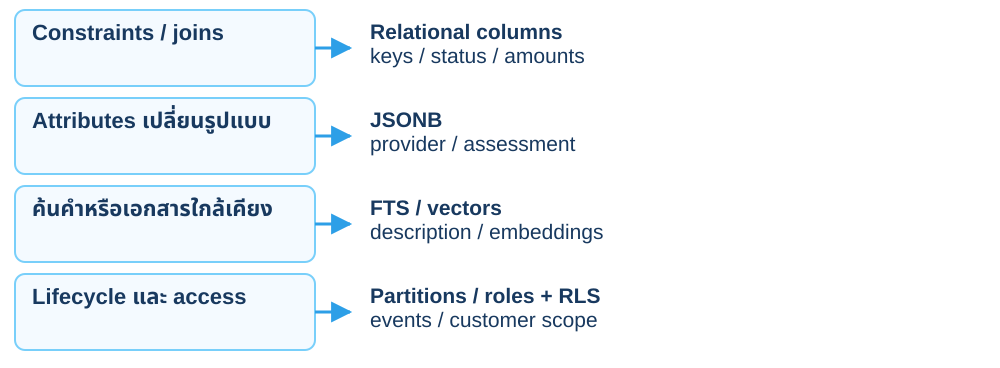
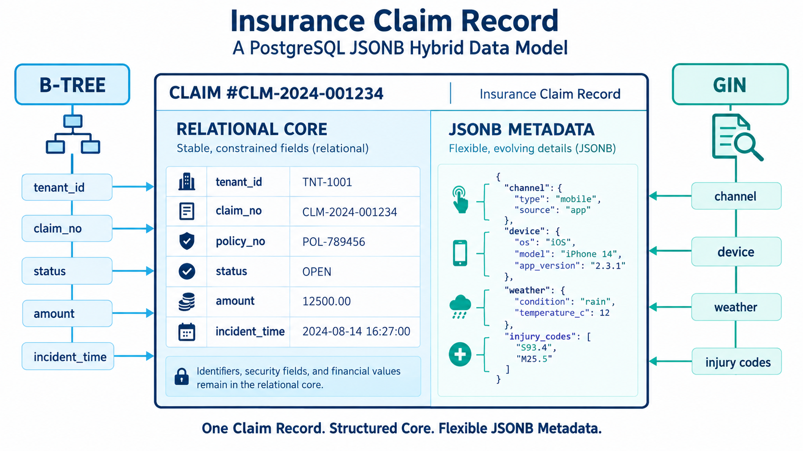
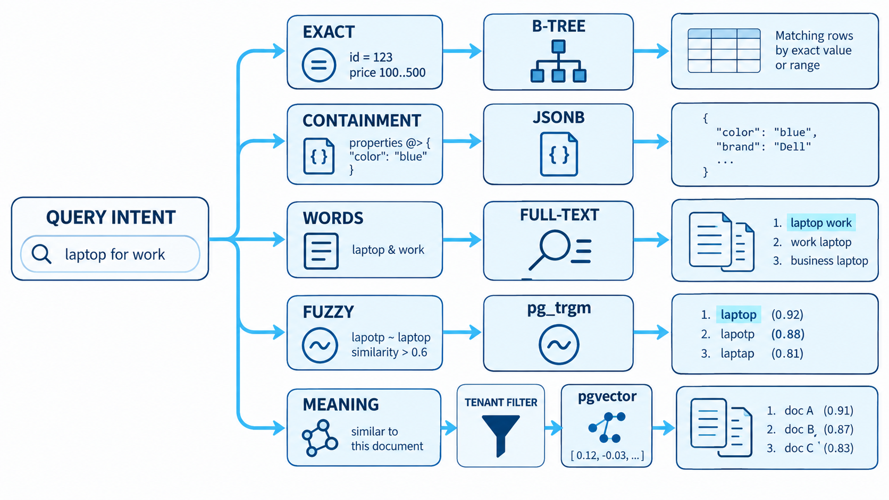
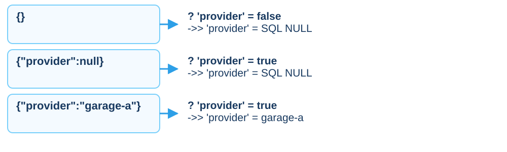
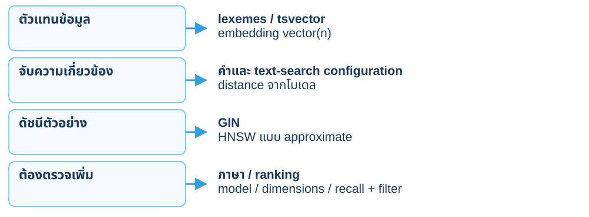
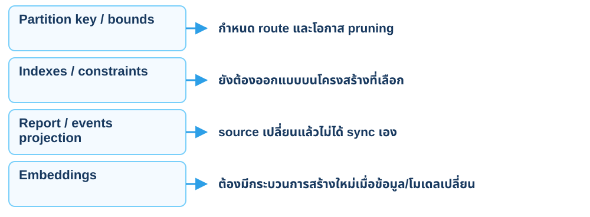
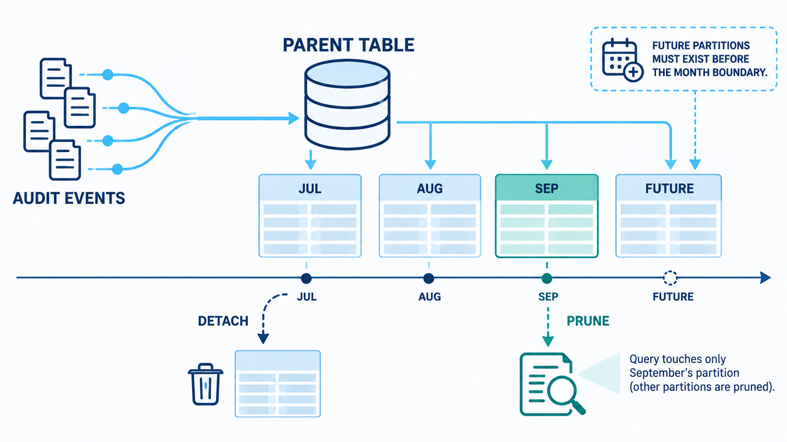
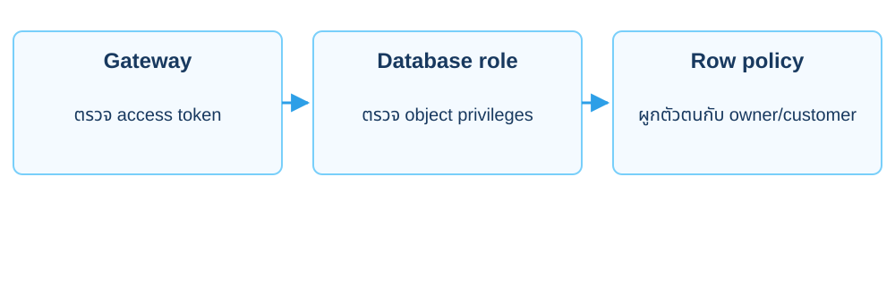
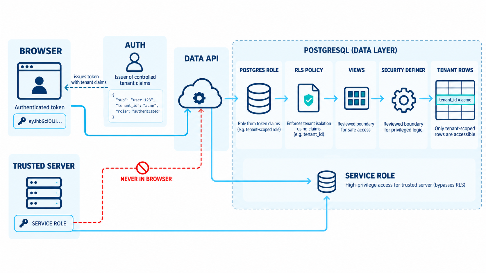

<CaseCover :module-id="10" />

# Module 10<br>Modern PostgreSQL

## JSONB, Search, Events และ Data API ของเคลมเดิม

<footer class="cs-footer"><span>ClaimSure · ภาพรวม / เตรียมแล็บ</span><span>1 / 34</span></footer>

<!--
Speaker notes:
อ้างอิงคู่มือบท 10 หัวข้อ ภาพรวม
บทนี้ใช้ฐานข้อมูล claimsure_xx และ schema claimsure จากบท 1–2 ต่อเนื่องกัน เปิดคู่มือบทนี้ไว้เพื่อทำ SQL/native commands ทีละขั้น ภาพปก: ./assets/module-10-modern-features-cover-enterprise-blue.png

Source: ../labs/module-10-modern-features.md · ภาพรวม
-->

---
layout: default
class: continuous-deck cs-concept-deck cs-module-10 cs-fundamental
---

# 10A · Fundamental: เลือก feature ตามงาน



<p class="cs-concept-caption">เลือกจาก access path และวงจรข้อมูล ไม่ใช่แค่มี feature ให้ใช้</p>

<footer class="cs-footer"><span>ClaimSure · Fundamental ก่อน Lab 10A–10H</span><span>2 / 34</span></footer>

<!--
Speaker notes:
อ้างอิงคู่มือบท 10 หัวข้อ 10A–10H · อธิบายก่อนคำสั่งที่เกี่ยวข้อง
แต่ละ feature แก้คนละปัญหา JSONB ยังอยู่ใน table ที่มี SQL types/constraints ส่วน vector เป็นผลจากโมเดลและการค้นคืน ไม่ใช่ decision engine ของการอนุมัติเคลม

Sources:
- https://www.postgresql.org/docs/18/datatype-json.html
- https://www.postgresql.org/docs/18/textsearch-intro.html
- https://github.com/pgvector/pgvector
Source: ../labs/module-10-modern-features.md · 10A–10H
-->

---
layout: default
class: continuous-deck cs-concept-deck cs-module-10
---

# Lab 10A · ตรวจฐานข้อมูลและของเดิม

<div class="cs-flow"><div><strong>customer / policy</strong><small>ขอบเขตลูกค้าเดิม</small></div><span aria-hidden="true">→</span><div><strong>claim</strong><small>100,006 แถวเดิม</small></div><span aria-hidden="true">→</span><div><strong>view / claim_tax</strong><small>สัญญาอ่านและสูตรบท 2</small></div></div>


<p class="cs-takeaway">metadata / description / GIN รับต่อจากบท 3</p>

<footer class="cs-footer"><span>ClaimSure · คู่มือ Lab 10A</span><span>3 / 34</span></footer>

<!--
Speaker notes:
อ้างอิงคู่มือบท 10 หัวข้อ 10A
บท 9 ต้อง rollback ทุก transaction แล้ว บทนี้ไม่สร้าง claim_feature หรือ profile ที่ไม่เชื่อมกับเคส เพิ่ม features ให้ claim เดิมโดยเก็บ PK/FK/ยอดเงินไว้

Source: ../labs/module-10-modern-features.md · 10A
-->

---
layout: default
class: continuous-deck cs-concept-deck cs-module-10 cs-fundamental cs-infographic
---

# 10A · Fundamental: Relational core + JSONB



<p class="cs-concept-caption">Keys / status / amounts อยู่ใน relational core · attributes เพิ่มเติมอยู่ใน JSONB</p>

<footer class="cs-footer"><span>ClaimSure · Fundamental ก่อน Lab 10A–10B</span><span>4 / 34</span></footer>

<!--
Speaker notes:
อ้างอิงคู่มือบท 10 หัวข้อ 10A–10B · อธิบายก่อนคำสั่งที่เกี่ยวข้อง
ภาพมี tenant_id และ CLM-2024 เป็นตัวอย่าง model ไม่ใช่ schema ที่สร้างเพิ่ม ชุด continuous ใช้ claimsure.claim ที่มี policy_id เชื่อม customer และเก็บ provider/assessment ใน metadata หกเคลมเดิมยังใช้ยอดและ FK ตามบทก่อนหน้า ไม่ย้ายจำนวนเงินเข้า JSON เพื่อเลี่ยง constraints
Source: ../labs/module-10-modern-features.md · 10A–10B
-->

---
layout: default
class: continuous-deck cs-concept-deck cs-module-10 cs-fundamental
---

# 10A · Fundamental: แยก core กับ attributes

| เก็บเป็น column | เก็บใน metadata JSONB |
| --- | --- |
| claim_id / claim_no / policy_id | channel / provider |
| status / incident_at | assessment.priority |
| estimated / approved amount | risk_score ที่ใช้ในตัวอย่าง |


<p class="cs-takeaway">Constraints, joins และยอดเงินหลักยังอยู่ใน relational columns</p>

<footer class="cs-footer"><span>ClaimSure · Fundamental ก่อน Lab 10A–10B</span><span>5 / 34</span></footer>

<!--
Speaker notes:
อ้างอิงคู่มือบท 10 หัวข้อ 10A–10B · อธิบายก่อนคำสั่งที่เกี่ยวข้อง
JSONB ช่วย attributes ที่เปลี่ยนรูปแบบ ไม่ย้ายเงิน/FK ไปซ่อนใน JSON Expression/GIN index ต้องตรงกับ operator ไม่ใช่แค่มี JSONB แล้ว query เร็ว

Source: ../labs/module-10-modern-features.md · 10A–10B
-->

---
layout: default
class: continuous-deck cs-concept-deck cs-module-10
---

# Lab 10A · เก็บค่าก่อนเพิ่ม metadata

```sql
CREATE TEMP TABLE cs_m10_before AS
SELECT claim_id,description,metadata
FROM claimsure.claim WHERE claim_no LIKE 'CLM-L1-%';
```


<p class="cs-takeaway">ค้าง psql connection นี้จนจบ reset · Supabase ใช้อีก Terminal</p>

<footer class="cs-footer"><span>ClaimSure · คู่มือ Lab 10A</span><span>6 / 34</span></footer>

<!--
Speaker notes:
อ้างอิงคู่มือบท 10 หัวข้อ 10A
temporary backup ของ 10A ใช้คืน description/metadata ตอน 10H ถ้าออก connection จะสูญ backup จึงใช้ terminal ใหม่สำหรับ optional Supabase

Source: ../labs/module-10-modern-features.md · 10A
-->

---
layout: default
class: continuous-deck cs-concept-deck cs-module-10
---

# Lab 10A · ตรวจรายละเอียดของหกเคลม

```sql
UPDATE claimsure.claim
SET description=CASE claim_no
 WHEN 'CLM-L1-002' THEN 'urgent repair vehicle accident'
 ELSE 'standard claim review' END,
 metadata=jsonb_build_object('channel','mobile','provider',
 CASE WHEN claim_no IN ('CLM-L1-001','CLM-L1-002')
 THEN 'garage-a' ELSE 'garage-b' END,
 'risk_score',CASE WHEN claim_no='CLM-L1-002'
 THEN 90 ELSE 20 END)
WHERE claim_no LIKE 'CLM-L1-%';
```

<footer class="cs-footer"><span>ClaimSure · คู่มือ Lab 10A</span><span>7 / 34</span></footer>

<!--
Speaker notes:
อ้างอิงคู่มือบท 10 หัวข้อ 10A
รันหลังเก็บ temporary backup แล้ว ยอดเงิน/status/policy ของหกเคลมไม่เปลี่ยน view และ claim_tax บท 2 ยังอ่านค่าเดิม

Source: ../labs/module-10-modern-features.md · 10A
-->

---
layout: default
class: continuous-deck cs-concept-deck cs-module-10 cs-fundamental cs-infographic
---

# 10B–10E · Fundamental: เครื่องมือค้นหา



<p class="cs-concept-caption">Exact / containment / words / meaning ใช้ representation และ index ต่างกัน</p>

<footer class="cs-footer"><span>ClaimSure · Fundamental ก่อน Lab 10B–10E</span><span>8 / 34</span></footer>

<!--
Speaker notes:
อ้างอิงคู่มือบท 10 หัวข้อ 10B–10E · อธิบายก่อนคำสั่งที่เกี่ยวข้อง
ภาพแสดงหลายเครื่องมือรวม pg_trgm ซึ่งไม่ใช่แล็บในคู่มือชุดนี้ 10B เปรียบเทียบ GIN jsonb_path_ops สำหรับ @> กับ expression B-tree สำหรับ ->>; 10C ใช้ generated tsvector/GIN และ simple config; 10E เป็น optional pgvector โดย toy vector(3) ไม่ใช่ embedding model จริง ไม่ใช้ customer filter แทน RLS
Source: ../labs/module-10-modern-features.md · 10B–10E
-->

---
layout: default
class: continuous-deck cs-concept-deck cs-module-10 cs-fundamental
---

# 10B · Fundamental: JSON null และ operators



<p class="cs-concept-caption">GIN jsonb_path_ops รองรับ containment แต่ไม่รองรับ key-existence operator ?</p>

<footer class="cs-footer"><span>ClaimSure · Fundamental ก่อน Lab 10B</span><span>9 / 34</span></footer>

<!--
Speaker notes:
อ้างอิงคู่มือบท 10 หัวข้อ 10B · อธิบายก่อนคำสั่งที่เกี่ยวข้อง
JSON null เป็นค่าในเอกสาร ไม่เท่ากับ key ที่ไม่มีอยู่ แม้ ->> อาจได้ SQL NULL เหมือนกัน ใช้ existence operator ตรวจแยกเมื่อจำเป็น และเลือก index ที่รองรับ operator จริง Expression B-tree เหมาะกับ equality ของ text path

Sources:
- https://www.postgresql.org/docs/18/datatype-json.html
- https://www.postgresql.org/docs/18/functions-json.html
Source: ../labs/module-10-modern-features.md · 10B
-->

---
layout: default
class: continuous-deck cs-concept-deck cs-module-10
---

# Lab 10B · เพิ่ม nested path ของเคลม 002

```sql
UPDATE claimsure.claim
SET metadata=jsonb_set(metadata,'{assessment}',
 '{"priority":"high"}'::jsonb,true)
WHERE claim_no='CLM-L1-002';
SELECT claim_no,metadata#>>'{assessment,priority}' AS priority,
 (metadata->>'risk_score')::integer AS risk_score
FROM claimsure.claim WHERE claim_no LIKE 'CLM-L1-%';
```


<p class="cs-takeaway">->> คืน text · cast เมื่อต้องใช้เป็นตัวเลข</p>

<footer class="cs-footer"><span>ClaimSure · คู่มือ Lab 10B</span><span>10 / 34</span></footer>

<!--
Speaker notes:
อ้างอิงคู่มือบท 10 หัวข้อ 10B
priority เป็น high เฉพาะ 002 path ที่ไม่มีให้ NULL Nested attributes เป็นตัวอย่าง metadata ยืดหยุ่น ไม่ใช่กฎอนุมัติเคลมที่เชื่อจาก client ได้

Source: ../labs/module-10-modern-features.md · 10B
-->

---
layout: default
class: continuous-deck cs-concept-deck cs-module-10
---

# Lab 10B · จับคู่ operator กับ index

| Operator | Index | ผลที่คาด |
| --- | --- | --- |
| metadata @> '{…garage-a…}' | GIN ของบท 3 | 001 และ 002 |
| metadata->>'provider' = 'garage-a' | Expression B-tree | 001 และ 002 |


```sql
CREATE INDEX cs_claim_provider
ON claimsure.claim((metadata->>'provider'));
ANALYZE claimsure.claim;
```

<footer class="cs-footer"><span>ClaimSure · คู่มือ Lab 10B</span><span>11 / 34</span></footer>

<!--
Speaker notes:
อ้างอิงคู่มือบท 10 หัวข้อ 10B
ใช้ EXPLAIN สอง query ใน 10B ไม่สร้าง GIN ซ้ำกับบท 3 ค่า selectivity และขนาดข้อมูลทำให้ planner เลือกต่างกันได้

Source: ../labs/module-10-modern-features.md · 10B
-->

---
layout: default
class: continuous-deck cs-concept-deck cs-module-10 cs-fundamental
---

# 10C · Fundamental: Lexical เทียบ Vector



<p class="cs-concept-caption">Query กับเอกสารต้องใช้ representation ที่เข้ากัน</p>

<footer class="cs-footer"><span>ClaimSure · Fundamental ก่อน Lab 10C–10E</span><span>12 / 34</span></footer>

<!--
Speaker notes:
อ้างอิงคู่มือบท 10 หัวข้อ 10C–10E · อธิบายก่อนคำสั่งที่เกี่ยวข้อง
simple ไม่รับประกันการตัดคำภาษาไทย Embedding document/query ต้องมาจากโมเดลที่เข้ากัน Approximate index อาจคืนผลหลัง filter น้อยกว่า LIMIT ที่ขอ จึงตรวจ recall และขอบเขต customer ร่วมด้วย

Sources:
- https://www.postgresql.org/docs/18/textsearch-intro.html
- https://github.com/pgvector/pgvector
Source: ../labs/module-10-modern-features.md · 10C–10E
-->

---
layout: default
class: continuous-deck cs-concept-deck cs-module-10
---

# Lab 10C · Generated full-text column

```sql
ALTER TABLE claimsure.claim ADD COLUMN search_document tsvector
GENERATED ALWAYS AS (
 to_tsvector('simple',coalesce(description,'')||' '||
             coalesce(metadata->>'provider',''))
) STORED;
CREATE INDEX cs_claim_search_gin
ON claimsure.claim USING gin(search_document);
```


<p class="cs-takeaway">description / provider เปลี่ยน → search_document เปลี่ยนตาม</p>

<footer class="cs-footer"><span>ClaimSure · คู่มือ Lab 10C</span><span>13 / 34</span></footer>

<!--
Speaker notes:
อ้างอิงคู่มือบท 10 หัวข้อ 10C
Generated column คง expression ไว้ใน database ใช้ language config simple เพื่อสาธิต ไม่ยืนยันคุณภาพตัดคำภาษาไทย

Source: ../labs/module-10-modern-features.md · 10C
-->

---
layout: default
class: continuous-deck cs-concept-deck cs-module-10
---

# Lab 10C · ค้น urgent repair ใน seed

```sql
SELECT claim_no,ts_rank(search_document,
 websearch_to_tsquery('simple','urgent repair')) AS rank
FROM claimsure.claim
WHERE claim_no LIKE 'CLM-L1-%'
 AND search_document @@
     websearch_to_tsquery('simple','urgent repair')
ORDER BY rank DESC;
```


<p class="cs-takeaway">ใน seed ต้องได้ CLM-L1-002 · ถ้าไม่กรอง seed จะพบ CLM-L3-* ด้วย</p>

<footer class="cs-footer"><span>ClaimSure · คู่มือ Lab 10C</span><span>14 / 34</span></footer>

<!--
Speaker notes:
อ้างอิงคู่มือบท 10 หัวข้อ 10C
ข้อมูล bulk ของบท 3 มีคำ urgent repair เช่นกัน ต้องระบุขอบเขต expected result ให้ตรง ไม่สรุปว่าคำค้นได้เพียงหนึ่งเคลมทั้งระบบ

Source: ../labs/module-10-modern-features.md · 10C
-->

---
layout: default
class: continuous-deck cs-concept-deck cs-module-10 cs-fundamental
---

# 10D · Fundamental: Partition กับ projection



<p class="cs-concept-caption">แยกที่เก็บข้อมูล กับการทำสำเนา/คำนวณล่วงหน้า</p>

<footer class="cs-footer"><span>ClaimSure · Fundamental ก่อน Lab 10D</span><span>15 / 34</span></footer>

<!--
Speaker notes:
อ้างอิงคู่มือบท 10 หัวข้อ 10D · อธิบายก่อนคำสั่งที่เกี่ยวข้อง
ในเคสนี้ claim ยังเป็นตารางหลัก ส่วน cs_claim_event เป็น projection ที่โหลดจาก incident_at การ detach partition ไม่ลบข้อมูล และการมี partition ไม่แทน freshness/backup plan ของข้อมูลอนุพันธ์

Sources:
- https://www.postgresql.org/docs/18/ddl-partitioning.html
- https://www.postgresql.org/docs/18/rules-materializedviews.html
Source: ../labs/module-10-modern-features.md · 10D
-->

---
layout: default
class: continuous-deck cs-concept-deck cs-module-10 cs-fundamental cs-infographic
---

# 10D · Fundamental: Partition lifecycle



<p class="cs-concept-caption">ภาพใช้เดือน Jul–Sep · แล็บจริง Jan–Mar 2026 · DETACH ไม่ลบแถว</p>

<footer class="cs-footer"><span>ClaimSure · Fundamental ก่อน Lab 10D</span><span>16 / 34</span></footer>

<!--
Speaker notes:
อ้างอิงคู่มือบท 10 หัวข้อ 10D · อธิบายก่อนคำสั่งที่เกี่ยวข้อง
ภาพ lifecycle เป็นแนวคิดเรื่อง routing/pruning/future partitions และ retention ชุด continuous ใช้ cs_claim_event จากหกเคลมเดิม เดือนละสองแถว 10D เพิ่ม partition เมษายนก่อนทดลอง DETACH มกราคมใน transaction แล้ว ROLLBACK ให้ parent กลับหก events ภาพมีถังขยะเป็น retention ทางเลือก แต่ DETACH อย่างเดียวไม่ DROP ตารางและไม่ลบ bytes ภาพ events ไม่ได้ทำให้ projection sync อัตโนมัติ
Source: ../labs/module-10-modern-features.md · 10D
-->

---
layout: default
class: continuous-deck cs-concept-deck cs-module-10 cs-fundamental
---

# 10D · Fundamental: Events จากเคลมเดิม

| เดือน 2026 | เคลมต้นทาง | จำนวน events |
| --- | --- | --- |
| January | CLM-L1-001 / 002 | 2 |
| February | CLM-L1-003 / 004 | 2 |
| March | CLM-L1-005 / 006 | 2 |


<p class="cs-takeaway">cs_claim_event เป็น projection ที่ INSERT จาก claim เดิม</p>

<footer class="cs-footer"><span>ClaimSure · Fundamental ก่อน Lab 10D</span><span>17 / 34</span></footer>

<!--
Speaker notes:
อ้างอิงคู่มือบท 10 หัวข้อ 10D · อธิบายก่อนคำสั่งที่เกี่ยวข้อง
ใช้วันเหตุการณ์จริงจากบท 1 ไม่สร้าง audit_event ที่ไม่เกี่ยวกับเคลม INSERT projection ครั้งเดียวไม่ใช่ audit history อัตโนมัติ ต้องมีวิธี sync/refresh หลังเปลี่ยนหรือ restore core

Source: ../labs/module-10-modern-features.md · 10D
-->

---
layout: default
class: continuous-deck cs-concept-deck cs-module-10
---

# Lab 10D · สร้าง partition ของ claim events

```sql
CREATE TABLE claimsure.cs_claim_event(
 claim_id bigint NOT NULL,policy_id bigint NOT NULL,
 event_time timestamptz NOT NULL,payload jsonb NOT NULL,
 PRIMARY KEY(claim_id,event_time)
) PARTITION BY RANGE(event_time);
CREATE TABLE claimsure.cs_claim_event_2026_02
PARTITION OF claimsure.cs_claim_event
FOR VALUES FROM ('2026-02-01 00:00+07')
             TO ('2026-03-01 00:00+07');
```

<footer class="cs-footer"><span>ClaimSure · คู่มือ Lab 10D</span><span>18 / 34</span></footer>

<!--
Speaker notes:
อ้างอิงคู่มือบท 10 หัวข้อ 10D
ตัวอย่าง parent และหนึ่ง partition สร้าง Jan/Mar ตาม 10D ก่อน INSERT events พร้อม payload ที่มาจากเคลมเดิม

Source: ../labs/module-10-modern-features.md · 10D
-->

---
layout: default
class: continuous-deck cs-concept-deck cs-module-10
---

# Lab 10D · ตรวจ routing และ pruning

```sql
SELECT tableoid::regclass,count(*)
FROM claimsure.cs_claim_event GROUP BY tableoid;
EXPLAIN (ANALYZE,BUFFERS)
SELECT * FROM claimsure.cs_claim_event
WHERE event_time >= '2026-02-01 00:00+07'
  AND event_time <  '2026-03-01 00:00+07';
```


<p class="cs-takeaway">เดือนละสองแถว · query กุมภาพันธ์ควรตัดเดือนอื่นออก</p>

<footer class="cs-footer"><span>ClaimSure · คู่มือ Lab 10D</span><span>19 / 34</span></footer>

<!--
Speaker notes:
อ้างอิงคู่มือบท 10 หัวข้อ 10D
PK รวม event_time ซึ่งเป็น partition key ขอบเขตบน exclusive เหมือนรายงานบท 3 เตรียม partition เมษายนก่อนรับ event ช่วงใหม่

Source: ../labs/module-10-modern-features.md · 10D
-->

---
layout: default
class: continuous-deck cs-concept-deck cs-module-10
---

# Lab 10D · DETACH แล้วตรวจและ ROLLBACK

```sql
BEGIN;
ALTER TABLE claimsure.cs_claim_event DETACH PARTITION
claimsure.cs_claim_event_2026_01;
SELECT count(*) FROM claimsure.cs_claim_event;
SELECT count(*) FROM claimsure.cs_claim_event_2026_01;
ROLLBACK;
```


<p class="cs-takeaway">Parent เหลือ 4 · detached table มี 2 · หลัง rollback กลับ 6</p>

<footer class="cs-footer"><span>ClaimSure · คู่มือ Lab 10D</span><span>20 / 34</span></footer>

<!--
Speaker notes:
อ้างอิงคู่มือบท 10 หัวข้อ 10D
ทำหลังโหลดหก events และสร้าง future partition ตาม 10D การ detach แยกตารางออกจาก parent แต่ข้อมูลยังอยู่ ต้องมี retention policy ที่จัดการ lifecycle ต่อ

Source: ../labs/module-10-modern-features.md · 10D
-->

---
layout: default
class: continuous-deck cs-concept-deck cs-module-10 cs-fundamental
---

# 10E · Fundamental: Vector ของเอกสารเคลม

<div class="cs-flow"><div><strong>ข้อความเอกสาร</strong><small>description ของ claim</small></div><span aria-hidden="true">→</span><div><strong>Embedding model</strong><small>โมเดลเดียวกับคำถาม</small></div><span aria-hidden="true">→</span><div><strong>vector(n)</strong><small>จัดเก็บเพื่อค้นใกล้เคียง</small></div></div>


<p class="cs-takeaway">Question embedding → nearest claims → customer filter → human review</p>

<footer class="cs-footer"><span>ClaimSure · Fundamental ก่อน Lab 10E</span><span>21 / 34</span></footer>

<!--
Speaker notes:
อ้างอิงคู่มือบท 10 หัวข้อ 10E · อธิบายก่อนคำสั่งที่เกี่ยวข้อง
แล็บ 10E ใช้ vector(3) toy data ไม่เรียกโมเดลจริง ระบบจริง document/query ต้องใช้โมเดลและ dimension ที่เข้ากัน nearest ไม่ใช่การอนุมัติเคลมอัตโนมัติ

Source: ../labs/module-10-modern-features.md · 10E
-->

---
layout: default
class: continuous-deck cs-concept-deck cs-module-10
---

# Lab 10E · Optional pgvector ของ claim_id เดิม

| เคลม | ลูกค้าเดิม | Toy vector(3) |
| --- | --- | --- |
| CLM-L1-001 | CUS-001 | [0.10, 0.20, 0.30] |
| CLM-L1-002 | CUS-001 | [0.12, 0.18, 0.33] |
| CLM-L1-005 | CUS-002 | [0.90, 0.10, 0.05] |


<p class="cs-takeaway">Instructor ติดตั้ง extension · ไม่มี vector ให้ข้ามตาม 10E</p>

<footer class="cs-footer"><span>ClaimSure · คู่มือ Lab 10E</span><span>22 / 34</span></footer>

<!--
Speaker notes:
อ้างอิงคู่มือบท 10 หัวข้อ 10E
ตาราง cs_claim_embedding ใช้ claim_id ที่ SELECT จาก claim_no ไม่เดา ID HNSW เป็น approximate และตารางเล็กอาจไม่ใช้ index ตัวเลขไม่ใช่ semantic embedding จริง

Source: ../labs/module-10-modern-features.md · 10E
-->

---
layout: default
class: continuous-deck cs-concept-deck cs-module-10
---

# Lab 10E · ค้นใกล้เคียงพร้อม customer filter

```sql
SELECT c.claim_no,u.customer_code,
 e.embedding <=> '[0.11,0.19,0.31]'::vector AS distance
FROM claimsure.cs_claim_embedding e
JOIN claimsure.claim c USING(claim_id)
JOIN claimsure.policy p USING(policy_id)
JOIN claimsure.customer u USING(customer_id)
WHERE u.customer_code='CUS-001'
ORDER BY e.embedding <=> '[0.11,0.19,0.31]'::vector LIMIT 2;
```


<p class="cs-takeaway">ได้เฉพาะ 001/002 · filter ใน query ไม่แทนการบังคับ RLS</p>

<footer class="cs-footer"><span>ClaimSure · คู่มือ Lab 10E</span><span>23 / 34</span></footer>

<!--
Speaker notes:
อ้างอิงคู่มือบท 10 หัวข้อ 10E
รันเมื่อ pgvector พร้อมและตั้ง search_path ของ extension ตาม 10E ถ้าเปิด embedding table ผ่าน API ต้องมี policy ของตารางนั้น ไม่อาศัยว่า query ตัวอย่างมี filter แล้วปลอดภัยทุก access path

Source: ../labs/module-10-modern-features.md · 10E
-->

---
layout: default
class: continuous-deck cs-concept-deck cs-module-10 cs-fundamental
---

# 10F · Fundamental: API identity / role / RLS



<p class="cs-concept-caption">จำลอง request.jwt.claims ผ่าน SQL ไม่ใช่การ verify JWT</p>

<footer class="cs-footer"><span>ClaimSure · Fundamental ก่อน Lab 10F.0–10F.1</span><span>24 / 34</span></footer>

<!--
Speaker notes:
อ้างอิงคู่มือบท 10 หัวข้อ 10F.0–10F.1 · อธิบายก่อนคำสั่งที่เกี่ยวข้อง
Supabase auth.uid() ใช้ตัวตนของ request ที่อยู่ใน trust boundary ของบริการ ต้องมี grants และ policy ที่เหมาะกัน การทดสอบด้วย GUC ที่ผู้เรียนตั้งเองครอบคลุมแค่ database context ทุก table/view/function access path ที่เปิดใช้ต้องถูกพิจารณา

Sources:
- https://supabase.com/docs/guides/database/postgres/row-level-security
- https://www.postgresql.org/docs/18/ddl-priv.html
Source: ../labs/module-10-modern-features.md · 10F.0–10F.1
-->

---
layout: default
class: continuous-deck cs-concept-deck cs-module-10 cs-fundamental cs-infographic
---

# 10F · Fundamental: Auth และ access paths



<p class="cs-concept-caption">Gateway ตรวจ token → role / grants → RLS · SQL GUC simulation ไม่ verify JWT</p>

<footer class="cs-footer"><span>ClaimSure · Fundamental ก่อน Lab 10F.0–10G</span><span>25 / 34</span></footer>

<!--
Speaker notes:
อ้างอิงคู่มือบท 10 หัวข้อ 10F.0–10G · อธิบายก่อนคำสั่งที่เกี่ยวข้อง
ภาพรวม Supabase Auth/Data API/security boundaries ไม่ใช่ทุก request ต้องผ่าน view และ SECURITY DEFINER ต่อกัน ใน 10F.1 นักเรียนตั้ง request.jwt.claims เอง จึงทดสอบเพียง context simulation ส่วน 10G ใช้ project แยกและ user access token ที่ gateway ตรวจจริง ไม่ใช้ service-role token เป็นหลักฐานว่า RLS ถูกบังคับ helper definer ต้องจำกัด search_path/EXECUTE และ policy ต้องครอบคลุม access path ที่เปิดใช้
Source: ../labs/module-10-modern-features.md · 10F.0–10G
-->

---
layout: default
class: continuous-deck cs-concept-deck cs-module-10 cs-fundamental
---

# 10F–10G · Fundamental: Simulation กับ JWT

| ส่วน | แล็บ 10F | Supabase จริง 10G |
| --- | --- | --- |
| ตัวตน | นักเรียนตั้ง request.jwt.claims เอง | gateway ตรวจ access token |
| กฎแถว | customer จาก subject mapping | owner_id = auth.uid() |
| ขอบเขต | claimsure.claim ของ shared | snapshot หกเคลมใน project ฝึก |


<p class="cs-takeaway">ผ่าน context simulation ไม่ได้ยืนยันว่า token ปลอมถูกปฏิเสธ</p>

<footer class="cs-footer"><span>ClaimSure · Fundamental ก่อน Lab 10F.1–10G</span><span>26 / 34</span></footer>

<!--
Speaker notes:
อ้างอิงคู่มือบท 10 หัวข้อ 10F.1–10G · อธิบายก่อนคำสั่งที่เกี่ยวข้อง
ไม่ใช้ผล RLS simulation แทนการทดสอบ gateway ตัวจริง ระบบต้องป้องกัน client ตั้ง context ปลอมและต้องคุมทุก table/function access path

Source: ../labs/module-10-modern-features.md · 10F.1–10G
-->

---
layout: default
class: continuous-deck cs-concept-deck cs-module-10
---

# Lab 10F.0 · Instructor เตรียม API role

```sql
SELECT 'cs_api_'||:'student_no' AS api_role,
       'student_'||:'student_no' AS student_role \gset
CREATE ROLE :"api_role" NOLOGIN NOSUPERUSER
NOCREATEROLE NOBYPASSRLS;
GRANT :"api_role" TO :"student_role"
WITH INHERIT FALSE, SET TRUE;
```

<p class="cs-takeaway">Instructor ตั้ง student_no ตาม 10F.0 · Student กลับ connection เดิมจาก 10A</p>

<footer class="cs-footer"><span>ClaimSure · คู่มือ Lab 10F.0</span><span>27 / 34</span></footer>

<!--
Speaker notes:
อ้างอิงคู่มือบท 10 หัวข้อ 10F.0
อาจารย์เปิด connection postgres ไป claimsure_xx พร้อม -v student_no=xx ตามคู่มือ 10F.0 ทำครั้งเดียวสำหรับ NOLOGIN API role ไม่มีการเพิ่ม SUPERUSER/BYPASSRLS ให้ role นี้ นักเรียนยังต้องค้าง psql จาก 10A ไว้เพื่อรักษา cs_m10_before และทำ 10F.1 ด้วย session_user ของตน ไม่ใช้ connection Instructor ต่อ เมื่อจบและ grants คืนด้วย ROLLBACK แล้วให้อาจารย์ลบเฉพาะ API role ตาม 10H
Source: ../labs/module-10-modern-features.md · 10F.0
-->

---
layout: default
class: continuous-deck cs-concept-deck cs-module-10
---

# Lab 10F.1 · Student map subject กับ customer

| sub จำลอง | customer | seed claims ที่เห็น |
| --- | --- | --- |
| aaaaaaaa-… | CUS-001 | 001–004 |
| bbbbbbbb-… | CUS-002 | 005–006 |
| ไม่มี sub | ไม่มี mapping | 0 แถว |


<p class="cs-takeaway">cs_allowed_policies() คืนเฉพาะ policy IDs ของ subject</p>

<footer class="cs-footer"><span>ClaimSure · คู่มือ Lab 10F.1</span><span>28 / 34</span></footer>

<!--
Speaker notes:
อ้างอิงคู่มือบท 10 หัวข้อ 10F.1
Instructor เตรียม cs_api_xx ใน 10F.0 ส่วน student สร้าง mapping/helper ภายใน transaction helper SECURITY DEFINER จำกัด search_path และ EXECUTE ไม่ grant ตาราง mapping ให้ API role ทั้งก้อน

Source: ../labs/module-10-modern-features.md · 10F.1
-->

---
layout: default
class: continuous-deck cs-concept-deck cs-module-10
---

# Lab 10F.1 · RLS ผ่าน helper ที่จำกัดสิทธิ์

หลังเตรียม role, mapping และ helper ตาม 10F.1

```sql
ALTER TABLE claimsure.claim ENABLE ROW LEVEL SECURITY;
ALTER TABLE claimsure.claim FORCE ROW LEVEL SECURITY;
CREATE POLICY cs_api_customer ON claimsure.claim
FOR SELECT TO :"api_role"
USING(policy_id IN (
 SELECT claimsure.cs_allowed_policies()));
```


<p class="cs-takeaway">ทดสอบใน BEGIN/ROLLBACK ของคู่มือ · ไม่ทำด้วย postgres</p>

<footer class="cs-footer"><span>ClaimSure · คู่มือ Lab 10F.1</span><span>29 / 34</span></footer>

<!--
Speaker notes:
อ้างอิงคู่มือบท 10 หัวข้อ 10F.1
helper และ grants ต้องสร้างก่อน predicate นี้ ใช้ SET LOCAL ROLE api_role และทดสอบสาม sub contexts แล้ว rollback คืน policy/helper/ACL ก่อนจบบท

Source: ../labs/module-10-modern-features.md · 10F.1
-->

---
layout: default
class: continuous-deck cs-concept-deck cs-module-10
---

# Lab 10F.1 · ตรวจ client access path

<div class="cs-flow"><div><strong>Client</strong><small>auth token</small></div><span aria-hidden="true">→</span><div><strong>Data API</strong><small>ตรวจ signature / ส่ง context</small></div><span aria-hidden="true">→</span><div><strong>PG role + RLS</strong><small>อ่าน tables / views / functions</small></div></div>


<p class="cs-takeaway">แยกสิทธิ์ object กับ row policy · เก็บ service credentials ฝั่ง trusted server</p>

<footer class="cs-footer"><span>ClaimSure · คู่มือ Lab 10F.1</span><span>30 / 34</span></footer>

<!--
Speaker notes:
อ้างอิงคู่มือบท 10 หัวข้อ 10F.1
ระบบจริง gateway ต้องยืนยันตัวตนก่อนส่ง context ส่วน 10F ต่อไปเป็นเพียงการจำลอง GUC ไม่ตรวจ token การมี API ไม่ทำให้ grants และ RLS หายไป

Source: ../labs/module-10-modern-features.md · 10F.1
-->

---
layout: default
class: continuous-deck cs-concept-deck cs-module-10
---

# Lab 10G · Optional Supabase project แยก

<div class="cs-flow"><div><strong>claim · 6 seeds</strong><small>export CSV จาก shared</small></div><span aria-hidden="true">→</span><div><strong>course_claim</strong><small>snapshot + owner_id</small></div><span aria-hidden="true">→</span><div><strong>Data API + RLS</strong><small>ผู้ใช้ที่มี token ตรง owner</small></div></div>


<p class="cs-takeaway">ใช้ Terminal ใหม่ · snapshot ไม่ sync กลับ shared อัตโนมัติ</p>

<footer class="cs-footer"><span>ClaimSure · คู่มือ Lab 10G</span><span>31 / 34</span></footer>

<!--
Speaker notes:
อ้างอิงคู่มือบท 10 หัวข้อ 10G
10G import CSV ผ่าน TEMP staging แล้วผูก owner_id กับ UUID ของผู้ใช้ทดสอบจริง หกเคลมทั้งหมดเป็น snapshot ของ user นี้ ไม่ใช่ customer mapping เดียวกับ simulation 10F ใช้เฉพาะ project ฝึกที่อนุญาต

Source: ../labs/module-10-modern-features.md · 10G
-->

---
layout: default
class: continuous-deck cs-concept-deck cs-module-10
---

# Lab 10G · ตรวจ Data API ด้วย user token

```bash
curl -fsS \
 "$SUPABASE_URL/rest/v1/course_claim?select=claim_no,status,estimated_amount&order=claim_no" \
 -H "apikey: $SUPABASE_PUBLIC_KEY" \
 -H "Authorization: Bearer $SUPABASE_ACCESS_TOKEN"
```


<p class="cs-takeaway">เจ้าของ snapshot เห็นหกเคลม · token ผู้ใช้อื่นต้องไม่เห็น</p>

<footer class="cs-footer"><span>ClaimSure · คู่มือ Lab 10G</span><span>32 / 34</span></footer>

<!--
Speaker notes:
อ้างอิงคู่มือบท 10 หัวข้อ 10G
ตั้ง URL/key/access token ด้วย hidden prompts ใน 10G ไม่ใช้ service-role key เป็น token ทดสอบ HTTP success ไม่เท่ากับสิทธิ์ถูกต้อง ต้องตรวจแถวที่ได้และผู้ใช้ทดสอบคนอื่นด้วย

Source: ../labs/module-10-modern-features.md · 10G
-->

---
layout: default
class: continuous-deck cs-concept-deck cs-module-10
---

# Lab 10H · คืนเฉพาะส่วนขยายของบท 10

```sql
ROLLBACK;
RESET ROLE;
DROP TABLE IF EXISTS claimsure.cs_claim_event,
                     claimsure.cs_claim_embedding;
DROP INDEX IF EXISTS claimsure.cs_claim_provider;
ALTER TABLE claimsure.claim DROP COLUMN search_document;
UPDATE claimsure.claim c
SET metadata=b.metadata,description=b.description
FROM cs_m10_before b WHERE c.claim_id=b.claim_id;
```


<p class="cs-takeaway">รันใน student session เดิม · เก็บ description/metadata และ indexes บท 3</p>

<footer class="cs-footer"><span>ClaimSure · คู่มือ Lab 10H</span><span>33 / 34</span></footer>

<!--
Speaker notes:
อ้างอิงคู่มือบท 10 หัวข้อ 10H
ก่อน cleanup ต้อง rollback/reset role ตาม 10H DROP search_document ถอด search index ที่ผูกด้วย อาจารย์ลบ API role หลัง grants ใน transaction ถูก rollback ส่วน Supabase drop เฉพาะ course_claim ใน project แยก

Source: ../labs/module-10-modern-features.md · 10H
-->

---
layout: default
class: continuous-deck cs-concept-deck cs-module-10
---

# Lab 10H · ตรวจเคสเดิมหลังจบคอร์ส

| สิ่งที่พัฒนา | ฐานจากบท 1–2 |
| --- | --- |
| Performance / configuration | claim จริง + view / สูตรภาษีเดิม |
| Security / monitoring | กรมธรรม์ของ customer + เคลมเดิม |
| Recovery | สามตาราง FK เดิม + routines คงอยู่ |
| JSONB / FTS / events / vector | รายละเอียดและ incident ของเคลมเดิม |


<p class="cs-takeaway">หลัง reset ยังมี 3 customers · 3 policies · 100,006 claims</p>

<footer class="cs-footer"><span>ClaimSure · คู่มือ Lab 10H</span><span>34 / 34</span></footer>

<!--
Speaker notes:
อ้างอิงคู่มือบท 10 หัวข้อ 10H
ตรวจหกเคลมตั้งต้น view/functions และ RLS/reloptions ก่อนส่งงาน เลือก feature ตาม access path พร้อมวิธี backup/refresh ไม่เพิ่ม feature โดยไม่มี workload รองรับ

Source: ../labs/module-10-modern-features.md · 10H
-->

